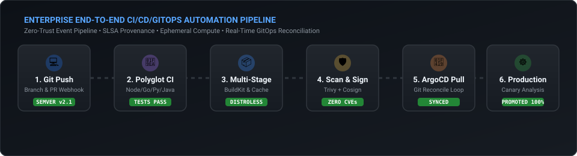
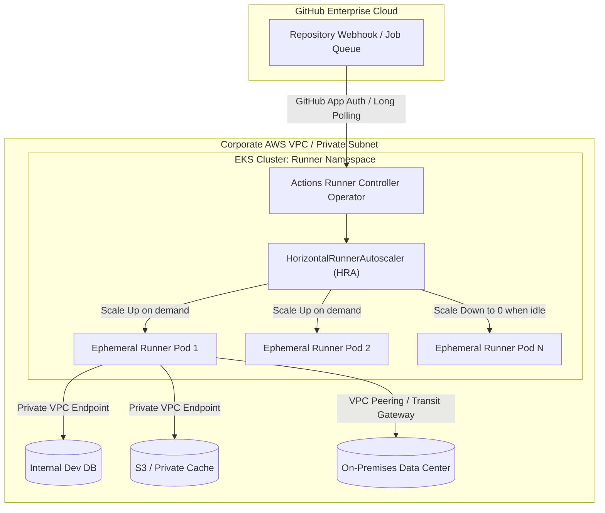
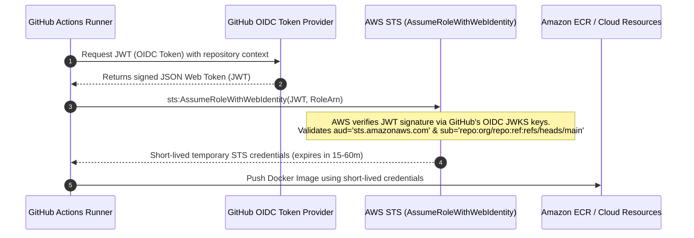

# Module 01: GitHub Actions Enterprise Architecture

> **Focus Level**: Senior / Staff / Lead DevOps Engineer (6+ Years Experience)  
> **Key Domains**: Runner Infrastructure (ARC), Keyless Cloud Auth (OIDC), Polyglot CI/CD (Node, Python, Go, Java), Monorepo Optimization, Security Hardening.

---

## ⚡ Animated Delivery Pipeline Flow

<p align="center">
  
</p>

---

## 1. Enterprise Runner Topologies: Cloud vs. Self-Hosted (ARC)

For enterprise workloads handling compliance (HIPAA, SOC2, PCI-DSS) or heavy compute needs (large Docker builds, ML training, Android/iOS builds), standard GitHub-hosted runners are often insufficient due to cost, network isolation, or security constraints.



### Architectural Comparison
| Metric | GitHub-Hosted Runners | Self-Hosted on VMs | Actions Runner Controller (ARC on K8s) |
| :--- | :--- | :--- | :--- |
| **Network Isolation** | Public IP, outbound internet access | Inside private VPC, static IPs | Inside Kubernetes private VPC / Service Mesh |
| **Compute Scaling** | Fixed (2-core to 64-core fixed SKUs) | Manual or AWS ASG scaling | Ephemeral pods, scale from 0 to 100+ pods in seconds |
| **State Sanitization** | Fully ephemeral (clean VM every job) | Persistent disk dirtying risk | **Ephemeral runner pods killed immediately** after job completion |
| **Cost Profile** | Per-minute billing (higher at scale) | Pay for idle EC2 compute | Bin-packed on Spot/Karpenter instances (up to 80% cheaper) |
| **Security Risk** | Minimal machine persistence | High (toxic artifacts on shared disk) | Nil (pod destroyed at container exit) |

---

## 2. Zero-Trust Cloud Authentication: OIDC vs. Static IAM Secrets

### Why Static IAM User Keys Are Banned in Modern Enterprises
- Long-lived AWS access keys (`AKIA...`) stored in GitHub Secrets are static targets for credential leakage.
- No automated rotation, no granular per-branch scoping.
- **The Modern Standard**: OpenID Connect (OIDC) federated token exchange.



### Trust Policy Definition (AWS IAM Role)
```json
{
  "Version": "2012-10-17",
  "Statement": [
    {
      "Effect": "Allow",
      "Principal": {
        "Federated": "arn:aws:iam::123456789012:oidc-provider/token.actions.githubusercontent.com"
      },
      "Action": "sts:AssumeRoleWithWebIdentity",
      "Condition": {
        "StringEquals": {
          "token.actions.githubusercontent.com:aud": "sts.amazonaws.com"
        },
        "StringLike": {
          "token.actions.githubusercontent.com:sub": "repo:my-enterprise-org/payment-service:ref:refs/heads/main"
        }
      }
    }
  ]
}
```

---

## 3. High-Performance Caching & BuildKit Layer Optimization

Slow builds kill developer velocity. In large microservices or monorepos, builds must leverage layered caching:

1. **Dependency Caching (`actions/setup-*` or `actions/cache`)**:
   - Cache lockfile keys: `${{ runner.os }}-node-${{ hashFiles('**/package-lock.json') }}`.
2. **Container Layer Caching with Buildx & Registry Cache**:
   - Avoid building layers from scratch on ephemeral runners.
   - Use `type=gha` (GitHub Actions cache) or `type=registry` (ECR/DockerHub cache manifest).

```yaml
- name: Set up Docker Buildx
  uses: docker/setup-buildx-action@v3

- name: Build and push Docker image with layered cache
  uses: docker/build-push-action@v5
  with:
    context: .
    push: true
    tags: ${{ steps.meta.outputs.tags }}
    cache-from: type=gha
    cache-to: type=gha,mode=max
```

---

## 4. Reusable Workflows vs. Composite Actions

| Criterion | Reusable Workflows (`workflow_call`) | Composite Actions (`runs: using: 'composite'`) |
| :--- | :--- | :--- |
| **Execution Environment** | Defines whole jobs, runners (`runs-on`), and matrix | Runs as a series of steps inside an existing caller job |
| **Secrets Inheritance** | Can pass secrets explicitly or via `secrets: inherit` | Cannot declare its own secrets block; runner inherits environment |
| **Multi-Job Orchestration** | Can orchestrate multiple interdependent jobs | Single job step sequence only |
| **Primary Use Case** | Enterprise standard pipelines (Lint -> Scan -> Test -> Build) enforced across 200 repos | Custom multi-step utility script (e.g. login + setup custom CLI) |

---

## 5. Polyglot Tech Stack Pipelines & Production Artifacts

Detailed architectural comparisons and working implementations across modern enterprise runtimes:
- 📖 [**Polyglot Architectural Deep-Dive & Comparison Guide**](./polyglot-stack-comparison.md)
- 🟢 [**Node.js / TypeScript**](./stacks/nodejs/): Multi-stage distroless Dockerfile & CI pipeline
- 🟡 [**Python / FastAPI**](./stacks/python/): C-extension wheel-builder Dockerfile & Pytest CI pipeline
- 🔵 [**Go (Golang)**](./stacks/golang/): Static binary scratch Dockerfile (~15MB) & race-detection CI pipeline
- 🔴 [**Java / Spring Boot 3.x**](./stacks/java-springboot/): Spring Boot layered JAR Dockerfile & JaCoCo CI pipeline

### Production Workflows Included:
1. [`workflows/oidc-aws-ecr-publish.yml`](./workflows/oidc-aws-ecr-publish.yml) - Keyless AWS STS authentication, multi-platform Docker build, and ECR push.
2. [`workflows/reusable-enterprise-ci.yml`](./workflows/reusable-enterprise-ci.yml) - Enterprise standard reusable workflow enforcing SAST scanning, unit testing, and artifact uploads.
3. [`workflows/monorepo-smart-build.yml`](./workflows/monorepo-smart-build.yml) - Path-filtering matrix build for microservices in a single repository.
4. [`workflows/container-security-sign.yml`](./workflows/container-security-sign.yml) - Trivy vulnerability scanning, Syft SBOM generation, and Cosign cryptographic signing.
5. [**Senior / Lead Interview Scenarios & Solutions**](./interview-scenarios.md) - Real-time scenario interview questions & deep-dive engineering answers.
