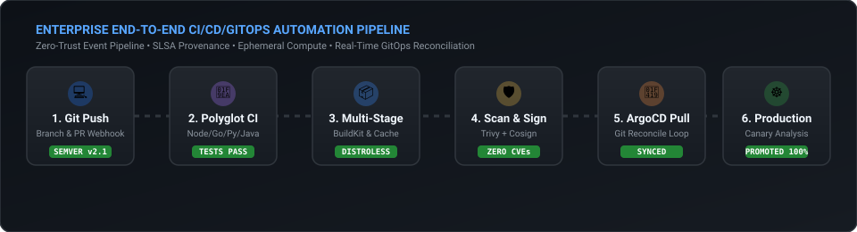
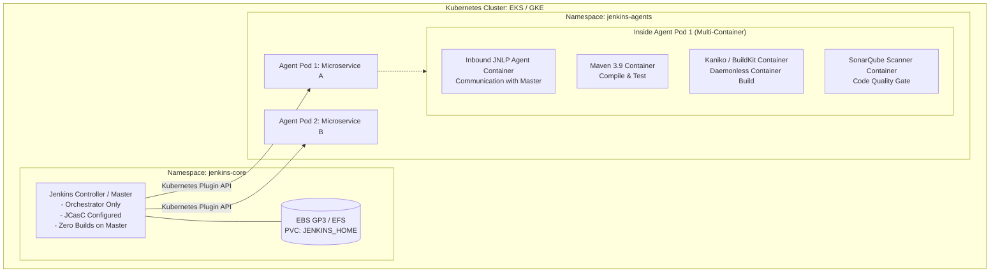

# Module 02: Jenkins Enterprise & Modern Architecture

> **Focus Level**: Senior / Staff DevOps Engineer (6+ Years Experience)  
> **Key Domains**: Kubernetes-Native Dynamic Agents, Jenkins Configuration as Code (JCasC), Enterprise Shared Libraries, Declarative vs Scripted Pipelines, JVM Tuning & Scalability.

---

## ⚡ Animated Jenkins & Dynamic Agent Pipeline Flow

<p align="center">
  
</p>

---

## 1. Enterprise Jenkins Architecture: Dynamic Kubernetes Pod Agents

Legacy Jenkins setups running builds directly on the master/controller or on static EC2 instances face executor starvation, workspace contamination, and single-point-of-failure issues.

In high-scale enterprise environments, **Jenkins Controller runs strictly as an orchestrator**, and every build spins up an ephemeral Kubernetes Pod with isolated containers for each toolchain.



### Why Daemonless Builds (Kaniko / BuildKit) Matter
Mounting `/var/run/docker.sock` from the host node into Jenkins agent pods gives root-level access to the underlying Kubernetes worker node, violating CIS Kubernetes benchmarks. 

Enterprise best practice: Use **Kaniko** or **BuildKit (rootless)** to build and push container images inside the pod without privileged access or docker daemon sockets.

---

## 2. Declarative Pipeline vs. Scripted Pipeline

| Feature | Declarative Pipeline (`pipeline { ... }`) | Scripted Pipeline (`node { ... }`) |
| :--- | :--- | :--- |
| **Syntax Philosophy** | Strict, structured DSL with opinionated blocks | Groovy script executed directly on the Jenkins controller |
| **Error Handling** | Declarative `post { success {}, failure {}, always {} }` | Standard Groovy `try-catch-finally` |
| **Parallelism** | Clean `parallel` directive inside stages | Groovy closures and dynamic map building |
| **Validation** | Syntactically validated before execution begins | Errors might only crash at runtime when statement is hit |
| **Shared Libraries** | Ideal for standardizing organizational steps | Required when complex custom Groovy logic/loops are needed |
| **Recommendation** | **Standard for 95% of enterprise pipelines** | Specialized legacy or hyper-dynamic workflows |

---

## 3. Jenkins Configuration as Code (JCasC)

Instead of clicking through the web UI and storing configurations in ad-hoc XML files, JCasC defines the entire Jenkins controller configuration declaratively in YAML.

```yaml
jenkins:
  systemMessage: "PRODUCTION ENTERPRISE JENKINS - MANAGED VIA JCASC & GIT"
  numExecutors: 0  # Zero executors on controller! Forces all jobs to agents.
  mode: EXCLUSIVE
  clouds:
    - kubernetes:
        name: "k8s-us-east-1"
        serverUrl: "https://kubernetes.default.svc"
        namespace: "jenkins-agents"
        jenkinsUrl: "http://jenkins.jenkins-core.svc.cluster.local:8080"
        templates:
          - name: "standard-maven-agent"
            label: "k8s-maven"
            containers:
              - name: "maven"
                image: "maven:3.9.6-eclipse-temurin-17"
                command: "cat"
                ttyEnabled: true
```

---

## 4. Enterprise Shared Libraries Architecture

Shared Libraries allow engineering organizations to eliminate boilerplate code across hundreds of `Jenkinsfile`s.

```
(root of shared-library repository)
+- src                     # Standard Groovy source files (Classes, OOP, utilities)
|   +- com
|       +- enterprise
|           +- devops
|               +- SecurityScanner.groovy
|               +- NotificationHelper.groovy
+- vars                    # Global variables and custom pipeline steps (accessible in Jenkinsfile)
|   +- standardMicroservicePipeline.groovy
|   +- dockerBuildAndPush.groovy
|   +- sendSlackAlert.groovy
+- resources               # Non-Groovy static files (JSON schemas, YAML templates)
```

In the application `Jenkinsfile`, a 300-line build reduces to 5 lines:
```groovy
@Library('enterprise-shared-library@v3.2.0') _

standardMicroservicePipeline {
    serviceName = 'order-service'
    language = 'java-17'
    coverageThreshold = 85
    deployEnvironment = 'staging'
}
```

---

## 5. Performance Tuning & JVM Garbage Collection for Large Controllers

When controllers manage 5,000+ jobs and dozens of builds per minute, poor JVM tuning leads to Long Stop-The-World GC pauses, causing agent disconnects and UI freezes.

### Recommended JVM Flags for Jenkins Enterprise Controller:
```bash
JAVA_OPTS="-Xms16g -Xmx16g \
  -XX:+UseG1GC \
  -XX:+ExplicitGCInvokesConcurrent \
  -XX:+ParallelRefProcEnabled \
  -XX:+UseStringDeduplication \
  -XX:+UnlockDiagnosticVMOptions \
  -XX:G1SummarizeRSetStatsPeriod=1 \
  -Djenkins.install.runSetupWizard=false \
  -Dorg.apache.commons.jelly.tags.fmt.timeZone=UTC"
```

- **Avoid swap**: Lock memory in RAM (`mlockall`).
- **Disk I/O**: Use NVMe SSDs or AWS EBS `gp3` with high IOPS provisioned (3000+ IOPS, 250 MB/s throughput) for `JENKINS_HOME`.
- **Discard Old Builds**: Enforce `buildDiscarder(logRotator(numToKeepStr: '30'))` organization-wide to prevent millions of small build XML files from destroying Linux inode tables.

---

## 6. Production Artifacts & Interview Scenarios in this Module

1. [`pipeline-templates/Jenkinsfile.declarative`](./pipeline-templates/Jenkinsfile.declarative) - Full Declarative pipeline with Kubernetes pod agents, SonarQube quality gate, and daemonless Kaniko builds.
2. [`pipeline-templates/Jenkinsfile.scripted`](./pipeline-templates/Jenkinsfile.scripted) - Advanced Scripted pipeline with dynamic parallel matrix generation and promotion gates.
3. [`pipeline-templates/k8s-pod-agent.yaml`](./pipeline-templates/k8s-pod-agent.yaml) - Multi-container Kubernetes Pod agent (JNLP, Maven, Kaniko, Trivy).
4. [`pipeline-templates/shared-library-deploy.groovy`](./pipeline-templates/shared-library-deploy.groovy) - Standardized enterprise shared library entrypoint.
5. [**Senior / Lead Interview Scenarios & Solutions**](./interview-scenarios.md) - Deep-dive troubleshooting cases: JVM OOMKills, CPS serialization bugs, docker.sock container escape, and Jenkins-to-GHA migration playbooks.
