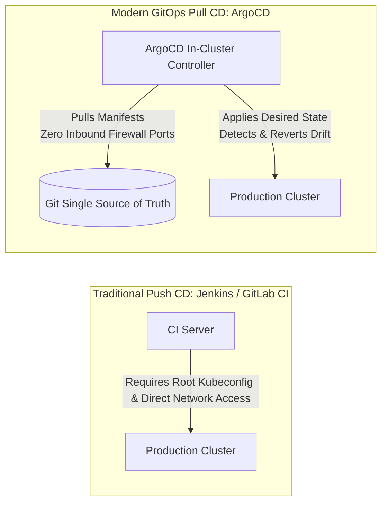
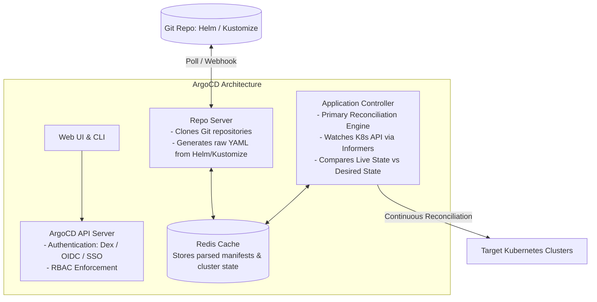
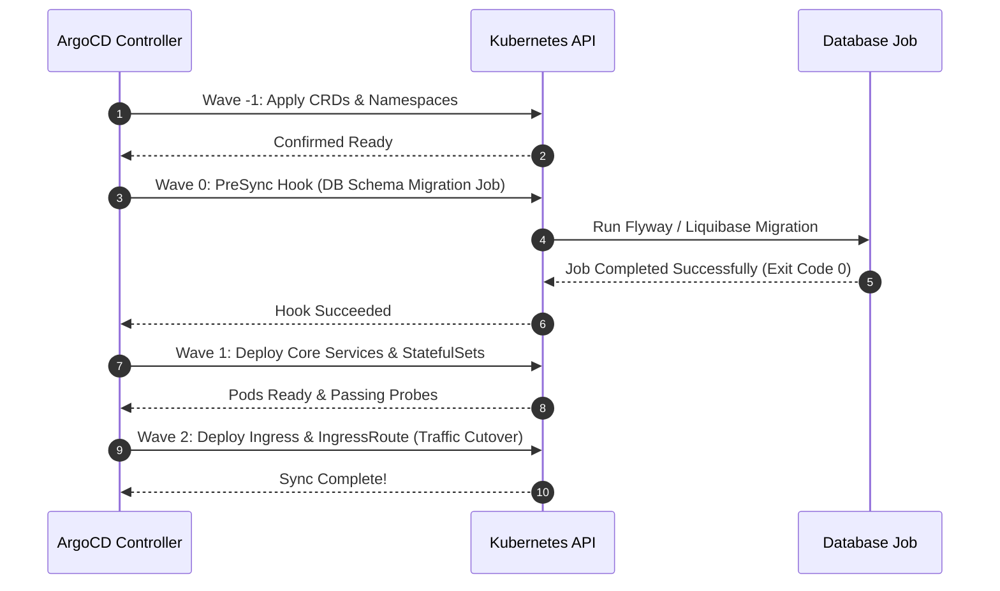
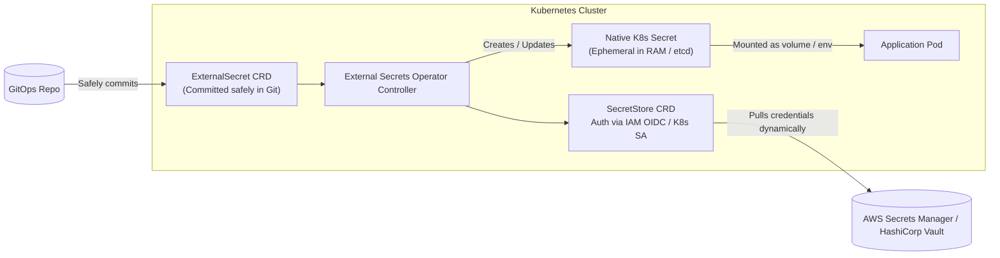

# Module 03: GitOps Architecture & Enterprise ArgoCD

> **Focus Level**: Senior / Staff DevOps & Platform Engineer (6+ Years Experience)  
> **Key Domains**: OpenGitOps Principles, ArgoCD Internal Components, Multi-Cluster ApplicationSets, Sync Waves & Hooks, Argo Rollouts (Progressive Delivery), Enterprise Secrets Management.

---

## ⚡ Animated GitOps Reconciliation & Drift Self-Healing Loop

  

---

## 1. GitOps Core Principles: Push-Based vs. Pull-Based CD

### Architectural Comparison
| Dimension | Push-Based CD (e.g. Jenkins `kubectl apply`) | Pull-Based GitOps (ArgoCD) |
| :--- | :--- | :--- |
| **Cluster Access** | CI system must hold long-lived cluster admin credentials | Cluster never exposes API endpoint; agent pulls outbound |
| **Firewall / Ingress** | Kubernetes API server must allow inbound traffic from CI | Outbound HTTPS only; zero inbound network punch-through |
| **Manual Drift Detection** | None. If an engineer runs `kubectl edit`, CI has no idea | **Instant drift detection and automated self-healing** |
| **Auditability** | Scatted across CI pipeline run logs | Complete Git commit history (`git log`) is the audit trail |
| **Disaster Recovery** | Manual restoration from backups / disparate scripts | Re-apply Git repository to a fresh cluster $\rightarrow$ 100% recovered |

---

## 2. ArgoCD Internal Architecture & Reconciler Loop

1. **API Server**: Exposes gRPC/REST endpoints for UI, CLI, and webhooks. Handles SSO (Okta, Azure AD, GitHub) via Dex.
2. **Repository Server**: Dedicated microservice that clones Git repos, caches them locally, and invokes manifest generators (`kustomize build`, `helm template`).
3. **Application Controller**: The brain of ArgoCD. Continuously compares live cluster state (via K8s informers) against desired state (from Repo Server). When drift is detected, marks application `OutOfSync` and triggers reconciliation if `selfHeal: true`.
4. **Redis**: In-memory cache caching generated manifests and cluster resource trees, preventing Git server overload and K8s API rate-limiting.

---

## 3. ApplicationSet: Multi-Cluster & Multi-Tenant Management

Managing 500 individual `Application` YAMLs creates massive duplication. **ApplicationSet** uses generators to dynamically produce hundreds of ArgoCD Applications.

### Common ApplicationSet Generators:
- **Git Directory Generator**: Loops through folders in a Git repository (`apps/*`) and creates an application for each folder.
- **Cluster Generator**: Targets all registered Kubernetes clusters matching specific labels (e.g., `environment: production`).
- **Matrix Generator**: Combines multiple generators (e.g., Deploy every app in `[appA, appB]` to every cluster in `[us-east-1, eu-west-1]`).

---

## 4. Sync Waves & Lifecycle Hooks

When deploying complex distributed systems, resources must not be created all at once. For example, a database schema migration must complete *before* new application pods start.

- **Sync Waves (`argocd.argoproj.io/sync-wave: "<number>"`)**: Dictates order of execution. Lower numbers run first. ArgoCD waits for wave $N$ resources to be `Healthy` before beginning wave $N+1$.
- **Sync Hooks (`argocd.argoproj.io/hook: PreSync / PostSync / SyncFail`)**: Triggers one-off jobs (e.g., database backup, smoke tests, slack alerts).

---

## 5. Progressive Delivery with Argo Rollouts (Canary & Blue-Green)

Standard Kubernetes `RollingUpdate` lacks metric-driven traffic analysis and automated rollback. **Argo Rollouts** provides advanced deployment controllers:

- **Canary with AnalysisTemplate**: Shifts 5% traffic $\rightarrow$ queries Prometheus/Datadog for HTTP 5xx error rate and latency $\rightarrow$ promotes to 20% $\rightarrow$ verifies metrics $\rightarrow$ promotes to 100%. If error rate spikes above 1%, it automatically rolls back within seconds.
- **Blue-Green**: Runs both old (Active) and new (Preview) versions simultaneously. Once preview tests pass, atomically switches the service selector.

---

## 6. Secrets Management in GitOps: The External Secrets Operator Standard

### The Golden Rule of GitOps: Never commit raw plaintext secrets to Git.

1. **ExternalSecret CRD** is checked into Git. It contains only pointers (e.g. `secretKey: /production/database/password`).
2. **External Secrets Operator (ESO)** connects securely to AWS Secrets Manager or HashiCorp Vault via IAM Role / Service Account.
3. ESO reads the secret value from the cloud vault and generates a standard native Kubernetes `Secret` inside the cluster.
4. If the password is rotated in AWS Secrets Manager, ESO detects the change and updates the K8s Secret automatically.

---

## 7. Production Manifests & Interview Scenarios in this Module

1. [`manifests/argocd-application.yaml`](./manifests/argocd-application.yaml) - Complete ArgoCD Application CRD with automated self-heal, prune, and retry backoff.
2. [`manifests/applicationset-matrix.yaml`](./manifests/applicationset-matrix.yaml) - Enterprise ApplicationSet combining Git directory and cluster generators.
3. [`manifests/argo-rollout-canary.yaml`](./manifests/argo-rollout-canary.yaml) - Progressive Canary Rollout with automated Prometheus analysis metrics.
4. [`manifests/external-secrets-vault.yaml`](./manifests/external-secrets-vault.yaml) - External Secrets Operator CRD integration with AWS Secrets Manager.
5. [**Senior / Lead Interview Scenarios & Solutions**](./interview-scenarios.md) - High-bar scenarios: OutOfSync loops with mutating admission controllers, zero-downtime DB migrations via sync waves, accidental mass prune prevention, and disaster recovery.
