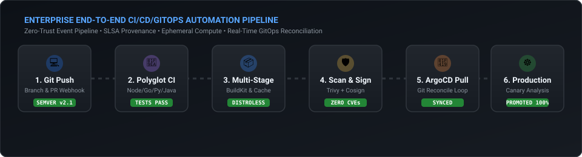
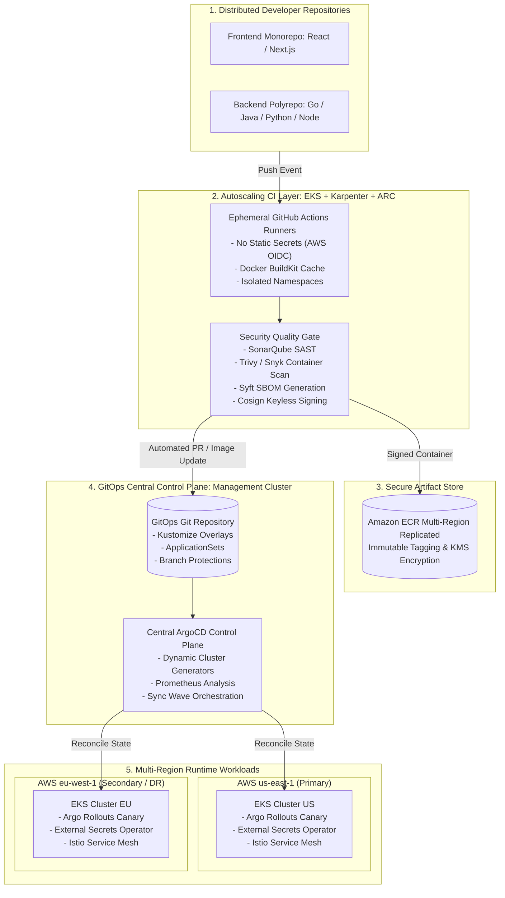

# Module 04: End-to-End Production System Designs

> **Focus Level**: Lead DevOps / Principal Cloud Architect (6+ Years Experience)  
> **Key Domains**: Zero-Trust CI/CD Pipeline Architecture, Multi-Region Progressive Delivery, Supply Chain Security (SLSA Level 3), Enterprise Incident Playbooks.

---

## ⚡ Animated Multi-Region Pipeline Execution

  

---

## 🏛️ Reference System Architecture: 500+ Microservices Multi-Region Pipeline

---

## 🔒 Supply Chain Security: Achieving SLSA Level 3 Compliance

In modern high-security environments (banking, healthcare, defense), producing a Docker image is not enough. You must cryptographically guarantee **Supply-chain Levels for Software Artifacts (SLSA)**:

1. **Source Integrity**: Every commit signed via GPG/SSH; PRs require two peer reviews and linear git history.
2. **Build as Code in Isolated Ephemeral Compute**: Every build executes on clean, short-lived virtual machines or containers (ARC pods) with zero residual state.
3. **Cryptographic Provenance**:
   - The CI pipeline generates an in-toto attestation recording:
     - Exact Git commit SHA
     - Build runner identity
     - Source repository URL
     - Timestamp and build parameters
4. **Cosign & Sigstore Keyless Signing**:
   - The runner signs the container digest using short-lived OIDC certificates from Fulcio, recorded in the Rekor transparency log.
5. **Admission Control Enforcement (Kyverno / OPA Gatekeeper)**:
   - In-cluster admission controllers intercept all `Pod` creation requests. If an image is not signed by the corporate Cosign public key or lacks a valid SBOM attestation, **Kubernetes rejects execution at the API level**.

---

## ⚡ Zero-Downtime Deployment Comparison Matrix

| Strategy | Resource Overhead | Traffic Switch Speed | Automated Rollback Time | Real-Time Production Trade-Off |
| :--- | :--- | :--- | :--- | :--- |
| **RollingUpdate (Default K8s)** | +25% maxSurge pods | Gradual pod-by-pod | 2 to 5 minutes | Cannot analyze live metrics; faulty builds leak errors to real users before healthchecks fail. |
| **Blue-Green Deployment** | **+100% (2x full capacity)** | Instantaneous (service cutover) | **Sub-second (instant cutback)** | Expensive compute cost during cutover; database schema must support both versions simultaneously. |
| **Canary with Argo Rollouts** | **+10% to 20% surge** | Gradual (5% $\rightarrow$ 20% $\rightarrow$ 100%) | **Automated in <15 seconds** | Gold standard for enterprise; requires Prometheus/Datadog metric instrumentation and traffic routing mesh (Istio/ALB). |

---

## 📂 Production Incident Post-Mortems & Playbooks

- 🚨 [**Senior Incident Scenarios & Root Cause Analysis**](./production-incident-scenarios.md)
  - **Incident 1**: Connection Pool Starvation & Database Thundering Herd during Canary Release (Aurora PostgreSQL + PgBouncer).
  - **Incident 2**: Supply Chain Zero-Day (Malicious Transitive NPM Dependency, Kyverno ClusterPolicy Admission Blocking).
  - **Incident 3**: CoreDNS Exhaustion & ndots:5 UDP packet drops under high microservice discovery churn (NodeLocal DNSCache fix).
