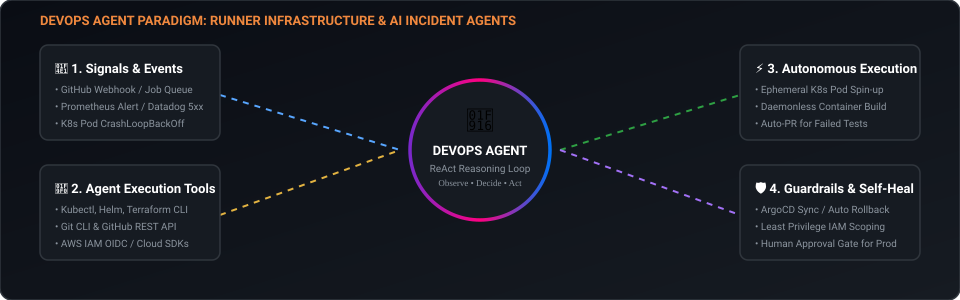
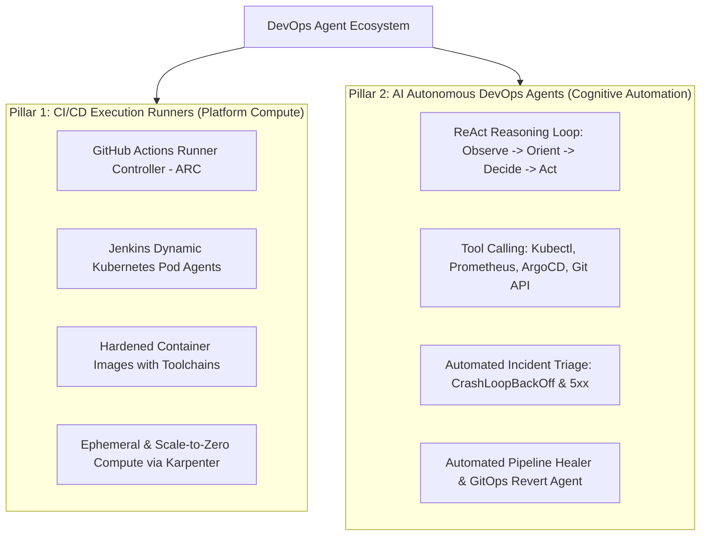
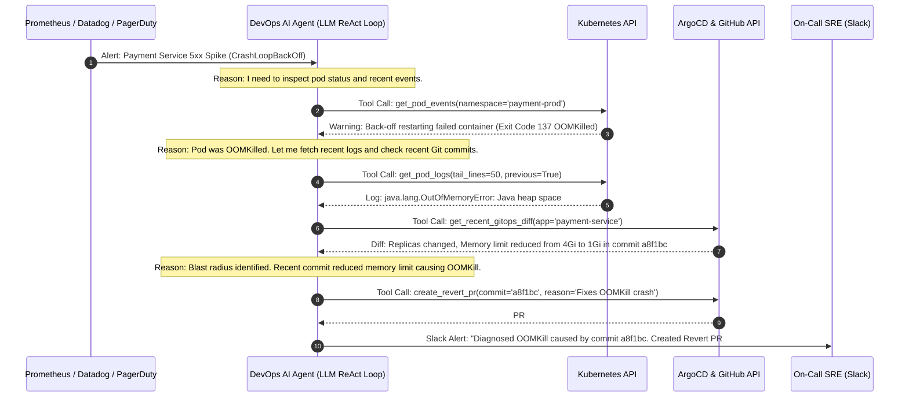

# Module 05: Building Enterprise DevOps Agents

> **Focus Level**: Senior / Staff / Lead Platform & DevOps Engineer (6+ Years Experience)  
> **Key Domains**: CI/CD Runner Infrastructure (ARC & Dynamic Pods), Custom Hardened Agent Images, AI-Powered SRE & Triage Agents, Model Context Protocol (MCP) & Autonomous Self-Healing.

---

## ⚡ Animated Agent Architecture & Execution Loop

  

---

## The Dual Nature of "Agents" in Modern DevOps

When engineering leaders talk about "building agents for DevOps", they are operating across two critical pillars:

---

## Pillar 1: Building Custom CI/CD Execution Runners

Public cloud runners (GitHub-hosted or standard VM agents) suffer from:
1. **Security Vulnerabilities**: Mounting `/var/run/docker.sock` allows root container breakout.
2. **Egress & Ingress Bottlenecks**: Inability to talk to internal databases, Kafka brokers, or private artifact registries without opening public firewall rules.
3. **Slow Build Times**: Every runner spends 3-5 minutes downloading Java, Go, Python, Docker Buildx, Helm, Kubectl on every single pipeline run.

### The Solution: Custom Hardened Ephemeral Runner Containers
- Build an enterprise base image containing all necessary CLIs pre-installed and cached.
- Run as non-root user (`UID 1001:1001`).
- Deploy on Kubernetes using **Actions Runner Controller (ARC)** for GitHub Actions or **Kubernetes Cloud Plugin** for Jenkins.
- **Ephemeral Lifecycle**: Pod is provisioned on job dispatch $\rightarrow$ executes single job $\rightarrow$ destroyed immediately. Zero dirty state, zero toxic cache cross-contamination.

---

## Pillar 2: Building Autonomous AI DevOps & SRE Agents

An AI DevOps Agent is an autonomous program that connects an LLM (Large Language Model) to real-world infrastructure tools via **Function Calling / Tool Calling** or **Model Context Protocol (MCP)**.

### The ReAct (Reasoning + Acting) Agent Loop:

---

## 📂 Production Code in this Module

1. [`cicd-runner-agents/Dockerfile.hardened-runner`](./cicd-runner-agents/Dockerfile.hardened-runner): Hardened multi-tool rootless container runner for GitHub ARC & Jenkins.
2. [`cicd-runner-agents/arc-runner-scaleset.yaml`](./cicd-runner-agents/arc-runner-scaleset.yaml): Production Kubernetes `AutoScalingRunnerSet` CRD with Karpenter spot autoscaling.
3. [`cicd-runner-agents/jenkins-k8s-pod-agent.yaml`](./cicd-runner-agents/jenkins-k8s-pod-agent.yaml): Kubernetes multi-container dynamic pod agent definition for Jenkins.
4. [`ai-devops-agents/architecture.md`](./ai-devops-agents/architecture.md): Architectural design for SRE AI agents, security guardrails, read-only vs write boundaries, and MCP integration.
5. [`ai-devops-agents/k8s_incident_triage_agent.py`](./ai-devops-agents/k8s_incident_triage_agent.py): Full working Python AI Agent implementing the ReAct pattern with live Kubernetes API tool-calling for automated root-cause analysis.
6. [`interview-scenarios.md`](./interview-scenarios.md): High-bar Senior / Principal DevOps interview scenarios on runner fleet scaling and AI agent safety.
