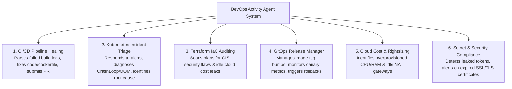

# Building Agents for Specific DevOps Activities

> **Focus Level**: Senior / Lead / Principal Platform Engineer (6+ Years Experience)  
> **Key Domains**: Autonomous Workflow Agents, CI/CD Auto-Healing, Terraform IaC Auditing, Kubernetes Incident Response, Multi-Agent Collaboration.

---

## 🎯 The 6 Core DevOps Activities Automated by Agents



---

## 🛠️ The 5-Step Engineering Blueprint to Build Any DevOps Activity Agent

Regardless of whether you are building an agent for CI failure diagnosis, Kubernetes triage, or Terraform auditing, every production DevOps agent follows this 5-stage architecture:

```mermaid
flowchart LR
    subgraph S1["1. Event Trigger"]
        E1[GitHub Webhook\nworkflow_run.completed]
        E2[AlertManager\nseverity: critical]
        E3[Slack Bot\n/diagnose <service>]
    end

    subgraph S2["2. Perception & Tool Calling"]
        T1[Kubernetes API / Kubectl]
        T2[GitHub / GitLab REST API]
        T3[AWS Boto3 / CloudWatch]
        T4[Prometheus PromQL]
    end

    subgraph S3["3. Cognitive Engine (LLM)"]
        ReAct[ReAct Loop / LangGraph State]
        Reason[Evaluate Hypothesis & Extract RCA]
    end

    subgraph S4["4. Safety Guardrails"]
        Gate{Mutating Action?}
        ReadOnly[Autonomous Run]
        HumanGate[Slack Interactive Approval]
    end

    subgraph S5["5. Action & Resolution"]
        Out1[Submit Git PR with Fix]
        Out2[Trigger ArgoCD Rollback]
        Out3[Post Incident Report to Slack]
    end

    S1 --> S2
    S2 --> S3
    S3 --> S4
    Gate -->|No (Read-Only)| ReadOnly
    Gate -->|Yes (Write/Mutate)| HumanGate
    HumanGate -->|Approved| S5
    ReadOnly --> S5
```

---

### Step 1: Event Ingestion (Perception Layer)
Your agent must be triggered by events rather than continuous manual polling:
- **FastAPI / Lambda Webhook Receiver**: Listens for GitHub Actions failure webhooks (`workflow_run` with `conclusion: "failure"`).
- **Prometheus AlertManager Webhook**: Listens for alerts like `KubePodCrashLooping` or `High5xxRate`.
- **Slack / Teams Bot**: Listens for slash commands (e.g. `/triage payment-service`).

---

### Step 2: Defining Sandboxed Tools (The Agent's Hands)
Never give an LLM raw bash access. Expose **strictly typed, parameter-validated Python functions**:
```python
# Safe tool definition example
def get_failed_step_logs(owner: str, repo: str, run_id: int) -> str:
    """Fetches stdout/stderr logs specifically for failed steps in a GitHub Actions run."""
    # Queries GitHub REST API: /repos/{owner}/{repo}/actions/runs/{run_id}/logs
    ...

def query_prometheus_error_rate(service_name: str, duration: str = "5m") -> float:
    """Calculates HTTP 5xx percentage for the given service over a time window."""
    ...
```

---

### Step 3: The Cognitive Reasoning Engine (ReAct / LangGraph)
Choose the right agent framework based on complexity:

| Framework | Best Use Case | Pros & Cons |
| :--- | :--- | :--- |
| **Pure Python Function Calling** | Single-activity targeted agents (e.g. CI log parser) | **Zero dependencies, ultra-fast, 100% predictable.** |
| **LangGraph (LangChain)** | Complex multi-step cyclical workflows (e.g. Incident investigation with branching) | State persistence, cyclical graph support, easy human-in-the-loop pauses. |
| **CrewAI / AutoGen** | Multi-agent collaborative roles (e.g. SRE Agent + Security Auditor Agent + Tech Writer) | Good for simulation; higher token cost and coordination overhead. |
| **Model Context Protocol (MCP)** | Standardized enterprise integrations | Standardizes tools across GitHub, K8s, AWS, Datadog using client-server protocol. |

---

### Step 4: Security Guardrails & Human-in-the-Loop Gateway
**The Golden Rule of Autonomous DevOps Agents**:
> *Agents can autonomously inspect, diagnose, and propose solutions. They must NEVER execute destructive mutations in production without human approval.*

1. **Read-Only Scoping**: Agent's Kubernetes ServiceAccount or AWS IAM Role has only `get`, `list`, `watch`, `describe`.
2. **GitOps as the Mediation Layer**: The agent never runs `kubectl apply` directly. It creates a Git Pull Request containing the proposed fix.
3. **Slack Interactive Modals**: The agent posts the diagnosis and proposed PR link to Slack with buttons: `[Approve & Merge]` or `[Reject]`.

---

## 📂 Real-World Implementations in this Folder

1. [`ci_pipeline_healer_agent.py`](./ci_pipeline_healer_agent.py):
   - **Activity**: Autonomous CI/CD Pipeline Healing.
   - **Flow**: Ingests failed build logs $\rightarrow$ extracts compilation/test/lint stacktrace $\rightarrow$ pinpoints culprit file $\rightarrow$ generates a code patch $\rightarrow$ creates a GitHub Pull Request with the fix.
2. [`terraform_cost_security_agent.py`](./terraform_cost_security_agent.py):
   - **Activity**: Infrastructure as Code (IaC) Auditing & Cost Optimization.
   - **Flow**: Analyzes Terraform plan JSON $\rightarrow$ flags unencrypted S3 buckets, wide-open security groups (`0.0.0.0/0`), and over-provisioned NAT gateways $\rightarrow$ outputs an actionable remediation report.
