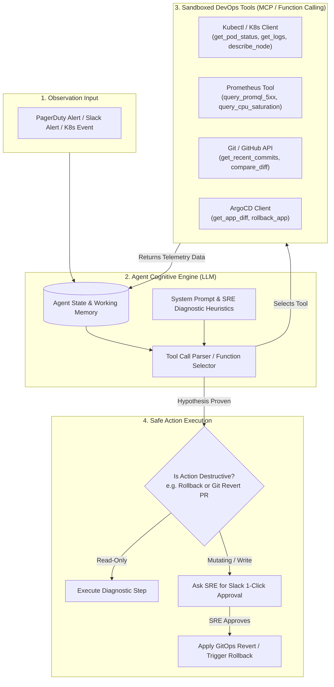

# AI DevOps & SRE Agent Architecture

> **Focus Level**: Senior / Staff / Principal Platform Engineer (6+ Years Experience)  
> **Key Domains**: Autonomous Agentic Loops (ReAct), Tool Calling & Function Schemas, Model Context Protocol (MCP), Security Guardrails & Blast Radius Control.

---

## 1. What Makes an AI Agent Different from a Chatbot?

A traditional LLM chatbot is purely reactive: you send text, it predicts tokens, and returns text. It has no hands, no memory of live systems, and cannot inspect production.

An **AI DevOps Agent** has:
1. **Perception**: Connects to webhooks, Prometheus AlertManager, Datadog monitors, and Kubernetes event streams.
2. **Cognitive ReAct Loop (Reason + Act)**: Breaks complex production incidents into step-by-step diagnostic hypotheses.
3. **Tool Execution Capability**: Executes sandboxed functions via Kubernetes API, Git APIs, Prometheus PromQL, and cloud providers.
4. **Safety Guardrails**: Operates within strict blast-radius controls (Read-Only diagnostics vs. Human-Approved mutations).

---

## 2. Model Context Protocol (MCP) in DevOps

Rather than hardcoding REST clients for every monitoring tool, modern DevOps agents leverage **Anthropic's Model Context Protocol (MCP)** or **OpenAI/Gemini Tool Calling Schemas**.

MCP defines a standard client-server protocol where:
- The **MCP Server** runs inside the Kubernetes cluster with direct, secure access to the cluster's API and Prometheus.
- The **AI Agent Client** connects via stdio or SSE (Server-Sent Events) and requests tools dynamically:
  - `tools/list`: Exposes available infrastructure functions.
  - `tools/call`: Executes commands inside the cluster with strict RBAC.

---

## 3. Security Guardrails & Blast Radius Constraints

When deploying autonomous agents with access to production Kubernetes clusters:

| Security Rule | Implementation Pattern | Why It Matters |
| :--- | :--- | :--- |
| **Least Privilege RBAC** | ServiceAccount with read-only verbs (`get`, `list`, `watch`) on Pods/Events. | Prevents compromised LLM from running `kubectl delete namespace`. |
| **No In-Band Shell Injection** | No raw `exec` or arbitrary bash commands allowed. | Prompts cannot trick the model into running `rm -rf /` or downloading external malware. |
| **Air-Gapped Tool Calling** | All tools are strictly typed Python functions with Pydantic schema validation. | Enforces strict input validation on namespace, pod name, and time ranges. |
| **Human-in-the-Loop for Mutations** | Agent prepares a Git revert PR or an ArgoCD rollback command, but sends an interactive Slack button to the on-call engineer. | Human judgment retains ultimate authority over production state. |
