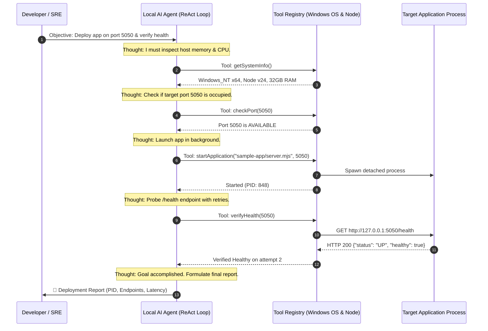

# Module 06: Building Your First Real-Time Local AI DevOps Agent

> **Goal**: Build and run an autonomous AI Deployment Agent directly on your local Windows machine without needing external cloud servers or paid API keys.  
> **Key Concepts**: ReAct Loop (Reason + Act), Deterministic Tool Calling, Autonomous Self-Healing (Port Conflict Resolution), Health Probing & Verification.

---

## ⚡ How This Agent Works Under the Hood

The agent receives a human objective:
> *"Deploy sample Node.js payment microservice locally on Windows, verify healthcheck, and report runtime status."*

Instead of running a dumb script that crashes if something goes wrong, the AI Agent follows an **autonomous cognitive loop**:



---

## 🚀 Running Your First AI Agent on Windows

Both **Python** and **Node.js** versions are available:

### Option A: Running with Python (Recommended Standard)
Using your local Windows Python 3.14:
```powershell
# 1. Run the Autonomous Python Deployment Agent
& "C:\Users\Sri\AppData\Local\Programs\Python\Python314\python.exe" 06-local-ai-deploy-agent/agent.py

# 2. Check service status via Python
& "C:\Users\Sri\AppData\Local\Programs\Python\Python314\python.exe" 06-local-ai-deploy-agent/agent.py status

# 3. Gracefully stop the application
& "C:\Users\Sri\AppData\Local\Programs\Python\Python314\python.exe" 06-local-ai-deploy-agent/agent.py stop
```

---

### Option B: Running with Node.js
```powershell
node 06-local-ai-deploy-agent/agent.mjs
node 06-local-ai-deploy-agent/agent.mjs status
node 06-local-ai-deploy-agent/agent.mjs stop
```

---

## 🛡️ Autonomous Self-Healing in Action (Port Conflicts)

What happens if another process is already hogging port `5050`?
- **A dumb script**: Crashes with `EADDRINUSE: address already in use`.
- **Your AI Agent**:
  1. Detects `Port 5050 is currently OCCUPIED`.
  2. Generates thought: *"Port is blocked. I will find the process ID holding the port and terminate it."*
  3. Executes tool: `freePortOnWindows(5050)`.
  4. Clears the port, re-verifies availability, and successfully deploys the application with zero human intervention!

---

## 🧠 Connecting to an LLM (OpenAI, Gemini, or Local Ollama)

The core structure in `agent.mjs` maps 1:1 to OpenAI / Anthropic / Gemini Tool Calling.

To steer this agent with an LLM prompt:
```javascript
// Example LLM Tool Calling definition matching agent.mjs
const tools = [
  {
    type: "function",
    function: {
      name: "checkPort",
      description: "Checks if a local TCP port is available or occupied",
      parameters: {
        type: "object",
        properties: {
          port: { type: "number", description: "Target port number" }
        },
        required: ["port"]
      }
    }
  },
  {
    type: "function",
    function: {
      name: "startApplication",
      description: "Launches the target microservice entrypoint in the background",
      parameters: {
        type: "object",
        properties: {
          appPath: { type: "string" },
          port: { type: "number" }
        },
        required: ["appPath", "port"]
      }
    }
  }
];
```

The LLM emits `tool_calls: [{ name: "checkPort", arguments: { port: 5050 } }]`, your agent executes `Tools.checkPort(5050)`, and sends the result back to the LLM until the LLM replies with the final completion message!
