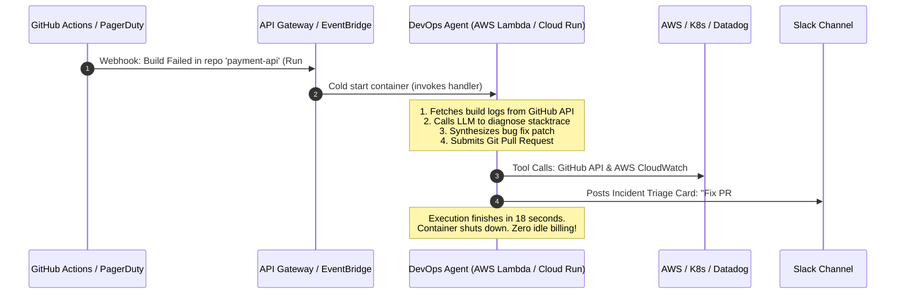

# Module 07: Deploying DevOps AI Agents in Enterprise Production

> **Focus Level**: Lead DevOps / Staff Platform Architect (6+ Years Experience)  
> **Key Domains**: Kubernetes In-Cluster Deployments (EKS/GKE), Serverless Event Workers, Standalone VM Services, Language Selection (Python vs TypeScript vs Go vs Java), Containerization & IRSA Security.

---

## 🏛️ The Core Mental Model

> **Question**: *"Do we basically build an AI agent, dockerize it, and deploy it to EKS Kubernetes or run it as a standalone service in a VM?"*  
> **Answer**: **YES, EXACTLY.**

An AI Agent is simply a standard backend service or worker process. What makes it "agentic" is its internal software architecture (ReAct reasoning loop + Tool Calling + LLM API), but from an operations and infrastructure perspective, it is:
1. Written in standard code (Python, TypeScript, Go, or Java).
2. Packaged into a standard OCI container image via a `Dockerfile`.
3. Given access to tools (Kubernetes API, AWS Boto3, GitHub API, Prometheus).
4. Deployed as a Kubernetes `Deployment` (or AWS Lambda / VM `systemd` service).

```mermaid
flowchart LR
    Dev[Agent Code\nPython / TS / Go] --> Docker[Multi-Stage Dockerfile]
    Docker --> Registry[(Container Registry\nECR / Harbor / GHCR)]
    
    Registry --> Topo1[1. EKS / GKE Pod\n(In-Cluster Deployment)]
    Registry --> Topo2[2. AWS Lambda / Cloud Run\n(Serverless Webhook Worker)]
    Registry --> Topo3[3. EC2 / Linux VM\n(systemd Background Service)]
```

---

## 🏢 The 3 Enterprise Production Deployment Architectures

### Architecture 1: In-Cluster Kubernetes Deployment (EKS / GKE) - *The Industry Standard (80%)*
The agent runs as a containerized microservice directly inside your Kubernetes platform/management cluster.

```mermaid
flowchart TD
    subgraph EKS["Kubernetes Cluster (EKS / GKE)"]
        subgraph Namespace["Namespace: platform-agents"]
            AgentPod[DevOps AI Agent Pod\n- ReAct Cognitive Loop\n- FastAPI / Slack Bolt Server]
            SA[ServiceAccount with AWS IRSA\narn:aws:iam::...:role/DevOpsAgentRole]
            AgentPod --- SA
        end

        K8sAPI[Kubernetes API Server\nhttps://kubernetes.default.svc]
        Prometheus[Prometheus Monitoring\nhttp://prometheus-k8s.monitoring.svc:9090]
        ArgoCD[ArgoCD API\nhttp://argocd-server.argocd.svc:80]
        
        AgentPod <-->|In-Cluster TLS (Zero Egress Cost)| K8sAPI
        AgentPod <-->|In-Cluster DNS| Prometheus
        AgentPod <-->|In-Cluster DNS| ArgoCD
    end

    Slack[Slack / Microsoft Teams] <-->|WebSocket Mode (Zero Inbound Open Ports)| AgentPod
    AlertManager[AlertManager Webhooks] -->|Cluster Ingress / Internal Service| AgentPod
```

#### Why 80% of Enterprise Platform Teams Choose In-Cluster:
- **Zero Ingress Attack Surface**: Using **Slack Socket Mode** or WebSocket listeners, the agent establishes an *outbound* connection to Slack. **Zero firewall ports or public IPs are required**.
- **Blazing Fast In-Cluster Tool Calling**: Communicates with the Kubernetes API (`https://kubernetes.default.svc`) and Prometheus over internal cluster networking with sub-millisecond latency.
- **Keyless AWS IAM Authentication (IRSA / EKS Pod Identity)**: The pod exchanges its Kubernetes service account token with AWS STS for temporary IAM credentials (no static access keys).
- **Manifest**: Check out [`manifests/eks-in-cluster-deployment.yaml`](./manifests/eks-in-cluster-deployment.yaml).

---

### Architecture 2: Serverless Event-Driven Workers (AWS Lambda / Google Cloud Run) - *15%*
The agent container is packaged as a serverless image. It sleeps until triggered by an event.



#### When to Choose Serverless:
- High burst, low frequency tasks: CI failure triage, pull request automated code review, weekly cost audit reports.
- **Cost**: If you have 50 CI failures a day and each triage takes 20 seconds, you pay for only 1,000 seconds of compute per day (~$0.02/month).

---

### Architecture 3: Standalone Service in a Virtual Machine (EC2 / Bare Metal) - *5%*
The agent runs on a traditional Linux VM managed by `systemd`.

- Ideal for legacy environments, on-premises datacenters, or dedicated jumpboxes/bastions with complex legacy network tunnels.
- Uses `systemd` to handle automatic restarts on failure, log rotation via `journald`, and environment variable injection via `/etc/devops-agent/agent.env`.
- **Systemd Unit File**: Check out [`manifests/systemd-agent.service`](./manifests/systemd-agent.service).

---

## 💻 Language Comparison: What Language Should You Use?

DevOps AI Agents are developed across four primary programming languages in industry:

| Language | Industry Share | Primary Agent Frameworks | Core DevOps Tooling | Verdict & Recommended Use |
| :--- | :--- | :--- | :--- | :--- |
| **Python** | **~75% - 80%** | **LangGraph**, **CrewAI**, **AutoGen**, LlamaIndex, Instructor | `kubernetes` (official), `boto3` (AWS), `azure-mgmt`, `google-cloud`, `github` (PyGithub) | 🥇 **#1 Industry Standard**. AI models and SDKs are written in Python first. Largest selection of agentic frameworks. |
| **TypeScript / Node.js** | **~15%** | **LangChain.js**, **Vercel AI SDK**, Anthropic MCP SDK, Slack Bolt | `@kubernetes/client-node`, `@aws-sdk/*`, `@octokit/rest` (GitHub) | 🥈 **Best for Event-Driven Slack Bots & Webhooks**. Superb async I/O performance, easy JSON manipulation, great full-stack dashboards. |
| **Go (Golang)** | **~5% - 7%** | `langchaingo`, raw OpenAI/Gemini REST, custom ReAct | `client-go` (Kubernetes native), `aws-sdk-go-v2`, `terraform-exec` | 🥉 **Best for Ultra-High Performance & Kubernetes Operators**. Single 15MB static binary, 5ms cold start, native language of Kubernetes & Docker. |
| **Java / Kotlin** | **~2%** | **LangChain4j**, Spring AI | `fabric8` K8s client, AWS SDK v2 for Java | Used strictly in enterprise banking/financial institutions that mandate JVM-only technology stacks. |

---

## 🛠️ Code Implementations & Production Blueprints Included

1. [`manifests/eks-in-cluster-deployment.yaml`](./manifests/eks-in-cluster-deployment.yaml): Complete Kubernetes Deployment, ServiceAccount with AWS IRSA, ClusterRole with read-only least privilege RBAC, and Secret configs.
2. [`manifests/systemd-agent.service`](./manifests/systemd-agent.service): Enterprise Linux systemd service unit file for running agents on dedicated VMs.
3. [`docker/Dockerfile.agent-python`](./docker/Dockerfile.agent-python): Multi-stage, non-root production Dockerfile for a Python LangGraph agent.
4. [`docker/Dockerfile.agent-node`](./docker/Dockerfile.agent-node): Hardened distroless Dockerfile for a TypeScript / Node.js agent.
5. [`docker/Dockerfile.agent-go`](./docker/Dockerfile.agent-go): Static scratch Dockerfile (~18MB) for a Go-based Kubernetes triage agent.
6. [`examples/python-agent/agent.py`](./examples/python-agent/agent.py): Complete Python implementation using official `kubernetes` and `boto3` libraries.
7. [`examples/golang-agent/main.go`](./examples/golang-agent/main.go): Complete Go implementation using official Kubernetes `client-go`.
