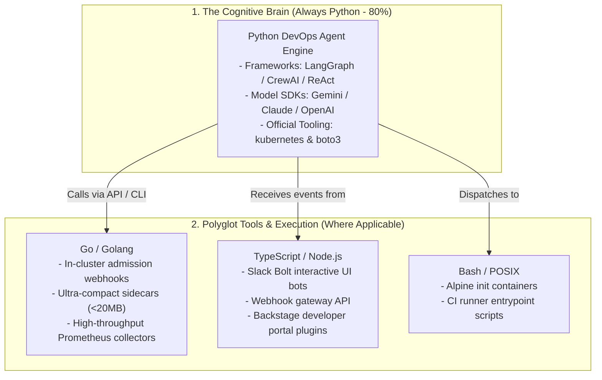
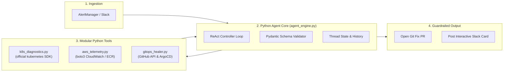

# Module 08: Enterprise Python-First DevOps AI Agent Framework

> **Principle**: **Python is the Primary Language for AI Agents** across the entire DevOps and SRE lifecycle.  
> Other languages (Go, TypeScript, Bash) are used strictly as supporting components where their specific runtime characteristics apply.

---

## 🏛️ The Python-First Polyglot Matrix



### Why Python is the Sovereign Standard for AI Agents:
1. **First-Party AI SDK Support**: Every frontier AI lab (Google DeepMind, Anthropic, OpenAI) releases features, tool-calling optimizations, and structured outputs in Python first.
2. **First-Class DevOps Client Libraries**:
   - **`kubernetes`**: The official Python client for Kubernetes API.
   - **`boto3`**: The official AWS SDK for Python.
   - **`PyGithub`**: Robust GitHub REST/GraphQL automation.
3. **Data Science & Incident Telemetry**: Python's native support for dataframes (`pandas`), metrics math (`numpy`), and time-series analysis makes calculating p99 latencies and anomaly detection effortless.

---

## 🏗️ Production Python Agent Architecture



---

## 📂 Framework Directory Structure

```text
08-python-devops-agent-framework/
├── README.md               # Architecture & Production Best Practices
├── requirements.txt        # Official Enterprise Python Dependencies
├── agent_engine.py         # The ReAct Agent Controller with Pydantic Tool Validation
├── tools/
│   ├── k8s_diagnostics.py  # Kubernetes API: Pods, Crash Logs, Events
│   ├── aws_telemetry.py    # AWS Boto3: CloudWatch Metrics & ECR Digests
│   └── gitops_healer.py    # GitHub API: Revert PRs & Kustomize Bumps
└── manifests/
    └── k8s-python-agent-deployment.yaml # EKS Deployment with AWS IRSA
```

---

## 🚀 Running the Python Agent Locally on Windows

You have native **Python 3.14.0** installed at:  
`C:\Users\Sri\AppData\Local\Programs\Python\Python314\python.exe`

### 1. Run the Local Deployment Agent
```powershell
& "C:\Users\Sri\AppData\Local\Programs\Python\Python314\python.exe" 06-local-ai-deploy-agent/agent.py
```

### 2. Verify Health Status
```powershell
& "C:\Users\Sri\AppData\Local\Programs\Python\Python314\python.exe" 06-local-ai-deploy-agent/agent.py status
```

### 3. Gracefully Stop the Background Service
```powershell
& "C:\Users\Sri\AppData\Local\Programs\Python\Python314\python.exe" 06-local-ai-deploy-agent/agent.py stop
```
