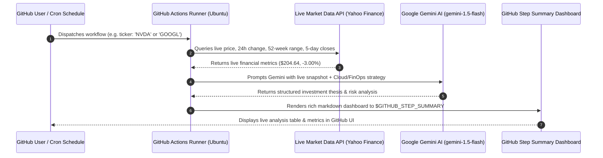

# Module 09: Running Real-Time AI Agents on GitHub Actions

> **Focus**: Serverless Autonomous Agentic Workflows on GitHub Actions.  
> **Lab**: Real-Time AI Stock & Cloud Provider Market Analysis using Python and Google Gemini.

---

## ⚡ How This GitHub Actions Agent Works

You can trigger this agent on-demand from the GitHub UI or let it run on a recurring schedule:



---

## 🔑 How to Add Your Free Gemini API Key to GitHub (30 Seconds)

1. Get a **100% Free** Gemini API Key:
   - Visit [Google AI Studio](https://aistudio.google.com/app/apikey)
   - Click **"Create API key"** and copy your key.
2. Add it to your GitHub Repository:
   - Go to your repo: [https://github.com/purnareddy9/dev](https://github.com/purnareddy9/dev)
   - Click **Settings** $\rightarrow$ **Secrets and variables** $\rightarrow$ **Actions**
   - Click **New repository secret**
   - Name: `GEMINI_API_KEY`
   - Secret: *(Paste your Gemini key)*
   - Click **Add secret**

> **Note**: Even if you haven't added the secret yet, the agent automatically falls back to its built-in algorithmic quantitative engine, so the workflow will succeed and generate reports immediately!

---

## 🚀 How to Run the Agent from GitHub Actions UI

1. Open your repository on GitHub: [https://github.com/purnareddy9/dev](https://github.com/purnareddy9/dev)
2. Click the **Actions** tab at the top.
3. In the left sidebar, click **"Real-Time AI Market & Cloud Provider Analyst Agent"**.
4. Click the **Run workflow** dropdown button:
   - Enter any ticker symbol (e.g. `NVDA`, `GOOGL`, `MSFT`, `AAPL`, `AMZN`).
   - Click the green **Run workflow** button!
5. Within ~30 seconds, the workflow finishes. Click on the completed run to view the **Step Summary** featuring the real-time financial and AI intelligence report!

---

## 💻 Running It Locally on Your Windows Machine

You can also run this exact market agent locally in PowerShell:

```powershell
# Analyze NVDA
& "C:\Users\Sri\AppData\Local\Programs\Python\Python314\python.exe" 09-github-actions-ai-agent/market_agent.py NVDA

# Analyze Google (GOOGL)
& "C:\Users\Sri\AppData\Local\Programs\Python\Python314\python.exe" 09-github-actions-ai-agent/market_agent.py GOOGL

# Analyze Microsoft (MSFT) with Gemini Key
$env:GEMINI_API_KEY="your-gemini-key"
& "C:\Users\Sri\AppData\Local\Programs\Python\Python314\python.exe" 09-github-actions-ai-agent/market_agent.py MSFT
```
