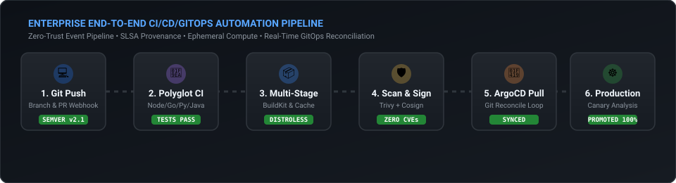
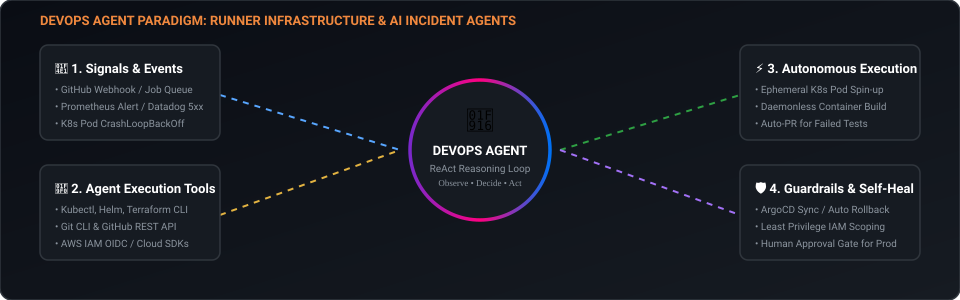
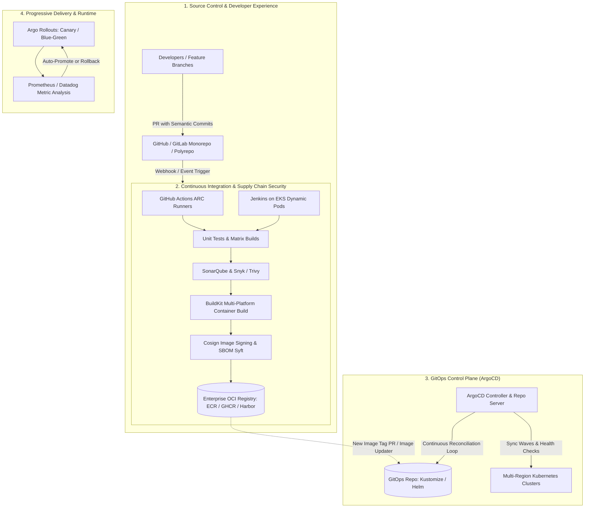

# Enterprise DevOps, CI/CD, GitOps & Production Engineering Guide
> **Engineered for Senior & Lead DevOps / SRE Engineers (6+ Years Experience)**  
> Comprehensive Architectures, Production Polyglot Pipelines, Real-Time Failure Scenarios & High-Bar Interview Case Studies.

---

## ⚡ Animated End-to-End Enterprise CI/CD Pipeline

  

---

## 🐙 Animated GitOps Reconciliation & Drift Self-Healing Loop

  

---

## 🤖 Animated DevOps Agent Execution: Runners & AI Incident Loops

  

---

## 🏛️ Comprehensive Architecture Blueprint

---

## 📂 Navigation Index

| Module | Core Architecture Focus | Real-World Artifacts & Templates | Interview Case Studies |
| :--- | :--- | :--- | :--- |
| [**01. GitHub Actions Enterprise**](./01-github-actions/README.md) | OIDC Security, Self-Hosted ARC (Kubernetes), Monorepo Path Filtering, Matrix Builds, Caching Strategies | [OIDC ECR Publish](./01-github-actions/workflows/oidc-aws-ecr-publish.yml), [Reusable Pipeline](./01-github-actions/workflows/reusable-enterprise-ci.yml), [Monorepo Matrix](./01-github-actions/workflows/monorepo-smart-build.yml), [Cosign Signing](./01-github-actions/workflows/container-security-sign.yml) | [Senior GHA Scenarios](./01-github-actions/interview-scenarios.md) |
| [**🧪 Polyglot CI/CD Comparison**](./01-github-actions/polyglot-stack-comparison.md) | **Node.js, Python FastAPI, Go, and Java Spring Boot** Deep Comparison: Caching, Test Runners, Docker Multi-Stage & Distroless | [Node.js Stack](./01-github-actions/stacks/nodejs/), [Python Stack](./01-github-actions/stacks/python/), [Golang Stack](./01-github-actions/stacks/golang/), [Java Spring Boot Stack](./01-github-actions/stacks/java-springboot/) | [Stack Architecture Comparison](./01-github-actions/polyglot-stack-comparison.md) |
| [**02. Jenkins Enterprise**](./02-jenkins-enterprise/README.md) | JCasC (Config-as-Code), Dynamic K8s Pod Agents, Enterprise Shared Libraries, Declarative vs Scripted, Performance & GC Tuning | [Declarative Jenkinsfile](./02-jenkins-enterprise/pipeline-templates/Jenkinsfile.declarative), [Scripted Jenkinsfile](./02-jenkins-enterprise/pipeline-templates/Jenkinsfile.scripted), [K8s Pod Agent](./02-jenkins-enterprise/pipeline-templates/k8s-pod-agent.yaml), [Shared Library](./02-jenkins-enterprise/pipeline-templates/shared-library-deploy.groovy) | [Senior Jenkins Scenarios](./02-jenkins-enterprise/interview-scenarios.md) |
| [**03. GitOps & ArgoCD**](./03-gitops-and-argocd/README.md) | Declarative K8s Delivery, ApplicationSets (Cluster/Matrix), Sync Waves, Pre/Post Hooks, Argo Rollouts (Canary), Secrets Management (External Secrets Operator) | [Application CRD](./03-gitops-and-argocd/manifests/argocd-application.yaml), [ApplicationSet Matrix](./03-gitops-and-argocd/manifests/applicationset-matrix.yaml), [Canary Rollout](./03-gitops-and-argocd/manifests/argo-rollout-canary.yaml), [External Secrets](./03-gitops-and-argocd/manifests/external-secrets-vault.yaml) | [Senior GitOps Scenarios](./03-gitops-and-argocd/interview-scenarios.md) |
| [**04. End-to-End System Designs**](./04-end-to-end-production-designs/README.md) | Zero-Trust 500+ Microservice Multi-Region Pipeline Architecture, Disaster Recovery, SLSA Level 3 Compliance | System Diagrams & Production Failure Case Studies | [Incident Response Scenarios](./04-end-to-end-production-designs/production-incident-scenarios.md) |
| [**05. Building DevOps Agents**](./05-devops-agents/README.md) | **Pillar 1**: Custom Hardened CI Runners (ARC & Jenkins Pods) **Pillar 2**: Autonomous AI SRE Agents (ReAct Loop, Tool Calling, K8s Triage) | [Hardened Runner Dockerfile](./05-devops-agents/cicd-runner-agents/Dockerfile.hardened-runner), [ARC ScaleSet](./05-devops-agents/cicd-runner-agents/arc-runner-scaleset.yaml), [AI SRE Agent Python](./05-devops-agents/ai-devops-agents/k8s_incident_triage_agent.py) | [Senior Agent Scenarios](./05-devops-agents/interview-scenarios.md) |

---

## 🎯 Key Differentiators for 6+ Years Experience

When interviewing for Lead / Senior DevOps or Principal SRE positions, interviewers look beyond syntax. They test:

1. **Failure Modes & Blast Radius Mitigation**:
   - How do you prevent corrupted dependencies from breaking 100 pipelines?
   - How do you guarantee a database schema migration doesn't run before a rollback is impossible?
2. **Security & Compliance (Zero-Trust)**:
   - Eliminating static cloud credentials using AWS IAM OIDC roles.
   - Supply Chain Security: Software Bill of Materials (SBOM) generation and cryptographic signing via Cosign.
   - Secrets management that never checks secrets into Git (External Secrets Operator + HashiCorp Vault / AWS Secrets Manager).
3. **Scale & Cost Optimization**:
   - Autoscaling CI compute dynamically using Kubernetes Actions Runner Controller (ARC) vs static VMs.
   - Distributed Docker layer caching (BuildKit inline cache, registry cache, GitHub Actions GHA cache).
   - Multi-tenant ArgoCD clusters handling thousands of applications without API throttling or controller OOM.
4. **Resiliency & Rollbacks**:
   - Automated Canary releases with metric-driven progressive promotion and sub-second rollback triggers.
   - Disaster recovery: Re-hydrating an entire Kubernetes infrastructure and workloads purely from Git within minutes.
