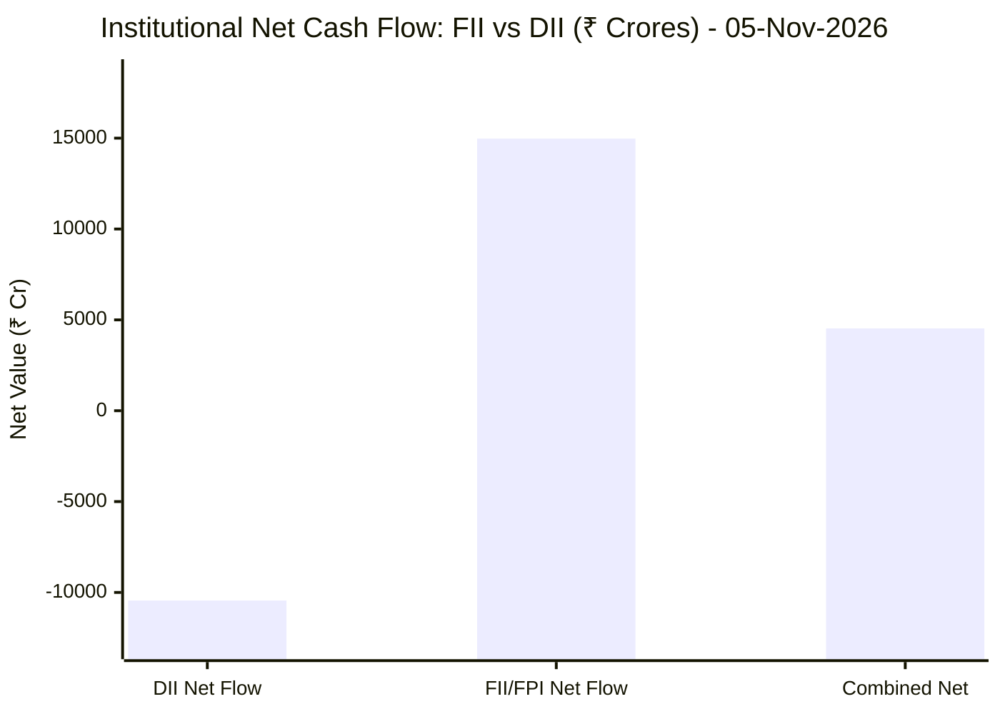

# 🌐 Autonomous Cloud & Market Intelligence Hub
> **Real-Time Financial & Cloud Infrastructure Analytics Engine**
> Autonomously updated on every market session via GitHub Actions and Google Gemini 3.8 Flash.

---

## 🌍 1. Global & Domestic Market Indices Pulse


| Index Benchmark | Live Level | 24h Change | Market Posture | Benchmark Sector Coverage |
| :--- | :--- | :--- | :--- | :--- |
| **NIFTY 50** (`^NSEI`) | **24,653.55 INR** | **+0.48%** (📈) | `🟢 BULLISH` | Indian Benchmark (Top 50 Blue-Chip Equities) |
| **SENSEX** (`^BSESN`) | **79,913.16 INR** | **+0.76%** (📈) | `🟢 BULLISH` | BSE Benchmark (Top 30 Established Companies) |
| **NIFTY IT** (`^CNXIT`) | **33,274.85 INR** | **+1.33%** (📈) | `🟢 BULLISH` | Indian Technology & Software Enterprise Sector |
| **NIFTY 500** (`^CRSLDX`) | **23,168.75 INR** | **-0.24%** (📉) | `🔴 BEARISH` | Indian Broad Market (Top 500 Across Large/Mid/Small-Cap) |
| **BANK NIFTY** (`^NSEBANK`) | **57,896.80 INR** | **+0.21%** (📈) | `🟢 BULLISH` | Indian Banking & Financial Services Sector |
| **S&P 500** (`^GSPC`) | **7,353.73 USD** | **-4.36%** (📉) | `🔴 BEARISH` | US Large-Cap Market Benchmark |
| **NASDAQ Composite** (`^IXIC`) | **24,315.00 USD** | **-5.52%** (📉) | `🔴 BEARISH` | Global Technology & Growth Benchmark |


---

## 🏛️ 2. Institutional Capital Flow Matrix (FII / DII Inflows & Outflows)
> *Official National Stock Exchange (NSE) Daily Institutional Cash Market Activity:*


| Institutional Segment | Gross Buy (₹ Cr) | Gross Sell (₹ Cr) | Net Inflow / Outflow (₹ Cr) | Institutional Posture | Session Date |
| :--- | :--- | :--- | :--- | :--- | :--- |
| **FII / FPI** (Foreign Institutions) | ₹31,797.86 Cr | ₹16,823.18 Cr | **+14,974.68 Cr** (🟢) | `🟢 AGGRESSIVE BUYING` | 05-Nov-2026 |
| **DII** (Domestic Mutual Funds / Banks) | ₹22,168.28 Cr | ₹32,612.82 Cr | **-10,444.54 Cr** (🔴) | `🔴 PROFIT BOOKING` | 05-Nov-2026 |
| **Combined Institutional Net** | **₹53,966.14 Cr** | **₹49,436.00 Cr** | **+4,530.14 Cr** (🟢) | `🟢 NET LIQUIDITY EXPANSION` | 05-Nov-2026 |


### FII vs DII Net Trading Flow


---

## 🧭 3. Daily Pre-Market & Post-Market Institutional Intelligence
- 🧭 **[Institutional Pre-Market 08:50 AM Framework & Trap Radar Blueprint](./frameworks/pre-market-intelligence-blueprint.md)**
  - *The 6-Pillar 08:50 AM Diagnostic Sequence* | *Bear Trap vs. Bull Trap Detection*
  - *Sector-by-Sector Opening Matrix (Banking 35% Weight vs IT)* | *Indian IT vs. US AI Capex Bubble Decoupling Moat*
  - *The 3-Candle Morning Opening Rule (09:15–09:30 AM)* | *Automated Bracket & Trailing GTT Execution*
- 📅 **[November 2, 2026: Institutional Order Flow & Macro Day-Trader Analysis](./daily-pulse/2026-11-02-day-trader-intelligence.md)**
  - *FII Net Buying Surge (+₹3,600 Cr)* | *US Election & Geopolitical Standoff (Iran / Qatar)*
  - *Institutional Masterclass: What is Short Covering & Short Squeeze Anatomy Explained*
  - *The 4 F&O Derivatives Quadrants (Long Buildup, Short Buildup, Short Covering, Long Unwinding)*
  - *Gold/Silver Crash Breakdown (Binance $6.33B Hack Liquidation & Central Bank Sales)*
  - *Day Trader Pre/Post-Market Rules & Risk Management (Nithin Kamath Naked Option Warning)*
  - *Corporate Earnings Scorecards: Delhivery, Ramkrishna Forgings, Equitas SFB, Subex, Syrma SGS*

---

## 📈 4. Tracked Enterprise & Infrastructure Stocks

| Ticker | Company Name | Live Price | 24h Change | RSI (14) | Direct Reports |
| :--- | :--- | :--- | :--- | :--- | :--- |
| **[BSOFT](./stocks/BSOFT/README.md)** | Birlasoft Limited | 341.4 INR | +3.36% | 64.24 | [Latest](./stocks/BSOFT/latest.md) • [News](./stocks/BSOFT/news.md) • [History](./stocks/BSOFT/history/) |
| **[COFORGE](./stocks/COFORGE/README.md)** | COFORGE | View | +0.00% | N/A | [Latest](./stocks/COFORGE/latest.md) • [News](./stocks/COFORGE/news.md) • [History](./stocks/COFORGE/history/) |
| **[GOLDBEES](./stocks/GOLDBEES/README.md)** | GOLDBEES | View | +0.00% | N/A | [Latest](./stocks/GOLDBEES/latest.md) • [News](./stocks/GOLDBEES/news.md) • [History](./stocks/GOLDBEES/history/) |
| **[HDFC](./stocks/HDFC/README.md)** | HDFC | View | +0.00% | N/A | [Latest](./stocks/HDFC/latest.md) • [News](./stocks/HDFC/news.md) • [History](./stocks/HDFC/history/) |
| **[NVDA](./stocks/NVDA/README.md)** | NVDA | View | +0.00% | N/A | [Latest](./stocks/NVDA/latest.md) • [News](./stocks/NVDA/news.md) • [History](./stocks/NVDA/history/) |
| **[PERSISTENT](./stocks/PERSISTENT/README.md)** | PERSISTENT | View | +0.00% | N/A | [Latest](./stocks/PERSISTENT/latest.md) • [News](./stocks/PERSISTENT/news.md) • [History](./stocks/PERSISTENT/history/) |
| **[PVP](./stocks/PVP/README.md)** | PVP | View | +0.00% | N/A | [Latest](./stocks/PVP/latest.md) • [News](./stocks/PVP/news.md) • [History](./stocks/PVP/history/) |
| **[TRENT](./stocks/TRENT/README.md)** | TRENT | View | +0.00% | N/A | [Latest](./stocks/TRENT/latest.md) • [News](./stocks/TRENT/news.md) • [History](./stocks/TRENT/history/) |

---

### 📂 Directory Architecture
```text
market-intelligence/
├── README.md                      # Master Portfolio Index (This File)
└── stocks/
    └── <TICKER>/                  # Dedicated Stock Directory
        ├── README.md              # Live Interactive Dashboard & Visual Charts
        ├── latest.md              # Latest Complete Research Analysis
        ├── news.md                # Breaking News & Sentiment Feed
        └── history/
            └── YYYY-MM-DD.md      # Immutable Date-Wise Session Archives
```

---
*Built with Python, GitHub Actions, and Google Gemini 3.8 Flash.*
