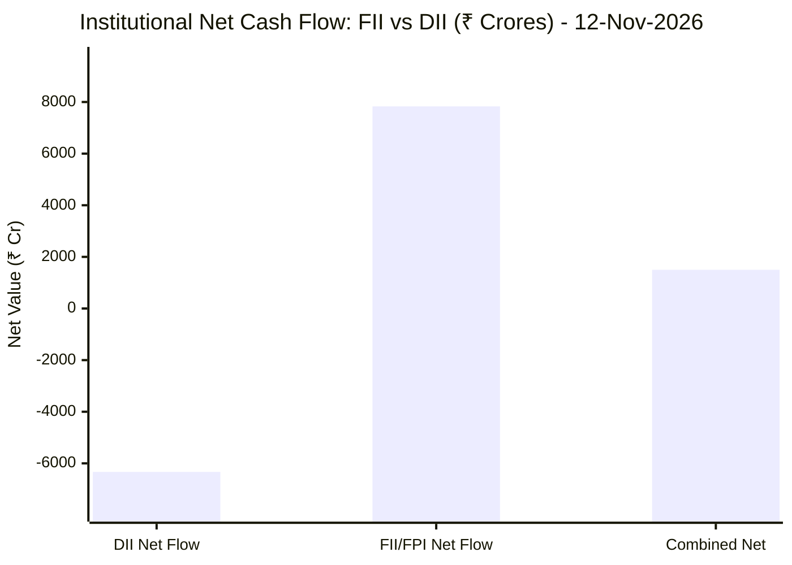

# 🌐 Autonomous Cloud & Market Intelligence Hub
> **Real-Time Financial & Cloud Infrastructure Analytics Engine**
> Autonomously updated on every market session via GitHub Actions and Google Gemini 3.8 Flash.

---

## 🌍 1. Global & Domestic Market Indices Pulse & Pre-Market Radar

### 🧭 08:50 AM Pre-Market Trap & Sector Radar
> 📖 **Pre-Market Operational Framework**: [Read Full 08:50 AM Institutional Blueprint](https://github.com/purnareddy9/dev/blob/main/market-intelligence/frameworks/pre-market-intelligence-blueprint.md)

| Diagnostic Metric | Live Status / Reading | Operational Strategic Implication |
| :--- | :--- | :--- |
| **Trap Radar Detection** | **`ORDERLY EXPANSION 📈`** | **⚖️ BALANCED ACCUMULATION / NORMAL VOLATILITY**<br>_Market is trading within standard technical bands. Follow standard support/resistance pivot levels._ |
| **Live US Tech Futures (`NQ=F`)** | **-0.28%** | Continuous 23h CME Asian session signal for global tech sentiment. |
| **Live US S&P Futures (`ES=F`)** | **-0.31%** | Broad market Wall Street dip-buying / continuation gauge. |
| **Overnight Nasdaq Close (`^IXIC`)** | **-0.39%** | Baseline historical session close. |
| **Asian Regional Pulse (`^N225`)** | **-0.70%** | Asian semiconductor and exporter health indicator. |
| **NSE Volatility Index (`^INDIAVIX`)** | **16.62 PTS** | 🟡 Normal market volatility |
| **Indian IT Decoupling Moat** | **`🛡️ ACTIVE`** | Indian IT provides high-margin enterprise software integration & cloud modernization (services moat), insulating domestic balance sheets from US hardware/GPU capex bubble concerns. |


---

### 🇮🇳 Domestic Benchmarks & Sectoral Breadth
| Index / Sector Benchmark | Live Level | 24h Change | Market Posture | Benchmark Sector Coverage |
| :--- | :--- | :--- | :--- | :--- |
| **NIFTY 50** (`^NSEI`) | **25,299.35 INR** | **+0.17%** (📈) | `🟢 BULLISH` | Indian Benchmark (Top 50 Blue-Chip Equities) |
| **SENSEX** (`^BSESN`) | **81,911.01 INR** | **+0.04%** (📈) | `🟢 BULLISH` | BSE Benchmark (Top 30 Established Companies) |
| **BANK NIFTY** (`^NSEBANK`) | **61,518.50 INR** | **+1.19%** (📈) | `🟢 BULLISH` | Indian Banking & Financial Services (~35% Nifty Weight) |
| **NIFTY IT** (`^CNXIT`) | **32,163.55 INR** | **-0.41%** (📉) | `🔴 BEARISH` | Indian Technology & Enterprise Software Sector |
| **NIFTY AUTO** (`^CNXAUTO`) | **28,231.00 INR** | **-1.02%** (📉) | `🔴 BEARISH` | Automobile & OEM Sector (Domestic Festive Demand) |
| **NIFTY FMCG** (`^CNXFMCG`) | **46,838.50 INR** | **-0.74%** (📉) | `🔴 BEARISH` | Fast-Moving Consumer Goods (Defensive Domestic Consumption) |
| **NIFTY METAL** (`^CNXMETAL`) | **12,772.60 INR** | **-0.11%** (📉) | `🔴 BEARISH` | Metals, Mining & Global Commodity Play |
| **NIFTY PHARMA** (`^CNXPHARMA`) | **28,675.75 INR** | **-0.35%** (📉) | `🔴 BEARISH` | Pharmaceutical & Healthcare (Defensive Shelter) |
| **INDIA VIX** (`^INDIAVIX`) | **16.62 INR** | **-5.34%** (📉) | `🔴 BEARISH` | NSE Volatility & Market Fear Index |

### 🌐 Global Overnight Benchmarks & Live 23h Futures
| Global Benchmark / Futures | Live Level | 24h Change | Market Posture | Strategic Market Signal |
| :--- | :--- | :--- | :--- | :--- |
| **NASDAQ 100 Futures** (`NQ=F`) | **28,392.25 USD** | **-0.28%** (📉) | `🔴 BEARISH` | Live US Tech E-mini Futures (Trades 23h CME Asian Hours) |
| **S&P 500 Futures** (`ES=F`) | **7,616.75 USD** | **-0.31%** (📉) | `🔴 BEARISH` | Live US Broad Market E-mini Futures (Asian Hours) |
| **NASDAQ Composite** (`^IXIC`) | **25,366.09 USD** | **-0.39%** (📉) | `🔴 BEARISH` | Global Technology Benchmark (Overnight US Cash Close) |
| **S&P 500** (`^GSPC`) | **7,592.40 USD** | **-0.35%** (📉) | `🔴 BEARISH` | US Large-Cap Market Benchmark (Overnight US Cash Close) |
| **NIKKEI 225** (`^N225`) | **60,819.36 JPY** | **-0.70%** (📉) | `🔴 BEARISH` | Japan Benchmark (Asia Market Sentiment) |
| **HANG SENG** (`^HSI`) | **24,008.55 HKD** | **-1.26%** (📉) | `🔴 BEARISH` | Hong Kong Benchmark (Asia Tech & China Sentiment) |
| **BRENT CRUDE** (`BZ=F`) | **96.09 USD** | **+3.59%** (📈) | `🟢 BULLISH` | Global Crude Oil Benchmark (Energy Import Cost) |
| **USD / INR** (`USDINR=X`) | **94.03 INR** | **+0.38%** (📈) | `🟢 BULLISH` | US Dollar vs Indian Rupee Exchange Rate |
| **US DOLLAR INDEX** (`DX-Y.NYB`) | **103.19 USD** | **+0.28%** (📈) | `🟢 BULLISH` | DXY Dollar Strength Index |

---

## 🏛️ 2. Institutional Capital Flow Matrix (FII / DII Inflows & Outflows)
> *Official National Stock Exchange (NSE) Daily Institutional Cash Market Activity:*


| Institutional Segment | Gross Buy (₹ Cr) | Gross Sell (₹ Cr) | Net Inflow / Outflow (₹ Cr) | Institutional Posture | Session Date |
| :--- | :--- | :--- | :--- | :--- | :--- |
| **FII / FPI** (Foreign Institutions) | ₹20,273.32 Cr | ₹12,442.72 Cr | **+7,830.60 Cr** (🟢) | `🟢 AGGRESSIVE BUYING` | 12-Nov-2026 |
| **DII** (Domestic Mutual Funds / Banks) | ₹15,855.13 Cr | ₹22,186.30 Cr | **-6,331.17 Cr** (🔴) | `🔴 PROFIT BOOKING` | 12-Nov-2026 |
| **Combined Institutional Net** | **₹36,128.45 Cr** | **₹34,629.02 Cr** | **+1,499.43 Cr** (🟢) | `🟢 NET LIQUIDITY EXPANSION` | 12-Nov-2026 |


### FII vs DII Net Trading Flow


---

## 🧭 3. Daily Pre-Market & Post-Market Institutional Intelligence
- 🧭 **[Institutional Pre-Market 08:50 AM Framework & Trap Radar Blueprint](./frameworks/pre-market-intelligence-blueprint.md)**
  - *The 6-Pillar 08:50 AM Diagnostic Sequence* | *Bear Trap vs. Bull Trap Detection*
  - *Sector-by-Sector Opening Matrix (Banking 35% Weight vs IT)* | *Indian IT vs. US AI Capex Bubble Decoupling Moat*
  - *The 3-Candle Morning Opening Rule (09:15–09:30 AM)* | *Automated Bracket & Trailing GTT Execution*
- 📅 **[November 2, 2026: Institutional Order Flow & Macro Day-Trader Analysis](./daily-pulse/2026-11-02-day-trader-intelligence.md)**
  - *FII Net Buying Surge (+₹3,600 Cr)* | *US Election & Geopolitical Standoff (Iran / Qatar)*
  - *Institutional Masterclass: What is Short Covering & Short Squeeze Anatomy Explained*
  - *The 4 F&O Derivatives Quadrants (Long Buildup, Short Buildup, Short Covering, Long Unwinding)*
  - *Gold/Silver Crash Breakdown (Binance $6.33B Hack Liquidation & Central Bank Sales)*
  - *Day Trader Pre/Post-Market Rules & Risk Management (Nithin Kamath Naked Option Warning)*
  - *Corporate Earnings Scorecards: Delhivery, Ramkrishna Forgings, Equitas SFB, Subex, Syrma SGS*

---

## 📈 4. Tracked Enterprise & Infrastructure Stocks

| Ticker | Company Name | Live Price | 24h Change | RSI (14) | Direct Reports |
| :--- | :--- | :--- | :--- | :--- | :--- |
| **[BSOFT](./stocks/BSOFT/README.md)** | BSOFT | View | +0.00% | N/A | [Latest](./stocks/BSOFT/latest.md) • [News](./stocks/BSOFT/news.md) • [History](./stocks/BSOFT/history/) |
| **[COFORGE](./stocks/COFORGE/README.md)** | COFORGE | View | +0.00% | N/A | [Latest](./stocks/COFORGE/latest.md) • [News](./stocks/COFORGE/news.md) • [History](./stocks/COFORGE/history/) |
| **[GOLDBEES](./stocks/GOLDBEES/README.md)** | GOLDBEES | View | +0.00% | N/A | [Latest](./stocks/GOLDBEES/latest.md) • [News](./stocks/GOLDBEES/news.md) • [History](./stocks/GOLDBEES/history/) |
| **[HDFC](./stocks/HDFC/README.md)** | HDFC | View | +0.00% | N/A | [Latest](./stocks/HDFC/latest.md) • [News](./stocks/HDFC/news.md) • [History](./stocks/HDFC/history/) |
| **[NVDA](./stocks/NVDA/README.md)** | NVDA | View | +0.00% | N/A | [Latest](./stocks/NVDA/latest.md) • [News](./stocks/NVDA/news.md) • [History](./stocks/NVDA/history/) |
| **[PERSISTENT](./stocks/PERSISTENT/README.md)** | Persistent Systems Limited | 6030.0 INR | +0.95% | 57.28 | [Latest](./stocks/PERSISTENT/latest.md) • [News](./stocks/PERSISTENT/news.md) • [History](./stocks/PERSISTENT/history/) |
| **[PVP](./stocks/PVP/README.md)** | PVP | View | +0.00% | N/A | [Latest](./stocks/PVP/latest.md) • [News](./stocks/PVP/news.md) • [History](./stocks/PVP/history/) |
| **[TRENT](./stocks/TRENT/README.md)** | TRENT | View | +0.00% | N/A | [Latest](./stocks/TRENT/latest.md) • [News](./stocks/TRENT/news.md) • [History](./stocks/TRENT/history/) |

---

### 📂 Directory Architecture
```text
market-intelligence/
├── README.md                      # Master Portfolio Index (This File)
└── stocks/
    └── <TICKER>/                  # Dedicated Stock Directory
        ├── README.md              # Live Interactive Dashboard & Visual Charts
        ├── latest.md              # Latest Complete Research Analysis
        ├── news.md                # Breaking News & Sentiment Feed
        └── history/
            └── YYYY-MM-DD.md      # Immutable Date-Wise Session Archives
```

---
*Built with Python, GitHub Actions, and Google Gemini 3.8 Flash.*
