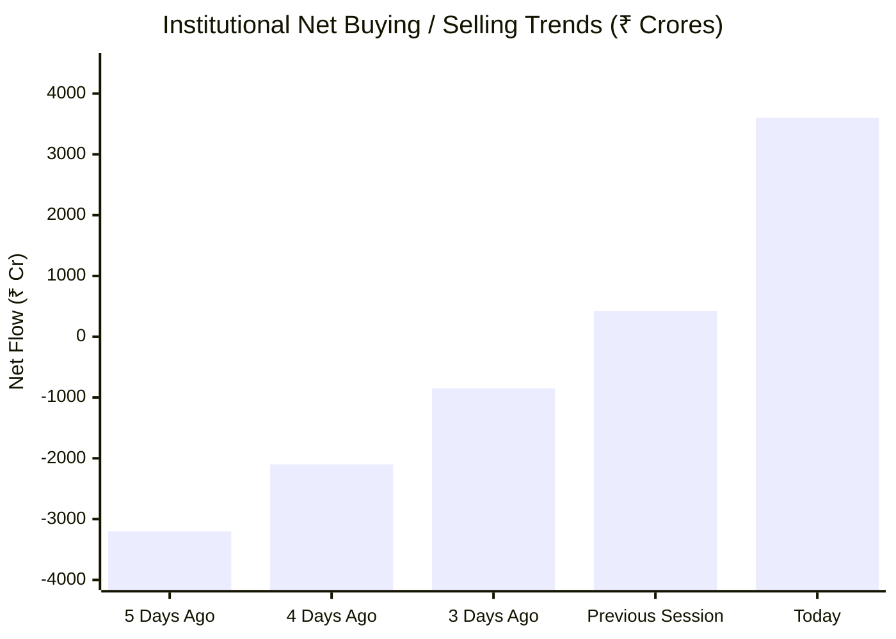
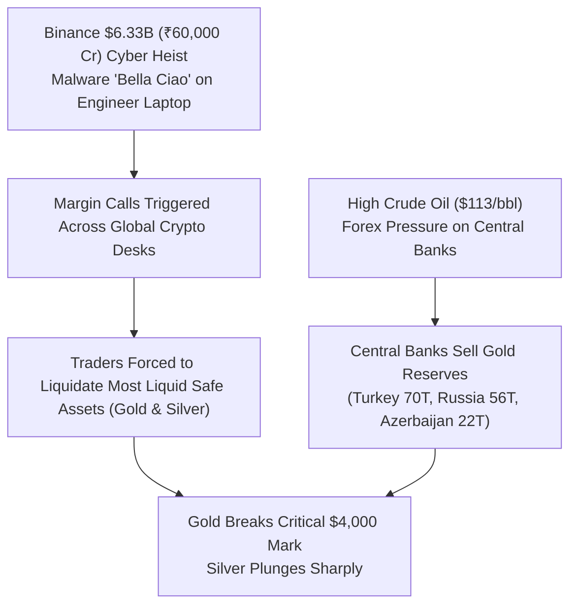

# 🎯 Institutional Day Trader Daily Pulse: Pre & Post-Market Intelligence
> **Market Date**: Monday, November 2, 2026 | **Author**: DevOps AI Market Intelligence Desk  
> **Source Synthesis**: Institutional Order Flow & Telugu Day Trader Transcript Decoding

---

## 🧭 1. Multi-Horizon Market Directional Predictions

| Horizon | Forecast | Target / Key Range | Key Catalysts & Technical Rationale |
| :--- | :---: | :---: | :--- |
| **Today's Session (Intraday)** | **Cautiously Bullish 🟢** | **Nifty 23,380 – 23,620** | GIFT Nifty indicating +60 pts gap-up; FIIs aggressive single-day buying (+₹3,600 Cr); IT sector leading momentum. |
| **Tomorrow (Nov 3, 2026)** | **High Volatility / Event Risk ⚡** | **Nifty 23,200 – 23,750** | US Election Day & US-Iran geopolitical mediation outcome; binary swings expected. **Strictly avoid naked option selling.** |
| **This Week (Nov 2 – Nov 6)** | **Selective Bullish / Large-Cap Bias 📈** | **Nifty 23,150 – 23,850** | Large-caps taking front seat; Mid & Small-caps undergoing healthy cooling/profit booking (-1% to -2%); IT & Financials acting as anchors. |
| **Month Outlook (Nov 2026)** | **Accumulation / Structural Upside 🌟** | **Nifty 24,200 Target** | Jefferies tax catalyst (potential LTCG/STCG budget concessions for FPIs to reverse $16.5B-$21B outflows); FII flow reversal. |

---

## 📊 2. FII & DII Institutional Money Flow Analysis

### Institutional Breakdown
1. **FII Massive Buying Reversal (+₹3,600 Cr)**:
   - Foreign Institutional Investors (FIIs) recorded their **largest single-day net purchase in recent months** at **₹3,600 Crores**.
   - Cumulative institutional positioning is now pivoting towards **+₹20,000 Crores positive bias**, indicating smart money pre-positioning ahead of major global binary catalysts.
2. **Jefferies Institutional Tax Catalyst**:
   - Institutional investment bank **Jefferies** released a landmark note on Indian capital markets:
     - **FY26 Outflows**: Foreign investors have withdrawn ~$21 Billion (~$16.5 Billion in recent months).
     - **3 Government Policy Levers on Table**:
       1. *Broad LTCG / STCG Reduction*: Benefit all market participants (government collected ₹30,000 Cr in FY25, so full reduction has fiscal cost).
       2. *FPI-Specific LTCG Concession*: Targeted foreign investor relief to stem currency flight.
       3. *USD-Denominated Capital Gains Tax*: Calculating gains in US Dollars rather than INR, insulating foreign funds from Rupee depreciation.
   - **Market Implication**: Strong expectations of a pro-market fiscal announcement or budget measure to stimulate foreign institutional capital inflows.

---

## ⚡ 3. Pre-Market vs Post-Market Day Trader Framework

### 🌅 A. The Pre-Market Checklist (08:00 AM – 09:00 AM IST)

1. **GIFT Nifty Signal**: Indicating **+60 points positive gap-up opening**.
2. **Global Indices Cross-Check**:
   - **US Markets**: S&P 500 (-0.57%), NASDAQ (-2.00%) dropped due to Big Tech AI spending warnings (Broadcom CEO, Elon Musk) and Google ad-revenue deceleration (-13%).
   - **Asian Markets**: KOSPI crashed ~4% and Chinese tech equities dropped due to global AI hardware selloff.
   - **Indian Decoupling Effect**: While global hardware/chip stocks fell, **Indian Enterprise Software IT (Nifty IT +0.79%) acted as a defensive safe haven**, drawing capital away from volatile manufacturing pockets.
3. **Macro Indicators Dashboard**:
   - **Brent Crude Oil**: High at **$113 / barrel** (Warning zone: $117–$130 triggers severe inflationary airline/shipping cost pressure; IndiGo hiking fares).
   - **US Dollar Index (DXY)**: Stable at **102.00**.
   - **US 10-Year Treasury Yield**: Sub-5% at **4.94%**.
   - **Currency**: USD/INR tracking under pressure.

---

### 🌆 B. Post-Market Review & Intraday Divergence (03:45 PM IST)

1. **The Great Breadth Divergence (Why Portfolios Were Red Despite Green Indices)**:
   - **Nifty 50** closed **+3.04%** (23,440.80) and **Sensex** closed **+2.85%** (75,692.78).
   - **Small-Cap Index** plunged **-2.00%**; **Mid-Cap Index** dropped **-1.00%**.
   - **Why this happened**: Large-cap IT and select heavyweight blue-chips rallied, driving the index higher, while speculative mid and small-cap momentum stocks saw aggressive profit booking.
2. **Key Technical Support / Resistance Levels**:
   - **Nifty 50**: Support base at **23,150 – 23,200**; Invalidation band at **22,750 – 22,850**; Overhead resistance at **23,650 – 23,800**.
   - **Bank Nifty**: Closed at **55,002.20 (+1.90%)**; Support at **54,200**; Resistance at **55,600**.
   - **Nifty IT**: Closed at **32,442.50 (+0.79%)**; Support at **31,800**; Resistance at **33,200**.

---

## 🪙 4. Gold & Silver Crash Deep-Dive: The Binance Crypto Connection

### Why Gold Broke $4,000 and Silver Plunged:
1. **The ₹60,000 Crore Binance Cyber Heist**:
   - A historic $6.33 Billion (~₹60,000–₹65,000 Crores) cyber attack struck the world's largest crypto exchange, **Binance**, via sophisticated malware dubbed *"Bella Ciao"* infiltrating a core engineer's compromised laptop.
   - Massive margin calls across institutional crypto funds forced rapid liquidation of liquid non-crypto collateral—primarily **Gold and Silver**.
2. **Central Bank Forex Defenses**:
   - High crude oil costs ($113/bbl) forced emerging market central banks to sell gold reserves to fund energy imports:
     - **Turkey**: Sold ~70 tons of gold in Q1 2026.
     - **Russia**: Sold ~56 tons.
     - **Azerbaijan**: Sold ~22 tons.
3. **Day Trader Takeaway**: Short-term gold/silver volatility is driven by liquidity crunches, not a breakdown of long-term safe-haven thesis. Expect rebound once crude stabilizes and liquidity normalizes.

---

## ⚠️ 5. Professional Day Trader Rules & Risk Management

> [!CAUTION]
> **Avoid Naked Option Selling Ahead of Nov 3 Binary Event (US Elections & Geopolitical Tensions)**:
> Citing data shared by Zerodha founder **Nithin Kamath**: while option sellers win in 9 out of 10 standard sessions, **a single tail-risk binary event can wipe out 100% of capital on naked short options**. 
> - **Rule**: Use defined-risk hedges (Credit Spreads, Iron Condors) rather than naked strangles/straddles.
> - **VIX Watch**: India VIX expansion demands reduced position sizing.

---

## 📰 6. Corporate Earnings & Actionable Stock Scorecards

| Stock Ticker | Event / Numbers | Verdict & Technical Play |
| :--- | :--- | :--- |
| **Delhivery** | **Massive Turnaround**: ₹41 Cr Net Profit vs -₹50 Cr loss YoY; Operating Cash Flow surged from ₹215 Cr to ₹525 Cr; Margins doubled. | **BULLISH 🟢** — Accumulate on dips; strong logistics operating leverage. |
| **Ramkrishna Forgings** | **Outstanding Beat**: Net Profit jumped from -₹10 Cr to +₹71 Cr YoY; Cash flow turned positive (+₹482 Cr); Strong domestic & export capacity utilization. | **BULLISH 🟢** — Breakout momentum candidate. |
| **BEML / BEL** | Revenue +27%, Operating Profit +20%, Operating Margins stable at 28%. | **BULLISH 🟢** — Defense & electronics infrastructure compounder. |
| **Syrma SGS** | Revenue +74% YoY, Profit +87% YoY on margin expansion. | **STRONG BUY 🌟** — EMS tech leadership. |
| **SJVN** | Revenue +118% YoY, Net Profit +114% YoY. | **BULLISH 🟢** — Renewable energy transition beneficiary. |
| **Skipper** | Profit +57% YoY on transmission/power infrastructure expansion. | **BULLISH 🟢** — Multi-decadal infrastructure opportunity. |
| **Goodluck India** | ₹58.2 Cr order for 155mm defense artillery (acute global shortage). | **BULLISH 🟢** — Defense specialty order book expanding. |
| **Knowledge Marine (KMEW)** | ₹303.7 Cr dredging contract from New Mangalore Port Authority (3-year execution). | **BULLISH 🟢** — Long-term revenue visibility. |
| **Subex** | $72 Million AI Agent contract win with African telecom operator. | **BULLISH 🟢** — Enterprise AI agent deployment validation. |
| **ACME Solar** | 400 MW FDRE power purchase agreement with NTPC at ₹4.37/unit tariff. | **POSITIVE 🟢** — Firm renewable power monetization. |
| **Laurus Labs** | ₹32.5 Cr acquisition of SI & C Resins for backward integration into 1600L peptide reactor (GLP-1 drugs). | **STRATEGIC BUY 🟢** — High-margin CDMO expansion. |
| **Equitas Small Finance Bank** | **20% Lower Circuit**: MD & CEO P.N. Vasudevan resigned over conflict-of-interest allegations regarding daughter's NBFC (Unico Housing Finance). | **BEARISH / AVOID 🔴** — Corporate governance overhang; wait for interim leadership clarity. |
| **Thyrocare** | Profit dropped 67% YoY due to ₹45 Cr one-time impairment loss on Nuclear Healthcare radiology subsidiary. | **NEUTRAL 🟡** — Core business stable (33% margin), but one-off cleanups cloud near-term. |
| **EPACK Durable** | Operating margin collapsed to 1.62% (from 6.21%); Depreciation +33%; Auditor flagged ₹19.61 Cr disputed receivables; CFO Rajesh Kumar resigned. | **HIGH RISK / SELL 🔴** — Margin breakdown and leadership churn. |
| **AU Small Finance Bank** | Third-party vehicle loan SaaS customer data breach (core banking safe, but customer risk). | **CAUTIOUS 🟡** — Monitor customer trust and regulatory scrutiny. |
| **Suzlon Energy** | Profitability pressured by margin contraction and cost inflation. | **PULLBACK 🟡** — Await support test before fresh entry. |
| **IndiGo (InterGlobe Aviation)** | Aviation Turbine Fuel (ATF) surge forcing airfare hikes to protect margins. | **VOLATILE 🟡** — Higher fares could dampen holiday passenger volume. |
