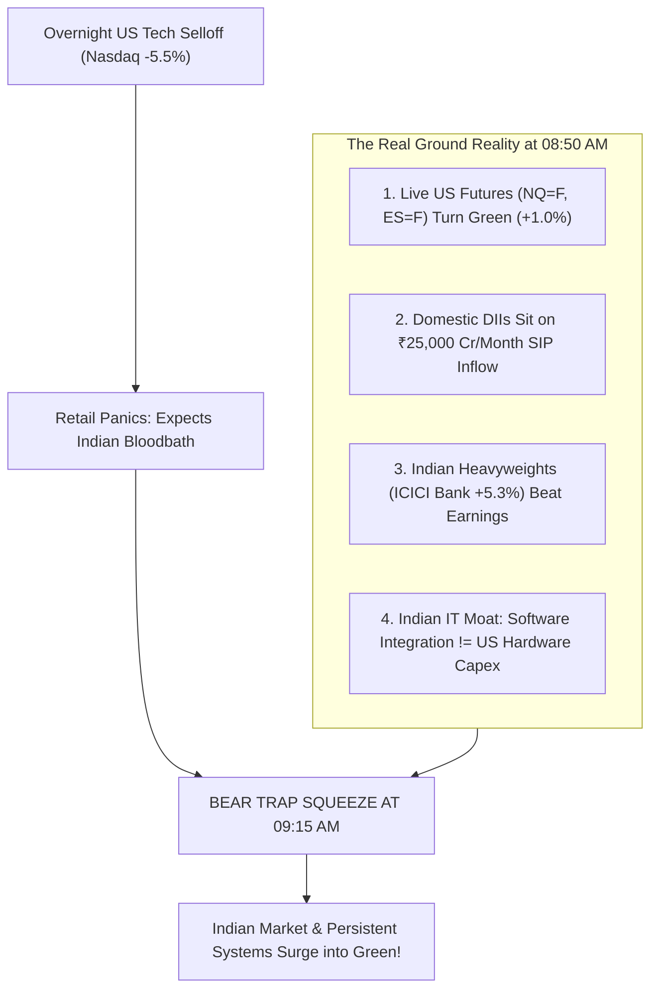
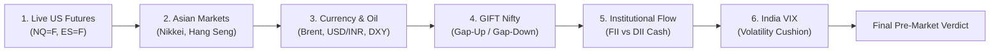
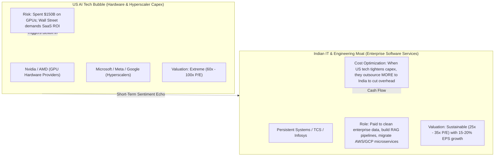

# 🧭 Institutional Pre-Market 08:50 AM Framework & Trap Radar
> **Engineered for**: Indian Equity Traders, DevOps Algorithmic Systems, and Indian IT (`PERSISTENT.NS`, `TCS.NS`, `INFY.NS`)  
> **Operational Time Window**: 08:30 AM – 09:15 AM IST Every Trading Day  
> **Objective**: Eliminate panic-selling, detect institutional traps (Bear Traps vs Bull Traps), predict sector-wise opening gaps, and execute with zero emotion.

---

## 📌 Executive Summary: The Anatomy of a Volatile Morning

On mornings with high global volatility (e.g. Wall Street dropping -5% to -6% overnight), **over 90% of retail traders make one of two fatal errors**:
1. **Panic Dumping at 09:15 AM**: Placing a Market Sell Order (`MKT`) at open into an artificial discount, selling at the absolute bottom tick.
2. **FOMO Paralyzation & Panic Re-Exit**: Watching the stock open with a surprise gap-up, missing a fast spike (e.g. ₹6,230), and panic-selling on the first normal minor pullback (e.g. ₹6,150) out of fear that profits will turn into losses.



---

## 🔍 Part 1: The 08:50 AM 6-Pillar Diagnostic Checklist

Every morning at **08:50 AM IST**, run through this checklist before making any trading decision.



### Pillar 1: Live US Futures vs. Overnight Cash Close
* **The Common Mistake**: Looking only at what the US market did last night (e.g., "Nasdaq closed -5%").
* **The Institutional Truth**: The US cash market closed hours ago. **Live US Futures (E-mini Nasdaq `NQ=F`, S&P `ES=F`) trade 23 hours a day on CME Globex through our morning!**
* **Diagnostic Rule**:
  * If US closed deep red, but live futures at 08:30 AM are **Green (+0.5% to +1.2%)**, international smart money is buying the dip. **Do NOT expect a crash in India.**

### Pillar 2: Asian Regional Temperature
* **Nikkei 225 (`^N225`) & KOSPI**: Hardware and semiconductor export economies (very sensitive to US chip news).
* **Hang Seng (`^HSI`)**: China tech and liquidity barometer.
* **Diagnostic Rule**: If Tokyo is down -4% but Hang Seng and Shanghai are flat or green, the panic is localized to hardware/semiconductors, not broad emerging markets.

### Pillar 3: Currency & Commodities (The Indian Advantage)
* **Brent Crude Oil (`BZ=F`)**: India imports 85%+ of its crude oil.
  * *Global selloff cools crude prices?* $\rightarrow$ **Huge Bullish Tailwinds for India!** Cuts inflation, lowers CAD (Current Account Deficit), and boosts FMCG, Auto, and Paint margins.
* **USD / INR (`USDINR=X`)**: Stable exchange rate (< 0.25% daily move) confirms zero foreign capital flight panic.

### Pillar 4: GIFT Nifty (The Exact Opening Gap Indicator)
* Discovered on the NSE International Exchange in GIFT City:
  * **GIFT Nifty Premium > +80 pts**: Expect Nifty Gap-Up.
  * **GIFT Nifty Flat (-30 to +30 pts)**: Neutral / Balanced Open.
  * **GIFT Nifty Discount > -150 pts**: Gap-Down open (Assess if it is a Bear Trap).

### Pillar 5: Domestic Institutions (The ₹25,000 Cr SIP Shield)
* **Official NSE FII vs DII Daily Cash Data**:
  * Even if FIIs sell ₹2,000–₹4,000 Crores, **DIIs consistently absorb ₹3,000–₹5,000 Crores** funded by relentless retail mutual fund SIPs.
  * If **Combined Net Flow is Positive**, domestic liquidity prevents systemic crashes.

### Pillar 6: India VIX (The Fear Index)
* **India VIX < 15.0**: Market is calm and orderly; opening dips will be bought.
* **India VIX 15.0 – 20.0**: Normal volatility; wide morning wicks (±₹40–₹60 on large stocks).
* **India VIX > 22.0**: Extreme turbulence; reduce position size and widen stop-loss buffers.

---

## ⚖️ Part 2: Sector-by-Sector Opening Matrix & Weighting Arithmetic

Why did Nifty stay green when global tech fell? **The Math of Nifty Index Weighting:**

| Sector Benchmark | Nifty 50 Weight | Key Heavyweights | Reaction to Global Tech Crash | Sector Opening Bias |
| :--- | :---: | :--- | :--- | :--- |
| **Banking & Financial Services (`^NSEBANK`)** | **~35.2%** | HDFC Bank, ICICI Bank, SBI, Kotak | Completely immune to US tech capex. Driven by domestic credit growth and NPAs. | **🟢 BULLISH / RESILIENT** |
| **Information Technology (`^CNXIT`)** | **~13.4%** | TCS, Infosys, Persistent, Wipro | Correlated sentiment, but enterprise services insulate from hardware dips. | **🟡 MILD PULLBACK / BOUNCE** |
| **Oil & Gas / Energy** | **~11.5%** | Reliance, ONGC, BPCL | Benefit from lower crude crack spreads or refining margins. | **🟢 NEUTRAL TO GREEN** |
| **Automobile (`^CNXAUTO`)** | **~7.8%** | Tata Motors, M&M, Maruti, Uno Minda | Domestic festive demand boom; raw material costs drop when commodities fall. | **🟢 STRONG GREEN** |
| **Fast-Moving Consumer Goods (`^CNXFMCG`)** | **~8.1%** | ITC, HUL, Nestlé, Britannia | Classic defensive shelter; money rotates here during global uncertainty. | **🟢 DEFENSIVE GREEN** |
| **Metals & Mining (`^CNXMETAL`)** | **~3.9%** | Tata Steel, JSW Steel, Hindalco | Tied to China stimulus and global commodities. | **🔴 VULNERABLE TO PULLBACK** |
| **Pharma & Healthcare (`^CNXPHARMA`)** | **~4.2%** | Sun Pharma, Cipla, Dr. Reddy's | Non-cyclical defensive asset. | **🟢 SAFE HAVEN GREEN** |

> **Key Takeaway**: **Banking (35%) + Auto & FMCG (16%) = Over 50% of the entire Indian stock market!**  
> If ICICI Bank rallies +5% and Auto rallies +3%, Nifty mathematically **cannot crash**, even if IT drops -2%.

---

## 💻 Part 3: Indian IT vs. US AI Tech Bubble Deconstruction

Many traders mistakenly assume: *"If Nvidia or Nasdaq falls, Indian IT (Persistent, TCS, INFY) must fall equally."* **This is fundamentally incorrect.**



### Why Indian IT Decouples from US Tech Crashes:
1. **Service Integrators, Not Silicon Manufacturers**:
   * Indian IT companies do not buy \$40,000 Nvidia GPUs. 
   * Fortune 500 banks, healthcare providers, and retailers hire **Persistent Systems** to integrate their legacy Oracle/SAP databases into modern AI agent architectures.
2. **Cost-Cutting Tailwinds**:
   * When US hyperscalers enter cost-cutting cycles, they lay off expensive US engineers (\$250k/yr) and offshore the workloads to high-end Indian engineering centers (Persistent, Coforge) at a fraction of the cost.
3. **Valuation Cushion**:
   * US AI stocks traded at 60x–100x P/E multiples. Persistent and Tier-1 Indian IT trade at 28x–40x P/E with double-digit constant-currency revenue growth and high ROCE (>30%).

---

## 🪤 Part 4: The Institutional Trap Detector Engine

Before 09:15 AM, institutional market makers deliberately set traps for retail traders. Here is how to identify them:

```
                          TRAP DETECTION MATRIX
                                    │
       ┌────────────────────────────┴────────────────────────────┐
       ▼                                                         ▼
[ 1. THE BEAR TRAP (Short Squeeze) ]           [ 2. THE BULL TRAP (Distribution) ]
• US overnight crashed hard                    • Market opens with large gap-up (>+1.5%)
• Morning live US futures GREEN (>+0.4%)       • Hits major structural resistance
• DIIs net buyers / Domestic earnings beat     • FIIs heavy net sellers (>₹2,500 Cr)
• VIX cool (< 18.0)                            • Live US futures fading red
ACTION: DO NOT SELL! Buy dip / ride squeeze.   ACTION: DO NOT BUY! Book profit / tighten SL.
```

### Anatomy of Today's Bear Trap (What Happened This Morning):
1. **08:00 AM**: Retail woke up, saw scary US headlines (-6%), and decided: *"I must sell my shares at 09:15 AM or I will lose everything."*
2. **08:30 AM**: Algorithmic short sellers flooded pre-market with sell bids.
3. **08:50 AM**: US futures quietly rebounded into the green. Titan and Airtel released monster quarterly earnings.
4. **09:08 AM**: Pre-open discovered price at **₹6,190** (UP +₹125!).
5. **09:15 AM**: Market opened. All the short sellers who bet on a crash got trapped. To close their shorts, they were forced to **BUY**, sparking a vertical spike straight to **₹6,230** in 60 seconds!

---

## 🎯 Part 5: Retail Trader Psychology & Execution Playbook

### Dissecting Your Trade Today (Persistent Systems):
* **Entry**: Bought at `₹6,130`.
* **Pre-Market**: Terrified of a market crash; contemplating selling below `₹6,000`.
* **Open Bell (09:15 AM)**: Opened at `₹6,190` and surged to `₹6,230`!
* **Pullback (09:16–09:20 AM)**: Dipped from `₹6,230` to `₹6,170`.
* **Execution**: Panicked that it would fall below `₹6,130`, so sold at `₹6,150`.

### The 3 Mistakes in That Sequence:
1. **Allowing fear to set prices**: Selling at ₹6,150 wasn't based on a technical broken support; it was driven by fear of seeing green turn into red.
2. **Watching tick-by-tick charts**: Watching 10-second price ticks makes normal market oscillations look like catastrophic collapses.
3. **Missing the Spike (`₹6,230`)**: Nobody can manually click "sell" at the exact top tick of a 30-second candle without a predetermined limit order.

---

### The Golden 3-Rule Execution System (Never Panic Again)

```
                       THE 3-RULE EXECUTION SYSTEM
                                   │
      ┌────────────────────────────┼────────────────────────────┐
      ▼                            ▼                            ▼
[ Rule 1: 08:50 AM Bias ]   [ Rule 2: The 5-Min Filter ]  [ Rule 3: Automated Trailing ]
Check 6 Pillars & Trap      NO market orders 09:15-09:20. Use Bracket / GTT orders
Radar before 09:00 AM.       Let the 1st candle close.     with ₹15-20 slippage gap.
```

#### Rule 1: The 08:50 AM Pre-Market Diagnostic
If the Trap Radar shows a **Bear Trap / Short Squeeze setup**, promise yourself in advance: **"I will NOT place any sell order below yesterday's close."**

#### Rule 2: The 5-Minute Opening Filter (09:15 – 09:20 AM)
* Never execute on the opening 60 seconds unless you have a resting Limit Order placed during pre-open (09:00–09:08 AM).
* Allow the **first 5-minute candle** to close. The high and low of that first 5-minute candle establish the day's true range.

#### Rule 3: The Automated Trailing Bracket / GTT Method
Instead of manually watching the screen and panicking on every tick:
1. **Target Limit Sell**: Place a Limit Sell at your target (e.g., ₹6,240).
2. **Safety Stop-Loss (GTT)**: Set a Stop-Loss Limit (`SL-L`) at your key support:
   * **Trigger**: `₹6,135`
   * **Price / Limit**: `₹6,115` (Always leave a ₹15–₹20 buffer).
3. **Once price moves higher**:
   * If stock reaches ₹6,200, **move your trigger up to ₹6,180**.
   * If stock reaches ₹6,250, **move your trigger up to ₹6,220**.
   * Let the exchange algorithm execute for you automatically.

---

## 🏁 Summary Checklist Card (Save This to Mobile)

```
✅ 08:30 AM: Check US Futures (NQ=F, ES=F). If Green, relax.
✅ 08:40 AM: Check GIFT Nifty points gap.
✅ 08:45 AM: Check Bank Nifty & Domestic earnings (Are banks strong?).
✅ 08:50 AM: Identify Trap: Is it a Bear Trap short squeeze?
✅ 09:05 AM: Check pre-open settlement price.
✅ 09:15 AM: Hands off Market Orders. Let 5-min candle form.
✅ 09:20 AM: Trail stop-loss or sell into target limit order.
```
