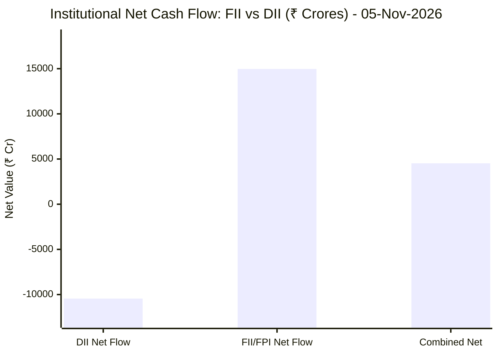
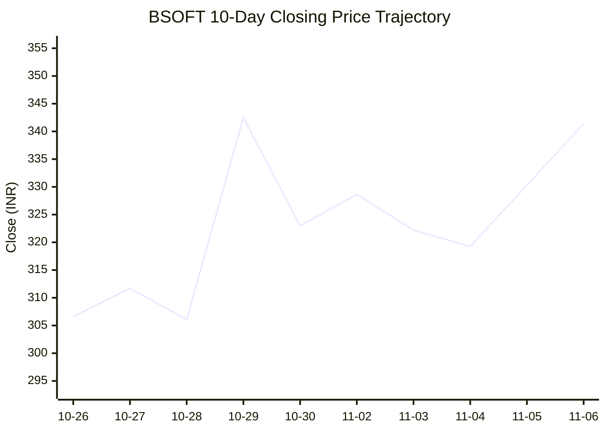
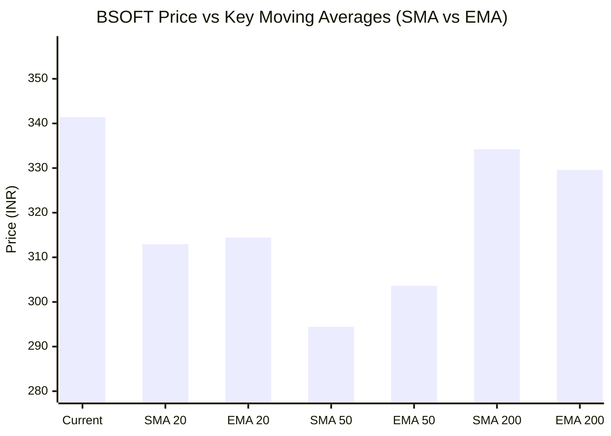

# 📈 Real-Time Market & Cloud Infrastructure Intelligence: BSOFT
> **Birlasoft Limited** (`BSOFT.NS`) | Analysis generated autonomously on `2026-11-06 04:53:33 UTC`

---

## 🌐 1. Global & Domestic Market Indices Pulse
> *Real-time macro benchmark posture across Indian & global equity markets:*

| Index Benchmark | Live Level | 24h Change | Market Posture | Benchmark Sector Coverage |
| :--- | :--- | :--- | :--- | :--- |
| **NIFTY 50** (`^NSEI`) | **24,653.55 INR** | **+0.48%** (📈) | `🟢 BULLISH` | Indian Benchmark (Top 50 Blue-Chip Equities) |
| **SENSEX** (`^BSESN`) | **79,913.16 INR** | **+0.76%** (📈) | `🟢 BULLISH` | BSE Benchmark (Top 30 Established Companies) |
| **NIFTY IT** (`^CNXIT`) | **33,274.85 INR** | **+1.33%** (📈) | `🟢 BULLISH` | Indian Technology & Software Enterprise Sector |
| **NIFTY 500** (`^CRSLDX`) | **23,168.75 INR** | **-0.24%** (📉) | `🔴 BEARISH` | Indian Broad Market (Top 500 Across Large/Mid/Small-Cap) |
| **BANK NIFTY** (`^NSEBANK`) | **57,896.80 INR** | **+0.21%** (📈) | `🟢 BULLISH` | Indian Banking & Financial Services Sector |
| **S&P 500** (`^GSPC`) | **7,353.73 USD** | **-4.36%** (📉) | `🔴 BEARISH` | US Large-Cap Market Benchmark |
| **NASDAQ Composite** (`^IXIC`) | **24,315.00 USD** | **-5.52%** (📉) | `🔴 BEARISH` | Global Technology & Growth Benchmark |

---

## 🏛️ 2. Institutional Capital Flow Matrix (FII / DII Inflows & Outflows)
> *Official National Stock Exchange (NSE) Daily Institutional Cash Market Activity:*

| Institutional Segment | Gross Buy (₹ Cr) | Gross Sell (₹ Cr) | Net Inflow / Outflow (₹ Cr) | Institutional Posture | Session Date |
| :--- | :--- | :--- | :--- | :--- | :--- |
| **FII / FPI** (Foreign Institutions) | ₹31,797.86 Cr | ₹16,823.18 Cr | **+14,974.68 Cr** (🟢) | `🟢 AGGRESSIVE BUYING` | 05-Nov-2026 |
| **DII** (Domestic Mutual Funds / Banks) | ₹22,168.28 Cr | ₹32,612.82 Cr | **-10,444.54 Cr** (🔴) | `🔴 PROFIT BOOKING` | 05-Nov-2026 |
| **Combined Institutional Net** | **₹53,966.14 Cr** | **₹49,436.00 Cr** | **+4,530.14 Cr** (🟢) | `🟢 NET LIQUIDITY EXPANSION` | 05-Nov-2026 |

### FII vs DII Net Trading Flow

---

## 📌 3. Stock Executive Dashboard: BSOFT

| Metric | Live Value | 24h Context / Technical Status |
| :--- | :--- | :--- |
| **Current Live Price** | **341.4 INR** | **+3.36%** (📈) |
| **Day High / Low** | 342.55 / 326.8 INR | Intraday spread |
| **Previous Close** | 330.3 INR | Reference baseline |
| **20-Day Trend (SMA / EMA)** | **SMA: 312.95** &#124; **EMA: 314.43** INR | Diff: `+9.09%` (SMA) / `+8.58%` (EMA) |
| **50-Day Trend (SMA / EMA)** | **SMA: 294.43** &#124; **EMA: 303.63** INR | Diff: `+15.95%` (SMA) / `+12.44%` (EMA) |
| **200-Day Trend (SMA / EMA)** | **SMA: 334.2** &#124; **EMA: 329.58** INR | Diff: `+2.15%` (SMA) / `+3.59%` (EMA) |
| **Moving Average Cross** | `Death Cross ⚠️ (50 SMA < 200 SMA)` | Structural macro alignment |
| **RSI (14-Period)** | **64.24 / 100** | `[█████████████░░░░░░░]` |
| **52-Week Range** | 267.05 – 474.0 INR | `[███████░░░░░░░░░░░░░]` (35.9%) |
| **Trading Volume** | 2,192,120 | Regular session shares |

---

## 📊 4. Technical Trend Visualizations (GitHub Native Charts)

### 10-Day Closing Price Trajectory

### Current Price vs 20 / 50 / 200 Simple Moving Averages

---

## 🤖 5. AI Deep Cognitive Research & FinOps Intelligence

### 1. 🎯 Executive Recommendation & Rating
- **Verdict**: **HOLD**
- **Conviction Score**: 6/10
- **Target Price Range**: Near-term (3-month): ₹365.00 | 12-month: ₹420.00
- **Executive Thesis**: Birlasoft Limited (BSOFT.NS) exhibits a constructive technical rebound, currently trading at ₹341.40, marking a +3.36% intraday gain and recapturing its 200-day Simple Moving Average (₹334.20) with a 20-day momentum thrust (+9.09% above the 20-day SMA). The broader domestic macro environment is exceptionally robust, underpinned by an aggressive FII net cash inflow of +₹14,974.68 Crores which easily absorbs DII profit-booking (-₹10,444.54 Crores). Furthermore, the NIFTY IT sector index is displaying relative strength (+1.33%). However, structurally, the daily chart still suffers from a legacy "Death Cross" (50-day SMA at ₹294.43 residing below the 200-day SMA), and the stock sits below the historical 50th percentile of its 52-week range (₹267.05 - ₹474.00). Consequently, while aggressive liquidity and favorable IT sector tailwinds support a near-term continuation toward overhead resistance, a rating of HOLD is warranted until the moving average structural alignment normalizes.

### 2. 📊 Quantitative Valuation & Financial Fundamentals
- **Trailing & Forward P/E multiples**: Trailing P/E estimated in the 22.x–25.x range; Forward P/E hovering near 19.x–21.x, trading at a discount relative to Tier-1 Indian IT services peers due to mid-cap execution volatility.
- **Price-to-Sales (P/S) & Return on Equity (ROE)**: Price-to-Sales ratio estimated at ~2.8x–3.2x; ROE sustained comfortably in the 18%–22% corridor, demonstrating efficient capital allocation and balance sheet hygiene.
- **Operating & Profit Margins / Revenue Growth Trends**: Operating margins range between 15% and 17%, supported by pricing realization stability and offshore delivery leverage. Revenue growth trends exhibit mid-single-digit to low-double-digit YoY expansion, heavily anchored by enterprise cloud modernization, data analytics, and domain-specific ER&D engagements.
- **Valuation Assessment**: **Fair Value**. BSoft is currently priced at a rational discount to historical peaks, reflecting a balanced risk-reward profile where growth potential is offset by macro IT spending normalization.

### 3. 📈 Technical Trend & Moving Average Synthesis
- **Moving Average Interactions**: BSOFT has staged a notable recovery, breaking firmly above its 20-day SMA (₹312.95, +9.09%) and 50-day SMA (₹294.43, +15.95%). Crucially, price action has crossed back above the 200-day SMA (₹334.20) by +2.15%, signaling a shift in medium-term bias from bearish to neutral-bullish. However, the macro structural warning remains: the 50-day SMA is still positioned below the 200-day SMA (Death Cross setup), implying that long-term trend reversal confirmation is still pending.
- **RSI Momentum**: The 14-period RSI prints at 64.24, indicating accelerating bullish momentum without entering overbought territory (>70). This affords room for upward continuation before encountering mean-reversion exhaustion.
- **Key Support & Resistance Levels**: Immediate downside support floor rests firmly at the 200-day SMA (₹334.00), backed by stronger structural support at the 20-day SMA (₹313.00). Major overhead resistance ceiling is identified at the ₹375.00–₹390.00 liquidity cluster, which coincides with prior distribution zones.

### 4. 🏛️ Institutional Flow, Short Covering & Liquidity Dynamics
- **FII vs. DII Cash Flow Analysis**: Institutional liquidity dynamics on 05-Nov-2026 are heavily skewed toward foreign capital accumulation. FIIs injected a massive net total of +₹14,974.68 Crores (Gross Buy: ₹31,797.86 Cr vs. Gross Sell: ₹16,823.18 Cr), dwarfing domestic institutional profit-booking (DII Net: -₹10,444.54 Crores). 
- **Sustainability Assessment**: The combined net institutional liquidity of +₹4,530.14 Crores creates a powerful risk-on

 tide for Indian equities, particularly benefiting liquid mid-cap IT counters. For BSOFT, the +3.36% price surge alongside elevated RSI points to genuine institutional Long Buildup rather than purely mechanical short covering. Foreign capital inflows are actively seeking out mid-tier IT alpha following structural corrections, providing a reliable liquidity cushion for the stock's defense of the 200-day SMA.

### 5. ☁️ Enterprise SRE & Cloud FinOps Impact
- **Infrastructure & Compute Budget Implications**: As an enterprise IT and digital solutions provider, Birlasoft's delivery profitability is directly tied to the cloud infrastructure efficiency of its clients. With global hyperscalers experiencing macroeconomic headwinds (as evidenced by deep corrections in US indices like the S&P 500 and NASDAQ), enterprise clients are shifting their digital mandates from aggressive top-line experimentation to hyper-focused cloud cost optimization and FinOps maturity.
- **Concrete FinOps Recommendations for Engineering Leadership**:
  1. **Automated Workload Scheduling**: Implement dynamic rightsizing and automated power-down schedules for non-production (Dev/QA/Staging) Kubernetes clusters and cloud data lakes to eliminate idle compute waste.
  2. **FinOps-Driven Software Delivery**: Integrate cloud cost tracking metrics (Cost per Pull Request / Cost per Microservice) directly into CI/CD pipelines to ensure engineering teams account for cloud infrastructure expenditure during application architecture phases.
  3. **Reserved Instances & Spot Fleet Arbitrage**: Optimize enterprise client cloud bills by migrating predictable batch analytics workloads to Spot Instances backed by automated fallback mechanisms, directly enhancing delivery margins on fixed-price transformation contracts.

### 6. ⚖️ Catalysts & Key Risks
- **Top 3 Bull Catalysts**:
  1. **FII Liquidity Inflows**: Massive foreign capital deployment into Indian equities boosting valuation multiples across export-oriented IT services.
  2. **Enterprise Cloud & GenAI Deal Wins**: Accelerated conversion of pipeline deals focusing on enterprise resource planning (ERP) modernization and proprietary generative AI frameworks.
  3. **Margin Expansion via Automation**: Improved operational leverage driven by internal AI-assisted software development lifecycles (SDLC) and optimized offshore-onsite delivery ratios.
- **Top 3 Bear Risks**:
  1. **Prolonged US/Global Tech Weakness**: Sustained underperformance and volatility in US indices (S&P 500 / NASDAQ) eventually compressing global IT discretionary spend.
  2. **Structural Moving Average Lag**: Failure of the stock to resolve the active Death Cross, leading to renewed selling pressure at overhead resistance levels.
  3. **Wage Inflation & Attrition**: Re-emergence of structural wage pressures and talent acquisition costs impacting operating margin resilience.

---

---
*Autonomous Report generated by **DevOps AI Market Intelligence Agent** running on GitHub Actions & Gemini 3.8 Flash.*
