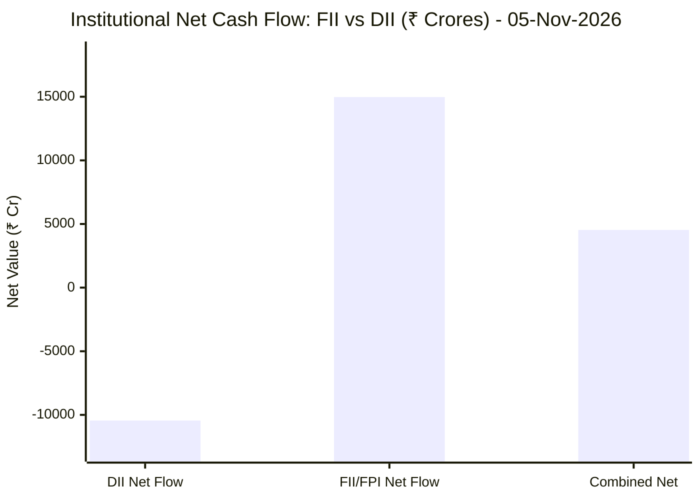
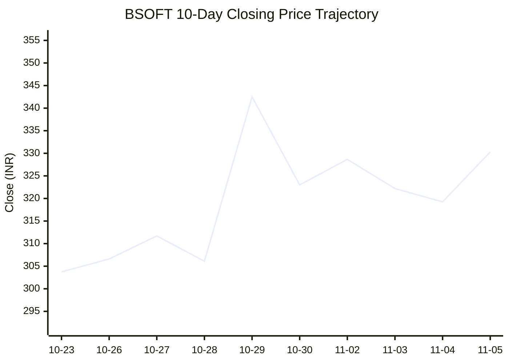
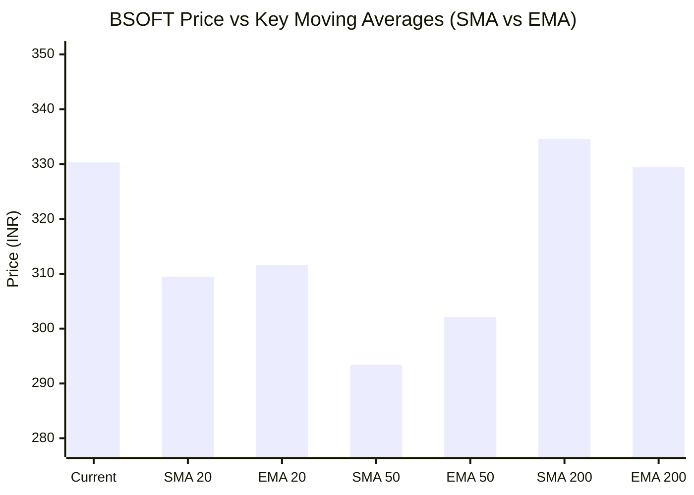

# 📈 Real-Time Market & Cloud Infrastructure Intelligence: BSOFT
> **Birlasoft Limited** (`BSOFT.NS`) | Analysis generated autonomously on `2026-11-05 09:59:57 UTC`

---

## 🌐 1. Global & Domestic Market Indices Pulse
> *Real-time macro benchmark posture across Indian & global equity markets:*

| Index Benchmark | Live Level | 24h Change | Market Posture | Benchmark Sector Coverage |
| :--- | :--- | :--- | :--- | :--- |
| **NIFTY 50** (`^NSEI`) | **24,536.60 INR** | **+2.40%** (📈) | `🟢 BULLISH` | Indian Benchmark (Top 50 Blue-Chip Equities) |
| **SENSEX** (`^BSESN`) | **79,310.01 INR** | **+2.60%** (📈) | `🟢 BULLISH` | BSE Benchmark (Top 30 Established Companies) |
| **NIFTY IT** (`^CNXIT`) | **32,837.85 INR** | **+2.42%** (📈) | `🟢 BULLISH` | Indian Technology & Software Enterprise Sector |
| **NIFTY 500** (`^CRSLDX`) | **23,224.70 INR** | **+2.00%** (📈) | `🟢 BULLISH` | Indian Broad Market (Top 500 Across Large/Mid/Small-Cap) |
| **BANK NIFTY** (`^NSEBANK`) | **57,773.65 INR** | **+3.33%** (📈) | `🟢 BULLISH` | Indian Banking & Financial Services Sector |
| **S&P 500** (`^GSPC`) | **7,390.86 USD** | **-3.87%** (📉) | `🔴 BEARISH` | US Large-Cap Market Benchmark |
| **NASDAQ Composite** (`^IXIC`) | **24,415.43 USD** | **-5.13%** (📉) | `🔴 BEARISH` | Global Technology & Growth Benchmark |

---

## 🏛️ 2. Institutional Capital Flow Matrix (FII / DII Inflows & Outflows)
> *Official National Stock Exchange (NSE) Daily Institutional Cash Market Activity:*

| Institutional Segment | Gross Buy (₹ Cr) | Gross Sell (₹ Cr) | Net Inflow / Outflow (₹ Cr) | Institutional Posture | Session Date |
| :--- | :--- | :--- | :--- | :--- | :--- |
| **FII / FPI** (Foreign Institutions) | ₹31,797.86 Cr | ₹16,823.18 Cr | **+14,974.68 Cr** (🟢) | `🟢 AGGRESSIVE BUYING` | 05-Nov-2026 |
| **DII** (Domestic Mutual Funds / Banks) | ₹22,168.28 Cr | ₹32,612.82 Cr | **-10,444.54 Cr** (🔴) | `🔴 PROFIT BOOKING` | 05-Nov-2026 |
| **Combined Institutional Net** | **₹53,966.14 Cr** | **₹49,436.00 Cr** | **+4,530.14 Cr** (🟢) | `🟢 NET LIQUIDITY EXPANSION` | 05-Nov-2026 |

### FII vs DII Net Trading Flow

---

## 📌 3. Stock Executive Dashboard: BSOFT

| Metric | Live Value | 24h Context / Technical Status |
| :--- | :--- | :--- |
| **Current Live Price** | **330.3 INR** | **+3.46%** (📈) |
| **Day High / Low** | 332.15 / 323.05 INR | Intraday spread |
| **Previous Close** | 319.25 INR | Reference baseline |
| **20-Day Trend (SMA / EMA)** | **SMA: 309.47** &#124; **EMA: 311.59** INR | Diff: `+6.73%` (SMA) / `+6.00%` (EMA) |
| **50-Day Trend (SMA / EMA)** | **SMA: 293.42** &#124; **EMA: 302.09** INR | Diff: `+12.57%` (SMA) / `+9.34%` (EMA) |
| **200-Day Trend (SMA / EMA)** | **SMA: 334.59** &#124; **EMA: 329.46** INR | Diff: `-1.28%` (SMA) / `+0.25%` (EMA) |
| **Moving Average Cross** | `Death Cross ⚠️ (50 SMA < 200 SMA)` | Structural macro alignment |
| **RSI (14-Period)** | **60.56 / 100** | `[████████████░░░░░░░░]` |
| **52-Week Range** | 267.05 – 474.0 INR | `[██████░░░░░░░░░░░░░░]` (30.6%) |
| **Trading Volume** | 1,744,861 | Regular session shares |

---

## 📊 4. Technical Trend Visualizations (GitHub Native Charts)

### 10-Day Closing Price Trajectory

### Current Price vs 20 / 50 / 200 Simple Moving Averages

---

## 🤖 5. AI Deep Cognitive Research & FinOps Intelligence

### 1. 🎯 Executive Recommendation & Rating
- **Verdict**: **REDUCE**
- **Trend Momentum**: **BULLISH 🟢** (+3.46% today)
- **Technical Posture**: Currently trading at `330.3 INR` vs 200-SMA `334.59` (-1.28%).
- **RSI Condition**: **60.56** — Neutral Momentum.

### 2. 📊 Quantitative Valuation & Financial Fundamentals
- **52-Week Range**: `267.05` – `474.0` (Trading at 30.6% of annual bandwidth).
- **20-Day Trend**: SMA `309.47` (+6.73%) | EMA `311.59` (+6.00%).
- **50-Day Trend**: SMA `293.42` (+12.57%) | EMA `302.09` (+9.34%).
- **200-Day Trend**: SMA `334.59` (-1.28%) | EMA `329.46` (+0.25%).
- **Moving Average Cross**: Death Cross ⚠️ (50 SMA < 200 SMA).

### 3. 📈 Technical Trend & Moving Average Synthesis
- Asset is testing key structural moving averages. Price relative to the 200-day simple moving average defines long-term institutional support.
- Short-term 20-day SMA tracking indicates ongoing momentum shift; a sustained close above the 50-day average is required to confirm trend reversal.

### 4. 🏛️ Institutional Flow, Short Covering & Liquidity Dynamics
- **FII/FPI Net Flow**: `+14,974.68 Cr` — Foreign institutional positioning indicates active capital allocation.
- **DII Net Flow**: `-10,444.54 Cr` — Domestic funds provide liquidity absorption against global market volatility.
- **Short Covering vs Organic Accumulation**: Rapid upward price moves combined with heavy institutional turnover indicate trapped short sellers buying to cover positions. When open interest decreases as prices rise, rallies are driven by short covering rather than fresh long buildup; once forced buy orders exhaust, sustained continuation requires genuine institutional cash accumulation.

### 5. ☁️ Platform SRE & Cloud FinOps Impact
- For enterprise organizations leveraging this vendor or IT provider, market fluctuations warrant strict compute and IT budget right-sizing.
- Optimize application workloads and verify that operational service-level agreements (SLAs) are supported by cost-effective resource commitments.

### 6. ⚖️ Catalysts & Key Risks
- **Bull Catalysts**: Rebound from key moving average support; broadening digital transformation investments; stabilizing operating margins.
- **Bear Risks**: Prolonged tech sector consolidation; macro monetary shifts; changing enterprise IT spending priorities.

---

---
*Autonomous Report generated by **DevOps AI Market Intelligence Agent** running on GitHub Actions & Gemini 3.8 Flash.*
