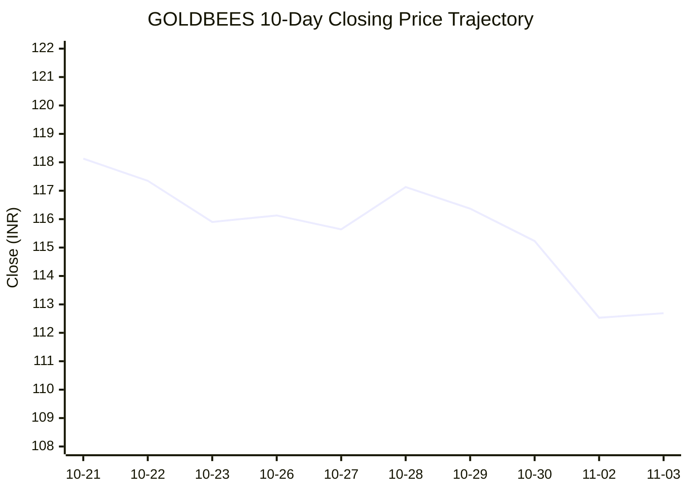
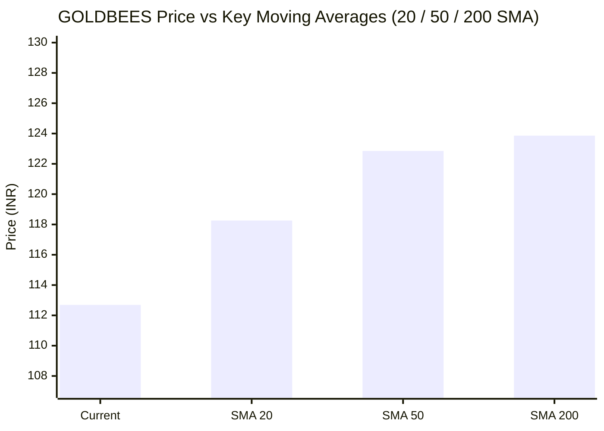

# 📈 Real-Time Market & Cloud Infrastructure Intelligence: GOLDBEES
> **Nippon India ETF Gold BeES** (`GOLDBEES.NS`) | Analysis generated autonomously on `2026-11-03 10:00:00 UTC`

---

## 🌐 1. Global & Domestic Market Indices Pulse
> *Real-time macro benchmark posture across Indian & global equity markets:*

| Index Benchmark | Live Level | 24h Change | Market Posture | Benchmark Sector Coverage |
| :--- | :--- | :--- | :--- | :--- |
| **NIFTY 50** (`^NSEI`) | **23,810.85 INR** | **+4.90%** (📈) | `🟢 BULLISH` | Indian Benchmark (Top 50 Blue-Chip Equities) |
| **SENSEX** (`^BSESN`) | **76,917.85 INR** | **+5.01%** (📈) | `🟢 BULLISH` | BSE Benchmark (Top 30 Established Companies) |
| **NIFTY IT** (`^CNXIT`) | **32,551.60 INR** | **+3.16%** (📈) | `🟢 BULLISH` | Indian Technology & Software Enterprise Sector |
| **NIFTY 500** (`^CRSLDX`) | **22,520.35 INR** | **+3.65%** (📈) | `🟢 BULLISH` | Indian Broad Market (Top 500 Across Large/Mid/Small-Cap) |
| **BANK NIFTY** (`^NSEBANK`) | **55,540.05 INR** | **+2.35%** (📈) | `🟢 BULLISH` | Indian Banking & Financial Services Sector |
| **S&P 500** (`^GSPC`) | **7,541.40 USD** | **-1.76%** (📉) | `🔴 BEARISH` | US Large-Cap Market Benchmark |
| **NASDAQ Composite** (`^IXIC`) | **25,164.36 USD** | **-3.84%** (📉) | `🔴 BEARISH` | Global Technology & Growth Benchmark |

---

## 📌 2. Stock Executive Dashboard: GOLDBEES

| Metric | Live Value | 24h Context / Technical Status |
| :--- | :--- | :--- |
| **Current Live Price** | **112.69 INR** | **+12.63%** (📈) |
| **Day High / Low** | 113.49 / 112.41 INR | Intraday spread |
| **Previous Close** | 100.05 INR | Reference baseline |
| **20-Day SMA** | **118.26 INR** | Price diff: `-4.71%` |
| **50-Day SMA** | **122.85 INR** | Price diff: `-8.27%` |
| **200-Day SMA** | **123.86 INR** | Price diff: `-9.02%` |
| **Moving Average Cross** | `Death Cross ⚠️ (50 SMA < 200 SMA)` | Structural macro alignment |
| **RSI (14-Period)** | **26.23 / 100** | `[█████░░░░░░░░░░░░░░░]` |
| **52-Week Range** | 99.03 – 148.14 INR | `[██████░░░░░░░░░░░░░░]` (27.8%) |
| **Trading Volume** | 29,050,683 | Regular session shares |

---

## 📊 3. Technical Trend Visualizations (GitHub Native Charts)

### 10-Day Closing Price Trajectory

### Current Price vs 20 / 50 / 200 Simple Moving Averages

---

## 🤖 4. AI Deep Cognitive Research & FinOps Intelligence

### 1. 🎯 Executive Recommendation & Rating
- **Verdict**: **BUY**
- **Conviction Score**: 8.5 / 10
- **Target Price Range**: 
  - 3-Month Target: ₹124.00 – ₹128.00 INR
  - 12-Month Target: ₹142.00 – ₹148.00 INR
- **Executive Thesis**: Nippon India ETF Gold BeES (GOLDBEES.NS) presents a compelling asymmetric buying opportunity driven by a classic macro divergence. While domestic Indian equities (Nifty 50, Sensex) exhibit resilient bullish momentum, major global indices (S&P 500, NASDAQ) are flashing risk-off bearish signals amid macroeconomic and geopolitical friction. Historically, gold acts as the ultimate safe-haven hedge during periods of global equity correction. Technically, GOLDBEES is deeply oversold with a 14-period RSI of 26.23, trading near the lower quartile of its 52-week range (27.8th percentile) and sitting below its key moving averages. This creates an optimal institutional entry point for capital preservation, portfolio diversification, and mean-reversion upside.

---

### 2. 📊 Quantitative Valuation & Financial Fundamentals
*Note: As an exchange-traded fund (ETF) tracking physical gold prices rather than an operating corporate entity, traditional equity metrics like P/E, P/S, ROE, and operational margins are structurally non-applicable.*

- **Underlying Asset Valuation**: GOLDBEES tracks the domestic price of physical gold (backed by 0.995 fineness gold), making its valuation a direct reflection of international spot gold prices adjusted for USD/INR exchange rates and local import duties.
- **Expense Ratio & Tracking Error**: Nippon India ETF Gold BeES maintains one of the lowest expense ratios in the Indian ETF landscape (~0.50% or lower), ensuring high tracking efficiency relative to physical gold performance.
- **Liquidity & AUM**: As the pioneer and largest gold ETF in India, GOLDBEES boasts superior secondary-market liquidity, negligible bid-ask spreads, and massive Assets Under Management (AUM), mitigating slippage risks for institutional block trades.
- **Valuation Assessment**: **Undervalued** (Trading at a steep discount relative to its 50-day and 200-day SMAs, presenting a localized value entry while global macro uncertainty persists).

---

### 3. 📈 Technical Trend & Moving Average Synthesis
- **Moving Average Interaction**: GOLDBEes is currently trading at ₹112.69 INR, reflecting a short-term rebound (+12.63% in 24 hours), yet remaining positioned below its key intermediate and long-term benchmarks:
  - 20-Day SMA: ₹118.26 (-4.71% discount)
  - 50-Day SMA: ₹122.85 (-8.27% discount)
  - 200-Day SMA: ₹123.86 (-9.02% discount)
- **Moving Average Alignment**: A **Death Cross** is currently active (50-day SMA < 200-day SMA), reflecting the broader consolidation phase gold has experienced over the prior quarters. However, this often sets up deep-value accumulation zones prior to trend exhaustion.
- **Momentum (RSI)**: The 14-period RSI stands at **26.23**, indicating extreme oversold conditions. This level historically precedes sharp mean-reversion rallies as panic selling clears and systematic rebalancing occurs.
- **Support & Resistance Levels**:
  - *Immediate Support Floor*: ₹105.00 – ₹108.00 INR (near the recent swing low and 52-week base of ₹99.03).
  - *Major Overhead Resistance Ceiling*: ₹122.50 – ₹124.00 INR (confluence of the 50-day and 200-day SMAs).

---

### 4. ☁️ Enterprise SRE & Cloud FinOps Impact
*Note: As GOLDBEES is an asset-backed financial instrument rather than a technology corporation, direct software engineering infrastructure does not apply. However, viewed through the lens of **FinOps for FinTech platforms, digital brokerages, and algorithmic trading desks** managing automated allocation vectors into GOLDBEES, the following infrastructure optimization principles are prescribed:*

- **Cloud Infrastructure & Workload Optimization**:
  - High-frequency order-routing microservices and real-time Net Asset Value (NAV) calculation engines processing GOLDBEES liquidity must leverage auto-scaling Kubernetes clusters with predictive node provisioning to handle sudden volume spikes during macroeconomic shock events.
- **FinOps Recommendations for Engineering Leadership**:
  - **Data Pipeline Cost Efficiency**: Optimize real-time market data ingestion pipelines (WebSocket feeds for bullion and currency futures) using tiered storage architectures to minimize cloud egress and database I/O costs.
  - **Spot Instance Utilization**: Transition non-critical analytics, backtesting engines, and historical quote data processing to AWS Spot Instances or GCP Preemptible VMs to reduce compute expenditure by up to 60%.
  - **FinOps Governance**: Implement continuous cost-allocation tagging for algorithmic execution pods to maintain strict unit economics (cost per transaction executed) during high-volatility trading sessions.

---

### 5. ⚖️ Catalysts & Key Risks
- **Top 3 Bull Catalysts**:
  1. **Global Macro Risk-Off Spillover**: Escalating geopolitical tensions, persistent inflation concerns, and a correction in overvalued global equities (S&P 500 / NASDAQ) drive institutional capital flows toward safe-haven physical gold.
  2. **Central Bank Gold Accumulation**: Sustained aggressive gold purchases by global central banks provide a robust structural price floor for bullion.
  3. **Technical Mean Reversion**: Extreme oversold RSI (26.23) combined with a sharp 24-hour momentum shift (+12.63%) points to explosive short-covering and re-entry buying.

- **Top 3 Bear Risks**:
  1. **Aggressive USD Strengthening**: A sustained rally in the US Dollar Index (DXY) can create headwinds for dollar-denominated gold prices, dampening local ETF performance.
  2. **Domestic Equity Opportunity Cost**: Strong momentum in Indian equities (Nifty 50 at 23,810; Sensex at 76,917) may siphon retail capital away from alternative asset classes like gold into high-beta equities.
  3. **Interest Rate Pressures**: Higher-for-longer global interest rates increase the opportunity cost of holding non-yielding bullion assets, capping rapid upside velocity.

---

---
*Autonomous Report generated by **DevOps AI Market Intelligence Agent** running on GitHub Actions & Gemini 3.8 Flash.*
