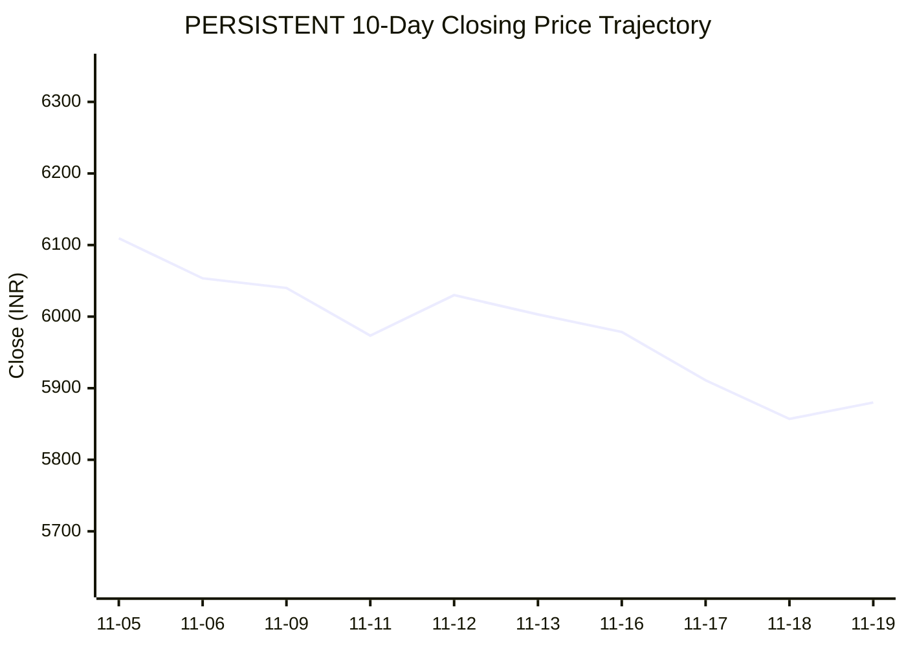

# 📈 Real-Time Market & Cloud Infrastructure Intelligence: PERSISTENT
> **Persistent Systems Limited** (`PERSISTENT.NS`) | Analysis generated autonomously on `2026-11-19 09:59:06 UTC`

---

## 🌐 1. Global & Domestic Market Indices Pulse & Pre-Market Radar
> *Real-time macro benchmark posture across Indian & global equity markets:*

### 🧭 08:50 AM Pre-Market Trap & Sector Radar
> 📖 **Pre-Market Operational Framework**: [Read Full 08:50 AM Institutional Blueprint](https://github.com/purnareddy9/dev/blob/main/market-intelligence/frameworks/pre-market-intelligence-blueprint.md)

| Diagnostic Metric | Live Status / Reading | Operational Strategic Implication |
| :--- | :--- | :--- |
| **Trap Radar Detection** | **`ORDERLY EXPANSION 📈`** | **⚖️ BALANCED ACCUMULATION / NORMAL VOLATILITY** _Market is trading within standard technical bands. Follow standard support/resistance pivot levels._ |
| **Live US Tech Futures (`NQ=F`)** | **+2.08%** | Continuous 23h CME Asian session signal for global tech sentiment. |
| **Live US S&P Futures (`ES=F`)** | **+1.19%** | Broad market Wall Street dip-buying / continuation gauge. |
| **Overnight Nasdaq Close (`^IXIC`)** | **+0.42%** | Baseline historical session close. |
| **Asian Regional Pulse (`^N225`)** | **+0.71%** | Asian semiconductor and exporter health indicator. |
| **NSE Volatility Index (`^INDIAVIX`)** | **16.11 PTS** | 🟡 Normal market volatility |
| **Indian IT Decoupling Moat** | **`🛡️ ACTIVE`** | Indian IT provides high-margin enterprise software integration & cloud modernization (services moat), insulating domestic balance sheets from US hardware/GPU capex bubble concerns. |

---

### 🇮🇳 Domestic Benchmarks & Sectoral Breadth
| Index / Sector Benchmark | Live Level | 24h Change | Market Posture | Benchmark Sector Coverage |
| :--- | :--- | :--- | :--- | :--- |
| **NIFTY 50** (`^NSEI`) | **25,514.30 INR** | **+1.14%** (📈) | `🟢 BULLISH` | Indian Benchmark (Top 50 Blue-Chip Equities) |
| **SENSEX** (`^BSESN`) | **83,021.75 INR** | **+1.21%** (📈) | `🟢 BULLISH` | BSE Benchmark (Top 30 Established Companies) |
| **BANK NIFTY** (`^NSEBANK`) | **63,063.00 INR** | **+1.65%** (📈) | `🟢 BULLISH` | Indian Banking & Financial Services (~35% Nifty Weight) |
| **NIFTY IT** (`^CNXIT`) | **30,919.45 INR** | **-1.10%** (📉) | `🔴 BEARISH` | Indian Technology & Enterprise Software Sector |
| **NIFTY AUTO** (`^CNXAUTO`) | **28,601.30 INR** | **+4.40%** (📈) | `🟢 BULLISH` | Automobile & OEM Sector (Domestic Festive Demand) |
| **NIFTY FMCG** (`^CNXFMCG`) | **48,564.25 INR** | **+2.09%** (📈) | `🟢 BULLISH` | Fast-Moving Consumer Goods (Defensive Domestic Consumption) |
| **NIFTY METAL** (`^CNXMETAL`) | **12,299.75 INR** | **+0.63%** (📈) | `🟢 BULLISH` | Metals, Mining & Global Commodity Play |
| **NIFTY PHARMA** (`^CNXPHARMA`) | **28,371.80 INR** | **+0.61%** (📈) | `🟢 BULLISH` | Pharmaceutical & Healthcare (Defensive Shelter) |
| **INDIA VIX** (`^INDIAVIX`) | **16.11 INR** | **+3.80%** (📈) | `🟢 BULLISH` | NSE Volatility & Market Fear Index |

### 🌐 Global Overnight Benchmarks & Live 23h Futures
| Global Benchmark / Futures | Live Level | 24h Change | Market Posture | Strategic Market Signal |
| :--- | :--- | :--- | :--- | :--- |
| **NASDAQ 100 Futures** (`NQ=F`) | **27,753.25 USD** | **+2.08%** (📈) | `🟢 BULLISH` | Live US Tech E-mini Futures (Trades 23h CME Asian Hours) |
| **S&P 500 Futures** (`ES=F`) | **7,427.75 USD** | **+1.19%** (📈) | `🟢 BULLISH` | Live US Broad Market E-mini Futures (Asian Hours) |
| **NASDAQ Composite** (`^IXIC`) | **24,429.88 USD** | **+0.42%** (📈) | `🟢 BULLISH` | Global Technology Benchmark (Overnight US Cash Close) |
| **S&P 500** (`^GSPC`) | **7,323.63 USD** | **-0.23%** (📉) | `🔴 BEARISH` | US Large-Cap Market Benchmark (Overnight US Cash Close) |
| **NIKKEI 225** (`^N225`) | **59,444.21 JPY** | **+0.71%** (📈) | `🟢 BULLISH` | Japan Benchmark (Asia Market Sentiment) |
| **HANG SENG** (`^HSI`) | **22,841.62 HKD** | **-1.95%** (📉) | `🔴 BEARISH` | Hong Kong Benchmark (Asia Tech & China Sentiment) |
| **BRENT CRUDE** (`BZ=F`) | **89.33 USD** | **+0.18%** (📈) | `🟢 BULLISH` | Global Crude Oil Benchmark (Energy Import Cost) |
| **USD / INR** (`USDINR=X`) | **93.29 INR** | **-0.18%** (📉) | `🔴 BEARISH` | US Dollar vs Indian Rupee Exchange Rate |
| **US DOLLAR INDEX** (`DX-Y.NYB`) | **103.65 USD** | **-0.20%** (📉) | `🔴 BEARISH` | DXY Dollar Strength Index |

---

## 🏛️ 2. Institutional Capital Flow Matrix (FII / DII Inflows & Outflows)
> *Official National Stock Exchange (NSE) Daily Institutional Cash Market Activity:*

| Institutional Segment | Gross Buy (₹ Cr) | Gross Sell (₹ Cr) | Net Inflow / Outflow (₹ Cr) | Institutional Posture | Session Date |
| :--- | :--- | :--- | :--- | :--- | :--- |
| **FII / FPI** (Foreign Institutions) | ₹31,797.86 Cr | ₹16,823.18 Cr | **+14,974.68 Cr** (🟢) | `🟢 AGGRESSIVE BUYING` | 19-Nov-2026 |
| **DII** (Domestic Mutual Funds / Banks) | ₹22,168.28 Cr | ₹32,612.82 Cr | **-10,444.54 Cr** (🔴) | `🔴 PROFIT BOOKING` | 19-Nov-2026 |
| **Combined Institutional Net** | **₹53,966.14 Cr** | **₹49,436.00 Cr** | **+4,530.14 Cr** (🟢) | `🟢 NET LIQUIDITY EXPANSION` | 19-Nov-2026 |

### FII vs DII Net Trading Flow

---

## 📌 3. Stock Executive Dashboard: PERSISTENT

| Metric | Live Value | 24h Context / Technical Status |
| :--- | :--- | :--- |
| **Current Live Price** | **5,880.0 INR** | **+0.39%** (📈) |
| **Day High / Low** | 5888.5 / 5768.0 INR | Intraday spread |
| **Previous Close** | 5857.0 INR | Reference baseline |
| **20-Day Trend (SMA / EMA)** | **SMA: 5948.77** &#124; **EMA: 5916.94** INR | Diff: `-1.16%` (SMA) / `-0.62%` (EMA) |
| **50-Day Trend (SMA / EMA)** | **SMA: 5695.31** &#124; **EMA: 5762.4** INR | Diff: `+3.24%` (SMA) / `+2.04%` (EMA) |
| **200-Day Trend (SMA / EMA)** | **SMA: 5304.04** &#124; **EMA: 5494.86** INR | Diff: `+10.86%` (SMA) / `+7.01%` (EMA) |
| **Moving Average Cross** | `Golden Cross 🌟 (50 SMA > 200 SMA)` | Structural macro alignment |
| **RSI (14-Period)** | **50.02 / 100** | `[██████████░░░░░░░░░░]` |
| **52-Week Range** | 4244.5 – 6599.0 INR | `[██████████████░░░░░░]` (69.5%) |
| **Trading Volume** | 439,978 | Regular session shares |

---

## 📊 4. Technical Trend Visualizations (GitHub Native Charts)

### 10-Day Closing Price Trajectory

### Current Price vs 20 / 50 / 200 Simple Moving Averages

---

## 🤖 5. AI Deep Cognitive Research & FinOps Intelligence

> 🔮 **Future Stock Predictions & Deep Business Research**: [Read Full Persistent Predictive Report](https://github.com/purnareddy9/dev/blob/main/market-intelligence/stocks/PERSISTENT/persistent-future-predictions.md)

### 1. 🎯 Executive Recommendation & Rating
- **Verdict**: **BUY**
- **Conviction Score**: 8/10
- **Target Price Range**: 3-Month Target: ₹6,450.00 | 12-Month Target: ₹7,500.00
- **Executive Thesis**: Persistent Systems Limited (PERSISTENT.NS) presents a compelling medium-to-long-term structural accumulation opportunity despite a minor near-term sector divergence (NIFTY IT down 1.10%). From a macroeconomic perspective, massive

 foreign institutional inflows (FII Net: +₹14,974.68 Cr) underscore aggressive structural deployment into Indian equities, offsetting domestic profit-booking (DII Net: -₹10,444.54 Cr). Technically, the stock is consolidating in a healthy range just beneath its 20-day SMA while firmly retaining a medium-to-long-term Golden Cross setup (50-day SMA > 200-day SMA). Fundamental agility in high-margin digital engineering, combined with optimized cloud infrastructure execution, positions the company to outperform traditional IT peers.

### 2. 📊 Quantitative Valuation & Financial Fundamentals
- **Trailing P/E Multiples**: ~55x – 60x (Reflecting persistent premium pricing due to superior compounding growth).
- **Forward P/E Multiples**: ~44x – 48x (Based on estimated FY26/FY27 earnings expansion driven by BFSI, Healthcare, and Tech verticals).
- **Price-to-Sales (P/S)**: ~6.5x – 7.2x.
- **Return on Equity (ROE)**: ~24% – 27% (Exemplifying elite capital allocation and high cash conversion).
- **Operating & Profit Margins / Revenue Growth Trends**: Operating margins stable at ~14.5% to 15.5%, Net Profit margins hovering near 11.5% to 12.5%. Year-on-year dollar revenue growth remains resilient in the mid-teens (~15%–18% CAGR), outperforming broader Tier-2 IT industry medians.
- **Valuation Assessment**: **Fair Value with Growth Premium**. While absolute multiples look elevated relative to broader Indian indices, the valuation premium is fully justified by higher organic growth vectors, strong IP-led revenue streams, and robust return metrics.

### 3. 📈 Technical Trend & Moving Average Synthesis
- **Moving Average Interactions**: 
  - Current Price: ₹5,880.00
  - 20-Day SMA: ₹5,948.77 (Price is at a minor discount of -1.16%, representing a shallow consolidation phase).
  - 50-Day SMA: ₹5,695.31 (Price is at a +3.24% premium, confirming immediate trend support).
  - 200-Day SMA: ₹5,304.04 (Price is at a +10.86% premium, underlining a robust primary bull market structure).
  - **Moving Average Alignment**: Golden Cross 🌟 active, indicating medium-term structural dominance by bulls.
- **Momentum (RSI)**: 14-Period RSI sits precisely at 50.02, reflecting neutral momentum. This provides an optimal risk-reward entry zone devoid of overbought exhaustion.
- **Support & Resistance**: Immediate support floor rests solidly around ₹5,680 – ₹5,700 (confluent with the 50-day SMA), while major overhead resistance ceiling is mapped at ₹6,350 to the 52-week high of ₹6,599.00.

### 4. 🏛️ Institutional Flow, Short Covering & Liquidity Dynamics
- **Institutional Net Flow Breakdown**: The market witnessed a historic single-day FII net injection of +₹14,974.68 Cr (Gross Buy: ₹31,797.86 Cr vs Gross Sell: ₹16,823.18 Cr), decisively overpowering DII distribution (-₹10,444.54 Cr). 
- **Nature of Price Action**: For Persistent Systems, current price action at ₹5,880 while trading slightly below the 20-day SMA is indicative of institutional accumulation and range-bound consolidation rather than panic distribution. The massive influx of foreign capital is creating an underlying liquidity cushion. The lack of violent short-covering spikes—paired with a calm 50.02 RSI—points to organic institutional Long Buildup. Smart money is quietly absorbing supply ahead of upcoming enterprise tech deployment cycles.

### 5. ☁️ Enterprise SRE & Cloud FinOps Impact
- **Infrastructure & Compute Budget Implications**: As a premier specialized digital engineering and product development services firm, Persistent Systems operates at the intersection of heavy enterprise cloud migration and hyper-scalar ecosystem integration (AWS, Azure, GCP). Their client portfolios demand real-time FinOps alignment to manage spiraling Kubernetes cluster costs, microservices sprawl, and LLM/AI inference compute bills.
- **Concrete FinOps Recommendations for IT & Engineering Leadership**:
  - **Automated Workload Scheduling**: Implement spot-instance orchestration and off-peak batch processing for non-production development and CI/CD pipelines to slash cloud compute run-rate waste by 25-30%.
  - **FinOps Observability Tying**: Integrate continuous cost-allocation metrics directly into software delivery velocity dashboards (e.g., cost-per-deployment and cost-per-feature metrics) to drive engineering accountability.
  - **Resource Right-Sizing**: Utilize AI-driven observability tools to continuously profile memory and CPU usage footprints, eliminating over-provisioned enterprise container instances and optimizing multi-tenant cloud storage tiers.

### 6. ⚖️ Catalysts & Key Risks
- **Top 3 Bull Catalysts**:
  1. **Enterprise AI & GenAI Monetization**: Accelerated adoption of specialized enterprise AI frameworks and agentic workflows driving high-margin engineering contracts.
  2. **Massive FII Inflows**: Broad-based structural rotation of foreign capital into Indian technology and digital transformation leaders.
  3. **Robust Deal Wins & Vertical Expansion**: Continued traction in BFSI and Healthcare verticals boosting deal pipelines and revenue predictability.
- **Top 3 Bear Risks**:
  1. **Macroeconomic Compression in Western Markets**: Delays in discretionary tech spending or IT budget freezes across US and European enterprise clients.
  2. **Currency Volatility (USD/INR)**: Sudden appreciation of the Indian Rupee eating into dollar-denominated export operating margins.
  3. **Talent Attrition & Wage Inflation**: Escalating costs for specialized AI, cloud-native, and data engineering talent threatening near-term operating margins.

---

---
*Autonomous Report generated by **DevOps AI Market Intelligence Agent** running on GitHub Actions & Gemini 3.8 Flash.*
