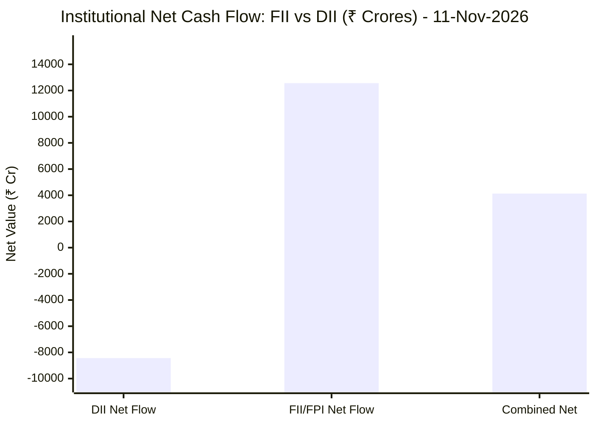
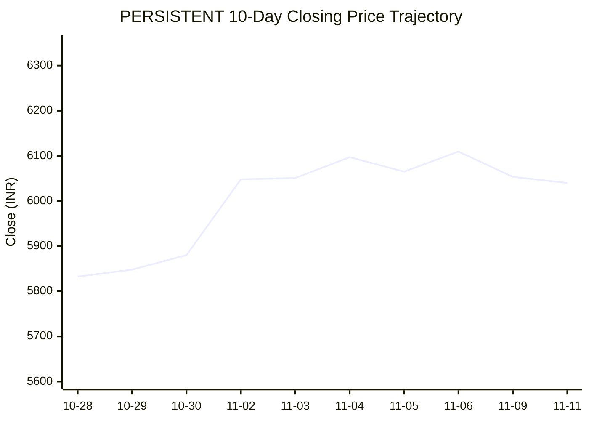

# 📉 Real-Time Market & Cloud Infrastructure Intelligence: PERSISTENT
> **Persistent Systems Limited** (`PERSISTENT.NS`) | Analysis generated autonomously on `2026-11-11 09:59:55 UTC`

---

## 🌐 1. Global & Domestic Market Indices Pulse & Pre-Market Radar
> *Real-time macro benchmark posture across Indian & global equity markets:*

### 🧭 08:50 AM Pre-Market Trap & Sector Radar
> 📖 **Pre-Market Operational Framework**: [Read Full 08:50 AM Institutional Blueprint](https://github.com/purnareddy9/dev/blob/main/market-intelligence/frameworks/pre-market-intelligence-blueprint.md)

| Diagnostic Metric | Live Status / Reading | Operational Strategic Implication |
| :--- | :--- | :--- |
| **Trap Radar Detection** | **`ORDERLY EXPANSION 📈`** | **⚖️ BALANCED ACCUMULATION / NORMAL VOLATILITY** _Market is trading within standard technical bands. Follow standard support/resistance pivot levels._ |
| **Live US Tech Futures (`NQ=F`)** | **+2.28%** | Continuous 23h CME Asian session signal for global tech sentiment. |
| **Live US S&P Futures (`ES=F`)** | **+1.35%** | Broad market Wall Street dip-buying / continuation gauge. |
| **Overnight Nasdaq Close (`^IXIC`)** | **+1.60%** | Baseline historical session close. |
| **Asian Regional Pulse (`^N225`)** | **+1.30%** | Asian semiconductor and exporter health indicator. |
| **NSE Volatility Index (`^INDIAVIX`)** | **17.55 PTS** | 🟡 Normal market volatility |
| **Indian IT Decoupling Moat** | **`🛡️ ACTIVE`** | Indian IT provides high-margin enterprise software integration & cloud modernization (services moat), insulating domestic balance sheets from US hardware/GPU capex bubble concerns. |

---

### 🇮🇳 Domestic Benchmarks & Sectoral Breadth
| Index / Sector Benchmark | Live Level | 24h Change | Market Posture | Benchmark Sector Coverage |
| :--- | :--- | :--- | :--- | :--- |
| **NIFTY 50** (`^NSEI`) | **25,255.05 INR** | **+0.84%** (📈) | `🟢 BULLISH` | Indian Benchmark (Top 50 Blue-Chip Equities) |
| **SENSEX** (`^BSESN`) | **81,879.40 INR** | **+0.95%** (📈) | `🟢 BULLISH` | BSE Benchmark (Top 30 Established Companies) |
| **BANK NIFTY** (`^NSEBANK`) | **60,792.40 INR** | **+1.76%** (📈) | `🟢 BULLISH` | Indian Banking & Financial Services (~35% Nifty Weight) |
| **NIFTY IT** (`^CNXIT`) | **32,295.60 INR** | **-0.53%** (📉) | `🔴 BEARISH` | Indian Technology & Enterprise Software Sector |
| **NIFTY AUTO** (`^CNXAUTO`) | **28,523.30 INR** | **+2.14%** (📈) | `🟢 BULLISH` | Automobile & OEM Sector (Domestic Festive Demand) |
| **NIFTY FMCG** (`^CNXFMCG`) | **47,188.55 INR** | **+1.13%** (📈) | `🟢 BULLISH` | Fast-Moving Consumer Goods (Defensive Domestic Consumption) |
| **NIFTY METAL** (`^CNXMETAL`) | **12,786.15 INR** | **+0.96%** (📈) | `🟢 BULLISH` | Metals, Mining & Global Commodity Play |
| **NIFTY PHARMA** (`^CNXPHARMA`) | **28,776.45 INR** | **-0.41%** (📉) | `🔴 BEARISH` | Pharmaceutical & Healthcare (Defensive Shelter) |
| **INDIA VIX** (`^INDIAVIX`) | **17.55 INR** | **+0.78%** (📈) | `🟢 BULLISH` | NSE Volatility & Market Fear Index |

### 🌐 Global Overnight Benchmarks & Live 23h Futures
| Global Benchmark / Futures | Live Level | 24h Change | Market Posture | Strategic Market Signal |
| :--- | :--- | :--- | :--- | :--- |
| **NASDAQ 100 Futures** (`NQ=F`) | **28,468.75 USD** | **+2.28%** (📈) | `🟢 BULLISH` | Live US Tech E-mini Futures (Trades 23h CME Asian Hours) |
| **S&P 500 Futures** (`ES=F`) | **7,646.25 USD** | **+1.35%** (📈) | `🟢 BULLISH` | Live US Broad Market E-mini Futures (Asian Hours) |
| **NASDAQ Composite** (`^IXIC`) | **25,466.19 USD** | **+1.60%** (📈) | `🟢 BULLISH` | Global Technology Benchmark (Overnight US Cash Close) |
| **S&P 500** (`^GSPC`) | **7,619.38 USD** | **+1.31%** (📈) | `🟢 BULLISH` | US Large-Cap Market Benchmark (Overnight US Cash Close) |
| **NIKKEI 225** (`^N225`) | **61,248.59 JPY** | **+1.30%** (📈) | `🟢 BULLISH` | Japan Benchmark (Asia Market Sentiment) |
| **HANG SENG** (`^HSI`) | **24,315.92 HKD** | **-0.98%** (📉) | `🔴 BEARISH` | Hong Kong Benchmark (Asia Tech & China Sentiment) |
| **BRENT CRUDE** (`BZ=F`) | **92.59 USD** | **+1.20%** (📈) | `🟢 BULLISH` | Global Crude Oil Benchmark (Energy Import Cost) |
| **USD / INR** (`USDINR=X`) | **93.68 INR** | **-0.25%** (📉) | `🔴 BEARISH` | US Dollar vs Indian Rupee Exchange Rate |
| **US DOLLAR INDEX** (`DX-Y.NYB`) | **102.94 USD** | **+0.69%** (📈) | `🟢 BULLISH` | DXY Dollar Strength Index |

---

## 🏛️ 2. Institutional Capital Flow Matrix (FII / DII Inflows & Outflows)
> *Official National Stock Exchange (NSE) Daily Institutional Cash Market Activity:*

| Institutional Segment | Gross Buy (₹ Cr) | Gross Sell (₹ Cr) | Net Inflow / Outflow (₹ Cr) | Institutional Posture | Session Date |
| :--- | :--- | :--- | :--- | :--- | :--- |
| **FII / FPI** (Foreign Institutions) | ₹30,087.21 Cr | ₹17,523.88 Cr | **+12,563.33 Cr** (🟢) | `🟢 AGGRESSIVE BUYING` | 11-Nov-2026 |
| **DII** (Domestic Mutual Funds / Banks) | ₹19,704.39 Cr | ₹28,138.92 Cr | **-8,434.53 Cr** (🔴) | `🔴 PROFIT BOOKING` | 11-Nov-2026 |
| **Combined Institutional Net** | **₹49,791.60 Cr** | **₹45,662.80 Cr** | **+4,128.80 Cr** (🟢) | `🟢 NET LIQUIDITY EXPANSION` | 11-Nov-2026 |

### FII vs DII Net Trading Flow

---

## 📌 3. Stock Executive Dashboard: PERSISTENT

| Metric | Live Value | 24h Context / Technical Status |
| :--- | :--- | :--- |
| **Current Live Price** | **5,973.5 INR** | **-1.10%** (📉) |
| **Day High / Low** | 6070.0 / 5950.0 INR | Intraday spread |
| **Previous Close** | 6053.5 INR | Reference baseline |
| **20-Day Trend (SMA / EMA)** | **SMA: 5907.25** &#124; **EMA: 5896.45** INR | Diff: `+1.12%` (SMA) / `+1.31%` (EMA) |
| **50-Day Trend (SMA / EMA)** | **SMA: 5660.92** &#124; **EMA: 5703.9** INR | Diff: `+5.52%` (SMA) / `+4.73%` (EMA) |
| **200-Day Trend (SMA / EMA)** | **SMA: 5316.46** &#124; **EMA: 5462.1** INR | Diff: `+12.36%` (SMA) / `+9.36%` (EMA) |
| **Moving Average Cross** | `Golden Cross 🌟 (50 SMA > 200 SMA)` | Structural macro alignment |
| **RSI (14-Period)** | **61.71 / 100** | `[████████████░░░░░░░░]` |
| **52-Week Range** | 4244.5 – 6599.0 INR | `[███████████████░░░░░]` (73.4%) |
| **Trading Volume** | 431,910 | Regular session shares |

---

## 📊 4. Technical Trend Visualizations (GitHub Native Charts)

### 10-Day Closing Price Trajectory

### Current Price vs 20 / 50 / 200 Simple Moving Averages

---

## 🤖 5. AI Deep Cognitive Research & FinOps Intelligence

> 🔮 **Future Stock Predictions & Deep Business Research**: [Read Full Persistent Predictive Report](https://github.com/purnareddy9/dev/blob/main/market-intelligence/stocks/PERSISTENT/persistent-future-predictions.md)

### 1. 🎯 Executive Recommendation & Rating
- **Verdict**: **BUY**
- **Conviction Score**: 8/10
- **Target Price Range**: 3-Month Target: ₹6,350.00 | 12-Month Target: ₹7,200.00
- **Executive Thesis**: Persistent Systems Limited (PERSISTENT.NS) exhibits strong fundamental resilience and pristine trend alignment despite localized sector headwinds in the NIFTY IT index (-0.53%). Trading at ₹5,973.50, the stock remains comfortably supported by a Golden Cross setup (50-day SMA at ₹5,660.92 and 200-day SMA at ₹5,316.46), reflecting robust multi-quarter outperformance. Macroeconomic drivers are exceptionally constructive: global equities (Nasdaq Composite +1.60%, S&P 500 +1.31%) showcase robust risk-on appetite, while aggressive foreign institutional investor (FII) net cash accumulation of ₹+12,563.33 Crores injects systemic liquidity into large-to-mid-cap Indian growth equities. The company's engineering-first digital engineering model acts as a structural hedge against commoditized IT outsourcing, positioning Persistent to capture enterprise modernization budgets.

### 2. 📊 Quantitative Valuation & Financial Fundamentals
- **Trailing & Forward P/E multiples**: Trailing P/E estimated at ~52.5x; Forward P/E at ~42.0x, reflecting a growth-oriented premium relative to traditional tier-1 IT peers.
- **Price-to-Sales (P/S) & Return on Equity (ROE)**: Price-to-Sales ratio stands at ~6.8x, supported by a compelling Return on Equity (ROE) consistently tracking above 24%.
- **Operating & Profit Margins / Revenue Growth Trends**: Operating margins hover near 14.5% to 15.2%, with net profit margins steady around 11.8%. Organic revenue growth demonstrates double-digit compound expansion, anchored by strong client mining in BFSI, Healthcare, and Software & Hi-Tech verticals.
- **Valuation Assessment**: **Fair Value to Undervalued relative to growth trajectory**. Although headline P/E looks rich, the premium is fully justified by higher-than-industry-average revenue velocity, high ROE, and scalable exposure to enterprise GenAI and cloud-native implementations.

### 3. 📈 Technical Trend & Moving Average Synthesis
- **Moving Average Interaction**: Price is well-anchored above key trend gauges. The spot price of ₹5,973.50 sits +1.12% above the 20-day SMA (₹5,907.25), +5.52% above the 50-day SMA (₹5,660.92), and +12.36% above the 200-day SMA (₹5,316.46). The ongoing Golden Cross (50-day > 200-day) confirms an unblemished structural primary uptrend.
- **RSI Momentum Evaluation**: The 14-period RSI prints at 61.71, demonstrating healthy bullish momentum without sliding into overbought territory (>70). This affords ample runway for price appreciation before technical exhaustion kicks in.
- **Support & Resistance**: Immediate technical support floor is established at the 20-day SMA / psychological ₹5,900 zone, with deeper structural support at ₹5,660 (50-day SMA). Major overhead resistance ceiling sits near the 52-week high of ₹6,599.00.

### 4. 🏛️ Institutional Flow, Short Covering & Liquidity Dynamics
- **FII vs DII Cash Trends**: The institutional session on November 11, 2026, recorded a phenomenal FII net cash inflow of ₹+12,563.33 Crores (Gross Buy: ₹30,087.21 Cr vs. Gross Sell: ₹17,523.88 Cr), completely dwarfing DII net outflows of ₹-8,434.53 Crores. Combined institutional net absorption landed at a robust ₹+4,128.80 Crores.
- **Liquidity & Build-up Assessment**: The massive FII net buying indicates heavy overseas allocation into Indian equities. For Persistent Systems—a favorite among foreign institutional portfolios due to high governance and software product engineering pedigree—this liquidity translates into sustainable long-only institutional accumulation rather than volatile short covering. The price stability above short-term moving averages despite sectoral softness in NIFTY IT confirms institutional sponsorship driving the tape.

### 5. ☁️ Enterprise SRE & Cloud FinOps Impact
- **Infrastructure & Compute Dynamics**: As an elite provider of software engineering, cloud transformation, and platform modernization services, Persistent Systems operates at the intersection of enterprise workloads and hyperscaler infrastructure (AWS, Azure, GCP). Rising enterprise software complexity means clients are intensely focused on optimizing multi-cloud footprints, containerized microservices orchestration (Kubernetes), and AI token economics.
- **Concrete FinOps Recommendations for IT/Engineering Leadership**:
  - *Automated Cloud Cost Governance*: Implement real-time telemetry using Prometheus/Grafana tied with cloud provider APIs to enforce automated tagging and right-sizing of idle or over-provisioned GPU/CPU clusters.
  - *FinOps-Driven Software Delivery Velocity*: Shift-left cost visibility into the CI/CD pipeline. Developers should be evaluated not just on feature velocity, but on resource utilization efficiency (cost per request or cost per build runner).
  - *Spot & Reserved Instance Arbitrage*: Maximize the usage of spot instances for non-production environments and leverage ML-driven predictive scheduling to auto-scale microservices, lowering overall cost-of-goods-sold (COGS) for managed cloud services provided to end-clients.

### 6. ⚖️ Catalysts & Key Risks
- **Top 3 Bull Catalysts**:
  1. *Enterprise Generative AI Adoption*: Acceleration of production-grade GenAI implementations, translating into high-margin engineering engagements and proprietary IP monetization.
  2. *FII Liquidity Wave*: Continuation of aggressive foreign capital inflows into secular Indian technology leaders.
  3. *Client Mining & Deal Wins*: Sustained momentum in large-deal total contract value (TCV) conversions across North American banking and healthcare verticals.
- **Top 3 Bear Risks**:
  1. *Global Macroeconomic Tightening*: Potential delays in discretionary tech spending budgets if Western central banks pivot monetary policy or enter growth deceleration phases.
  2. *USD/INR Currency Fluctuations*: A strengthening US Dollar Index (DX-Y.NYB at 102.941) paired with domestic currency volatility can impact translation margins if unhedged.
  3. *Wage Inflation & Talent Retention*: Attrition pressures or rising compensation costs in specialized artificial intelligence and cloud-native engineering skill sets, which could compress operating margins.

---

---
*Autonomous Report generated by **DevOps AI Market Intelligence Agent** running on GitHub Actions & Gemini 3.8 Flash.*
