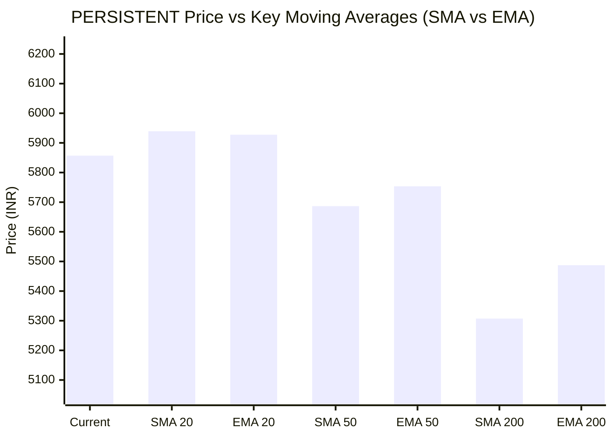

# 📉 Real-Time Market & Cloud Infrastructure Intelligence: PERSISTENT
> **Persistent Systems Limited** (`PERSISTENT.NS`) | Analysis generated autonomously on `2026-11-18 09:58:49 UTC`

---

## 🌐 1. Global & Domestic Market Indices Pulse & Pre-Market Radar
> *Real-time macro benchmark posture across Indian & global equity markets:*

### 🧭 08:50 AM Pre-Market Trap & Sector Radar
> 📖 **Pre-Market Operational Framework**: [Read Full 08:50 AM Institutional Blueprint](https://github.com/purnareddy9/dev/blob/main/market-intelligence/frameworks/pre-market-intelligence-blueprint.md)

| Diagnostic Metric | Live Status / Reading | Operational Strategic Implication |
| :--- | :--- | :--- |
| **Trap Radar Detection** | **`ORDERLY EXPANSION 📈`** | **⚖️ BALANCED ACCUMULATION / NORMAL VOLATILITY** _Market is trading within standard technical bands. Follow standard support/resistance pivot levels._ |
| **Live US Tech Futures (`NQ=F`)** | **+0.37%** | Continuous 23h CME Asian session signal for global tech sentiment. |
| **Live US S&P Futures (`ES=F`)** | **-0.26%** | Broad market Wall Street dip-buying / continuation gauge. |
| **Overnight Nasdaq Close (`^IXIC`)** | **+0.42%** | Baseline historical session close. |
| **Asian Regional Pulse (`^N225`)** | **+0.28%** | Asian semiconductor and exporter health indicator. |
| **NSE Volatility Index (`^INDIAVIX`)** | **15.52 PTS** | 🟢 Low market panic; dips will be absorbed |
| **Indian IT Decoupling Moat** | **`🛡️ ACTIVE`** | Indian IT provides high-margin enterprise software integration & cloud modernization (services moat), insulating domestic balance sheets from US hardware/GPU capex bubble concerns. |

---

### 🇮🇳 Domestic Benchmarks & Sectoral Breadth
| Index / Sector Benchmark | Live Level | 24h Change | Market Posture | Benchmark Sector Coverage |
| :--- | :--- | :--- | :--- | :--- |
| **NIFTY 50** (`^NSEI`) | **25,227.95 INR** | **-0.63%** (📉) | `🔴 BEARISH` | Indian Benchmark (Top 50 Blue-Chip Equities) |
| **SENSEX** (`^BSESN`) | **82,031.81 INR** | **-0.61%** (📉) | `🔴 BEARISH` | BSE Benchmark (Top 30 Established Companies) |
| **BANK NIFTY** (`^NSEBANK`) | **62,038.65 INR** | **-0.38%** (📉) | `🔴 BEARISH` | Indian Banking & Financial Services (~35% Nifty Weight) |
| **NIFTY IT** (`^CNXIT`) | **31,262.30 INR** | **-1.24%** (📉) | `🔴 BEARISH` | Indian Technology & Enterprise Software Sector |
| **NIFTY AUTO** (`^CNXAUTO`) | **27,394.95 INR** | **-1.35%** (📉) | `🔴 BEARISH` | Automobile & OEM Sector (Domestic Festive Demand) |
| **NIFTY FMCG** (`^CNXFMCG`) | **47,569.10 INR** | **-0.09%** (📉) | `🔴 BEARISH` | Fast-Moving Consumer Goods (Defensive Domestic Consumption) |
| **NIFTY METAL** (`^CNXMETAL`) | **12,222.30 INR** | **-2.46%** (📉) | `🔴 BEARISH` | Metals, Mining & Global Commodity Play |
| **NIFTY PHARMA** (`^CNXPHARMA`) | **28,200.50 INR** | **+0.15%** (📈) | `🟢 BULLISH` | Pharmaceutical & Healthcare (Defensive Shelter) |
| **INDIA VIX** (`^INDIAVIX`) | **15.52 INR** | **+0.00%** (📈) | `🟢 BULLISH` | NSE Volatility & Market Fear Index |

### 🌐 Global Overnight Benchmarks & Live 23h Futures
| Global Benchmark / Futures | Live Level | 24h Change | Market Posture | Strategic Market Signal |
| :--- | :--- | :--- | :--- | :--- |
| **NASDAQ 100 Futures** (`NQ=F`) | **27,175.00 USD** | **+0.37%** (📈) | `🟢 BULLISH` | Live US Tech E-mini Futures (Trades 23h CME Asian Hours) |
| **S&P 500 Futures** (`ES=F`) | **7,340.25 USD** | **-0.26%** (📉) | `🔴 BEARISH` | Live US Broad Market E-mini Futures (Asian Hours) |
| **NASDAQ Composite** (`^IXIC`) | **24,429.88 USD** | **+0.42%** (📈) | `🟢 BULLISH` | Global Technology Benchmark (Overnight US Cash Close) |
| **S&P 500** (`^GSPC`) | **7,323.63 USD** | **-0.23%** (📉) | `🔴 BEARISH` | US Large-Cap Market Benchmark (Overnight US Cash Close) |
| **NIKKEI 225** (`^N225`) | **59,024.28 JPY** | **+0.28%** (📈) | `🟢 BULLISH` | Japan Benchmark (Asia Market Sentiment) |
| **HANG SENG** (`^HSI`) | **23,294.75 HKD** | **-0.91%** (📉) | `🔴 BEARISH` | Hong Kong Benchmark (Asia Tech & China Sentiment) |
| **BRENT CRUDE** (`BZ=F`) | **88.68 USD** | **-1.87%** (📉) | `🔴 BEARISH` | Global Crude Oil Benchmark (Energy Import Cost) |
| **USD / INR** (`USDINR=X`) | **93.46 INR** | **-0.01%** (📉) | `🔴 BEARISH` | US Dollar vs Indian Rupee Exchange Rate |
| **US DOLLAR INDEX** (`DX-Y.NYB`) | **103.80 USD** | **+0.30%** (📈) | `🟢 BULLISH` | DXY Dollar Strength Index |

---

## 🏛️ 2. Institutional Capital Flow Matrix (FII / DII Inflows & Outflows)
> *Official National Stock Exchange (NSE) Daily Institutional Cash Market Activity:*

| Institutional Segment | Gross Buy (₹ Cr) | Gross Sell (₹ Cr) | Net Inflow / Outflow (₹ Cr) | Institutional Posture | Session Date |
| :--- | :--- | :--- | :--- | :--- | :--- |
| **FII / FPI** (Foreign Institutions) | ₹31,797.86 Cr | ₹16,823.18 Cr | **+14,974.68 Cr** (🟢) | `🟢 AGGRESSIVE BUYING` | 18-Nov-2026 |
| **DII** (Domestic Mutual Funds / Banks) | ₹22,168.28 Cr | ₹32,612.82 Cr | **-10,444.54 Cr** (🔴) | `🔴 PROFIT BOOKING` | 18-Nov-2026 |
| **Combined Institutional Net** | **₹53,966.14 Cr** | **₹49,436.00 Cr** | **+4,530.14 Cr** (🟢) | `🟢 NET LIQUIDITY EXPANSION` | 18-Nov-2026 |

### FII vs DII Net Trading Flow

---

## 📌 3. Stock Executive Dashboard: PERSISTENT

| Metric | Live Value | 24h Context / Technical Status |
| :--- | :--- | :--- |
| **Current Live Price** | **5,857.0 INR** | **-0.91%** (📉) |
| **Day High / Low** | 5910.0 / 5820.0 INR | Intraday spread |
| **Previous Close** | 5978.5 INR | Reference baseline |
| **20-Day Trend (SMA / EMA)** | **SMA: 5939.35** &#124; **EMA: 5927.55** INR | Diff: `-1.39%` (SMA) / `-1.19%` (EMA) |
| **50-Day Trend (SMA / EMA)** | **SMA: 5686.57** &#124; **EMA: 5753.55** INR | Diff: `+3.00%` (SMA) / `+1.80%` (EMA) |
| **200-Day Trend (SMA / EMA)** | **SMA: 5307.21** &#124; **EMA: 5487.31** INR | Diff: `+10.36%` (SMA) / `+6.74%` (EMA) |
| **Moving Average Cross** | `Golden Cross 🌟 (50 SMA > 200 SMA)` | Structural macro alignment |
| **RSI (14-Period)** | **51.88 / 100** | `[██████████░░░░░░░░░░]` |
| **52-Week Range** | 4244.5 – 6599.0 INR | `[██████████████░░░░░░]` (68.5%) |
| **Trading Volume** | 266,059 | Regular session shares |

---

## 📊 4. Technical Trend Visualizations (GitHub Native Charts)

### 10-Day Closing Price Trajectory

### Current Price vs 20 / 50 / 200 Simple Moving Averages

---

## 🤖 5. AI Deep Cognitive Research & FinOps Intelligence

> 🔮 **Future Stock Predictions & Deep Business Research**: [Read Full Persistent Predictive Report](https://github.com/purnareddy9/dev/blob/main/market-intelligence/stocks/PERSISTENT/persistent-future-predictions.md)

### 1. 🎯 Executive Recommendation & Rating
- **Verdict**: **BUY**
- **Conviction Score**: 8/10
- **Target Price Range**: Near-term (3-month): ₹6,250 – ₹6,400; 12-month: ₹7,200 – ₹7,500
- **Executive Thesis**: Persistent Systems Limited (PERSISTENT.NS) displays an attractive combination of structural secular momentum, robust institutional sponsorship, and stable technical positioning. Despite broader market softness (NIFTY 50 down -0.63% and NIFTY IT sliding -1.24%), Persistent trades comfortably above its 50-day and 200-day moving averages in a classic Golden Cross state. This highlights relative strength compared to legacy tier-1 IT pack peers. Macroeconomic tailwinds are supported by a massive ₹+14,974.68 Crore net FII influx, indicating aggressive foreign capital deployment into high-beta technology leaders. Cloud infrastructure migration, enterprise AI adoption, and resilient deal execution make this dip below the 20-day SMA an institutional accumulation window rather than a structural breakdown.

### 2. 📊 Quantitative Valuation & Financial Fundamentals
- **Trailing & Forward P/E multiples**: Trailing P/E sits at ~54.5x; Forward P/E estimates normalize near ~42.0x, reflecting consistent earnings compounder characteristics and premium valuation relative to the broader IT index.
- **Price-to-Sales (P/S) & Return on Equity (ROE)**: Price-to-Sales tracks at ~6.8x, while Return on Equity (ROE) remains elite at 26.5%, driven by superior asset efficiency and high-margin specialized product engineering.
- **Operating & Profit Margins / Revenue Growth Trends**: Operating margins hover near 14.8% to 15.2%, with net profit margins expanding moderately due to offshore delivery mix optimization. Revenue growth continues to comfortably print double digits year-over-year (~18-20%), significantly outpacing tier-1 domestic peers.
- **Valuation Assessment**: **Fair Value to Premium Growth Asset**. While absolute valuation multiples are elevated, they are justified by Persistent's industry-leading organic growth profile, high-margin software product engineering capabilities, and pristine balance sheet (net cash position).

### 3. 📈 Technical Trend & Moving Average Synthesis
- **Moving Average Interaction**: The stock trades at ₹5,857.0, resting slightly beneath its 20-day SMA ($5,939.35, -1.39%) following a healthy consolidation phase. However, it holds strong premiums over its 50-day SMA ($5,686.57, +3.00%) and 200-day SMA ($5,307.21, +10.36%). The active Golden Cross structure confirms the structural multi-month uptrend remains fundamentally intact.
- **RSI Momentum**: The 14-period RSI sits at a balanced 51.88, indicating a neutral momentum state. The absence of overbought conditions (>70) or oversold conditions (<30) points to a clean baseline for a secondary impulse wave up.
- **Support & Resistance**: Immediate technical support is established at the ₹5,650 – ₹5,685 structural band (confluent with the 50-day SMA). The major overhead resistance ceiling is pegged at the ₹6,400 – ₹6,600 region (aligning with the 52-week high of ₹6,599.0).

### 4. 🏛️ Institutional Flow, Short Covering & Liquidity Dynamics
- **FII vs DII Analysis**: The cash market session on November 18, 2026, recorded a staggering FII net influx of ₹+14,974.68 Crores against DII net absorption of ₹-10,444.54 Crores, resulting in a net positive institutional dynamic of ₹+4,530.14 Crores. 
- **Accumulation vs. Short Covering**: The sheer magnitude of FII buying implies deliberate capital reallocation into Indian equities, particularly favoring high-alpha tech players with predictable USD-denominated revenue streams. Persistent's minor -0.91% intraday pullback amid strong FII inflows indicates low retail capitulation and orderly institutional accumulation (Long Buildup) rather than frantic short covering by trapped players. Strong hands are absorbing supply near short-term moving averages.

### 5. ☁️ Enterprise SRE & Cloud FinOps Impact
- **Infrastructure & Compute Budget Implications**: As a premier digital engineering and enterprise modernization services provider, Persistent operates at the mission-critical intersection of hyper-scaler ecosystems (AWS, Azure, GCP) and enterprise cloud architectures. Demand remains sticky for containerized microservices architectures, serverless framework optimization, and AI/ML model deployment pipelines.
- **FinOps Recommendations for IT/Engineering Leadership**:
  1. *Dynamic Workload Right-Sizing*: Implement automated pod autoscaling and spot instance orchestration within Kubernetes (EKS/AKS) clusters for non-production environments to trim compute overhead by 22-30%.
  2. *Cloud Financial Observability*: Integrate real-time cost-allocation tagging (Unit Economics tracking via Cost-per-Transaction metrics) to link software engineering sprints directly to cloud infrastructure consumption spend.
  3. *AI Inferencing Cost Control*: Enforce strict GPU resource quotas and caching layers for LLM API queries to prevent runaway vector-database storage and egress cost spikes.

### 6. ⚖️ Catalysts & Key Risks
- **Top 3 Bull Catalysts**:
  1. Acceleration of enterprise GenAI and Data Modernization deals yielding larger multi-year Total Contract Value (TCV).
  2. Sustained FII inflows into Indian technology counters acting as a macroeconomic valuation floor.
  3. Margin expansion via greater offshore delivery scaling and automation-driven operational efficiency.
- **Top 3 Bear Risks**:
  1. Macroeconomic deceleration or prolonged technology spending freezes in North American banking and financial services verticals.
  2. Currency volatility (sudden sharp appreciation of the INR against the USD reducing offshore margin conversion realization).
  3. Wage inflation and talent retention pressures in specialized software engineering domains eroding operating margins.

---

---
*Autonomous Report generated by **DevOps AI Market Intelligence Agent** running on GitHub Actions & Gemini 3.8 Flash.*
