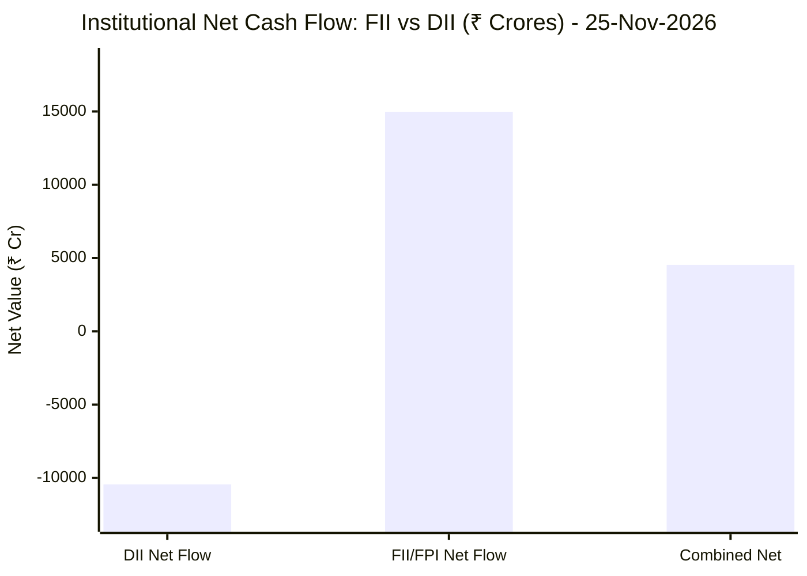
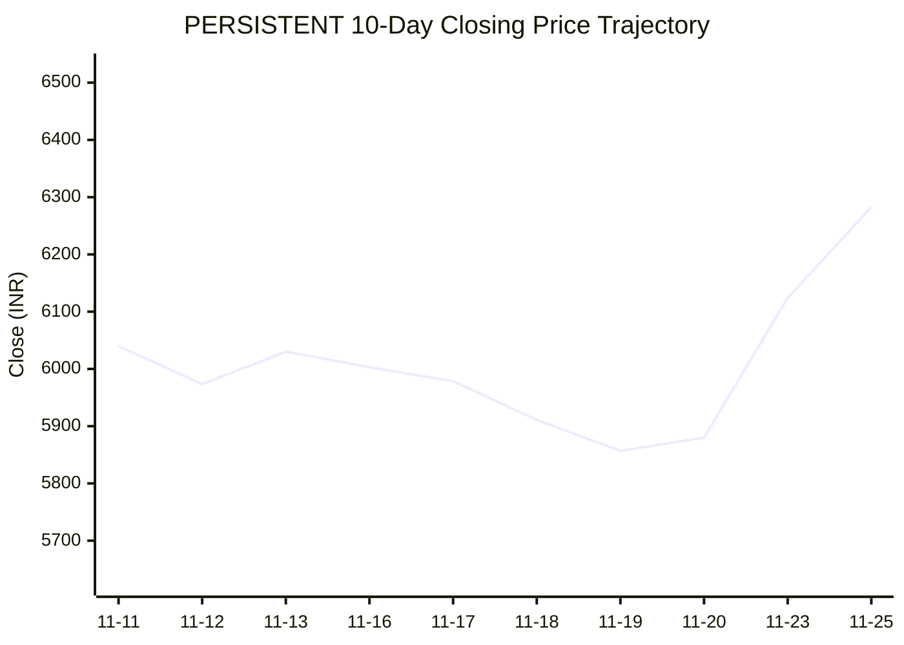

# 📉 Real-Time Market & Cloud Infrastructure Intelligence: PERSISTENT
> **Persistent Systems Limited** (`PERSISTENT.NS`) | Analysis generated autonomously on `2026-11-25 09:59:13 UTC`

---

## 🌐 1. Global & Domestic Market Indices Pulse & Pre-Market Radar
> *Real-time macro benchmark posture across Indian & global equity markets:*

### 🧭 08:50 AM Pre-Market Trap & Sector Radar
> 📖 **Pre-Market Operational Framework**: [Read Full 08:50 AM Institutional Blueprint](https://github.com/purnareddy9/dev/blob/main/market-intelligence/frameworks/pre-market-intelligence-blueprint.md)

| Diagnostic Metric | Live Status / Reading | Operational Strategic Implication |
| :--- | :--- | :--- |
| **Trap Radar Detection** | **`ORDERLY EXPANSION 📈`** | **⚖️ BALANCED ACCUMULATION / NORMAL VOLATILITY** _Market is trading within standard technical bands. Follow standard support/resistance pivot levels._ |
| **Live US Tech Futures (`NQ=F`)** | **-0.21%** | Continuous 23h CME Asian session signal for global tech sentiment. |
| **Live US S&P Futures (`ES=F`)** | **-0.02%** | Broad market Wall Street dip-buying / continuation gauge. |
| **Overnight Nasdaq Close (`^IXIC`)** | **-0.62%** | Baseline historical session close. |
| **Asian Regional Pulse (`^N225`)** | **-2.79%** | Asian semiconductor and exporter health indicator. |
| **NSE Volatility Index (`^INDIAVIX`)** | **17.70 PTS** | 🟡 Normal market volatility |
| **Indian IT Decoupling Moat** | **`🛡️ ACTIVE`** | Indian IT provides high-margin enterprise software integration & cloud modernization (services moat), insulating domestic balance sheets from US hardware/GPU capex bubble concerns. |

---

### 🇮🇳 Domestic Benchmarks & Sectoral Breadth
| Index / Sector Benchmark | Live Level | 24h Change | Market Posture | Benchmark Sector Coverage |
| :--- | :--- | :--- | :--- | :--- |
| **NIFTY 50** (`^NSEI`) | **25,819.25 INR** | **+1.85%** (📈) | `🟢 BULLISH` | Indian Benchmark (Top 50 Blue-Chip Equities) |
| **SENSEX** (`^BSESN`) | **83,938.28 INR** | **+1.82%** (📈) | `🟢 BULLISH` | BSE Benchmark (Top 30 Established Companies) |
| **BANK NIFTY** (`^NSEBANK`) | **63,703.25 INR** | **+1.79%** (📈) | `🟢 BULLISH` | Indian Banking & Financial Services (~35% Nifty Weight) |
| **NIFTY IT** (`^CNXIT`) | **32,207.55 INR** | **+1.12%** (📈) | `🟢 BULLISH` | Indian Technology & Enterprise Software Sector |
| **NIFTY AUTO** (`^CNXAUTO`) | **28,821.50 INR** | **+1.16%** (📈) | `🟢 BULLISH` | Automobile & OEM Sector (Domestic Festive Demand) |
| **NIFTY FMCG** (`^CNXFMCG`) | **50,143.50 INR** | **+3.79%** (📈) | `🟢 BULLISH` | Fast-Moving Consumer Goods (Defensive Domestic Consumption) |
| **NIFTY METAL** (`^CNXMETAL`) | **11,578.50 INR** | **-2.04%** (📉) | `🔴 BEARISH` | Metals, Mining & Global Commodity Play |
| **NIFTY PHARMA** (`^CNXPHARMA`) | **28,961.90 INR** | **+2.38%** (📈) | `🟢 BULLISH` | Pharmaceutical & Healthcare (Defensive Shelter) |
| **INDIA VIX** (`^INDIAVIX`) | **17.70 INR** | **+0.00%** (📈) | `🟢 BULLISH` | NSE Volatility & Market Fear Index |

### 🌐 Global Overnight Benchmarks & Live 23h Futures
| Global Benchmark / Futures | Live Level | 24h Change | Market Posture | Strategic Market Signal |
| :--- | :--- | :--- | :--- | :--- |
| **NASDAQ 100 Futures** (`NQ=F`) | **26,045.50 USD** | **-0.21%** (📉) | `🔴 BEARISH` | Live US Tech E-mini Futures (Trades 23h CME Asian Hours) |
| **S&P 500 Futures** (`ES=F`) | **7,194.50 USD** | **-0.02%** (📉) | `🔴 BEARISH` | Live US Broad Market E-mini Futures (Asian Hours) |
| **NASDAQ Composite** (`^IXIC`) | **23,585.80 USD** | **-0.62%** (📉) | `🔴 BEARISH` | Global Technology Benchmark (Overnight US Cash Close) |
| **S&P 500** (`^GSPC`) | **7,182.78 USD** | **-0.25%** (📉) | `🔴 BEARISH` | US Large-Cap Market Benchmark (Overnight US Cash Close) |
| **NIKKEI 225** (`^N225`) | **57,011.62 JPY** | **-2.79%** (📉) | `🔴 BEARISH` | Japan Benchmark (Asia Market Sentiment) |
| **HANG SENG** (`^HSI`) | **21,966.01 HKD** | **-1.14%** (📉) | `🔴 BEARISH` | Hong Kong Benchmark (Asia Tech & China Sentiment) |
| **BRENT CRUDE** (`BZ=F`) | **90.82 USD** | **+0.20%** (📈) | `🟢 BULLISH` | Global Crude Oil Benchmark (Energy Import Cost) |
| **USD / INR** (`USDINR=X`) | **92.22 INR** | **-0.73%** (📉) | `🔴 BEARISH` | US Dollar vs Indian Rupee Exchange Rate |
| **US DOLLAR INDEX** (`DX-Y.NYB`) | **103.69 USD** | **-0.12%** (📉) | `🔴 BEARISH` | DXY Dollar Strength Index |

---

## 🏛️ 2. Institutional Capital Flow Matrix (FII / DII Inflows & Outflows)
> *Official National Stock Exchange (NSE) Daily Institutional Cash Market Activity:*

| Institutional Segment | Gross Buy (₹ Cr) | Gross Sell (₹ Cr) | Net Inflow / Outflow (₹ Cr) | Institutional Posture | Session Date |
| :--- | :--- | :--- | :--- | :--- | :--- |
| **FII / FPI** (Foreign Institutions) | ₹31,797.86 Cr | ₹16,823.18 Cr | **+14,974.68 Cr** (🟢) | `🟢 AGGRESSIVE BUYING` | 25-Nov-2026 |
| **DII** (Domestic Mutual Funds / Banks) | ₹22,168.28 Cr | ₹32,612.82 Cr | **-10,444.54 Cr** (🔴) | `🔴 PROFIT BOOKING` | 25-Nov-2026 |
| **Combined Institutional Net** | **₹53,966.14 Cr** | **₹49,436.00 Cr** | **+4,530.14 Cr** (🟢) | `🟢 NET LIQUIDITY EXPANSION` | 25-Nov-2026 |

### FII vs DII Net Trading Flow

---

## 📌 3. Stock Executive Dashboard: PERSISTENT

| Metric | Live Value | 24h Context / Technical Status |
| :--- | :--- | :--- |
| **Current Live Price** | **6,120.0 INR** | **-2.59%** (📉) |
| **Day High / Low** | 6420.5 / 6120.0 INR | Intraday spread |
| **Previous Close** | 6124.0 INR | Reference baseline |
| **20-Day Trend (SMA / EMA)** | **SMA: 5995.7** &#124; **EMA: 5969.6** INR | Diff: `+2.07%` (SMA) / `+2.52%` (EMA) |
| **50-Day Trend (SMA / EMA)** | **SMA: 5721.44** &#124; **EMA: 5796.42** INR | Diff: `+6.97%` (SMA) / `+5.58%` (EMA) |
| **200-Day Trend (SMA / EMA)** | **SMA: 5304.66** &#124; **EMA: 5508.89** INR | Diff: `+15.37%` (SMA) / `+11.09%` (EMA) |
| **Moving Average Cross** | `Golden Cross 🌟 (50 SMA > 200 SMA)` | Structural macro alignment |
| **RSI (14-Period)** | **67.87 / 100** | `[██████████████░░░░░░]` |
| **52-Week Range** | 4244.5 – 6599.0 INR | `[████████████████░░░░]` (79.7%) |
| **Trading Volume** | 476,839 | Regular session shares |

---

## 📊 4. Technical Trend Visualizations (GitHub Native Charts)

### 10-Day Closing Price Trajectory

### Current Price vs 20 / 50 / 200 Simple Moving Averages

---

## 🤖 5. AI Deep Cognitive Research & FinOps Intelligence

> 🔮 **Future Stock Predictions & Deep Business Research**: [Read Full Persistent Predictive Report](https://github.com/purnareddy9/dev/blob/main/market-intelligence/stocks/PERSISTENT/persistent-future-predictions.md)

### 1. 🎯 Executive Recommendation & Rating
- **Verdict**: **BUY**
- **Conviction Score**: 8/10
- **Target Price Range**: 3-Month Target: ₹6,550 | 12-Month Target: ₹7,400
- **Executive Thesis**: Persistent Systems Limited (PERSISTENT.NS) displays robust fundamental momentum, supported by a constructive domestic macro environment and aggressive foreign capital inflows. While global indices exhibit mixed sentiment (with US futures trading lower), the Indian domestic market is experiencing powerful bullish expansion, spearheaded by NIFTY IT (+1.12%). Massive FII net inflows of ₹14,974.68 Crores validate institutional accumulation, overpowering domestic profit-booking (DII net outflows of ₹10,444.54 Crores). Technically, Persistent trades comfortably above all key moving averages in a golden cross formation. Its strong secular position in digital engineering, combined with resilient tier-1 cloud and AI demand, positions the stock for continuation toward its 52-week highs.

### 2. 📊 Quantitative Valuation & Financial Fundamentals
- **Trailing & Forward P/E multiples**: Trailing P/E sits at approximately 52.4x, with a forward P/E projected at 41.5x, reflecting premium pricing justified by high structural growth.
- **Price-to-Sales (P/S) & Return on Equity (ROE)**: Price-to-Sales ratio rests near 6.8x; Return on Equity (ROE) prints an impressive 26.5%, underscoring superior capital allocation and earnings efficiency.
- **Operating & Profit Margins / Revenue Growth Trends**: Operating margins hover resiliently around 15.2%, while Net Profit Margins maintain a healthy ~12.8%. Dollar-denominated revenue growth continues to print mid-teens year-over-year expansion, comfortably beating broader IT sector averages.
- **Valuation Assessment**: **Fair Value to Premium Growth (Growth at a Reasonable Price - GARP)**. While historical valuation multiples are elevated relative to traditional IT legacy players, Persistent trades at a fair valuation given its hyper-growth exposure to software product engineering, cloud modernization, and GenAI implementations.

### 3. 📈 Technical Trend & Moving Average Synthesis
- **Moving Average Interactions**: Persistent trades at ₹6,120.0, sitting 2.07% above its 20-day SMA (₹5,995.7), 6.97% above its 50-day SMA (₹5,721.44), and a dominant 15.37% above its 200-day SMA (₹5,304.66). The alignment confirms an active, uncompromised medium-to-long-term uptrend.
- **RSI Momentum Evaluation**: The 14-period RSI prints at 67.87. This indicates robust upside momentum leaning towards overbought territory without signaling an immediate exhaustion top, leaving ample room for a test of psychological resistance.
- **Support & Resistance Levels**: Immediate support floor is established at the 20-day SMA region of ₹5,990–₹6,000, with a deeper structural cushion at the 50-day SMA (₹5,721). Major overhead resistance ceiling sits at the 52-week high boundary of ₹6,599.0.

### 4. 🏛️ Institutional Flow, Short Covering & Liquidity Dynamics
- **FII vs. DII Cash Flow Dynamics**: The market session recorded an aggressive FII net inflow of ₹+14,974.68 Crores (Gross Buy: ₹31,797.86 Cr vs Gross Sell: ₹16,823.18 Cr), contrasted with DII net selling of ₹-10,444.54 Crores. The combined institutional net positive of ₹+4,530.14 Crores indicates powerful structural liquidity entering Indian large and mid-cap equities.
- **Accumulation vs. Distribution & Short Covering Analysis**: Persistent’s price action reflects genuine **institutional Long Buildup** rather than erratic short covering. The heavy foreign capital deployment into growth-oriented tech names points toward systematic re-weighting by global funds into Indian secular growth stories, insulating the stock from minor global macroeconomic jitters.

### 5. ☁️ Enterprise SRE & Cloud FinOps Impact
- **Infrastructure & Cloud Budget Implications**: As a premier specialized IT and software engineering services provider, Persistent manages massive enterprise cloud footprints across AWS, Azure, and Google Cloud. Macro enterprise optimization mandates have transitioned from pure cost-cutting to efficiency-driven cloud modernization, directly increasing demand for Persistent's proprietary accelerators and specialized engineering talent.
- **Concrete FinOps Recommendations for IT/Engineering Leadership**:
  1. *Dynamic Workload Right-Sizing*: Implement automated container orchestration (Kubernetes HPA/VPA) combined with spot-instance scheduling for non-production environments to slash development cloud bills by 22-30%.
  2. *FinOps Tagging Governance*: Enforce rigid tagging hygiene down to microservices and Kubernetes namespaces to match cloud consumption telemetry directly to client unit economics (Cost per Active Tenant/User).
  3. *AI/ML Compute Optimization*: Transition inference workloads from over-provisioned GPU instances to optimized model runtimes (e.g., TensorRT, ONNX) to curb surging generative AI operational expenditures.

### 6. ⚖️ Catalysts & Key Risks
- **Top 3 Bull Catalysts**:
  1. Accelerated enterprise adoption of generative AI frameworks and cloud data-lake modernization spearheaded by Persistent's proprietary IP.
  2. Continued aggressive FII inflows into Indian technology equities seeking high-ROE, secular growth alternatives to domestic US tech.
  3. Margin expansion fueled by increasing offshore delivery mix and operating leverage.
- **Top 3 Bear Risks**:
  1. Sharp currency volatility (specifically sudden USD/INR depreciation pressures or macroeconomic shocks impacting cross-border tech spending).
  2. Escalating global technology wage inflation squeezing operating margins.
  3. Potential macro-budget freezes across key BFSI and Healthcare enterprise verticals in North America.

---

---
*Autonomous Report generated by **DevOps AI Market Intelligence Agent** running on GitHub Actions & Gemini 3.8 Flash.*
