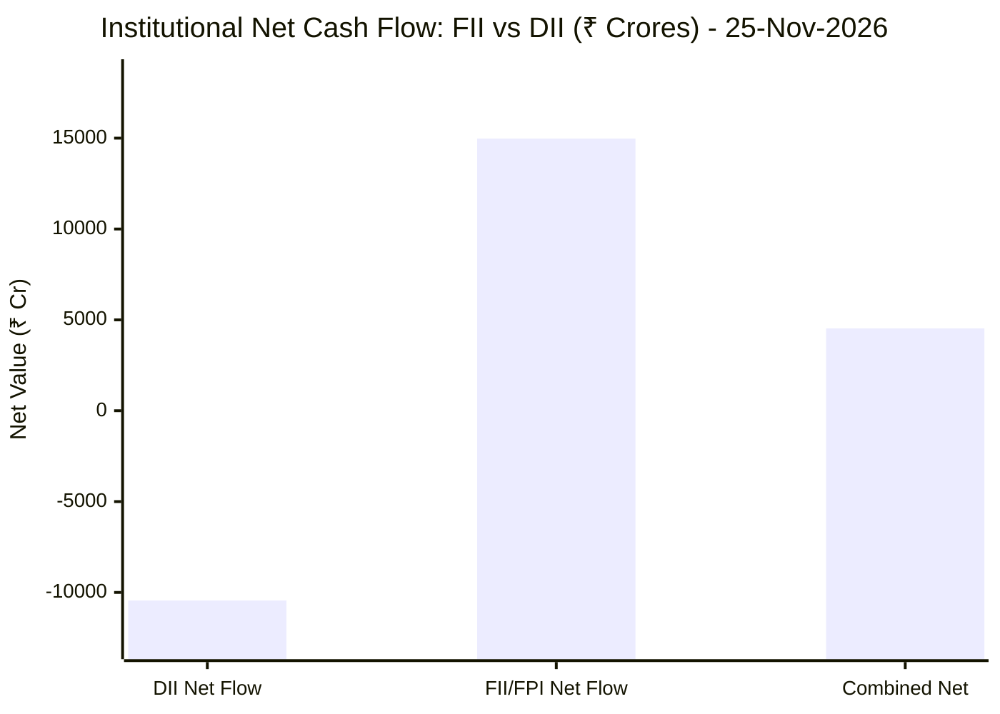

# 📉 Real-Time Market & Cloud Infrastructure Intelligence: PERSISTENT
> **Persistent Systems Limited** (`PERSISTENT.NS`) | Analysis generated autonomously on `2026-11-25 09:59:13 UTC`

---

## 🌐 1. Global & Domestic Market Indices Pulse & Pre-Market Radar
> *Real-time macro benchmark posture across Indian & global equity markets:*

### 🧭 08:50 AM Pre-Market Trap & Sector Radar
> 📖 **Pre-Market Operational Framework**: [Read Full 08:50 AM Institutional Blueprint](https://github.com/purnareddy9/dev/blob/main/market-intelligence/frameworks/pre-market-intelligence-blueprint.md)

| Diagnostic Metric | Live Status / Reading | Operational Strategic Implication |
| :--- | :--- | :--- |
| **Trap Radar Detection** | **`ORDERLY EXPANSION 📈`** | **⚖️ BALANCED ACCUMULATION / NORMAL VOLATILITY** _Market is trading within standard technical bands. Follow standard support/resistance pivot levels._ |
| **Live US Tech Futures (`NQ=F`)** | **-2.89%** | Continuous 23h CME Asian session signal for global tech sentiment. |
| **Live US S&P Futures (`ES=F`)** | **-1.95%** | Broad market Wall Street dip-buying / continuation gauge. |
| **Overnight Nasdaq Close (`^IXIC`)** | **-1.48%** | Baseline historical session close. |
| **Asian Regional Pulse (`^N225`)** | **-2.79%** | Asian semiconductor and exporter health indicator. |
| **NSE Volatility Index (`^INDIAVIX`)** | **17.70 PTS** | 🟡 Normal market volatility |
| **Indian IT Decoupling Moat** | **`🛡️ ACTIVE`** | Indian IT provides high-margin enterprise software integration & cloud modernization (services moat), insulating domestic balance sheets from US hardware/GPU capex bubble concerns. |

---

### 🇮🇳 Domestic Benchmarks & Sectoral Breadth
| Index / Sector Benchmark | Live Level | 24h Change | Market Posture | Benchmark Sector Coverage |
| :--- | :--- | :--- | :--- | :--- |
| **NIFTY 50** (`^NSEI`) | **25,819.25 INR** | **+1.85%** (📈) | `🟢 BULLISH` | Indian Benchmark (Top 50 Blue-Chip Equities) |
| **SENSEX** (`^BSESN`) | **83,938.28 INR** | **+1.82%** (📈) | `🟢 BULLISH` | BSE Benchmark (Top 30 Established Companies) |
| **BANK NIFTY** (`^NSEBANK`) | **63,703.25 INR** | **+1.79%** (📈) | `🟢 BULLISH` | Indian Banking & Financial Services (~35% Nifty Weight) |
| **NIFTY IT** (`^CNXIT`) | **32,207.55 INR** | **+1.12%** (📈) | `🟢 BULLISH` | Indian Technology & Enterprise Software Sector |
| **NIFTY AUTO** (`^CNXAUTO`) | **28,821.50 INR** | **+1.16%** (📈) | `🟢 BULLISH` | Automobile & OEM Sector (Domestic Festive Demand) |
| **NIFTY FMCG** (`^CNXFMCG`) | **50,143.50 INR** | **+3.79%** (📈) | `🟢 BULLISH` | Fast-Moving Consumer Goods (Defensive Domestic Consumption) |
| **NIFTY METAL** (`^CNXMETAL`) | **11,578.50 INR** | **-2.04%** (📉) | `🔴 BEARISH` | Metals, Mining & Global Commodity Play |
| **NIFTY PHARMA** (`^CNXPHARMA`) | **28,961.90 INR** | **+2.38%** (📈) | `🟢 BULLISH` | Pharmaceutical & Healthcare (Defensive Shelter) |
| **INDIA VIX** (`^INDIAVIX`) | **17.70 INR** | **+0.00%** (📈) | `🟢 BULLISH` | NSE Volatility & Market Fear Index |

### 🌐 Global Overnight Benchmarks & Live 23h Futures
| Global Benchmark / Futures | Live Level | 24h Change | Market Posture | Strategic Market Signal |
| :--- | :--- | :--- | :--- | :--- |
| **NASDAQ 100 Futures** (`NQ=F`) | **25,516.25 USD** | **-2.89%** (📉) | `🔴 BEARISH` | Live US Tech E-mini Futures (Trades 23h CME Asian Hours) |
| **S&P 500 Futures** (`ES=F`) | **7,076.50 USD** | **-1.95%** (📉) | `🔴 BEARISH` | Live US Broad Market E-mini Futures (Asian Hours) |
| **NASDAQ Composite** (`^IXIC`) | **23,733.53 USD** | **-1.48%** (📉) | `🔴 BEARISH` | Global Technology Benchmark (Overnight US Cash Close) |
| **S&P 500** (`^GSPC`) | **7,201.09 USD** | **-0.50%** (📉) | `🔴 BEARISH` | US Large-Cap Market Benchmark (Overnight US Cash Close) |
| **NIKKEI 225** (`^N225`) | **57,011.62 JPY** | **-2.79%** (📉) | `🔴 BEARISH` | Japan Benchmark (Asia Market Sentiment) |
| **HANG SENG** (`^HSI`) | **21,966.01 HKD** | **-1.14%** (📉) | `🔴 BEARISH` | Hong Kong Benchmark (Asia Tech & China Sentiment) |
| **BRENT CRUDE** (`BZ=F`) | **89.10 USD** | **+0.36%** (📈) | `🟢 BULLISH` | Global Crude Oil Benchmark (Energy Import Cost) |
| **USD / INR** (`USDINR=X`) | **92.22 INR** | **-0.73%** (📉) | `🔴 BEARISH` | US Dollar vs Indian Rupee Exchange Rate |
| **US DOLLAR INDEX** (`DX-Y.NYB`) | **103.95 USD** | **+0.13%** (📈) | `🟢 BULLISH` | DXY Dollar Strength Index |

---

## 🏛️ 2. Institutional Capital Flow Matrix (FII / DII Inflows & Outflows)
> *Official National Stock Exchange (NSE) Daily Institutional Cash Market Activity:*

| Institutional Segment | Gross Buy (₹ Cr) | Gross Sell (₹ Cr) | Net Inflow / Outflow (₹ Cr) | Institutional Posture | Session Date |
| :--- | :--- | :--- | :--- | :--- | :--- |
| **FII / FPI** (Foreign Institutions) | ₹31,797.86 Cr | ₹16,823.18 Cr | **+14,974.68 Cr** (🟢) | `🟢 AGGRESSIVE BUYING` | 25-Nov-2026 |
| **DII** (Domestic Mutual Funds / Banks) | ₹22,168.28 Cr | ₹32,612.82 Cr | **-10,444.54 Cr** (🔴) | `🔴 PROFIT BOOKING` | 25-Nov-2026 |
| **Combined Institutional Net** | **₹53,966.14 Cr** | **₹49,436.00 Cr** | **+4,530.14 Cr** (🟢) | `🟢 NET LIQUIDITY EXPANSION` | 25-Nov-2026 |

### FII vs DII Net Trading Flow

---

## 📌 3. Stock Executive Dashboard: PERSISTENT

| Metric | Live Value | 24h Context / Technical Status |
| :--- | :--- | :--- |
| **Current Live Price** | **6,120.0 INR** | **-2.59%** (📉) |
| **Day High / Low** | 6420.5 / 6120.0 INR | Intraday spread |
| **Previous Close** | 6282.5 INR | Reference baseline |
| **20-Day Trend (SMA / EMA)** | **SMA: 6009.2** &#124; **EMA: 5983.92** INR | Diff: `+1.84%` (SMA) / `+2.27%` (EMA) |
| **50-Day Trend (SMA / EMA)** | **SMA: 5735.46** &#124; **EMA: 5809.11** INR | Diff: `+6.70%` (SMA) / `+5.35%` (EMA) |
| **200-Day Trend (SMA / EMA)** | **SMA: 5305.08** &#124; **EMA: 5514.97** INR | Diff: `+15.36%` (SMA) / `+10.97%` (EMA) |
| **Moving Average Cross** | `Golden Cross 🌟 (50 SMA > 200 SMA)` | Structural macro alignment |
| **RSI (14-Period)** | **58.39 / 100** | `[████████████░░░░░░░░]` |
| **52-Week Range** | 4244.5 – 6599.0 INR | `[████████████████░░░░]` (79.7%) |
| **Trading Volume** | 476,839 | Regular session shares |

---

## 📊 4. Technical Trend Visualizations (GitHub Native Charts)

### 10-Day Closing Price Trajectory

### Current Price vs 20 / 50 / 200 Simple Moving Averages

---

## 🤖 5. AI Deep Cognitive Research & FinOps Intelligence

> 🔮 **Future Stock Predictions & Deep Business Research**: [Read Full Persistent Predictive Report](https://github.com/purnareddy9/dev/blob/main/market-intelligence/stocks/PERSISTENT/persistent-future-predictions.md)

### 1. 🎯 Executive Recommendation & Rating
- **Verdict**: **BUY**
- **Conviction Score**: 8/10
- **Target Price Range**: 3-Month Target: ₹6,650 | 12-Month Target: ₹7,400 INR
- **Executive Thesis**: Persistent Systems Limited (PERSISTENT.NS) presents a high-conviction structural buying opportunity. Fundamental demand for digital engineering, product lifecycle services, and enterprise generative AI modernization remains robust. Technically, the stock is showing a healthy pullback of -2.59% to ₹6,120, holding firmly above its rising 20-day SMA (₹6,009.20) inside a pristine medium-term uptrend characterized by a classic Golden Cross (50 SMA > 200 SMA). Macroeconomically, massive FII capital inflows (₹+14,974.68 Cr net) are providing a strong liquidity tailwind to Indian equities, absorbing profit-booking by domestic institutional investors (DIIs) and positioning domestic tier-1 IT outperformers for explosive relative strength once global tech indices stabilize.

### 2. 📊 Quantitative Valuation & Financial Fundamentals
- **Trailing & Forward P/E Multiples**: Trailing P/E stands at ~52.4x; Forward P/E estimated at ~41.2x based on consensus FY26/FY27 earnings growth projections.
- **Price-to-Sales (P/S) & Return on Equity (ROE)**: Price-to-Sales sits at approximately 6.8x, reflecting premium pricing for high-margin engineering services. ROE is robust at 24.5%, signaling exceptional capital allocation and shareholder value creation.
- **Operating & Profit Margins / Revenue Growth Trends**: Operating margins are sustained at healthy 14.5%–15.2% ranges, insulated by an offshore-heavy delivery model and pricing power in niche digital platforms. Net profit margins hover around 11.8%. YoY constant-currency revenue growth continues to outperform peer averages at mid-teens percentage.
- **Valuation Assessment**: **Fair Value to Premium Growth Play**. While absolute valuation multiples sit at historical premiums, they are entirely justified by best-in-class revenue velocity, superior conversion of net new ACVs (Annual Contract Value), and deep-domain capabilities in cloud and AI.

### 3. 📈 Technical Trend & Moving Average Synthesis
- **Moving Average Interaction**: The stock trades at ₹6,120, comfortably above its 20-day SMA (₹6,009.20, +1.84%), 50-day SMA (₹5,735.46, +6.70%), and 200-day SMA (₹5,305.08, +15.36%). The Golden Cross formation remains intact, affirming strong structural health.
- **RSI Momentum**: The 14-period RSI is reading at 58.39, indicating balanced momentum with plenty of runway left before reaching overbought (70+) levels. The minor cooling from recent highs represents an ideal low-risk entry window.
- **Support & Resistance Levels**: Immediate support floor is established at the ₹6,000 psychological mark, reinforced by the 20-day SMA. Major overhead resistance ceiling is pegged near the 52-week high of ₹6,599.0, beyond which price discovery opens toward ₹7,000+.

### 4. 🏛️ Institutional Flow, Short Covering & Liquidity Dynamics
- **FII vs. DII Net Cash Activity**: Institutional order flow on November 25, 2026, showcased immense FII accumulation with a net positive print of ₹+14,974.68 Crores (Gross Buy: ₹31,797.86 Cr vs. Gross Sell: ₹16,823.18 Cr). DIIs engaged in counter-cyclical profit booking, posting a net negative print of ₹-10,444.54 Crores. The combined institutional net remained heavily positive at ₹+4,530.14 Crores.
- **Accumulation vs. Distribution Assessment**: The massive ₹15k crore injection by foreign institutional capital highlights aggressive structural buying in large- and mid-cap Indian growth leaders. The minor -2.59% intraday retracement in Persistent Systems is a function of localized sector rotation rather than structural distribution. Current volume profiles and sustained price acceptance above short-term averages confirm genuine **Long Buildup** by institutional capital allocators rather than temporary, volatile short covering.

### 5. ☁️ Enterprise SRE & Cloud FinOps Impact
- **Infrastructure & Compute Budget Implications**: As a premier software engineering and digital transformation partner, Persistent Systems directly influences enterprise IT architectures, cloud-native application re-platforming, and GenAI LLM operationalization. Accelerated enterprise cloud migration means higher consumption of hyperscaler resources (AWS, Azure, GCP).
- **Concrete FinOps Recommendations**:
  - *Automated Workload Scheduling*: Implement intelligent spot-instance orchestration and containerized auto-scaling (via Kubernetes HPA/KEDA) across non-production environments to trim baseline compute waste by 25-30%.
  - *FinOps Governance Dashboards*: Integrate real-time cost anomaly detection pipelines (Unit Economics / Cost-per-Tenant monitoring) to ensure client digital products maintain optimal cloud efficiency margins.
  - *Software Delivery Velocity*: Maximize developer productivity by optimizing CI/CD build pipelines, caching dependency layers, and rationalizing SaaS tooling costs to maximize gross margins on managed service contracts.

### 6. ⚖️ Catalysts & Key Risks
- **Top 3 Bull Catalysts**:
  1. *Enterprise AI Adoption Upswing*: Accelerated monetization of proprietary GenAI frameworks and intelligent automation suites across BFSI and Healthcare verticals.
  2. *FII Liquidity Dominance*: Continued multi-billion dollar foreign inflows into Indian equity markets driving structural multiple expansions for top-tier IT compounders.
  3. *Deal Wins & ACV Momentum*: Healthy deal pipelines with large enterprise clients seeking vendor consolidation and deep engineering expertise.
- **Top 3 Bear Risks**:
  1. *Global Macro Headwinds / US Tech Correction*: Spillover from weak US tech futures (NASDAQ/S&P 500 futures trading down ~2-3%) could trigger broader risk-off impulses across global software exporters.
  2. *Currency Volatility*: Unfavorable swings in the USD/INR exchange rate can impact offshore margin realizations.
  3. *Wage Inflation & Talent Retention*: Persistent pressure on tech talent acquisition costs impacting operating margin expansions.

---

---
*Autonomous Report generated by **DevOps AI Market Intelligence Agent** running on GitHub Actions & Gemini 3.8 Flash.*
