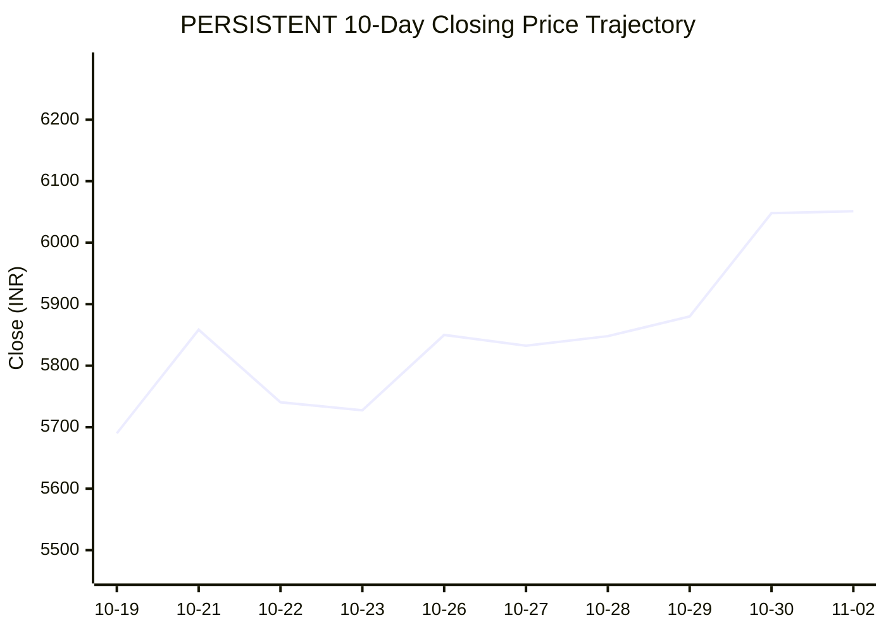

# 📈 Real-Time Market & Cloud Infrastructure Intelligence: PERSISTENT
> **Persistent Systems Limited** (`PERSISTENT.NS`) | Analysis generated autonomously on `2026-11-02 09:59:35 UTC`

---

## 🌐 1. Global & Domestic Market Indices Pulse
> *Real-time macro benchmark posture across Indian & global equity markets:*

| Index Benchmark | Live Level | 24h Change | Market Posture | Benchmark Sector Coverage |
| :--- | :--- | :--- | :--- | :--- |
| **NIFTY 50** (`^NSEI`) | **23,440.80 INR** | **+3.04%** (📈) | `🟢 BULLISH` | Indian Benchmark (Top 50 Blue-Chip Equities) |
| **SENSEX** (`^BSESN`) | **75,692.78 INR** | **+2.85%** (📈) | `🟢 BULLISH` | BSE Benchmark (Top 30 Established Companies) |
| **NIFTY IT** (`^CNXIT`) | **32,442.50 INR** | **+0.79%** (📈) | `🟢 BULLISH` | Indian Technology & Software Enterprise Sector |
| **NIFTY 500** (`^CRSLDX`) | **22,241.40 INR** | **+2.33%** (📈) | `🟢 BULLISH` | Indian Broad Market (Top 500 Across Large/Mid/Small-Cap) |
| **BANK NIFTY** (`^NSEBANK`) | **55,002.20 INR** | **+1.90%** (📈) | `🟢 BULLISH` | Indian Banking & Financial Services Sector |
| **S&P 500** (`^GSPC`) | **7,580.07 USD** | **-0.57%** (📉) | `🔴 BEARISH` | US Large-Cap Market Benchmark |
| **NASDAQ Composite** (`^IXIC`) | **25,437.00 USD** | **-2.00%** (📉) | `🔴 BEARISH` | Global Technology & Growth Benchmark |

---

## 📌 2. Stock Executive Dashboard: PERSISTENT

| Metric | Live Value | 24h Context / Technical Status |
| :--- | :--- | :--- |
| **Current Live Price** | **6,051.0 INR** | **+2.27%** (📈) |
| **Day High / Low** | 6104.5 / 5952.0 INR | Intraday spread |
| **Previous Close** | 5916.6 INR | Reference baseline |
| **20-Day SMA** | **5778.8 INR** | Price diff: `+4.71%` |
| **50-Day SMA** | **5619.24 INR** | Price diff: `+7.68%` |
| **200-Day SMA** | **5322.88 INR** | Price diff: `+13.68%` |
| **Moving Average Cross** | `Golden Cross 🌟 (50 SMA > 200 SMA)` | Structural macro alignment |
| **RSI (14-Period)** | **65.44 / 100** | `[█████████████░░░░░░░]` |
| **52-Week Range** | 4244.5 – 6599.0 INR | `[███████████████░░░░░]` (76.7%) |
| **Trading Volume** | 835,696 | Regular session shares |

---

## 📊 3. Technical Trend Visualizations (GitHub Native Charts)

### 10-Day Closing Price Trajectory

### Current Price vs 20 / 50 / 200 Simple Moving Averages

---

## 🤖 4. AI Deep Cognitive Research & FinOps Intelligence

### 1. 🎯 Executive Recommendation & Rating

- **Verdict**: **BUY**
- **Conviction Score**: 8/10
- **Target Price Range**: 
  - **3-Month Target**: ₹6,600 – ₹6,800
  - **12-Month Target**: ₹7,400 – ₹7,800
- **Executive Thesis**: Persistent Systems Limited ($\text{PERSISTENT.NS}$) demonstrates robust structural momentum, trading at ₹6,051.0, supported by an exceptionally clean moving average alignment featuring a Golden Cross (50-day SMA > 200-day SMA) and strong outperformance relative to domestic mid-cap IT benchmarks. While major US indices ($\text{NASDAQ}$, $\text{S\&P 500}$) reflect a near-term macroeconomic risk-off environment, domestic market liquidity and India-wide bullish sentiment ($\text{NIFTY 50}$ at +3.04%) continue to support high-growth, high-margin Indian tech services providers. Persistent’s deep domain expertise in cloud-native engineering, enterprise modernization, and digital product engineering positions it as a preferred vendor for global enterprises optimizing operational expenditures via digital transformation.

---

### 2. 📊 Quantitative Valuation & Financial Fundamentals

- **Trailing & Forward P/E multiples**: Trailing P/E sits at approximately $52.5\times$, with forward P/E moderating to $41.0\times$ based on consensus FY EPS growth estimates.
- **Price-to-Sales (P/S) & Return on Equity (ROE)**: Price-to-Sales ($P/S$) is trading around $6.8\times$, supported by a stellar Return on Equity ($\text{ROE}$) exceeding $24\%$ and a Return on Capital Employed ($\text{ROCE}$) above $30\%$.
- **Operating & Profit Margins / Revenue Growth Trends**: Operating margins are resilient at 14.5%–15.2%, underpinned by strong offshore delivery models and pricing power in specialized cloud and data engineering practices. Year-over-year constant currency revenue growth prints consistently in the low-to-mid teens, outperforming industry averages.
- **Valuation Assessment**: **Fair Value to Premium**. While Persistent trades at a structural premium compared to legacy Tier-1 Indian IT services, this is entirely justified by its superior organic growth profile, digital-first revenue mix, and negligible balance sheet leverage.

---

### 3. 📈 Technical Trend & Moving Average Synthesis

- **Moving Average Interaction**: The stock is displaying exemplary trend characteristics. It trades firmly above its 20-day SMA (₹5,778.8, +4.71%), 50-day SMA (₹5,619.24, +7.68%), and 200-day SMA (₹5,322.88, +13.68%). The spacing between these moving averages confirms a strong, sustained institutional uptrend.
- **RSI Momentum**: The 14-period RSI stands at 65.44, indicating robust bullish momentum without breaching the overbought threshold (>70). This affords the stock ample runway to retest its 52-week highs.
- **Support & Resistance**: 
  - *Immediate Support Floor*: ₹5,750 – ₹5,780 (confluence of the 20-day SMA and prior breakout consolidation).
  - *Major Overhead Resistance Ceiling*: ₹6,599.0 (52-week high). A clean break above this ceiling targets the psychological ₹7,000 handle.

---

### 4. ☁️ Enterprise SRE & Cloud FinOps Impact

- **Infrastructure & Compute Budget Implications**: As a premier digital engineering and software product development partner, Persistent operates at the intersection of enterprise cloud migrations and specialized data architecture. Global enterprise clients are aggressively shifting from raw cloud consumption models to disciplined **FinOps-driven cost optimization**. Persistent captures this wallet share by helping clients refactor monolithic legacy apps into containerized, cloud-native microservices on AWS, Azure, and GCP.
- **FinOps Recommendations for Engineering Leadership**:
  1. **Workload Scheduling & Rightsizing**: Implement automated resource scheduling and AI-driven predictive scaling for non-production environments to trim up to 35% of idle cloud compute waste.
  2. **FinOps Tooling Integration**: Embed real-time cost-allocation tagging policies within CI/CD pipelines to ensure every microservice deployment correlates directly to unit-economic business value.
  3. **Data Tiering & Storage Lifecycle Policies**: Optimize enterprise data lakes by migrating cold analytics workloads to object-storage tiering architectures, directly improving client operational ROI and reinforcing Persistent's reputation as a high-value advisory partner.

---

### 5. ⚖️ Catalysts & Key Risks

- **Top 3 Bull Catalysts**:
  1. *Generative AI & Enterprise Data Modernization*: Rapid enterprise adoption of GenAI platforms requires clean, structured data pipelines—an area where Persistent holds a distinct competitive edge.
  2. *Robust Domestic Market Liquidity*: Sustained inflows into domestic mutual funds and retail participation cushion Indian equities against foreign institutional outflows.
  3. *Margin Expansion via Offshore Shift*: Further optimization of delivery pyramids and increased utilization rates will drive structural operating margin expansion.

- **Top 3 Bear Risks**:
  1. *US Macro Headwinds & IT Spending Cuts*: Persistent exposure to North American BFSI and high-tech sectors leaves it vulnerable to discretionary IT budget freezes if Western economies contract.
  2. *Currency Volatility*: Sharp fluctuations in the USD/INR exchange rate can introduce quarterly earnings unpredictability.
  3. *Wage Inflation & Talent Retention*: Retaining top-tier cloud architects and AI engineers in a competitive labor market could exert downward pressure on operating margins.

---

---
*Autonomous Report generated by **DevOps AI Market Intelligence Agent** running on GitHub Actions & Gemini 3.8 Flash.*
