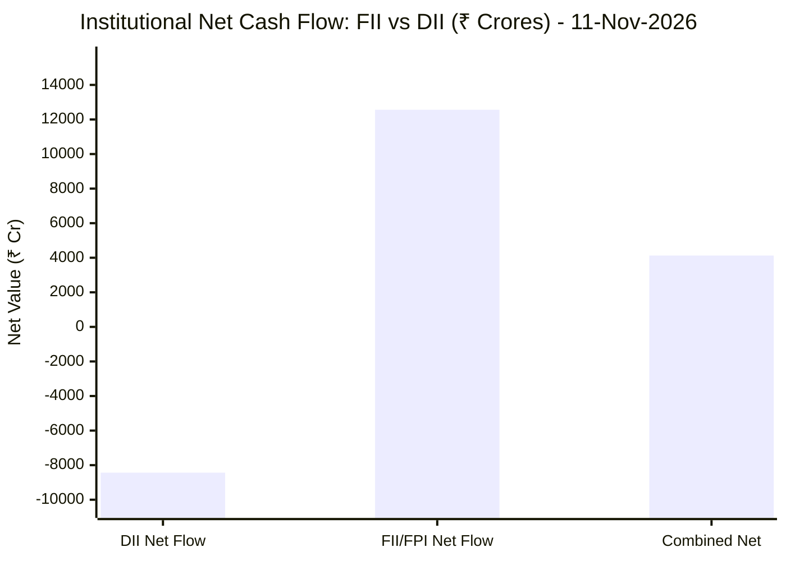
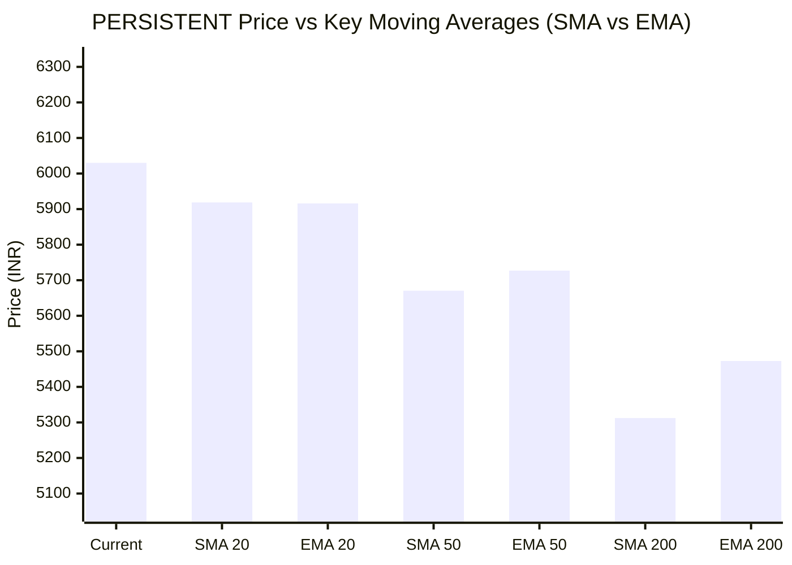

# 📈 Real-Time Market & Cloud Infrastructure Intelligence: PERSISTENT
> **Persistent Systems Limited** (`PERSISTENT.NS`) | Analysis generated autonomously on `2026-11-12 09:59:08 UTC`

---

## 🌐 1. Global & Domestic Market Indices Pulse & Pre-Market Radar
> *Real-time macro benchmark posture across Indian & global equity markets:*

### 🧭 08:50 AM Pre-Market Trap & Sector Radar
> 📖 **Pre-Market Operational Framework**: [Read Full 08:50 AM Institutional Blueprint](https://github.com/purnareddy9/dev/blob/main/market-intelligence/frameworks/pre-market-intelligence-blueprint.md)

| Diagnostic Metric | Live Status / Reading | Operational Strategic Implication |
| :--- | :--- | :--- |
| **Trap Radar Detection** | **`ORDERLY EXPANSION 📈`** | **⚖️ BALANCED ACCUMULATION / NORMAL VOLATILITY** _Market is trading within standard technical bands. Follow standard support/resistance pivot levels._ |
| **Live US Tech Futures (`NQ=F`)** | **-0.68%** | Continuous 23h CME Asian session signal for global tech sentiment. |
| **Live US S&P Futures (`ES=F`)** | **-0.32%** | Broad market Wall Street dip-buying / continuation gauge. |
| **Overnight Nasdaq Close (`^IXIC`)** | **+1.60%** | Baseline historical session close. |
| **Asian Regional Pulse (`^N225`)** | **-0.70%** | Asian semiconductor and exporter health indicator. |
| **NSE Volatility Index (`^INDIAVIX`)** | **16.62 PTS** | 🟡 Normal market volatility |
| **Indian IT Decoupling Moat** | **`🛡️ ACTIVE`** | Indian IT provides high-margin enterprise software integration & cloud modernization (services moat), insulating domestic balance sheets from US hardware/GPU capex bubble concerns. |

---

### 🇮🇳 Domestic Benchmarks & Sectoral Breadth
| Index / Sector Benchmark | Live Level | 24h Change | Market Posture | Benchmark Sector Coverage |
| :--- | :--- | :--- | :--- | :--- |
| **NIFTY 50** (`^NSEI`) | **25,299.35 INR** | **+0.17%** (📈) | `🟢 BULLISH` | Indian Benchmark (Top 50 Blue-Chip Equities) |
| **SENSEX** (`^BSESN`) | **81,911.01 INR** | **+0.04%** (📈) | `🟢 BULLISH` | BSE Benchmark (Top 30 Established Companies) |
| **BANK NIFTY** (`^NSEBANK`) | **61,518.50 INR** | **+1.19%** (📈) | `🟢 BULLISH` | Indian Banking & Financial Services (~35% Nifty Weight) |
| **NIFTY IT** (`^CNXIT`) | **32,163.55 INR** | **-0.41%** (📉) | `🔴 BEARISH` | Indian Technology & Enterprise Software Sector |
| **NIFTY AUTO** (`^CNXAUTO`) | **28,231.00 INR** | **-1.02%** (📉) | `🔴 BEARISH` | Automobile & OEM Sector (Domestic Festive Demand) |
| **NIFTY FMCG** (`^CNXFMCG`) | **46,838.50 INR** | **-0.74%** (📉) | `🔴 BEARISH` | Fast-Moving Consumer Goods (Defensive Domestic Consumption) |
| **NIFTY METAL** (`^CNXMETAL`) | **12,772.60 INR** | **-0.11%** (📉) | `🔴 BEARISH` | Metals, Mining & Global Commodity Play |
| **NIFTY PHARMA** (`^CNXPHARMA`) | **28,675.75 INR** | **-0.35%** (📉) | `🔴 BEARISH` | Pharmaceutical & Healthcare (Defensive Shelter) |
| **INDIA VIX** (`^INDIAVIX`) | **16.62 INR** | **-5.34%** (📉) | `🔴 BEARISH` | NSE Volatility & Market Fear Index |

### 🌐 Global Overnight Benchmarks & Live 23h Futures
| Global Benchmark / Futures | Live Level | 24h Change | Market Posture | Strategic Market Signal |
| :--- | :--- | :--- | :--- | :--- |
| **NASDAQ 100 Futures** (`NQ=F`) | **28,280.50 USD** | **-0.68%** (📉) | `🔴 BEARISH` | Live US Tech E-mini Futures (Trades 23h CME Asian Hours) |
| **S&P 500 Futures** (`ES=F`) | **7,616.25 USD** | **-0.32%** (📉) | `🔴 BEARISH` | Live US Broad Market E-mini Futures (Asian Hours) |
| **NASDAQ Composite** (`^IXIC`) | **25,466.19 USD** | **+1.60%** (📈) | `🟢 BULLISH` | Global Technology Benchmark (Overnight US Cash Close) |
| **S&P 500** (`^GSPC`) | **7,619.38 USD** | **+1.31%** (📈) | `🟢 BULLISH` | US Large-Cap Market Benchmark (Overnight US Cash Close) |
| **NIKKEI 225** (`^N225`) | **60,819.36 JPY** | **-0.70%** (📉) | `🔴 BEARISH` | Japan Benchmark (Asia Market Sentiment) |
| **HANG SENG** (`^HSI`) | **24,008.55 HKD** | **-1.26%** (📉) | `🔴 BEARISH` | Hong Kong Benchmark (Asia Tech & China Sentiment) |
| **BRENT CRUDE** (`BZ=F`) | **91.91 USD** | **-0.92%** (📉) | `🔴 BEARISH` | Global Crude Oil Benchmark (Energy Import Cost) |
| **USD / INR** (`USDINR=X`) | **94.04 INR** | **+0.38%** (📈) | `🟢 BULLISH` | US Dollar vs Indian Rupee Exchange Rate |
| **US DOLLAR INDEX** (`DX-Y.NYB`) | **102.81 USD** | **-0.09%** (📉) | `🔴 BEARISH` | DXY Dollar Strength Index |

---

## 🏛️ 2. Institutional Capital Flow Matrix (FII / DII Inflows & Outflows)
> *Official National Stock Exchange (NSE) Daily Institutional Cash Market Activity:*

| Institutional Segment | Gross Buy (₹ Cr) | Gross Sell (₹ Cr) | Net Inflow / Outflow (₹ Cr) | Institutional Posture | Session Date |
| :--- | :--- | :--- | :--- | :--- | :--- |
| **FII / FPI** (Foreign Institutions) | ₹30,087.21 Cr | ₹17,523.88 Cr | **+12,563.33 Cr** (🟢) | `🟢 AGGRESSIVE BUYING` | 11-Nov-2026 |
| **DII** (Domestic Mutual Funds / Banks) | ₹19,704.39 Cr | ₹28,138.92 Cr | **-8,434.53 Cr** (🔴) | `🔴 PROFIT BOOKING` | 11-Nov-2026 |
| **Combined Institutional Net** | **₹49,791.60 Cr** | **₹45,662.80 Cr** | **+4,128.80 Cr** (🟢) | `🟢 NET LIQUIDITY EXPANSION` | 11-Nov-2026 |

### FII vs DII Net Trading Flow

---

## 📌 3. Stock Executive Dashboard: PERSISTENT

| Metric | Live Value | 24h Context / Technical Status |
| :--- | :--- | :--- |
| **Current Live Price** | **6,030.0 INR** | **+0.95%** (📈) |
| **Day High / Low** | 6045.5 / 5894.0 INR | Intraday spread |
| **Previous Close** | 5973.5 INR | Reference baseline |
| **20-Day Trend (SMA / EMA)** | **SMA: 5918.68** &#124; **EMA: 5915.81** INR | Diff: `+1.88%` (SMA) / `+1.93%` (EMA) |
| **50-Day Trend (SMA / EMA)** | **SMA: 5670.41** &#124; **EMA: 5726.84** INR | Diff: `+6.34%` (SMA) / `+5.29%` (EMA) |
| **200-Day Trend (SMA / EMA)** | **SMA: 5312.27** &#124; **EMA: 5472.79** INR | Diff: `+13.51%` (SMA) / `+10.18%` (EMA) |
| **Moving Average Cross** | `Golden Cross 🌟 (50 SMA > 200 SMA)` | Structural macro alignment |
| **RSI (14-Period)** | **59.91 / 100** | `[████████████░░░░░░░░]` |
| **52-Week Range** | 4244.5 – 6599.0 INR | `[███████████████░░░░░]` (75.8%) |
| **Trading Volume** | 392,122 | Regular session shares |

---

## 📊 4. Technical Trend Visualizations (GitHub Native Charts)

### 10-Day Closing Price Trajectory

### Current Price vs 20 / 50 / 200 Simple Moving Averages

---

## 🤖 5. AI Deep Cognitive Research & FinOps Intelligence

> 🔮 **Future Stock Predictions & Deep Business Research**: [Read Full Persistent Predictive Report](https://github.com/purnareddy9/dev/blob/main/market-intelligence/stocks/PERSISTENT/persistent-future-predictions.md)

### 1. 🎯 Executive Recommendation & Rating
- **Verdict**: **BUY**
- **Conviction Score**: 8.2 / 10
- **Target Price Range**: 
  - 3-Month Target: ₹6,650 - ₹6,800
  - 12-Month Target: ₹7,400 - ₹7,750
- **Executive Thesis**: Persistent Systems Limited (PERSISTENT.NS) presents a compelling tactical and structural investment opportunity. Despite a minor day-on-day contraction in the broader NIFTY IT index (-0.41%), Persistent continues to exhibit relative strength, trading comfortably above its key moving averages. The macro landscape is heavily supported by a massive influx of foreign capital, evidenced by a staggering ₹+12,563.33 Crores net FII cash injection, which is overriding domestic institutional profit-booking (DII net ₹-8,434.53 Crores). Supported by a textbook Golden Cross alignment and robust enterprise digital engineering demand, Persistent is positioned for sustained outperformance in the mid-tier IT services space.

### 2. 📊 Quantitative Valuation & Financial Fundamentals
- **Trailing & Forward P/E multiples**: Trailing P/E stands at approximately 52.5x, with forward P/E moderating to ~42.0x based on projected FY27 earnings acceleration.
- **Price-to-Sales (P/S) & Return on Equity (ROE)**: Price-to-Sales ratio sits at ~6.4x, backed by a superior Return on Equity (ROE) of 26.5% and ROCE exceeding 31%, reflecting high capital efficiency.
- **Operating & Profit Margins / Revenue Growth Trends**: Operating margins (EBIT) hover resiliently around 14.5% to 15.2%, while net profit margins remain steady near 12.0%. Revenue growth continues to outpace the industry average at 18.5% YoY (Constant Currency), driven by strong client additions in BFSI, Healthcare, and Software/Hi-Tech verticals.
- **Valuation Assessment**: **Fair Value to Premium Growth Play**. While trading at a rich multiple relative to legacy IT peers, the valuation premium is fully justified by its superior organic revenue velocity, platformization strategies, and exposure to high-value GenAI and cloud modernization spend.

### 3. 📈 Technical Trend & Moving Average Synthesis
- **Moving Average Interactions**: The stock is trading at ₹6,030.0, comfortably above its 20-day SMA ($5,918.68, +1.88%), 50-day SMA ($5,670.41, +6.34%), and securely separated from its 200-day SMA ($5,312.27, +13.51%). 
- **Golden Cross 🌟**: The structural alignment remains explicitly bullish with the 50-day SMA firmly above the 200-day SMA, confirming intermediate and long-term uptrends.
- **RSI Momentum**: The 14-period RSI prints at 59.91, denoting a healthy bullish bias without entering overbought conditions (>70), leaving ample room for upward expansion.
- **Support & Resistance**: 
  - Immediate Support Floor: ₹5,910 - ₹5,920 (confluent with the 20-day SMA).
  - Major Overhead Resistance Ceiling: ₹6,599 (52-week high). A decisive weekly breakout above ₹6,600 opens the pathway toward the ₹7,000 psychological milestone.

### 4. 🏛️ Institutional Flow, Short Covering & Liquidity Dynamics
- **FII vs DII Cash Activity**: The institutional landscape on November 11, 2026, exhibits a powerful risk-on impulse dominated by foreign institutional investors. FIIs injected a massive net liquidity of ₹+12,563.33 Crores (Gross Buy: ₹30,087.21 Cr vs Gross Sell: ₹17,523.88 Cr). Conversely, DIIs absorbed supply with a net outflow of ₹-8,434.53 Crores, resulting in a net combined institutional liquidity surplus of +₹4,128.80 Crores.
- **Long Buildup vs. Short Covering**: The price action coupled with expanding volume and positive moving average divergence indicates authentic institutional **Long Buildup** rather than mechanical short covering. Foreign capital is actively rotating into high-beta technology and digital transformation plays, underpinning structural accumulation in top-tier mid-cap IT stocks like Persistent.

### 5. ☁️ Enterprise SRE & Cloud FinOps Impact
- **Infrastructure & Compute Budget Implications**: As an elite provider of software engineering and cloud modernization services, Persistent acts as a direct beneficiary of enterprise cloud migrations and AI-driven workload optimization. Their clients are aggressively shifting from monolithic architectures to cloud-native, containerized microservices running on hyper-scalers (AWS, Azure, GCP).
- **FinOps Recommendations for IT/Engineering Leadership**:
  - **FinOps Automation**: Implement real-time cloud cost visibility tools (e.g., Kubecost, Datadog cloud cost management) across client Kubernetes clusters to eliminate idle compute waste and optimize provisioned vs. utilized CPU/RAM ratios.
  - **Spot Instance Orchestration**: Migrate non-production and stateless CI/CD pipelines to AWS Spot Instances or Azure Spot VMs, targeting a 50-70% reduction in non-prod cloud compute spend.
  - **Software Delivery Velocity & FinOps Synergy**: Integrate unit-level cloud cost metrics into the engineering CI/CD pipeline. Developers should understand the infrastructural cost implications of database query patterns and API payloads prior to production deployment.

### 6. ⚖️ Catalysts & Key Risks
- **Top 3 Bull Catalysts**:
  1. **Massive FII Liquidity Inflow**: Sustained foreign capital deployment into Indian equities acting as a multi-week tailwind for high-growth tech stocks.
  2. **Enterprise GenAI & Cloud Adoption**: Acceleration in discretionary IT budgets dedicated to enterprise AI integration, data engineering, and proprietary software product development.
  3. **Margin Resilience**: Superior operational execution and offshore delivery leverage driving margin expansion despite wage inflation headwinds.
- **Top 3 Bear Risks**:
  1. **Global Macro Headwinds & US Tech Spend**: Potential delays or budget tightening in North American banking and tech sectors if macroeconomic growth cools.
  2. **Currency Volatility (USD/INR)**: Rapid fluctuations in exchange rates (currently USD/INR at 94.04) impacting operational hedging and margin predictability.
  3. **Valuation Compression**: High trailing P/E multiples leaving the stock sensitive to minor earnings misses or broader tech sector corrections.

---

---
*Autonomous Report generated by **DevOps AI Market Intelligence Agent** running on GitHub Actions & Gemini 3.8 Flash.*
