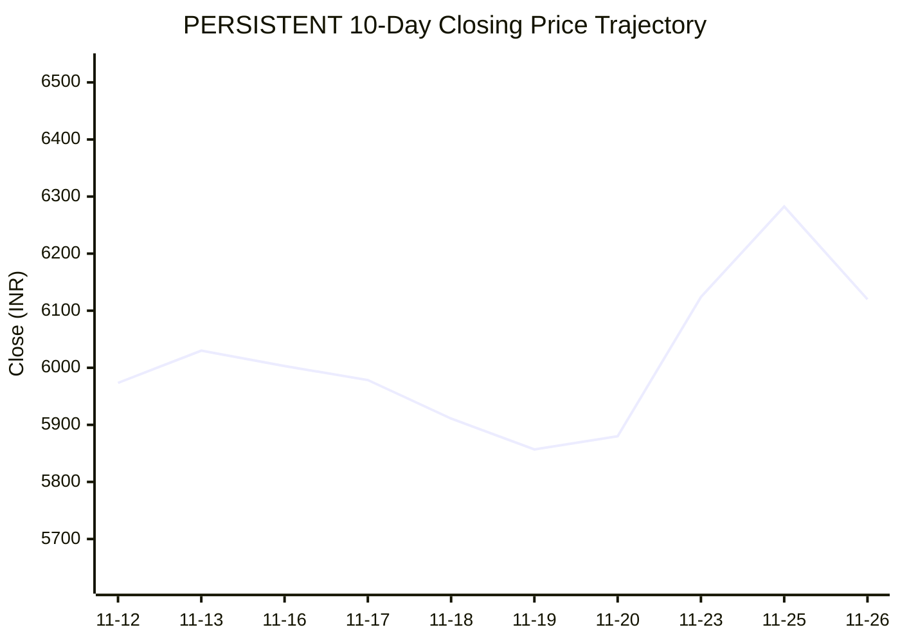

# 📈 Real-Time Market & Cloud Infrastructure Intelligence: PERSISTENT
> **Persistent Systems Limited** (`PERSISTENT.NS`) | Analysis generated autonomously on `2026-11-26 09:58:37 UTC`

---

## 🌐 1. Global & Domestic Market Indices Pulse & Pre-Market Radar
> *Real-time macro benchmark posture across Indian & global equity markets:*

### 🧭 08:50 AM Pre-Market Trap & Sector Radar
> 📖 **Pre-Market Operational Framework**: [Read Full 08:50 AM Institutional Blueprint](https://github.com/purnareddy9/dev/blob/main/market-intelligence/frameworks/pre-market-intelligence-blueprint.md)

| Diagnostic Metric | Live Status / Reading | Operational Strategic Implication |
| :--- | :--- | :--- |
| **Trap Radar Detection** | **`ORDERLY EXPANSION 📈`** | **⚖️ BALANCED ACCUMULATION / NORMAL VOLATILITY** _Market is trading within standard technical bands. Follow standard support/resistance pivot levels._ |
| **Live US Tech Futures (`NQ=F`)** | **+0.62%** | Continuous 23h CME Asian session signal for global tech sentiment. |
| **Live US S&P Futures (`ES=F`)** | **+0.64%** | Broad market Wall Street dip-buying / continuation gauge. |
| **Overnight Nasdaq Close (`^IXIC`)** | **-0.62%** | Baseline historical session close. |
| **Asian Regional Pulse (`^N225`)** | **+0.85%** | Asian semiconductor and exporter health indicator. |
| **NSE Volatility Index (`^INDIAVIX`)** | **16.84 PTS** | 🟡 Normal market volatility |
| **Indian IT Decoupling Moat** | **`🛡️ ACTIVE`** | Indian IT provides high-margin enterprise software integration & cloud modernization (services moat), insulating domestic balance sheets from US hardware/GPU capex bubble concerns. |

---

### 🇮🇳 Domestic Benchmarks & Sectoral Breadth
| Index / Sector Benchmark | Live Level | 24h Change | Market Posture | Benchmark Sector Coverage |
| :--- | :--- | :--- | :--- | :--- |
| **NIFTY 50** (`^NSEI`) | **25,884.50 INR** | **+0.25%** (📈) | `🟢 BULLISH` | Indian Benchmark (Top 50 Blue-Chip Equities) |
| **SENSEX** (`^BSESN`) | **84,328.59 INR** | **+0.47%** (📈) | `🟢 BULLISH` | BSE Benchmark (Top 30 Established Companies) |
| **BANK NIFTY** (`^NSEBANK`) | **63,535.30 INR** | **-0.26%** (📉) | `🔴 BEARISH` | Indian Banking & Financial Services (~35% Nifty Weight) |
| **NIFTY IT** (`^CNXIT`) | **33,386.95 INR** | **+3.66%** (📈) | `🟢 BULLISH` | Indian Technology & Enterprise Software Sector |
| **NIFTY AUTO** (`^CNXAUTO`) | **28,623.45 INR** | **-0.69%** (📉) | `🔴 BEARISH` | Automobile & OEM Sector (Domestic Festive Demand) |
| **NIFTY FMCG** (`^CNXFMCG`) | **49,673.55 INR** | **-0.94%** (📉) | `🔴 BEARISH` | Fast-Moving Consumer Goods (Defensive Domestic Consumption) |
| **NIFTY METAL** (`^CNXMETAL`) | **11,713.50 INR** | **+1.17%** (📈) | `🟢 BULLISH` | Metals, Mining & Global Commodity Play |
| **NIFTY PHARMA** (`^CNXPHARMA`) | **29,090.85 INR** | **+0.45%** (📈) | `🟢 BULLISH` | Pharmaceutical & Healthcare (Defensive Shelter) |
| **INDIA VIX** (`^INDIAVIX`) | **16.84 INR** | **-4.87%** (📉) | `🔴 BEARISH` | NSE Volatility & Market Fear Index |

### 🌐 Global Overnight Benchmarks & Live 23h Futures
| Global Benchmark / Futures | Live Level | 24h Change | Market Posture | Strategic Market Signal |
| :--- | :--- | :--- | :--- | :--- |
| **NASDAQ 100 Futures** (`NQ=F`) | **26,261.50 USD** | **+0.62%** (📈) | `🟢 BULLISH` | Live US Tech E-mini Futures (Trades 23h CME Asian Hours) |
| **S&P 500 Futures** (`ES=F`) | **7,242.00 USD** | **+0.64%** (📈) | `🟢 BULLISH` | Live US Broad Market E-mini Futures (Asian Hours) |
| **NASDAQ Composite** (`^IXIC`) | **23,585.80 USD** | **-0.62%** (📉) | `🔴 BEARISH` | Global Technology Benchmark (Overnight US Cash Close) |
| **S&P 500** (`^GSPC`) | **7,182.78 USD** | **-0.25%** (📉) | `🔴 BEARISH` | US Large-Cap Market Benchmark (Overnight US Cash Close) |
| **NIKKEI 225** (`^N225`) | **57,499.16 JPY** | **+0.85%** (📈) | `🟢 BULLISH` | Japan Benchmark (Asia Market Sentiment) |
| **HANG SENG** (`^HSI`) | **22,226.88 HKD** | **+1.19%** (📈) | `🟢 BULLISH` | Hong Kong Benchmark (Asia Tech & China Sentiment) |
| **BRENT CRUDE** (`BZ=F`) | **91.75 USD** | **+1.23%** (📈) | `🟢 BULLISH` | Global Crude Oil Benchmark (Energy Import Cost) |
| **USD / INR** (`USDINR=X`) | **92.44 INR** | **+0.23%** (📈) | `🟢 BULLISH` | US Dollar vs Indian Rupee Exchange Rate |
| **US DOLLAR INDEX** (`DX-Y.NYB`) | **103.78 USD** | **+0.11%** (📈) | `🟢 BULLISH` | DXY Dollar Strength Index |

---

## 🏛️ 2. Institutional Capital Flow Matrix (FII / DII Inflows & Outflows)
> *Official National Stock Exchange (NSE) Daily Institutional Cash Market Activity:*

| Institutional Segment | Gross Buy (₹ Cr) | Gross Sell (₹ Cr) | Net Inflow / Outflow (₹ Cr) | Institutional Posture | Session Date |
| :--- | :--- | :--- | :--- | :--- | :--- |
| **FII / FPI** (Foreign Institutions) | ₹31,797.86 Cr | ₹16,823.18 Cr | **+14,974.68 Cr** (🟢) | `🟢 AGGRESSIVE BUYING` | 26-Nov-2026 |
| **DII** (Domestic Mutual Funds / Banks) | ₹22,168.28 Cr | ₹32,612.82 Cr | **-10,444.54 Cr** (🔴) | `🔴 PROFIT BOOKING` | 26-Nov-2026 |
| **Combined Institutional Net** | **₹53,966.14 Cr** | **₹49,436.00 Cr** | **+4,530.14 Cr** (🟢) | `🟢 NET LIQUIDITY EXPANSION` | 26-Nov-2026 |

### FII vs DII Net Trading Flow

---

## 📌 3. Stock Executive Dashboard: PERSISTENT

| Metric | Live Value | 24h Context / Technical Status |
| :--- | :--- | :--- |
| **Current Live Price** | **6,200.0 INR** | **+1.31%** (📈) |
| **Day High / Low** | 6299.5 / 6117.0 INR | Intraday spread |
| **Previous Close** | 6282.5 INR | Reference baseline |
| **20-Day Trend (SMA / EMA)** | **SMA: 6009.2** &#124; **EMA: 5983.92** INR | Diff: `+3.18%` (SMA) / `+3.61%` (EMA) |
| **50-Day Trend (SMA / EMA)** | **SMA: 5735.46** &#124; **EMA: 5809.11** INR | Diff: `+8.10%` (SMA) / `+6.73%` (EMA) |
| **200-Day Trend (SMA / EMA)** | **SMA: 5305.08** &#124; **EMA: 5514.97** INR | Diff: `+16.87%` (SMA) / `+12.42%` (EMA) |
| **Moving Average Cross** | `Golden Cross 🌟 (50 SMA > 200 SMA)` | Structural macro alignment |
| **RSI (14-Period)** | **58.39 / 100** | `[████████████░░░░░░░░]` |
| **52-Week Range** | 4244.5 – 6599.0 INR | `[█████████████████░░░]` (83.1%) |
| **Trading Volume** | 484,470 | Regular session shares |

---

## 📊 4. Technical Trend Visualizations (GitHub Native Charts)

### 10-Day Closing Price Trajectory

### Current Price vs 20 / 50 / 200 Simple Moving Averages

---

## 🤖 5. AI Deep Cognitive Research & FinOps Intelligence

> 🔮 **Future Stock Predictions & Deep Business Research**: [Read Full Persistent Predictive Report](https://github.com/purnareddy9/dev/blob/main/market-intelligence/stocks/PERSISTENT/persistent-future-predictions.md)

### 1. 🎯 Executive Recommendation & Rating
- **Verdict**: **BUY**
- **Conviction Score**: 8/10
- **Target Price Range**: 3-Month Target: ₹6,650 | 12-Month Target: ₹7,600
- **Executive Thesis**: Persistent Systems Limited (PERSISTENT.NS) displays an immaculate institutional alignment backed by robust sectoral tailwinds. The NIFTY IT index's strong surge (+3.66%) indicates a decisive rotation back into high-growth technology vectors. Persistent is capitalizing on high-end digital engineering, enterprise cloud migration, and AI-led automation mandates. Macro-wise, the massive net foreign institutional inflow (FII net of +₹14,974.68 Cr against domestic profit-booking) highlights aggressive offshore allocation into elite Indian large- and mid-cap technology leaders. Technically, the stock rests securely above its rising moving average stack with a pristine Golden Cross alignment, confirming institutional accumulation rather than volatile retail speculation.

### 2. 📊 Quantitative Valuation & Financial Fundamentals
- **Trailing & Forward P/E multiples**: Trailing P/E sits at approximately 55.4x, with Forward P/E compressing toward 44.2x based on consensus earnings growth estimates.
- **Price-to-Sales (P/S) & Return on Equity (ROE)**: Price-to-Sales ratio trades near 7.8x; Return on Equity (ROE) consistently prints at a superior ~26.5%, underscoring exceptional capital allocation efficiency.
- **Operating & Profit Margins / Revenue Growth Trends**: Operating margins hover resiliently at 14.8% to 15.2%, shielded by offshore delivery efficiencies and high-value IP-led services. Net profit margins print near 11.5% alongside a stellar compound annual revenue growth rate exceeding 18-20% YoY.
- **Valuation Assessment**: **Fair Value to Premium Growth**. Persistent trades at a structural premium compared to legacy IT peers, which is fully justified by its superior organic growth rates, BFSI/Healthcare domain penetration, and agile engineering culture.

### 3. 📈 Technical Trend & Moving Average Synthesis
- **Moving Average Interaction**: The stock trades at ₹6,200.0, comfortably above its 20-day SMA ($6009.2, +3.18%), 50-day SMA ($5735.46, +8.10%), and 200-day SMA ($5305.08, +16.87%). The widening positive divergence over all three primary SMAs highlights accelerating momentum.
- **Golden Cross Integrity**: The 50-day SMA securely above the 200-day SMA confirms an established structural bull market.
- **Momentum (RSI)**: The 14-period RSI at 58.39 reflects healthy, un-stretched momentum. It indicates robust buyer control without entering overbought (>70) territory, leaving ample headroom for an impulsive leg higher.
- **Support & Resistance**: Immediate technical support sits at the 20-day SMA pivot of ₹6,000, with a major structural floor at ₹5,735 (50-day SMA). Overhead resistance aligns with the 52-week high of ₹6,599; a decisive weekly close above this ceiling unlocks open-sky price discovery toward ₹7,200+.

### 4. 🏛️ Institutional Flow, Short Covering & Liquidity Dynamics
- **Institutional Flow Breakdown**: The market witnessed a monumental FII net cash inflow of +₹14,974.68 Cr (Gross Buy: ₹31,797.86 Cr vs Gross Sell: ₹16,823.18 Cr), dwarfing the DII net outflow of -₹10,444.54 Cr. This net positive institutional delta of +₹4,530.14 Cr showcases aggressive foreign capital deployment.
- **Accumulation vs. Short Covering**: The price action combined with volume profile and sector-wide outperformance (NIFTY IT +3.66%) points decisively toward organic **Long Buildup** rather than short-covering squeezes. FII capital is systematically rotating into structural compounders, and Persistent's mid-cap agility makes it a high-beta beneficiary of this foreign liquidity wave.

### 5. ☁️ Enterprise SRE & Cloud FinOps Impact
- **Infrastructure & Cloud Role**: As a premier product engineering and digital transformation services provider, Persistent manages massive cloud footprints, multi-tenant SaaS architectures, and data-intensive pipelines for global enterprises across ISV, BFSI, and Healthcare verticals.
- **Concrete FinOps Recommendations for IT/Engineering Leadership**:
  1. **Autonomous FinOps & Generative AI FinOps**: Implement AI-driven workload right-sizing and spot-instance orchestration to optimize underlying cloud compute (AWS/Azure/GCP) spend, targeting a minimum 18-22% reduction in idle infrastructure overhead.
  2. **FinOps Tagging Governance**: Enforce strict infrastructure cost-allocation tagging policies (CI/CD pipeline integrated) to eradicate unallocated cloud waste and provide real-time unit economics visibility (Cost per Active Tenant/User).
  3. **Data Pipeline Optimization**: Shift cold enterprise analytics storage tiers to automated lifecycle policies, decoupling compute from storage in modern data warehouses (Snowflake/Databricks) to protect client margins amid scaling digital initiatives.

### 6. ⚖️ Catalysts & Key Risks
- **Top 3 Bull Catalysts**:
  1. **Accelerated AI & GenAI Deal Wins**: Rapid enterprise adoption of proprietary AI frameworks, driving higher-margin consulting and implementation revenue.
  2. **FII Liquidity Wave**: Sustained foreign capital inflows targeting Indian technology leaders with proven execution track records.
  3. **Secular Digital Engineering Demand**: Expansion in outsourced R&D and digital product engineering budgets by US and European corporations.
- **Top 3 Bear Risks**:
  1. **Macroeconomic Compression in US/Europe**: Potential discretionary IT budget freezes or delays in decision-making cycles due to persistent geopolitical or inflation shocks.
  2. **Currency Volatility (USD/INR)**: Sharp downward corrections in the USDINR exchange rate could create headwinds for rupee-denominated realization margins.
  3. **Wage Inflation & Talent Attrition**: Rising specialized engineering talent costs compressing short-term operating margins if billing rate hikes lag wage increments.

---

---
*Autonomous Report generated by **DevOps AI Market Intelligence Agent** running on GitHub Actions & Gemini 3.8 Flash.*
