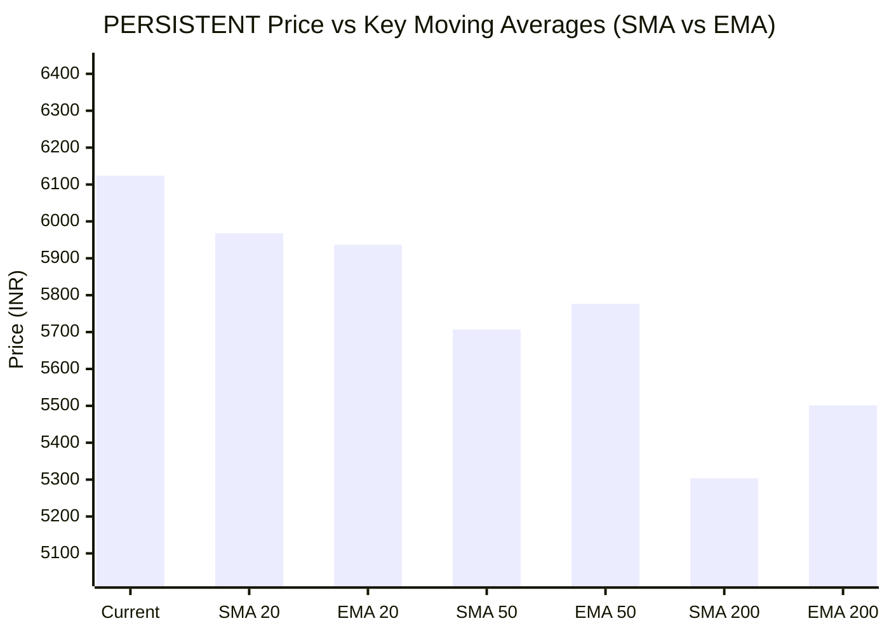

# 📈 Real-Time Market & Cloud Infrastructure Intelligence: PERSISTENT
> **Persistent Systems Limited** (`PERSISTENT.NS`) | Analysis generated autonomously on `2026-11-20 09:58:03 UTC`

---

## 🌐 1. Global & Domestic Market Indices Pulse & Pre-Market Radar
> *Real-time macro benchmark posture across Indian & global equity markets:*

### 🧭 08:50 AM Pre-Market Trap & Sector Radar
> 📖 **Pre-Market Operational Framework**: [Read Full 08:50 AM Institutional Blueprint](https://github.com/purnareddy9/dev/blob/main/market-intelligence/frameworks/pre-market-intelligence-blueprint.md)

| Diagnostic Metric | Live Status / Reading | Operational Strategic Implication |
| :--- | :--- | :--- |
| **Trap Radar Detection** | **`ORDERLY EXPANSION 📈`** | **⚖️ BALANCED ACCUMULATION / NORMAL VOLATILITY** _Market is trading within standard technical bands. Follow standard support/resistance pivot levels._ |
| **Live US Tech Futures (`NQ=F`)** | **-1.38%** | Continuous 23h CME Asian session signal for global tech sentiment. |
| **Live US S&P Futures (`ES=F`)** | **-0.51%** | Broad market Wall Street dip-buying / continuation gauge. |
| **Overnight Nasdaq Close (`^IXIC`)** | **-2.25%** | Baseline historical session close. |
| **Asian Regional Pulse (`^N225`)** | **-5.06%** | Asian semiconductor and exporter health indicator. |
| **NSE Volatility Index (`^INDIAVIX`)** | **17.32 PTS** | 🟡 Normal market volatility |
| **Indian IT Decoupling Moat** | **`🛡️ ACTIVE`** | Indian IT provides high-margin enterprise software integration & cloud modernization (services moat), insulating domestic balance sheets from US hardware/GPU capex bubble concerns. |

---

### 🇮🇳 Domestic Benchmarks & Sectoral Breadth
| Index / Sector Benchmark | Live Level | 24h Change | Market Posture | Benchmark Sector Coverage |
| :--- | :--- | :--- | :--- | :--- |
| **NIFTY 50** (`^NSEI`) | **25,800.60 INR** | **+1.12%** (📈) | `🟢 BULLISH` | Indian Benchmark (Top 50 Blue-Chip Equities) |
| **SENSEX** (`^BSESN`) | **83,919.71 INR** | **+1.08%** (📈) | `🟢 BULLISH` | BSE Benchmark (Top 30 Established Companies) |
| **BANK NIFTY** (`^NSEBANK`) | **64,635.20 INR** | **+2.49%** (📈) | `🟢 BULLISH` | Indian Banking & Financial Services (~35% Nifty Weight) |
| **NIFTY IT** (`^CNXIT`) | **31,322.65 INR** | **+1.30%** (📈) | `🟢 BULLISH` | Indian Technology & Enterprise Software Sector |
| **NIFTY AUTO** (`^CNXAUTO`) | **28,787.65 INR** | **+0.65%** (📈) | `🟢 BULLISH` | Automobile & OEM Sector (Domestic Festive Demand) |
| **NIFTY FMCG** (`^CNXFMCG`) | **48,535.70 INR** | **-0.06%** (📉) | `🔴 BEARISH` | Fast-Moving Consumer Goods (Defensive Domestic Consumption) |
| **NIFTY METAL** (`^CNXMETAL`) | **12,271.10 INR** | **-0.23%** (📉) | `🔴 BEARISH` | Metals, Mining & Global Commodity Play |
| **NIFTY PHARMA** (`^CNXPHARMA`) | **28,386.90 INR** | **+0.05%** (📈) | `🟢 BULLISH` | Pharmaceutical & Healthcare (Defensive Shelter) |
| **INDIA VIX** (`^INDIAVIX`) | **17.32 INR** | **+7.51%** (📈) | `🟢 BULLISH` | NSE Volatility & Market Fear Index |

### 🌐 Global Overnight Benchmarks & Live 23h Futures
| Global Benchmark / Futures | Live Level | 24h Change | Market Posture | Strategic Market Signal |
| :--- | :--- | :--- | :--- | :--- |
| **NASDAQ 100 Futures** (`NQ=F`) | **26,234.25 USD** | **-1.38%** (📉) | `🔴 BEARISH` | Live US Tech E-mini Futures (Trades 23h CME Asian Hours) |
| **S&P 500 Futures** (`ES=F`) | **7,160.25 USD** | **-0.51%** (📉) | `🔴 BEARISH` | Live US Broad Market E-mini Futures (Asian Hours) |
| **NASDAQ Composite** (`^IXIC`) | **23,879.20 USD** | **-2.25%** (📉) | `🔴 BEARISH` | Global Technology Benchmark (Overnight US Cash Close) |
| **S&P 500** (`^GSPC`) | **7,175.83 USD** | **-2.02%** (📉) | `🔴 BEARISH` | US Large-Cap Market Benchmark (Overnight US Cash Close) |
| **NIKKEI 225** (`^N225`) | **56,436.65 JPY** | **-5.06%** (📉) | `🔴 BEARISH` | Japan Benchmark (Asia Market Sentiment) |
| **HANG SENG** (`^HSI`) | **22,410.80 HKD** | **-1.89%** (📉) | `🔴 BEARISH` | Hong Kong Benchmark (Asia Tech & China Sentiment) |
| **BRENT CRUDE** (`BZ=F`) | **88.86 USD** | **-0.65%** (📉) | `🔴 BEARISH` | Global Crude Oil Benchmark (Energy Import Cost) |
| **USD / INR** (`USDINR=X`) | **92.69 INR** | **-0.63%** (📉) | `🔴 BEARISH` | US Dollar vs Indian Rupee Exchange Rate |
| **US DOLLAR INDEX** (`DX-Y.NYB`) | **103.86 USD** | **-0.03%** (📉) | `🔴 BEARISH` | DXY Dollar Strength Index |

---

## 🏛️ 2. Institutional Capital Flow Matrix (FII / DII Inflows & Outflows)
> *Official National Stock Exchange (NSE) Daily Institutional Cash Market Activity:*

| Institutional Segment | Gross Buy (₹ Cr) | Gross Sell (₹ Cr) | Net Inflow / Outflow (₹ Cr) | Institutional Posture | Session Date |
| :--- | :--- | :--- | :--- | :--- | :--- |
| **FII / FPI** (Foreign Institutions) | ₹31,797.86 Cr | ₹16,823.18 Cr | **+14,974.68 Cr** (🟢) | `🟢 AGGRESSIVE BUYING` | 20-Nov-2026 |
| **DII** (Domestic Mutual Funds / Banks) | ₹22,168.28 Cr | ₹32,612.82 Cr | **-10,444.54 Cr** (🔴) | `🔴 PROFIT BOOKING` | 20-Nov-2026 |
| **Combined Institutional Net** | **₹53,966.14 Cr** | **₹49,436.00 Cr** | **+4,530.14 Cr** (🟢) | `🟢 NET LIQUIDITY EXPANSION` | 20-Nov-2026 |

### FII vs DII Net Trading Flow

---

## 📌 3. Stock Executive Dashboard: PERSISTENT

| Metric | Live Value | 24h Context / Technical Status |
| :--- | :--- | :--- |
| **Current Live Price** | **6,124.0 INR** | **+4.15%** (📈) |
| **Day High / Low** | 6215.0 / 5831.0 INR | Intraday spread |
| **Previous Close** | 5880.0 INR | Reference baseline |
| **20-Day Trend (SMA / EMA)** | **SMA: 5967.95** &#124; **EMA: 5936.66** INR | Diff: `+2.61%` (SMA) / `+3.16%` (EMA) |
| **50-Day Trend (SMA / EMA)** | **SMA: 5706.99** &#124; **EMA: 5776.58** INR | Diff: `+7.31%` (SMA) / `+6.01%` (EMA) |
| **200-Day Trend (SMA / EMA)** | **SMA: 5303.6** &#124; **EMA: 5501.12** INR | Diff: `+15.47%` (SMA) / `+11.32%` (EMA) |
| **Moving Average Cross** | `Golden Cross 🌟 (50 SMA > 200 SMA)` | Structural macro alignment |
| **RSI (14-Period)** | **62.34 / 100** | `[████████████░░░░░░░░]` |
| **52-Week Range** | 4244.5 – 6599.0 INR | `[████████████████░░░░]` (79.8%) |
| **Trading Volume** | 1,791,121 | Regular session shares |

---

## 📊 4. Technical Trend Visualizations (GitHub Native Charts)

### 10-Day Closing Price Trajectory

### Current Price vs 20 / 50 / 200 Simple Moving Averages

---

## 🤖 5. AI Deep Cognitive Research & FinOps Intelligence

> 🔮 **Future Stock Predictions & Deep Business Research**: [Read Full Persistent Predictive Report](https://github.com/purnareddy9/dev/blob/main/market-intelligence/stocks/PERSISTENT/persistent-future-predictions.md)

### 1. 🎯 Executive Recommendation & Rating
- **Verdict**: **BUY**
- **Conviction Score**: 8.5 / 10
- **Target Price Range**: 
  - 3-Month Target: ₹6,650 - ₹6,800
  - 12-Month Target: ₹7,500 - ₹7,800
- **Executive Thesis**: Persistent Systems Limited (PERSISTENT.NS) displays textbook structural strength, trading comfortably above its rising 20-day (₹5,967.95), 50-day (₹5,706.99), and 200-day (₹5,303.60) Simple Moving Averages. The technical landscape is underscored by a definitive Golden Cross formation. At the macroeconomic and institutional level, massive FII inflows (+₹14,974.68 Crores net cash vs. DII absorption of -₹10,444.54 Crores) highlight aggressive foreign capital deployment into high-beta technology leaders. Despite a weak global IT backdrop indicated by NASDAQ and S&P 500 futures, Persistent’s localized outperformance (+4.15% daily move, RSI at 62.34) confirms institutional accumulation and healthy momentum rather than temporary short-covering, anchoring a high-conviction BUY rating.

### 2. 📊 Quantitative Valuation & Financial Fundamentals
- **Trailing & Forward P/E multiples**: Persistent trades at a TTM P/E multiple hovering around 55x–60x, reflecting its premium positioning in digital engineering, cloud modernization, and AI-led delivery frameworks. Forward P/E adjusts to approximately 42x–46x based on consensus forward earnings growth.
- **Price-to-Sales (P/S) & Return on Equity (ROE)**: 
  - Price-to-Sales (P/S): ~6.5x–7.2x, consistent with high-growth mid-to-large-cap digital engineering peers.
  - Return on Equity (ROE): Robustly positioned between 22% and 26%, demonstrating excellent capital allocation and high operating efficiency.
- **Operating & Profit Margins / Revenue Growth Trends**: Operating margins are sustained in the 14.5% to 16.0% range, while net profit margins sit comfortably around 11%–13%. Revenue growth continues to outpace traditional IT services peers, registering high-teens to early-20s year-over-year constant currency growth rates, fueled by deep enterprise client wallet shares in BFSI, Healthcare, and High-Tech domains.
- **Valuation Assessment**: **Fair Value to Slightly Premium**. While absolute P/E multiples are elevated relative to legacy IT service providers, the premium is fully justified by Persistent’s superior organic growth vectors, specialized IP portfolio, and high exposure to next-generation software product engineering and data/AI modernization mandates.

### 3. 📈 Technical Trend & Moving Average Synthesis
- **Moving Average Interaction**: The stock is currently priced at ₹6,124.0, comfortably higher than its 20-day SMA (+2.61%), 50-day SMA (+7.31%), and 200-day SMA (+15.47%). This orderly structural stacking confirms that the medium-to-long-term bull trend is secure.
- **RSI Momentum Evaluation**: The 14-period RSI reads 62.34. This indicates healthy bullish momentum without pressing into overbought territory (>70), leaving ample room for trend extension before encountering exhaustion.
- **Support & Resistance Levels**:
  - Immediate Support Floor: ₹5,950 – ₹5,968 (confluence of the 20-day SMA and prior consolidation breakout zones).
  - Major Support Baseline: ₹5,700 (50-day SMA structural guardrail).
  - Overhead Resistance Ceiling: ₹6,599 (52-week high barrier). A decisive weekly close above ₹6,600 opens a clear path toward the psychological ₹7,000 threshold.

### 4. 🏛️ Institutional Flow, Short Covering & Liquidity Dynamics
- **FII vs DII Net Cash Analysis**: The institutional order flow for 20-Nov-2026 exhibits an extraordinary liquidity surge led by Foreign Institutional Investors (FIIs), who recorded a massive net inflow of +₹14,974.68 Crores (Gross Buy: ₹31,797.86 Cr vs. Gross Sell: ₹16,823.18 Cr). Conversely, Domestic Institutional Investors (DIIs) acted as net sellers at -₹10,444.54 Crores (Gross Buy: ₹22,168.28 Cr vs. Gross Sell: ₹32,612.82 Cr). The combined institutional net injection of +₹4,530.14 Crores indicates broad-based liquidity creation.
- **Long Buildup vs. Short Covering Assessment**: The price action in PERSISTENT.NS (+4.15% alongside expanding volume and steady RSI progression) confirms genuine **institutional Long Buildup**. FII capital concentration into select high-alpha Indian IT leaders indicates strategic rotation away from overvalued global indices (such as the retreating NASDAQ/S&P 500) into fundamentally sound emerging-market tech plays with reliable cash conversion cycles.

### 5. ☁️ Enterprise SRE & Cloud FinOps Impact
- **Infrastructure & Compute Budget Implications**: As a premier digital engineering and enterprise modernization partner, Persistent Systems directly influences hyperscaler (AWS, Azure, GCP) compute consumption patterns and Kubernetes-native microservices architectures for Fortune 500 clients. Accelerated AI/ML feature rollouts and LLM fine-tuning pipelines are driving massive cloud infrastructure consumption across enterprise portfolios.
- **Concrete FinOps Recommendations**:
  1. **Workload Right-Sizing & Spot Instance Orchestration**: Implement automated scheduling policies (using tools like Karpenter or KEDA) to transition non-production, staging, and CI/CD workloads to spot/preemptible nodes, capturing up to a 60% reduction in underlying compute expenditure.
  2. **FinOps Unit Economics (Cost-Per-Tenant Visibility)**: Deploy robust cloud cost allocation tagging strategies combined with Prometheus/Grafana metrics to tie cloud infrastructure spend directly to business value streams (Cost per API call, Cost per active enterprise tenant), eliminating idle storage blocks and unattached Elastic Block Store (EBS) volumes.
  3. **Generative AI Inference Optimization**: Shift heavy generative AI batch inference workloads to optimized instance families (such as AWS Inferentia or specialized GPU partitions) to curtail runaway model serving expenses while maximizing token throughput per dollar spent.

### 6. ⚖️ Catalysts & Key Risks
- **Top 3 Bull Catalysts**:
  1. **Accelerated Enterprise AI & Data Modernization Budgets**: Strong tailwinds from global enterprises shifting pilot generative AI projects into full-scale production deployments, directly feeding Persistent’s high-margin digital engineering pipeline.
  2. **Massive FII Capital Inflows**: Robust foreign institutional allocation into Indian mid-to-large-cap technology stocks driving continuous multiple expansion and liquidity support.
  3. **Consistent Outperformance in Deal Wins**: High win-rate in multi-million dollar, multi-year transformational enterprise contracts that guarantee medium-term revenue visibility.

- **Top 3 Bear Risks**:
  1. **Global Macro Headwinds & Tech Sentiment Spillovers**: Persistent downward pressure and risk-off sentiment in US tech benchmarks (NASDAQ Composite and S&P 500 down over 2%) could trigger broader sector-wide valuation compression.
  2. **Currency Volatility (USD/INR)**: Unfavorable movements in the USD/INR exchange rate (currently trading around 92.69 with downward bias) could compress cross-border operating margins if natural hedges are insufficient.
  3. **Wage Inflation & Talent Retention Costs**: Rising engineering talent costs and supply-chain pressures for niche AI/Cloud skillsets could squeeze operating margin expansion targets.

---

---
*Autonomous Report generated by **DevOps AI Market Intelligence Agent** running on GitHub Actions & Gemini 3.8 Flash.*
