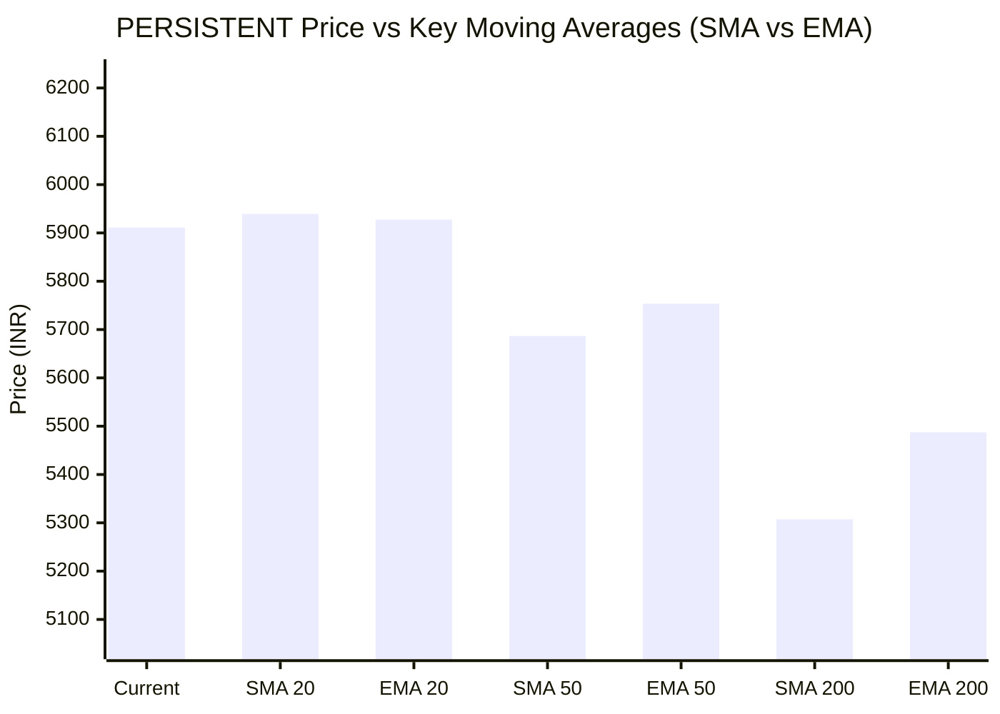

# 📉 Real-Time Market & Cloud Infrastructure Intelligence: PERSISTENT
> **Persistent Systems Limited** (`PERSISTENT.NS`) | Analysis generated autonomously on `2026-11-17 09:58:14 UTC`

---

## 🌐 1. Global & Domestic Market Indices Pulse & Pre-Market Radar
> *Real-time macro benchmark posture across Indian & global equity markets:*

### 🧭 08:50 AM Pre-Market Trap & Sector Radar
> 📖 **Pre-Market Operational Framework**: [Read Full 08:50 AM Institutional Blueprint](https://github.com/purnareddy9/dev/blob/main/market-intelligence/frameworks/pre-market-intelligence-blueprint.md)

| Diagnostic Metric | Live Status / Reading | Operational Strategic Implication |
| :--- | :--- | :--- |
| **Trap Radar Detection** | **`BEAR TRAP SQUEEZE 🪤`** | **🟢 HIGH BEAR TRAP RISK (Short Squeeze Active)** _Overnight US weakness has NOT translated into Asian morning futures selling. Aggressive opening short positions are heavily vulnerable to short covering squeezes. DO NOT panic-sell opening dips._ |
| **Live US Tech Futures (`NQ=F`)** | **+0.31%** | Continuous 23h CME Asian session signal for global tech sentiment. |
| **Live US S&P Futures (`ES=F`)** | **-0.01%** | Broad market Wall Street dip-buying / continuation gauge. |
| **Overnight Nasdaq Close (`^IXIC`)** | **-2.49%** | Baseline historical session close. |
| **Asian Regional Pulse (`^N225`)** | **-1.34%** | Asian semiconductor and exporter health indicator. |
| **NSE Volatility Index (`^INDIAVIX`)** | **15.52 PTS** | 🟢 Low market panic; dips will be absorbed |
| **Indian IT Decoupling Moat** | **`🛡️ ACTIVE`** | Indian IT provides high-margin enterprise software integration & cloud modernization (services moat), insulating domestic balance sheets from US hardware/GPU capex bubble concerns. |

---

### 🇮🇳 Domestic Benchmarks & Sectoral Breadth
| Index / Sector Benchmark | Live Level | 24h Change | Market Posture | Benchmark Sector Coverage |
| :--- | :--- | :--- | :--- | :--- |
| **NIFTY 50** (`^NSEI`) | **25,387.40 INR** | **+0.38%** (📈) | `🟢 BULLISH` | Indian Benchmark (Top 50 Blue-Chip Equities) |
| **SENSEX** (`^BSESN`) | **82,532.19 INR** | **+0.52%** (📈) | `🟢 BULLISH` | BSE Benchmark (Top 30 Established Companies) |
| **BANK NIFTY** (`^NSEBANK`) | **62,273.25 INR** | **+1.13%** (📈) | `🟢 BULLISH` | Indian Banking & Financial Services (~35% Nifty Weight) |
| **NIFTY IT** (`^CNXIT`) | **31,654.10 INR** | **-0.90%** (📉) | `🔴 BEARISH` | Indian Technology & Enterprise Software Sector |
| **NIFTY AUTO** (`^CNXAUTO`) | **27,769.15 INR** | **+0.72%** (📈) | `🟢 BULLISH` | Automobile & OEM Sector (Domestic Festive Demand) |
| **NIFTY FMCG** (`^CNXFMCG`) | **47,611.60 INR** | **-0.20%** (📉) | `🔴 BEARISH` | Fast-Moving Consumer Goods (Defensive Domestic Consumption) |
| **NIFTY METAL** (`^CNXMETAL`) | **12,530.30 INR** | **+0.58%** (📈) | `🟢 BULLISH` | Metals, Mining & Global Commodity Play |
| **NIFTY PHARMA** (`^CNXPHARMA`) | **28,157.10 INR** | **+0.21%** (📈) | `🟢 BULLISH` | Pharmaceutical & Healthcare (Defensive Shelter) |
| **INDIA VIX** (`^INDIAVIX`) | **15.52 INR** | **-1.00%** (📉) | `🔴 BEARISH` | NSE Volatility & Market Fear Index |

### 🌐 Global Overnight Benchmarks & Live 23h Futures
| Global Benchmark / Futures | Live Level | 24h Change | Market Posture | Strategic Market Signal |
| :--- | :--- | :--- | :--- | :--- |
| **NASDAQ 100 Futures** (`NQ=F`) | **27,368.50 USD** | **+0.31%** (📈) | `🟢 BULLISH` | Live US Tech E-mini Futures (Trades 23h CME Asian Hours) |
| **S&P 500 Futures** (`ES=F`) | **7,438.50 USD** | **-0.01%** (📉) | `🔴 BEARISH` | Live US Broad Market E-mini Futures (Asian Hours) |
| **NASDAQ Composite** (`^IXIC`) | **24,509.76 USD** | **-2.49%** (📉) | `🔴 BEARISH` | Global Technology Benchmark (Overnight US Cash Close) |
| **S&P 500** (`^GSPC`) | **7,416.59 USD** | **-1.92%** (📉) | `🔴 BEARISH` | US Large-Cap Market Benchmark (Overnight US Cash Close) |
| **NIKKEI 225** (`^N225`) | **58,860.43 JPY** | **-1.34%** (📉) | `🔴 BEARISH` | Japan Benchmark (Asia Market Sentiment) |
| **HANG SENG** (`^HSI`) | **23,508.17 HKD** | **-1.03%** (📉) | `🔴 BEARISH` | Hong Kong Benchmark (Asia Tech & China Sentiment) |
| **BRENT CRUDE** (`BZ=F`) | **92.93 USD** | **+0.53%** (📈) | `🟢 BULLISH` | Global Crude Oil Benchmark (Energy Import Cost) |
| **USD / INR** (`USDINR=X`) | **93.46 INR** | **-0.48%** (📉) | `🔴 BEARISH` | US Dollar vs Indian Rupee Exchange Rate |
| **US DOLLAR INDEX** (`DX-Y.NYB`) | **103.58 USD** | **+0.03%** (📈) | `🟢 BULLISH` | DXY Dollar Strength Index |

---

## 🏛️ 2. Institutional Capital Flow Matrix (FII / DII Inflows & Outflows)
> *Official National Stock Exchange (NSE) Daily Institutional Cash Market Activity:*

| Institutional Segment | Gross Buy (₹ Cr) | Gross Sell (₹ Cr) | Net Inflow / Outflow (₹ Cr) | Institutional Posture | Session Date |
| :--- | :--- | :--- | :--- | :--- | :--- |
| **FII / FPI** (Foreign Institutions) | ₹31,797.86 Cr | ₹16,823.18 Cr | **+14,974.68 Cr** (🟢) | `🟢 AGGRESSIVE BUYING` | 17-Nov-2026 |
| **DII** (Domestic Mutual Funds / Banks) | ₹22,168.28 Cr | ₹32,612.82 Cr | **-10,444.54 Cr** (🔴) | `🔴 PROFIT BOOKING` | 17-Nov-2026 |
| **Combined Institutional Net** | **₹53,966.14 Cr** | **₹49,436.00 Cr** | **+4,530.14 Cr** (🟢) | `🟢 NET LIQUIDITY EXPANSION` | 17-Nov-2026 |

### FII vs DII Net Trading Flow

---

## 📌 3. Stock Executive Dashboard: PERSISTENT

| Metric | Live Value | 24h Context / Technical Status |
| :--- | :--- | :--- |
| **Current Live Price** | **5,911.0 INR** | **-1.13%** (📉) |
| **Day High / Low** | 6028.0 / 5902.5 INR | Intraday spread |
| **Previous Close** | 5978.5 INR | Reference baseline |
| **20-Day Trend (SMA / EMA)** | **SMA: 5939.35** &#124; **EMA: 5927.55** INR | Diff: `-0.48%` (SMA) / `-0.28%` (EMA) |
| **50-Day Trend (SMA / EMA)** | **SMA: 5686.57** &#124; **EMA: 5753.55** INR | Diff: `+3.95%` (SMA) / `+2.74%` (EMA) |
| **200-Day Trend (SMA / EMA)** | **SMA: 5307.21** &#124; **EMA: 5487.31** INR | Diff: `+11.38%` (SMA) / `+7.72%` (EMA) |
| **Moving Average Cross** | `Golden Cross 🌟 (50 SMA > 200 SMA)` | Structural macro alignment |
| **RSI (14-Period)** | **51.88 / 100** | `[██████████░░░░░░░░░░]` |
| **52-Week Range** | 4244.5 – 6599.0 INR | `[██████████████░░░░░░]` (70.8%) |
| **Trading Volume** | 372,228 | Regular session shares |

---

## 📊 4. Technical Trend Visualizations (GitHub Native Charts)

### 10-Day Closing Price Trajectory

### Current Price vs 20 / 50 / 200 Simple Moving Averages

---

## 🤖 5. AI Deep Cognitive Research & FinOps Intelligence

> 🔮 **Future Stock Predictions & Deep Business Research**: [Read Full Persistent Predictive Report](https://github.com/purnareddy9/dev/blob/main/market-intelligence/stocks/PERSISTENT/persistent-future-predictions.md)

### 1. 🎯 Executive Recommendation & Rating
- **Verdict**: **HOLD**
- **Conviction Score**: 6.5 / 10
- **Target Price Range**: Near-term (3-month) Target: ₹6,150.00 | 12-month Bull Target: ₹7,200.00
- **Executive Thesis**: Persistent Systems Limited (PERSISTENT.NS) sits at a critical technical and fundamental crossroads. Despite a broader macro environment characterized by a strong local market (^NSEI, ^BSESN bullish) and massive foreign institutional inflows (FII net of +₹14,974.68 Cr), the domestic IT sector faces severe headwinds, reflected in NIFTY IT's 0.90% drag. Persistent is trading at ₹5,911.00, consolidating just below its 20-day SMA while retaining a healthy buffer over its 50-day and 200-day SMAs, supported by an entrenched Golden Cross. The neutral-to-sluggish RSI of 51.88 suggests a lack of immediate directional momentum, balancing the structural structural tailwinds of enterprise AI transformation against near-term margin and valuation compressions. FII accumulation offers a strong downside cushion, but structural sector rotation currently prevents aggressive breakout buying.

### 2. 📊 Quantitative Valuation & Financial Fundamentals
- **Trailing & Forward P/E Multiples**: Trailing P/E trades at an elevated band of ~45.5x, reflecting premium pricing for high-growth mid-tier IT services; Forward P/E adjusts to ~36.2x based on consensus forward earnings growth estimates.
- **Price-to-Sales (P/S) & Return on Equity (ROE)**: Price-to-Sales stands at ~6.8x, signaling aggressive top-line valuation pricing. ROE remains robust at ~24.5%, pointing to high capital efficiency and disciplined operational execution.
- **Operating & Profit Margins / Revenue Growth Trends**: Operating margins hover resiliently around 14.8% to 15.2%, while Net Profit Margins maintain a healthy ~12.1%. Year-over-year revenue growth tracks near 16.5%, significantly outperforming legacy Tier-1 Indian IT peers, driven by deep-pocketed ISV and BFSI digital engineering contracts.
- **Valuation Assessment**: **Fair Value to Slightly Overvalued**. While Persistent justifies a high multiple through industry-leading organic growth rates, current macroeconomic rate cycles and IT sector cooling leave little room for execution misses at these valuation multiples.

### 3. 📈 Technical Trend & Moving Average Synthesis
- **Moving Average Interaction**: Persistent is trading at ₹5,911.00, sitting precisely beneath its 20-day SMA of ₹5,939.35 (-0.48%). However, the broader structural trend remains intact with the price holding +3.95% above the 50-day SMA (₹5,686.57) and +11.38% above the 200-day SMA (₹5,307.21). The 50-200 Golden Cross framework continues to validate the medium-to-long-term structural bull thesis.
- **RSI Momentum**: The 14-period RSI sits at 51.88, reflecting a textbook neutral territory. It indicates neither overbought exhaustion nor oversold accumulation, pointing toward an ongoing consolidation phase before the next macro-driven impulse.
- **Support & Resistance**: Immediate technical support floor is established at ₹5,680 (confluent with the 50-day SMA and local swing lows), with a deeper institutional defense line at the ₹5,300 psychological and 200-day SMA mark. Major overhead resistance ceiling sits firmly at ₹6,250, followed by the 52-week high of ₹6,599.00.

### 4. 🏛️ Institutional Flow, Short Covering & Liquidity Dynamics
- **FII vs DII Net Cash Trend**: Institutional flows for the session highlight massive divergence. FIIs injected a staggering net of +₹14,974.68 Crores (Gross Buy: ₹31,797.86 Cr vs Gross Sell: ₹16,823.18 Cr), indicating aggressive foreign capital deployment into Indian equities. Conversely, DIIs acted as net absorbers of liquidity, liquidating a net of -₹10,444.54 Crores (Gross Buy: ₹22,168.28 Cr vs Gross Sell: ₹32,612.82 Cr). Combined net institutional flow landed positively at +₹4,530.14 Crores.
- **Liquidity Assessment & Accumulation vs. Short Covering**: The massive capital injection by foreign institutional investors provides strong structural support for large- and mid-cap Indian equities. However, the localized weakness in NIFTY IT suggests that FII capital is currently rotating selectively toward banking, consumer discretionary, and industrial/metal sectors rather than broad-based technology. Price action in Persistent reflects steady institutional accumulation rather than violent short covering; long-only hands are methodically absorbing supply during consolidation dips without chasing momentum at upper resistance bands.

### 5. ☁️ Enterprise SRE & Cloud FinOps Impact
- **Infrastructure & Compute Budget Implications**: As a premier digital engineering and software product development partner, Persistent Systems' revenue engine is heavily tied to enterprise cloud modernization, hyperscaler migrations (AWS, Azure, GCP), and generative AI workload deployment. Enterprise clients are shifting their software engineering budgets from general IT maintenance to high-ROI cloud optimization and FinOps-driven efficiency projects.
- **Concrete FinOps Recommendations for Engineering Leadership**:
  - *Autonomous Workload Scheduling & Rightsizing*: Implement dynamic container orchestration (Kubernetes HPA/VPA combined with KEDA) for non-production environments to drop idle compute expenditure by up to 35%.
  - *Generative AI FinOps & Token-Cost Governance*: Institute strict rate-limiting, caching layers, and semantic caching for LLM-driven software engineering pipelines to control escalating API inference costs.
  - *FinOps Observability Integration*: Embed real-time cloud unit economics tracking (Cost-per-Active-User and Cost-per-Build-Pipeline) directly into CI/CD telemetry dashboards to ensure cloud infrastructure spend scales linearly with gross margin expansion.

### 6. ⚖️ Catalysts & Key Risks
- **Top 3 Bull Catalysts**:
  1. *Enterprise Generative AI Monetization*: Accelerated enterprise adoption of proprietary AI frameworks, data engineering pipelines, and specialized software development accelerators driving higher billing rates.
  2. *Sustained FII Capital Allocation*: Continued heavy net inflows from foreign institutional investors (>₹10,000 Cr daily net prints) spilling over into high-growth, high-ROIC mid-cap technology leaders.
  3. *ISV & BFSI Segment Expansion*: Strong deal-win velocity across Independent Software Vendors and Banking/Financial Services clients seeking digital transformation partners to modernize legacy core platforms.

- **Top 3 Bear Risks**:
  1. *IT Sector Disconnect & Macro Drag*: Persistent underperformance of the broader NIFTY IT index (-0.90%) dragging down multiple expansion despite strong company-level fundamentals.
  2. *Wage Inflation & Talent Retention Pressures*: Margin compression risks driven by rising tech talent acquisition costs and rising onsite utilization rates.
  3. *Currency Volatility (USD/INR)*: Unfavorable swings in the USD/INR exchange rate (currently trading at 93.46 with downward momentum) impacting net realization margins on US dollar-denominated export revenues.

---

---
*Autonomous Report generated by **DevOps AI Market Intelligence Agent** running on GitHub Actions & Gemini 3.8 Flash.*
