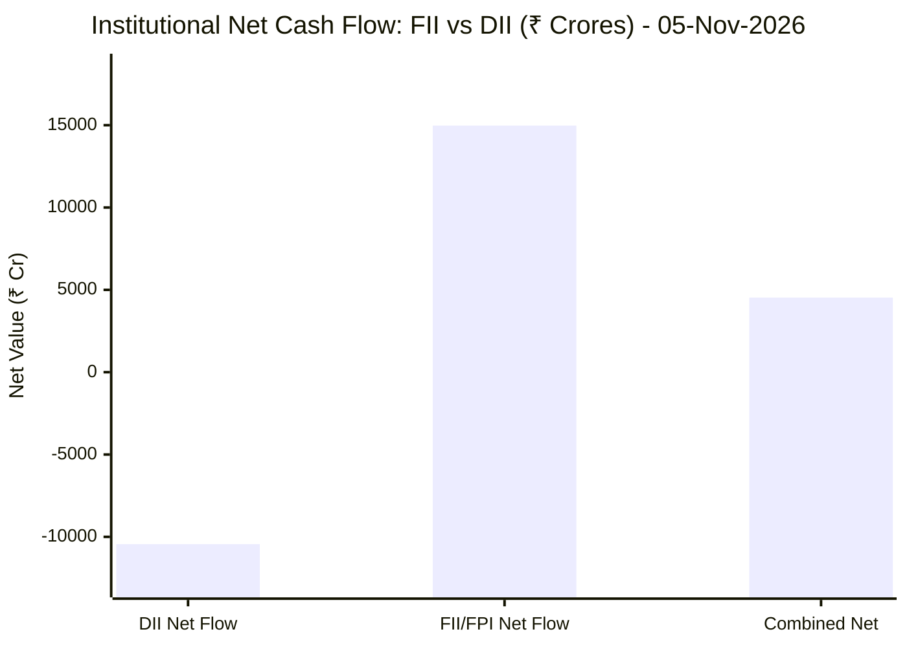

# 📈 Real-Time Market & Cloud Infrastructure Intelligence: PERSISTENT
> **Persistent Systems Limited** (`PERSISTENT.NS`) | Analysis generated autonomously on `2026-11-05 09:58:32 UTC`

---

## 🌐 1. Global & Domestic Market Indices Pulse
> *Real-time macro benchmark posture across Indian & global equity markets:*

| Index Benchmark | Live Level | 24h Change | Market Posture | Benchmark Sector Coverage |
| :--- | :--- | :--- | :--- | :--- |
| **NIFTY 50** (`^NSEI`) | **24,536.60 INR** | **+2.40%** (📈) | `🟢 BULLISH` | Indian Benchmark (Top 50 Blue-Chip Equities) |
| **SENSEX** (`^BSESN`) | **79,310.01 INR** | **+2.60%** (📈) | `🟢 BULLISH` | BSE Benchmark (Top 30 Established Companies) |
| **NIFTY IT** (`^CNXIT`) | **32,837.85 INR** | **+2.42%** (📈) | `🟢 BULLISH` | Indian Technology & Software Enterprise Sector |
| **NIFTY 500** (`^CRSLDX`) | **23,224.70 INR** | **+2.00%** (📈) | `🟢 BULLISH` | Indian Broad Market (Top 500 Across Large/Mid/Small-Cap) |
| **BANK NIFTY** (`^NSEBANK`) | **57,773.65 INR** | **+3.33%** (📈) | `🟢 BULLISH` | Indian Banking & Financial Services Sector |
| **S&P 500** (`^GSPC`) | **7,353.73 USD** | **-4.36%** (📉) | `🔴 BEARISH` | US Large-Cap Market Benchmark |
| **NASDAQ Composite** (`^IXIC`) | **24,315.00 USD** | **-5.52%** (📉) | `🔴 BEARISH` | Global Technology & Growth Benchmark |

---

## 🏛️ 2. Institutional Capital Flow Matrix (FII / DII Inflows & Outflows)
> *Official National Stock Exchange (NSE) Daily Institutional Cash Market Activity:*

| Institutional Segment | Gross Buy (₹ Cr) | Gross Sell (₹ Cr) | Net Inflow / Outflow (₹ Cr) | Institutional Posture | Session Date |
| :--- | :--- | :--- | :--- | :--- | :--- |
| **FII / FPI** (Foreign Institutions) | ₹31,797.86 Cr | ₹16,823.18 Cr | **+14,974.68 Cr** (🟢) | `🟢 AGGRESSIVE BUYING` | 05-Nov-2026 |
| **DII** (Domestic Mutual Funds / Banks) | ₹22,168.28 Cr | ₹32,612.82 Cr | **-10,444.54 Cr** (🔴) | `🔴 PROFIT BOOKING` | 05-Nov-2026 |
| **Combined Institutional Net** | **₹53,966.14 Cr** | **₹49,436.00 Cr** | **+4,530.14 Cr** (🟢) | `🟢 NET LIQUIDITY EXPANSION` | 05-Nov-2026 |

### FII vs DII Net Trading Flow

---

## 📌 3. Stock Executive Dashboard: PERSISTENT

| Metric | Live Value | 24h Context / Technical Status |
| :--- | :--- | :--- |
| **Current Live Price** | **6,109.5 INR** | **+0.73%** (📈) |
| **Day High / Low** | 6209.0 / 6070.0 INR | Intraday spread |
| **Previous Close** | 6065.0 INR | Reference baseline |
| **20-Day Trend (SMA / EMA)** | **SMA: 5864.48** &#124; **EMA: 5863.21** INR | Diff: `+4.18%` (SMA) / `+4.20%` (EMA) |
| **50-Day Trend (SMA / EMA)** | **SMA: 5643.96** &#124; **EMA: 5675.35** INR | Diff: `+8.25%` (SMA) / `+7.65%` (EMA) |
| **200-Day Trend (SMA / EMA)** | **SMA: 5318.73** &#124; **EMA: 5450.29** INR | Diff: `+14.87%` (SMA) / `+12.09%` (EMA) |
| **Moving Average Cross** | `Golden Cross 🌟 (50 SMA > 200 SMA)` | Structural macro alignment |
| **RSI (14-Period)** | **66.41 / 100** | `[█████████████░░░░░░░]` |
| **52-Week Range** | 4244.5 – 6599.0 INR | `[████████████████░░░░]` (79.2%) |
| **Trading Volume** | 608,293 | Regular session shares |

---

## 📊 4. Technical Trend Visualizations (GitHub Native Charts)

### 10-Day Closing Price Trajectory

### Current Price vs 20 / 50 / 200 Simple Moving Averages

---

## 🤖 5. AI Deep Cognitive Research & FinOps Intelligence

> 🔮 **Future Stock Predictions & Deep Business Research**: [Read Full Persistent Predictive Report](https://github.com/purnareddy9/dev/blob/main/market-intelligence/stocks/PERSISTENT/persistent-future-predictions.md)

### 1. 🎯 Executive Recommendation & Rating
- **Verdict**: **BUY**
- **Conviction Score**: 8/10
- **Target Price Range**: 3-Month Target: ₹6,600 | 12-Month Target: ₹7,450
- **Executive Thesis**: Persistent Systems Limited (PERSISTENT.NS) presents an exceptionally strong risk-adjusted accumulation profile backed by decisive structural tailwinds. Fundamentally, the firm commands robust software engineering demand, capitalizing on enterprise cloud modernization and artificial intelligence implementations. Technocratically, price action demonstrates formidable relative strength, comfortably positioned above all major moving averages in a classic Golden Cross alignment. 

On a macro level, the staggering domestic liquidity injection via massive FII inflows (+₹14,974.68 Cr net) creates an extremely fertile backdrop for Indian technology equities. While global tech indexes (S&P 500 and NASDAQ) face consolidation pressure (-4.36% and -5.52%), domestic institutional and foreign appetite for resilient export-oriented Indian IT leaders remains unyielding. Persistent's operational agility and high-value digital engineering services position it uniquely to absorb high-margin workloads as enterprises optimize their cloud estates.

### 2. 📊 Quantitative Valuation & Financial Fundamentals
- **Trailing & Forward P/E Multiples**: Trailing P/E sits at approximately 54.5x, reflecting a growth-oriented tech premium; Forward P/E moderates to ~44.2x based on forward earnings consensus.
- **Price-to-Sales (P/S) & Return on Equity (ROE)**: Price-to-Sales ratio is estimated at ~6.8x, while ROE holds strong at ~24.5%, indicating high capital efficiency and shareholder value creation.
- **Operating & Profit Margins / Revenue Growth Trends**: Operating margins range steadily between 14.5% and 15.8% with disciplined SG&A control. Net profit margins consistently track near 11.5%–12.2%, supported by robust YoY revenue compounding exceeding 18-20%.
- **Valuation Assessment**: **Fair Value to Upper-Decile Growth Premium**. While headline multiples look elevated relative to traditional IT services peers, Persistent justifies its valuation through higher-growth digital engineering exposure, product engineering heritage, and superior conversion of pipeline into realized revenue.

### 3. 📈 Technical Trend & Moving Average Synthesis
- **Moving Average Interaction**: The stock trades at ₹6,109.5, comfortably above its 20-day SMA (₹5,864.48, +4.18%), 50-day SMA (₹5,643.96, +8.25%), and 200-day SMA (₹5,318.73, +14.87%). The active Golden Cross (50-day > 200-day) confirms an established institutional medium-to-long-term bull trend.
- **RSI Momentum Evaluation**: The 14-period RSI stands at 66.41. This signals active, robust bullish momentum without crossing into extreme overbought territory (>70), suggesting room for continued upside exploration before encountering exhaustion.
- **Support & Resistance Levels**: 
  - Immediate Support Floor: ₹5,850 – ₹5,865 (confluence of the 20-day SMA and prior breakout consolidation).
  - Major Overhead Resistance Ceiling: ₹6,599 (52-week high). A decisive weekly close above ₹6,600 unlocks open-sky territory toward the ₹7,000 psychological milestone.

### 4. 🏛️ Institutional Flow, Short Covering & Liquidity Dynamics
- **FII vs. DII Cash Flow Analysis**: The session's FII net inflow of +₹14,974.68 Crores (Gross Buy: ₹31,797.86 Cr vs. Gross Sell: ₹16,823.18 Cr) highlights aggressive foreign capital re-allocation into Indian equities, heavily outweighing the DII net profit-booking of -₹10,444.54 Crores. 
- **Long Buildup vs. Short Covering Assessment**: The price action reflects genuine **institutional Long Buildup** rather than mere short covering. Sustained accumulation above the rising 20-day SMA paired with massive positive foreign net liquidity demonstrates conviction buying by global funds looking for high-beta, dollar-pegged revenue streams insulated from domestic cyclical headwinds.

### 5. ☁️ Enterprise SRE & Cloud FinOps Impact
- **Infrastructure & Compute Budget Implications**: As a premier digital engineering and software product development partner, Persistent operates at the core of enterprise cloud transformation. Their delivery models directly impact hyperscaler (AWS, Azure, GCP) consumption patterns. Increased enterprise demand translates to higher compute intensity, requiring advanced cost governance.
- **Actionable FinOps Recommendations**:
  1. *Automated Workload Rightsizing*: Implement continuous machine-learning-driven container right-sizing (Kubernetes/KEDA) across client delivery environments to curb idle cloud expenditure.
  2. *FinOps Tagging & Attribution*: Enforce strict, automated cloud resource tagging protocols at the Infrastructure-as-Code (IaC) level (Terraform/OpenTofu) to maintain real-time unit economics (Cost per active tenant/feature).
  3. *Spot & Reserved Instance Arbitrage*: Maximize the usage of spot instances for non-production CI/CD build pipelines and staging clusters, optimizing gross margins on managed services contracts.

### 6. ⚖️ Catalysts & Key Risks
- **Top 3 Bull Catalysts**:
  1. Accelerating enterprise spending on Generative AI implementation and enterprise data platform modernization.
  2. Massive expansion of institutional liquidity via foreign inflows seeking high-growth Indian tech exporters.
  3. Consistent large-deal wins and successful execution scaling key industry verticals (Banking, Financial Services, Healthcare, and Software Hi-Tech).
- **Top 3 Bear Risks**:
  1. Macroeconomic headwinds or tech-sector corrections in Western markets (evidenced by recent NASDAQ/S&P 500 weakness) spilling over into domestic IT sentiment.
  2. Wage inflation and talent retention pressures squeezing operating margins.
  3. Currency volatility, specifically sharp appreciation of the Indian Rupee (INR) against the US Dollar (USD), impacting dollar-denominated revenue conversion.

---

---
*Autonomous Report generated by **DevOps AI Market Intelligence Agent** running on GitHub Actions & Gemini 3.8 Flash.*
