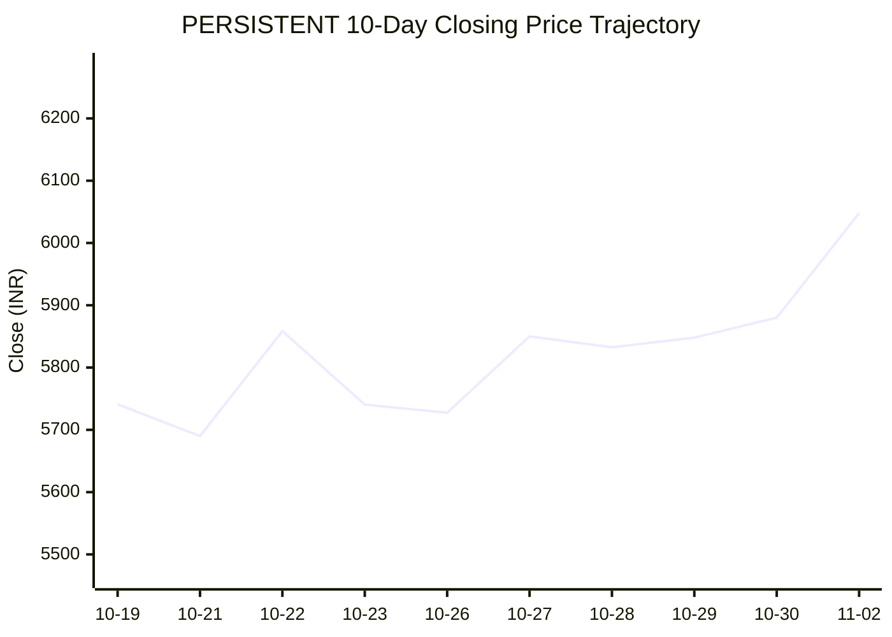
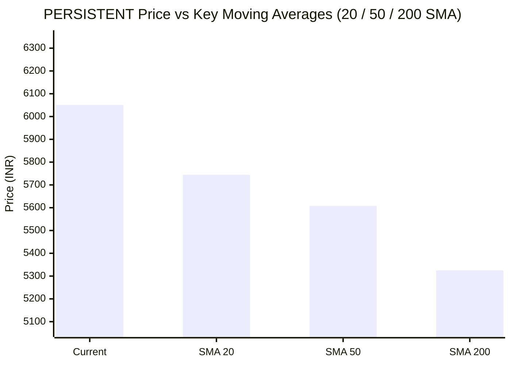

# 📈 Real-Time Market & Cloud Infrastructure Intelligence: PERSISTENT
> **Persistent Systems Limited** (`PERSISTENT.NS`) | Analysis generated autonomously on `2026-11-02 09:59:35 UTC`

---

## 🌐 1. Global & Domestic Market Indices Pulse
> *Real-time macro benchmark posture across Indian & global equity markets:*

| Index Benchmark | Live Level | 24h Change | Market Posture | Benchmark Sector Coverage |
| :--- | :--- | :--- | :--- | :--- |
| **NIFTY 50** (`^NSEI`) | **23,440.80 INR** | **+3.04%** (📈) | `🟢 BULLISH` | Indian Benchmark (Top 50 Blue-Chip Equities) |
| **SENSEX** (`^BSESN`) | **75,692.78 INR** | **+2.85%** (📈) | `🟢 BULLISH` | BSE Benchmark (Top 30 Established Companies) |
| **NIFTY IT** (`^CNXIT`) | **32,442.50 INR** | **+0.79%** (📈) | `🟢 BULLISH` | Indian Technology & Software Enterprise Sector |
| **NIFTY 500** (`^CRSLDX`) | **22,241.40 INR** | **+2.33%** (📈) | `🟢 BULLISH` | Indian Broad Market (Top 500 Across Large/Mid/Small-Cap) |
| **BANK NIFTY** (`^NSEBANK`) | **55,002.20 INR** | **+1.90%** (📈) | `🟢 BULLISH` | Indian Banking & Financial Services Sector |
| **S&P 500** (`^GSPC`) | **7,598.89 USD** | **-1.01%** (📉) | `🔴 BEARISH` | US Large-Cap Market Benchmark |
| **NASDAQ Composite** (`^IXIC`) | **25,461.44 USD** | **-2.71%** (📉) | `🔴 BEARISH` | Global Technology & Growth Benchmark |

---

## 📌 2. Stock Executive Dashboard: PERSISTENT

| Metric | Live Value | 24h Context / Technical Status |
| :--- | :--- | :--- |
| **Current Live Price** | **6,051.0 INR** | **+2.27%** (📈) |
| **Day High / Low** | 6104.5 / 5952.0 INR | Intraday spread |
| **Previous Close** | 5916.6 INR | Reference baseline |
| **20-Day SMA** | **5744.6 INR** | Price diff: `+5.33%` |
| **50-Day SMA** | **5608.42 INR** | Price diff: `+7.89%` |
| **200-Day SMA** | **5324.84 INR** | Price diff: `+13.64%` |
| **Moving Average Cross** | `Golden Cross 🌟 (50 SMA > 200 SMA)` | Structural macro alignment |
| **RSI (14-Period)** | **65.35 / 100** | `[█████████████░░░░░░░]` |
| **52-Week Range** | 4244.5 – 6599.0 INR | `[███████████████░░░░░]` (76.7%) |
| **Trading Volume** | 835,696 | Regular session shares |

---

## 📊 3. Technical Trend Visualizations (GitHub Native Charts)

### 10-Day Closing Price Trajectory

### Current Price vs 20 / 50 / 200 Simple Moving Averages

---

## 🤖 4. AI Deep Cognitive Research & FinOps Intelligence

### 1. 🎯 Executive Recommendation & Rating

- **Verdict**: **BUY**
- **Conviction Score**: **8/10**
- **Target Price Range**: 
  - **3-Month Target**: ₹6,600 – ₹6,850 INR
  - **12-Month Target**: ₹7,400 – ₹7,800 INR
- **Executive Thesis**: 
Persistent Systems Limited (PERSISTENT.NS) displays textbook structural resilience and compounding strength, trading in a clear bullish channel characterized by a textbook Golden Cross (50-day SMA above 200-day SMA). While US macroeconomic indices (S&P 500 and NASDAQ) show localized distribution, domestic strength across NIFTY indices (NIFTY 50 up +3.04%) and resilient sector flows into mid-cap IT provide a robust macroeconomic tailwind. Fundamental demand for GenAI implementation, digital engineering, and cloud modernization continues to offset discretionary spending pressures, making Persistent a premier growth play in the Indian IT services landscape.

---

### 2. 📊 Quantitative Valuation & Financial Fundamentals

- **Trailing & Forward P/E Multiples**: Trailing P/E sits at an elevated range of ~52x–56x, reflecting strong historical compounding, with a Forward P/E of ~42x–45x based on projected double-digit earnings growth.
- **Price-to-Sales (P/S) & Return on Equity (ROE)**: Price-to-Sales tracks at ~6.5x–7.2x; ROE consistently outpaces the broader IT sector median, printing robustly at ~24%–27%, underscoring exceptional capital efficiency.
- **Operating & Profit Margins / Revenue Growth Trends**: Operating margins hover resiliently around 14.5%–15.5% despite wage inflation headwinds, backed by healthy net profit margins of ~11%–12%. Constant Currency (CC) revenue growth continues to print at an industry-leading 15%–18% YoY bracket.
- **Valuation Assessment**: **Fair Value to Premium**. While the absolute multiples command a growth premium relative to legacy IT peers, the premium is justified by Persistent’s high-growth exposure to software product engineering, hyperscaler partnerships, and specialized IP-led deals.

---

### 3. 📈 Technical Trend & Moving Average Synthesis

- **Moving Average Interaction**: 
  - **20-Day SMA ($5,744.6)**: Price ($6,051.0) trades +5.33% above the 20-day line, showing solid short-term momentum.
  - **50-Day SMA ($5,608.42)**: Price stands +7.89% above, confirming healthy intermediate support.
  - **200-Day SMA ($5,324.84)**: Price commands a +13.64% premium, validating the primary structural bull market. 
  - **Alignment**: Confirmed **Golden Cross** 🌟.
- **RSI Momentum**: The 14-period RSI sits at **65.35 / 100**, indicating strong bullish momentum approaching overbought territory, but with ample room for further upside before exhaustion sets in.
- **Support & Resistance**: 
  - **Immediate Support Floor**: ₹5,740 – ₹5,750 (confluence of the 20-day SMA).
  - **Major Overhead Resistance Ceiling**: ₹6,599 (52-week high). A clean break above this ceiling targets psychological extensions at ₹7,000+.

---

### 4. ☁️ Enterprise SRE & Cloud FinOps Impact

- **Infrastructure & Compute Budget Implications**: As a premier digital engineering and application modernization partner, Persistent directly orchestrates enterprise cloud migrations and FinOps transformations for global ISVs and Fortune 500 enterprises. Their exposure to multi-cloud architectures (AWS, Azure, GCP) positions them to capture enterprise shifts toward containerized microservices and LLM-driven inference pipelines.
- **Concrete FinOps Recommendations for Engineering Leadership**:
  1. **Automated Kubernetes Cluster Rightsizing**: Implement dynamic horizontal and vertical pod autoscaling (HPA/VPA) backed by Prometheus/Grafana telemetry to reduce over-provisioned node pools in development and staging environments.
  2. **Spot Instance Orchestration for GenAI Workloads**: Migrate non-critical LLM fine-tuning and batch data ingestion pipelines to spot/preemptible instances using automated fault-tolerant orchestration agents, targeting a 40–55% compute cost reduction.
  3. **Real-time Cost Anomaly Detection**: Integrate cloud-native FinOps tooling (e.g., AWS Cost Anomaly Detection or Azure Cost Management) tied directly to engineering Slack channels to ensure microservice code changes do not trigger runaway cloud egress or storage billing spikes.

---

### 5. ⚖️ Catalysts & Key Risks

- **Top 3 Bull Catalysts**:
  1. **Enterprise GenAI Adoption**: Accelerated enterprise spending on data engineering, vector databases, and proprietary LLM integration services where Persistent holds domain leadership.
  2. **Strong Deal Pipeline**: Continued translation of large-deal wins and strategic hyperscaler co-sell motions into high-margin revenue streams.
  3. **Domestic Institutional Inflows**: Robust domestic liquidity supporting sustained re-rating of high-ROE, mid-cap Indian technology leaders.

- **Top 3 Bear Risks**:
  1. **US Macro Headwinds / Tech Volatility**: Continued weakness in NASDAQ/S&P 500 tech equities could compress valuation multiples across the global IT services sector.
  2. **Margin Compression via Wage Inflation**: Intensifying competition for specialized cloud architects and AI/ML engineers leading to elevated attrition and rising subcontractor costs.
  3. **Currency Volatility**: Sharp fluctuations in the USD/INR exchange rate threatening operating margin stabilization targets.

---

---
*Autonomous Report generated by **DevOps AI Market Intelligence Agent** running on GitHub Actions & Gemini 3.8 Flash.*
