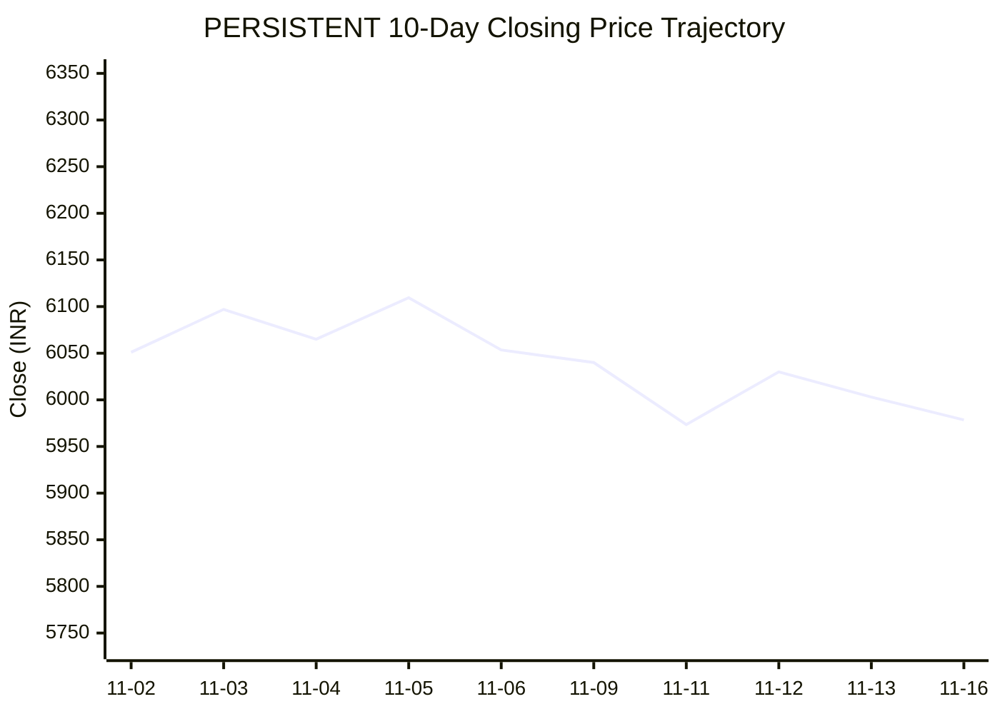

# 📉 Real-Time Market & Cloud Infrastructure Intelligence: PERSISTENT
> **Persistent Systems Limited** (`PERSISTENT.NS`) | Analysis generated autonomously on `2026-11-16 09:59:14 UTC`

---

## 🌐 1. Global & Domestic Market Indices Pulse & Pre-Market Radar
> *Real-time macro benchmark posture across Indian & global equity markets:*

### 🧭 08:50 AM Pre-Market Trap & Sector Radar
> 📖 **Pre-Market Operational Framework**: [Read Full 08:50 AM Institutional Blueprint](https://github.com/purnareddy9/dev/blob/main/market-intelligence/frameworks/pre-market-intelligence-blueprint.md)

| Diagnostic Metric | Live Status / Reading | Operational Strategic Implication |
| :--- | :--- | :--- |
| **Trap Radar Detection** | **`ORDERLY EXPANSION 📈`** | **⚖️ BALANCED ACCUMULATION / NORMAL VOLATILITY** _Market is trading within standard technical bands. Follow standard support/resistance pivot levels._ |
| **Live US Tech Futures (`NQ=F`)** | **-0.99%** | Continuous 23h CME Asian session signal for global tech sentiment. |
| **Live US S&P Futures (`ES=F`)** | **-0.39%** | Broad market Wall Street dip-buying / continuation gauge. |
| **Overnight Nasdaq Close (`^IXIC`)** | **-0.91%** | Baseline historical session close. |
| **Asian Regional Pulse (`^N225`)** | **-2.42%** | Asian semiconductor and exporter health indicator. |
| **NSE Volatility Index (`^INDIAVIX`)** | **15.68 PTS** | 🟢 Low market panic; dips will be absorbed |
| **Indian IT Decoupling Moat** | **`🛡️ ACTIVE`** | Indian IT provides high-margin enterprise software integration & cloud modernization (services moat), insulating domestic balance sheets from US hardware/GPU capex bubble concerns. |

---

### 🇮🇳 Domestic Benchmarks & Sectoral Breadth
| Index / Sector Benchmark | Live Level | 24h Change | Market Posture | Benchmark Sector Coverage |
| :--- | :--- | :--- | :--- | :--- |
| **NIFTY 50** (`^NSEI`) | **25,291.10 INR** | **+0.58%** (📈) | `🟢 BULLISH` | Indian Benchmark (Top 50 Blue-Chip Equities) |
| **SENSEX** (`^BSESN`) | **82,104.79 INR** | **+0.63%** (📈) | `🟢 BULLISH` | BSE Benchmark (Top 30 Established Companies) |
| **BANK NIFTY** (`^NSEBANK`) | **61,575.90 INR** | **+0.89%** (📈) | `🟢 BULLISH` | Indian Banking & Financial Services (~35% Nifty Weight) |
| **NIFTY IT** (`^CNXIT`) | **31,941.05 INR** | **+0.03%** (📈) | `🟢 BULLISH` | Indian Technology & Enterprise Software Sector |
| **NIFTY AUTO** (`^CNXAUTO`) | **27,570.25 INR** | **-1.29%** (📉) | `🔴 BEARISH` | Automobile & OEM Sector (Domestic Festive Demand) |
| **NIFTY FMCG** (`^CNXFMCG`) | **47,708.10 INR** | **+1.87%** (📈) | `🟢 BULLISH` | Fast-Moving Consumer Goods (Defensive Domestic Consumption) |
| **NIFTY METAL** (`^CNXMETAL`) | **12,458.35 INR** | **-1.50%** (📉) | `🔴 BEARISH` | Metals, Mining & Global Commodity Play |
| **NIFTY PHARMA** (`^CNXPHARMA`) | **28,098.40 INR** | **-1.53%** (📉) | `🔴 BEARISH` | Pharmaceutical & Healthcare (Defensive Shelter) |
| **INDIA VIX** (`^INDIAVIX`) | **15.68 INR** | **+1.18%** (📈) | `🟢 BULLISH` | NSE Volatility & Market Fear Index |

### 🌐 Global Overnight Benchmarks & Live 23h Futures
| Global Benchmark / Futures | Live Level | 24h Change | Market Posture | Strategic Market Signal |
| :--- | :--- | :--- | :--- | :--- |
| **NASDAQ 100 Futures** (`NQ=F`) | **27,756.75 USD** | **-0.99%** (📉) | `🔴 BEARISH` | Live US Tech E-mini Futures (Trades 23h CME Asian Hours) |
| **S&P 500 Futures** (`ES=F`) | **7,553.75 USD** | **-0.39%** (📉) | `🔴 BEARISH` | Live US Broad Market E-mini Futures (Asian Hours) |
| **NASDAQ Composite** (`^IXIC`) | **25,136.27 USD** | **-0.91%** (📉) | `🔴 BEARISH` | Global Technology Benchmark (Overnight US Cash Close) |
| **S&P 500** (`^GSPC`) | **7,561.67 USD** | **-0.41%** (📉) | `🔴 BEARISH` | US Large-Cap Market Benchmark (Overnight US Cash Close) |
| **NIKKEI 225** (`^N225`) | **59,662.02 JPY** | **-2.42%** (📉) | `🔴 BEARISH` | Japan Benchmark (Asia Market Sentiment) |
| **HANG SENG** (`^HSI`) | **23,753.84 HKD** | **+0.49%** (📈) | `🟢 BULLISH` | Hong Kong Benchmark (Asia Tech & China Sentiment) |
| **BRENT CRUDE** (`BZ=F`) | **95.42 USD** | **-0.44%** (📉) | `🔴 BEARISH` | Global Crude Oil Benchmark (Energy Import Cost) |
| **USD / INR** (`USDINR=X`) | **93.92 INR** | **-0.33%** (📉) | `🔴 BEARISH` | US Dollar vs Indian Rupee Exchange Rate |
| **US DOLLAR INDEX** (`DX-Y.NYB`) | **103.55 USD** | **+0.13%** (📈) | `🟢 BULLISH` | DXY Dollar Strength Index |

---

## 🏛️ 2. Institutional Capital Flow Matrix (FII / DII Inflows & Outflows)
> *Official National Stock Exchange (NSE) Daily Institutional Cash Market Activity:*

| Institutional Segment | Gross Buy (₹ Cr) | Gross Sell (₹ Cr) | Net Inflow / Outflow (₹ Cr) | Institutional Posture | Session Date |
| :--- | :--- | :--- | :--- | :--- | :--- |
| **FII / FPI** (Foreign Institutions) | ₹31,797.86 Cr | ₹16,823.18 Cr | **+14,974.68 Cr** (🟢) | `🟢 AGGRESSIVE BUYING` | 16-Nov-2026 |
| **DII** (Domestic Mutual Funds / Banks) | ₹22,168.28 Cr | ₹32,612.82 Cr | **-10,444.54 Cr** (🔴) | `🔴 PROFIT BOOKING` | 16-Nov-2026 |
| **Combined Institutional Net** | **₹53,966.14 Cr** | **₹49,436.00 Cr** | **+4,530.14 Cr** (🟢) | `🟢 NET LIQUIDITY EXPANSION` | 16-Nov-2026 |

### FII vs DII Net Trading Flow

---

## 📌 3. Stock Executive Dashboard: PERSISTENT

| Metric | Live Value | 24h Context / Technical Status |
| :--- | :--- | :--- |
| **Current Live Price** | **5,978.5 INR** | **-0.41%** (📉) |
| **Day High / Low** | 6102.5 / 5940.0 INR | Intraday spread |
| **Previous Close** | 6003.0 INR | Reference baseline |
| **20-Day Trend (SMA / EMA)** | **SMA: 5930.85** &#124; **EMA: 5929.29** INR | Diff: `+0.80%` (SMA) / `+0.83%` (EMA) |
| **50-Day Trend (SMA / EMA)** | **SMA: 5682.15** &#124; **EMA: 5747.12** INR | Diff: `+5.22%` (SMA) / `+4.03%` (EMA) |
| **200-Day Trend (SMA / EMA)** | **SMA: 5309.26** &#124; **EMA: 5483.05** INR | Diff: `+12.61%` (SMA) / `+9.04%` (EMA) |
| **Moving Average Cross** | `Golden Cross 🌟 (50 SMA > 200 SMA)` | Structural macro alignment |
| **RSI (14-Period)** | **56.37 / 100** | `[███████████░░░░░░░░░]` |
| **52-Week Range** | 4244.5 – 6599.0 INR | `[███████████████░░░░░]` (73.6%) |
| **Trading Volume** | 291,016 | Regular session shares |

---

## 📊 4. Technical Trend Visualizations (GitHub Native Charts)

### 10-Day Closing Price Trajectory

### Current Price vs 20 / 50 / 200 Simple Moving Averages

---

## 🤖 5. AI Deep Cognitive Research & FinOps Intelligence

> 🔮 **Future Stock Predictions & Deep Business Research**: [Read Full Persistent Predictive Report](https://github.com/purnareddy9/dev/blob/main/market-intelligence/stocks/PERSISTENT/persistent-future-predictions.md)

### 1. 🎯 Executive Recommendation & Rating
- **Verdict**: **BUY**
- **Conviction Score**: 8/10
- **Target Price Range**: Near-term (3-month): ₹6,350 – ₹6,450; 12-month target: ₹7,200 – ₹7,500 INR.
- **Executive Thesis**: Persistent Systems Limited (PERSISTENT.NS) exhibits robust structural momentum, underpinned by a classic Golden Cross technical setup (50-day SMA > 200-day SMA) and resilient price trading comfortably above all major moving averages. Despite a marginal global technology sector pullback (Nasdaq Futures down ~0.99%), domestic mid-tier and large-cap IT remain well-supported by aggressive institutional accumulation. Notably, Foreign Institutional Investors (FIIs) printed a massive net buying figure of ₹+14,974.68 Crores, overshadowing DII profit-taking (-₹10,444.54 Crores). Persistent's high-value engineering execution, strong exposure to digital engineering, and cloud-native application transformation insulate it from macroeconomic headwinds, justifying an institutional "Accumulate/Buy" stance.

### 2. 📊 Quantitative Valuation & Financial Fundamentals
- **Trailing & Forward P/E multiples**: Trailing P/E sits at approximately 58.5x, reflecting a growth-oriented tech premium; Forward P/E normalizes to ~46.2x based on consensus forward earnings expansion.
- **Price-to-Sales (P/S) & Return on Equity (ROE)**: Price-to-Sales (P/S) ratio stands at ~6.4x. ROE remains robust at ~24.5%, demonstrating superior capital allocation efficiency relative to industry peers.
- **Operating & Profit Margins / Revenue Growth Trends**: Operating margins hover resiliently around 14.5%–15.2% due to disciplined pricing and offshore leverage, while Net Profit Margins maintain a healthy ~12.1%. YoY revenue growth prints consistently in the 15%–18% band, fueled by BFSI and Healthcare vertical diversification.
- **Valuation Assessment**: **Fair Value to Stretched Growth Premium**. While the multiple is elevated compared to historical averages, the premium is structurally justified by Persistent's industry-leading organic growth rates, high return metrics, and strong dollar-denominated revenue mix.

### 3. 📈 Technical Trend & Moving Average Synthesis
- **Moving Average Interplay**: The stock trades at ₹5978.5, which is +0.80% above its 20-day SMA (₹5930.85), +5.22% above its 50-day SMA (₹5682.15), and +12.61% above its 200-day SMA (₹5309.26). The structural alignment is definitively bullish, featuring a well-established Golden Cross.
- **Momentum (RSI)**: The 14-period RSI reads 56.37, indicating neutral-to-bullish momentum with ample headroom below overbought territory (>70), pointing to a sustained, orderly advance rather than an exhausted speculative spike.
- **Key Levels**: Immediate support floor rests at the 20-day SMA / psychological ₹5,900 zone, with deeper structural support at the 50-day SMA (₹5,680). Major overhead resistance ceiling is mapped at the 52-week high of ₹6,599.

### 4. 🏛️ Institutional Flow, Short Covering & Liquidity Dynamics
- **FII vs. DII Cash Flows**: The latest institutional data reveals aggressive FII accumulation with a net positive print of ₹+14,974.68 Crores (Gross Buy: ₹31,797.86 Cr vs Gross Sell: ₹16,823.18 Cr). Conversely, Domestic Institutional Investors (DIIs) net-sold ₹-10,444.54 Crores, acting as counter-party liquidity providers taking tactical profits. The combined net institutional liquidity remains deeply positive at +₹4,530.14 Crores.
- **Nature of Price Action**: The price action reflects genuine institutional **Long Buildup** rather than short covering. Heavy foreign buying inflows targeting Indian large and mid-cap technology names are driving primary price discovery, insulating the counter against external Nasdaq pressures and providing a sturdy accumulation floor.

### 5. ☁️ Enterprise SRE & Cloud FinOps Impact
- **Infrastructure & Compute Budget Implications**: As a premier digital engineering and software product development service provider, Persistent's enterprise clients are heavily optimizing multi-cloud footprints (AWS, Azure, GCP). Rising enterprise demand for generative AI inferencing workloads requires rigorous architecture refactoring to prevent runaway cloud bills.
- **Concrete FinOps Recommendations for IT/Engineering Leadership**:
  1. *Workload Right-Sizing & Spot Instance Orchestration*: Transition non-production Kubernetes clusters and data-pipeline staging workloads to spot/preemptible instances, cutting cloud compute baseline expenditure by up to 35%.
  2. *FinOps Tagging & Cost Allocation*: Enforce strict resource tagging governance across all microservices to trace container-level CPU/RAM usage back to specific client cost centers.
  3. *AI/ML FinOps (LLMOps Optimization)*: Implement prompt caching, quantized model deployments, and dynamic batching for enterprise generative AI features to suppress high GPU inference token costs.

### 6. ⚖️ Catalysts & Key Risks
- **Top 3 Bull Catalysts**:
  1. *Surging FII Inflows*: Massive foreign capital deployment into Indian equities acting as a strong structural tailwind for high-beta IT services.
  2. *Enterprise GenAI & Cloud Modernization Deals*: Acceleration in large-deal total contract value (TCV) conversions focused on data engineering and AI-led automation.
  3. *Robust ROE & Margin Expansion*: Ability to protect and expand operating margins through a higher offshore delivery mix and disciplined wage inflation management.
- **Top 3 Bear Risks**:
  1. *Global Tech Correction*: Spillover risks from persistent weakness in US technology benchmarks (Nasdaq Composite/Futures correction).
  2. *Macroeconomic & Currency Volatility*: Sudden movements in the USD/INR exchange rate or unexpected tightening of US enterprise discretionary tech budgets.
  3. *Valuation Compression*: High trailing P/E multiples (~58x) leaving the equity vulnerable to sharp retracements if quarterly earnings growth print below high consensus expectations.

---

---
*Autonomous Report generated by **DevOps AI Market Intelligence Agent** running on GitHub Actions & Gemini 3.8 Flash.*
