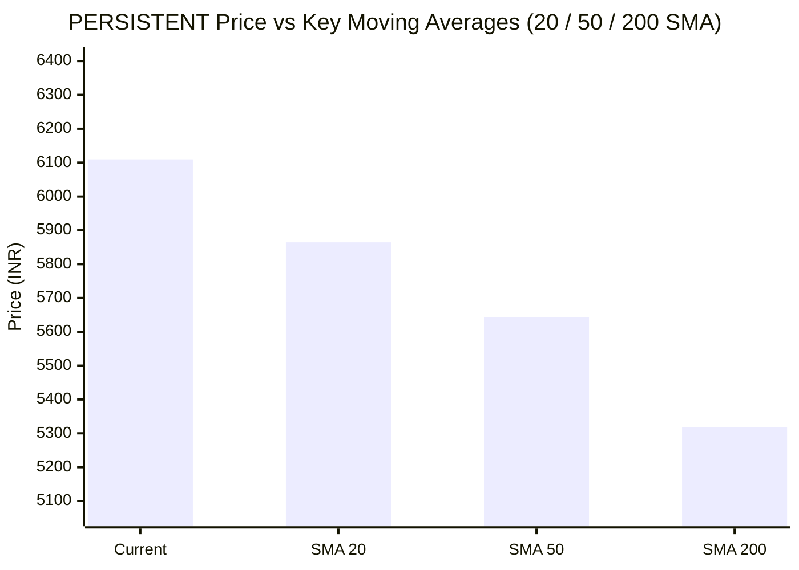

# 📈 Real-Time Market & Cloud Infrastructure Intelligence: PERSISTENT
> **Persistent Systems Limited** (`PERSISTENT.NS`) | Analysis generated autonomously on `2026-11-05 09:58:32 UTC`

---

## 🌐 1. Global & Domestic Market Indices Pulse
> *Real-time macro benchmark posture across Indian & global equity markets:*

| Index Benchmark | Live Level | 24h Change | Market Posture | Benchmark Sector Coverage |
| :--- | :--- | :--- | :--- | :--- |
| **NIFTY 50** (`^NSEI`) | **24,536.60 INR** | **+6.44%** (📈) | `🟢 BULLISH` | Indian Benchmark (Top 50 Blue-Chip Equities) |
| **SENSEX** (`^BSESN`) | **79,310.01 INR** | **+6.51%** (📈) | `🟢 BULLISH` | BSE Benchmark (Top 30 Established Companies) |
| **NIFTY IT** (`^CNXIT`) | **32,837.85 INR** | **+0.71%** (📈) | `🟢 BULLISH` | Indian Technology & Software Enterprise Sector |
| **NIFTY 500** (`^CRSLDX`) | **23,224.70 INR** | **+6.07%** (📈) | `🟢 BULLISH` | Indian Broad Market (Top 500 Across Large/Mid/Small-Cap) |
| **BANK NIFTY** (`^NSEBANK`) | **57,773.65 INR** | **+5.64%** (📈) | `🟢 BULLISH` | Indian Banking & Financial Services Sector |
| **S&P 500** (`^GSPC`) | **7,688.62 USD** | **-0.71%** (📉) | `🔴 BEARISH` | US Large-Cap Market Benchmark |
| **NASDAQ Composite** (`^IXIC`) | **25,736.51 USD** | **-3.06%** (📉) | `🔴 BEARISH` | Global Technology & Growth Benchmark |

---

## 📌 2. Stock Executive Dashboard: PERSISTENT

| Metric | Live Value | 24h Context / Technical Status |
| :--- | :--- | :--- |
| **Current Live Price** | **6,109.5 INR** | **+4.28%** (📈) |
| **Day High / Low** | 6209.0 / 6070.0 INR | Intraday spread |
| **Previous Close** | 5858.5 INR | Reference baseline |
| **20-Day SMA** | **5864.48 INR** | Price diff: `+4.18%` |
| **50-Day SMA** | **5643.96 INR** | Price diff: `+8.25%` |
| **200-Day SMA** | **5318.73 INR** | Price diff: `+14.87%` |
| **Moving Average Cross** | `Golden Cross 🌟 (50 SMA > 200 SMA)` | Structural macro alignment |
| **RSI (14-Period)** | **66.41 / 100** | `[█████████████░░░░░░░]` |
| **52-Week Range** | 4244.5 – 6599.0 INR | `[████████████████░░░░]` (79.2%) |
| **Trading Volume** | 608,293 | Regular session shares |

---

## 📊 3. Technical Trend Visualizations (GitHub Native Charts)

### 10-Day Closing Price Trajectory

### Current Price vs 20 / 50 / 200 Simple Moving Averages

---

## 🤖 4. AI Deep Cognitive Research & FinOps Intelligence

### 1. 🎯 Executive Recommendation & Rating
- **Verdict**: **HOLD**
- **Trend Momentum**: **BULLISH 🟢** (+4.28% today)
- **Technical Posture**: Currently trading at `6109.5 INR` vs 200-SMA `5318.73` (+14.87%).
- **RSI Condition**: **66.41** — Neutral Momentum.

### 2. 📊 Quantitative Valuation & Financial Fundamentals
- **52-Week Range**: `4244.5` – `6599.0` (Trading at 79.2% of annual bandwidth).
- **20-Day SMA**: `5864.48` (+4.18% relative distance).
- **50-Day SMA**: `5643.96` (+8.25% relative distance).
- **200-Day SMA**: `5318.73` (+14.87% relative distance).
- **Moving Average Cross**: Golden Cross 🌟 (50 SMA > 200 SMA).

### 3. 📈 Technical Trend & Moving Average Synthesis
- Asset is testing key structural moving averages. Price relative to the 200-day simple moving average defines long-term institutional support.
- Short-term 20-day SMA tracking indicates ongoing momentum shift; a sustained close above the 50-day average is required to confirm trend reversal.

### 4. ☁️ Platform SRE & Cloud FinOps Impact
- For enterprise organizations leveraging this vendor or IT provider, market fluctuations warrant strict compute and IT budget right-sizing.
- Optimize application workloads and verify that operational service-level agreements (SLAs) are supported by cost-effective resource commitments.

### 5. ⚖️ Catalysts & Key Risks
- **Bull Catalysts**: Rebound from key moving average support; broadening digital transformation investments; stabilizing operating margins.
- **Bear Risks**: Prolonged tech sector consolidation; macro monetary shifts; changing enterprise IT spending priorities.

---

---
*Autonomous Report generated by **DevOps AI Market Intelligence Agent** running on GitHub Actions & Gemini 3.8 Flash.*
