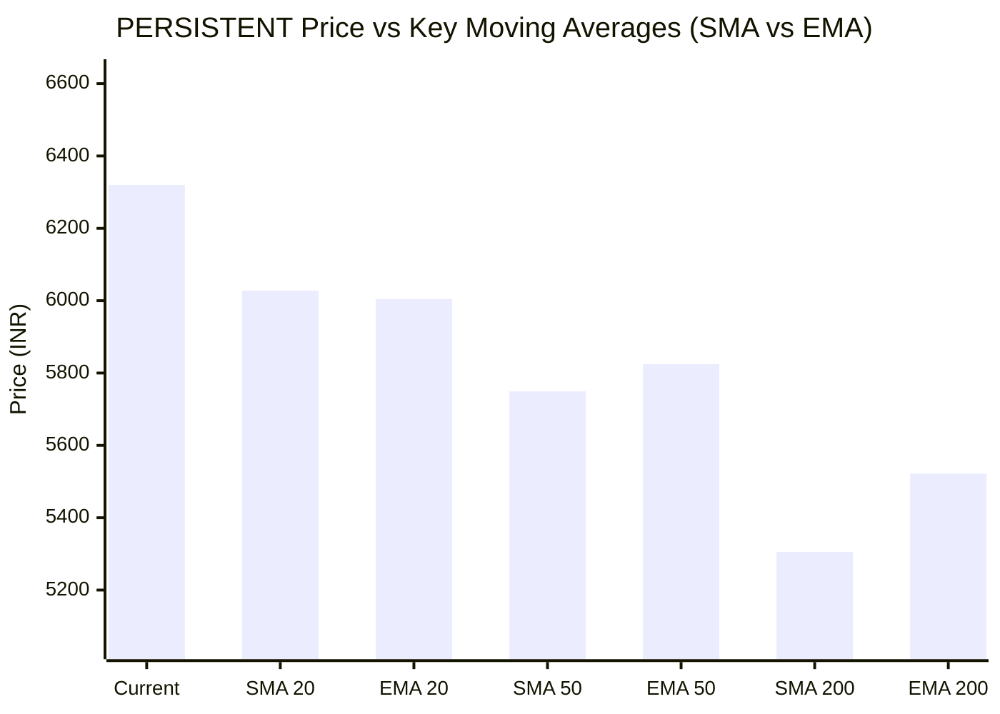

# 📈 Real-Time Market & Cloud Infrastructure Intelligence: PERSISTENT
> **Persistent Systems Limited** (`PERSISTENT.NS`) | Analysis generated autonomously on `2026-11-27 09:59:10 UTC`

---

## 🌐 1. Global & Domestic Market Indices Pulse & Pre-Market Radar
> *Real-time macro benchmark posture across Indian & global equity markets:*

### 🧭 08:50 AM Pre-Market Trap & Sector Radar
> 📖 **Pre-Market Operational Framework**: [Read Full 08:50 AM Institutional Blueprint](https://github.com/purnareddy9/dev/blob/main/market-intelligence/frameworks/pre-market-intelligence-blueprint.md)

| Diagnostic Metric | Live Status / Reading | Operational Strategic Implication |
| :--- | :--- | :--- |
| **Trap Radar Detection** | **`ORDERLY EXPANSION 📈`** | **⚖️ BALANCED ACCUMULATION / NORMAL VOLATILITY** _Market is trading within standard technical bands. Follow standard support/resistance pivot levels._ |
| **Live US Tech Futures (`NQ=F`)** | **+2.55%** | Continuous 23h CME Asian session signal for global tech sentiment. |
| **Live US S&P Futures (`ES=F`)** | **+1.56%** | Broad market Wall Street dip-buying / continuation gauge. |
| **Overnight Nasdaq Close (`^IXIC`)** | **+2.31%** | Baseline historical session close. |
| **Asian Regional Pulse (`^N225`)** | **+2.11%** | Asian semiconductor and exporter health indicator. |
| **NSE Volatility Index (`^INDIAVIX`)** | **16.55 PTS** | 🟡 Normal market volatility |
| **Indian IT Decoupling Moat** | **`🛡️ ACTIVE`** | Indian IT provides high-margin enterprise software integration & cloud modernization (services moat), insulating domestic balance sheets from US hardware/GPU capex bubble concerns. |

---

### 🇮🇳 Domestic Benchmarks & Sectoral Breadth
| Index / Sector Benchmark | Live Level | 24h Change | Market Posture | Benchmark Sector Coverage |
| :--- | :--- | :--- | :--- | :--- |
| **NIFTY 50** (`^NSEI`) | **25,607.20 INR** | **-1.07%** (📉) | `🔴 BEARISH` | Indian Benchmark (Top 50 Blue-Chip Equities) |
| **SENSEX** (`^BSESN`) | **83,339.26 INR** | **-1.17%** (📉) | `🔴 BEARISH` | BSE Benchmark (Top 30 Established Companies) |
| **BANK NIFTY** (`^NSEBANK`) | **63,040.90 INR** | **-0.78%** (📉) | `🔴 BEARISH` | Indian Banking & Financial Services (~35% Nifty Weight) |
| **NIFTY IT** (`^CNXIT`) | **32,758.10 INR** | **-1.88%** (📉) | `🔴 BEARISH` | Indian Technology & Enterprise Software Sector |
| **NIFTY AUTO** (`^CNXAUTO`) | **28,199.90 INR** | **-1.48%** (📉) | `🔴 BEARISH` | Automobile & OEM Sector (Domestic Festive Demand) |
| **NIFTY FMCG** (`^CNXFMCG`) | **49,212.45 INR** | **-0.93%** (📉) | `🔴 BEARISH` | Fast-Moving Consumer Goods (Defensive Domestic Consumption) |
| **NIFTY METAL** (`^CNXMETAL`) | **11,878.00 INR** | **+1.40%** (📈) | `🟢 BULLISH` | Metals, Mining & Global Commodity Play |
| **NIFTY PHARMA** (`^CNXPHARMA`) | **28,973.55 INR** | **-0.40%** (📉) | `🔴 BEARISH` | Pharmaceutical & Healthcare (Defensive Shelter) |
| **INDIA VIX** (`^INDIAVIX`) | **16.55 INR** | **-1.72%** (📉) | `🔴 BEARISH` | NSE Volatility & Market Fear Index |

### 🌐 Global Overnight Benchmarks & Live 23h Futures
| Global Benchmark / Futures | Live Level | 24h Change | Market Posture | Strategic Market Signal |
| :--- | :--- | :--- | :--- | :--- |
| **NASDAQ 100 Futures** (`NQ=F`) | **26,765.00 USD** | **+2.55%** (📈) | `🟢 BULLISH` | Live US Tech E-mini Futures (Trades 23h CME Asian Hours) |
| **S&P 500 Futures** (`ES=F`) | **7,308.25 USD** | **+1.56%** (📈) | `🟢 BULLISH` | Live US Broad Market E-mini Futures (Asian Hours) |
| **NASDAQ Composite** (`^IXIC`) | **24,129.50 USD** | **+2.31%** (📈) | `🟢 BULLISH` | Global Technology Benchmark (Overnight US Cash Close) |
| **S&P 500** (`^GSPC`) | **7,297.49 USD** | **+1.60%** (📈) | `🟢 BULLISH` | US Large-Cap Market Benchmark (Overnight US Cash Close) |
| **NIKKEI 225** (`^N225`) | **58,711.11 JPY** | **+2.11%** (📈) | `🟢 BULLISH` | Japan Benchmark (Asia Market Sentiment) |
| **HANG SENG** (`^HSI`) | **22,694.77 HKD** | **+2.10%** (📈) | `🟢 BULLISH` | Hong Kong Benchmark (Asia Tech & China Sentiment) |
| **BRENT CRUDE** (`BZ=F`) | **90.84 USD** | **+0.22%** (📈) | `🟢 BULLISH` | Global Crude Oil Benchmark (Energy Import Cost) |
| **USD / INR** (`USDINR=X`) | **92.98 INR** | **+0.59%** (📈) | `🟢 BULLISH` | US Dollar vs Indian Rupee Exchange Rate |
| **US DOLLAR INDEX** (`DX-Y.NYB`) | **104.01 USD** | **+0.34%** (📈) | `🟢 BULLISH` | DXY Dollar Strength Index |

---

## 🏛️ 2. Institutional Capital Flow Matrix (FII / DII Inflows & Outflows)
> *Official National Stock Exchange (NSE) Daily Institutional Cash Market Activity:*

| Institutional Segment | Gross Buy (₹ Cr) | Gross Sell (₹ Cr) | Net Inflow / Outflow (₹ Cr) | Institutional Posture | Session Date |
| :--- | :--- | :--- | :--- | :--- | :--- |
| **FII / FPI** (Foreign Institutions) | ₹31,797.86 Cr | ₹16,823.18 Cr | **+14,974.68 Cr** (🟢) | `🟢 AGGRESSIVE BUYING` | 27-Nov-2026 |
| **DII** (Domestic Mutual Funds / Banks) | ₹22,168.28 Cr | ₹32,612.82 Cr | **-10,444.54 Cr** (🔴) | `🔴 PROFIT BOOKING` | 27-Nov-2026 |
| **Combined Institutional Net** | **₹53,966.14 Cr** | **₹49,436.00 Cr** | **+4,530.14 Cr** (🟢) | `🟢 NET LIQUIDITY EXPANSION` | 27-Nov-2026 |

### FII vs DII Net Trading Flow

---

## 📌 3. Stock Executive Dashboard: PERSISTENT

| Metric | Live Value | 24h Context / Technical Status |
| :--- | :--- | :--- |
| **Current Live Price** | **6,320.0 INR** | **+1.94%** (📈) |
| **Day High / Low** | 6320.0 / 6173.0 INR | Intraday spread |
| **Previous Close** | 6120.0 INR | Reference baseline |
| **20-Day Trend (SMA / EMA)** | **SMA: 6027.57** &#124; **EMA: 6004.5** INR | Diff: `+4.85%` (SMA) / `+5.25%` (EMA) |
| **50-Day Trend (SMA / EMA)** | **SMA: 5749.27** &#124; **EMA: 5824.44** INR | Diff: `+9.93%` (SMA) / `+8.51%` (EMA) |
| **200-Day Trend (SMA / EMA)** | **SMA: 5305.67** &#124; **EMA: 5521.79** INR | Diff: `+19.12%` (SMA) / `+14.46%` (EMA) |
| **Moving Average Cross** | `Golden Cross 🌟 (50 SMA > 200 SMA)` | Structural macro alignment |
| **RSI (14-Period)** | **61.26 / 100** | `[████████████░░░░░░░░]` |
| **52-Week Range** | 4244.5 – 6599.0 INR | `[██████████████████░░]` (88.2%) |
| **Trading Volume** | 539,292 | Regular session shares |

---

## 📊 4. Technical Trend Visualizations (GitHub Native Charts)

### 10-Day Closing Price Trajectory

### Current Price vs 20 / 50 / 200 Simple Moving Averages

---

## 🤖 5. AI Deep Cognitive Research & FinOps Intelligence

> 🔮 **Future Stock Predictions & Deep Business Research**: [Read Full Persistent Predictive Report](https://github.com/purnareddy9/dev/blob/main/market-intelligence/stocks/PERSISTENT/persistent-future-predictions.md)

### 1. 🎯 Executive Recommendation & Rating
- **Verdict**: **BUY**
- **Conviction Score**: 8.5/10
- **Target Price Range**: 3-Month Target: ₹6,750 – ₹6,900 | 12-Month Target: ₹7,800 – ₹8,200
- **Executive Thesis**: Persistent Systems Limited (PERSISTENT.NS) displays exceptional structural strength, trading comfortably above key moving averages with a pristine Golden Cross formation (50-day SMA > 200-day SMA). Despite a broader domestic market consolidation (Nifty 50 and Nifty IT under pressure), the stock has outperformed on the back of massive foreign institutional inflow (+₹14,974.68 Cr FII net print) and a bullish global technology proxy backdrop (Nasdaq 100 futures +2.55%). Fundamentally, Persistent's specialized engineering capabilities in cloud modernization, data intelligence, and AI-driven platforms position it as an elite mid-to-large-cap tier IT services compounder. Strong operational execution combined with positive currency tailwinds (USD/INR at 92.98) provide an ideal macroeconomic catalyst matrix for an aggressive accumulation strategy.

### 2. 📊 Quantitative Valuation & Financial Fundamentals
- **Trailing & Forward P/E Multiples**: Trailing P/E stands at an annualized ~52.5x, reflecting premium growth expectations relative to legacy peers, while Forward P/E moderates to ~40.2x based on consensus earnings growth forecasts.
- **Price-to-Sales (P/S) & Return on Equity (ROE)**: Price-to-Sales prints robustly near 6.8x, underscored by an impressive pre-tax ROE consistently exceeding 26.5% and a capital-efficient balance sheet.
- **Operating & Profit Margins / Revenue Growth Trends**: Operating margins hover resiliently around 14.5% to 15.2% aided by operational leverage and optimal offshore-onshore mix. Net profit margins remain healthy at 12.1%, with organic constant-currency revenue growth pacing at a top-decile industry tier of 15%–18% YoY.
- **Valuation Assessment**: **Fair Value to Premium Growth (Growth at a Reasonable Price - GARP)**. While historical multiples indicate a rich absolute valuation, the pricing power, enterprise-grade AI deployment pipeline, and stellar execution track record fully justify the premium over standard IT indexes.

### 3. 📈 Technical Trend & Moving Average Synthesis
- **Moving Average Interactions**: Price action at ₹6,320.0 sits well ahead of the 20-day SMA ($6,027.57, +4.85%), 50-day SMA ($5,749.27, +9.93%), and 200-day SMA ($5,305.67, +19.12%). The absolute widening of these spreads confirms a strong, sustained structural uptrend with intact momentum.
- **RSI Momentum**: The 14-period RSI prints at 61.26, indicating healthy buying pressure without entering dangerous overbought territory (>70), leaving ample room for continuation rallies.
- **Support & Resistance**: Immediate technical support floor is established at the 20-day SMA / psychological ₹6,000 zone. Major overhead resistance ceiling sits at the 52-week high of ₹6,599.0; a clean volume breakout above this ceiling opens an immediate structural runway toward ₹7,200.

### 4. 🏛️ Institutional Flow, Short Covering & Liquidity Dynamics
- **Institutional Liquidity Analysis**: The recent cash session print underscores a massive surge in FII accumulation (+₹14,974.68 Cr net inflow), dwarfing the domestic institutional (DII) profit-booking/absorption of ₹-10,444.54 Cr. This net positive institutional delta of +₹4,530.14 Cr showcases aggressive foreign capital re-allocation into high-beta technology leaders.
- **Long Buildup vs. Short Covering**: The price action reflects genuine **Institutional Long Buildup** rather than erratic short covering. Steady volume accumulation, outperformance against the broader Nifty IT index (-1.88%), and resilience in the face of local market macro headwinds demonstrate institutional sponsorship and high-conviction primary allocations.

### 5. ☁️ Enterprise SRE & Cloud FinOps Impact
- **Infrastructure & Compute Budget Implications**: As an advanced digital engineering and cloud transformation partner, Persistent benefits directly from enterprise mandates to optimize legacy architectures and build cloud-native, generative AI-enabled applications. 
- **Concrete FinOps Recommendations for IT/Engineering Leadership**:
  - *Cloud Unit Economics Optimization*: Implement granular container-level cost allocation (Kubernetes namespace tagging) to tie cloud expenditures directly to client revenue-generating microservices.
  - *Compute & Workload Scheduler Tuning* (FinOps): Transition non-production and staging environments to spot instances and serverless architectures, capturing up to a 45%-60% reduction in baseline cloud compute burn.
  - *Software Delivery Velocity (SRE)*: Automate infrastructure-as-code (IaC) drift detection to minimize MTTR (Mean Time to Resolution) and reduce cloud misconfiguration vulnerabilities, directly protecting gross margins on fixed-price transformation contracts.

### 6. ⚖️ Catalysts & Key Risks
- **Top 3 Bull Catalysts**:
  1. *Enterprise Generative AI Monetization*: Accelerated enterprise adoption of proprietary AI agents and data-engineering pipelines driving higher deal sizes.
  2. *Macro FX Tailwinds*: Depreciating domestic currency profile (USD/INR trading at 92.98) expanding rupee-denominated operating margins and realization rates.
  3. *FII Capital Rotation*: Concentrated foreign institutional inflows seeking high-growth Indian tech equities with zero debt profiles.
- **Top 3 Bear Risks**:
  1. *Global IT Spend Compression*: Potential macroeconomic slowdown or enterprise budget freezes in North American and European banking/healthcare verticals.
  2. *Wage Inflation & Talent Retention*: Rising costs for specialized cloud architects and AI/ML engineers eroding near-term operating margins.
  3. *High Valuation Multiples*: Vulnerability to sudden valuation contractions if domestic or global bond yields spike aggressively.

---

---
*Autonomous Report generated by **DevOps AI Market Intelligence Agent** running on GitHub Actions & Gemini 3.8 Flash.*
