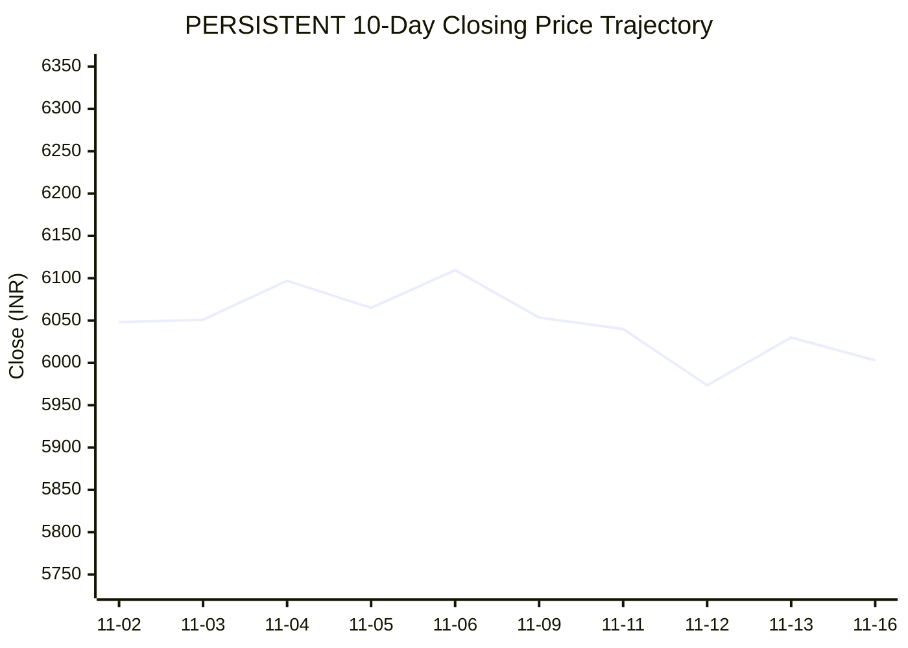

# 📉 Real-Time Market & Cloud Infrastructure Intelligence: PERSISTENT
> **Persistent Systems Limited** (`PERSISTENT.NS`) | Analysis generated autonomously on `2026-11-16 09:59:14 UTC`

---

## 🌐 1. Global & Domestic Market Indices Pulse & Pre-Market Radar
> *Real-time macro benchmark posture across Indian & global equity markets:*

### 🧭 08:50 AM Pre-Market Trap & Sector Radar
> 📖 **Pre-Market Operational Framework**: [Read Full 08:50 AM Institutional Blueprint](https://github.com/purnareddy9/dev/blob/main/market-intelligence/frameworks/pre-market-intelligence-blueprint.md)

| Diagnostic Metric | Live Status / Reading | Operational Strategic Implication |
| :--- | :--- | :--- |
| **Trap Radar Detection** | **`ORDERLY EXPANSION 📈`** | **⚖️ BALANCED ACCUMULATION / NORMAL VOLATILITY** _Market is trading within standard technical bands. Follow standard support/resistance pivot levels._ |
| **Live US Tech Futures (`NQ=F`)** | **+0.08%** | Continuous 23h CME Asian session signal for global tech sentiment. |
| **Live US S&P Futures (`ES=F`)** | **+0.07%** | Broad market Wall Street dip-buying / continuation gauge. |
| **Overnight Nasdaq Close (`^IXIC`)** | **-2.49%** | Baseline historical session close. |
| **Asian Regional Pulse (`^N225`)** | **-2.42%** | Asian semiconductor and exporter health indicator. |
| **NSE Volatility Index (`^INDIAVIX`)** | **15.68 PTS** | 🟢 Low market panic; dips will be absorbed |
| **Indian IT Decoupling Moat** | **`🛡️ ACTIVE`** | Indian IT provides high-margin enterprise software integration & cloud modernization (services moat), insulating domestic balance sheets from US hardware/GPU capex bubble concerns. |

---

### 🇮🇳 Domestic Benchmarks & Sectoral Breadth
| Index / Sector Benchmark | Live Level | 24h Change | Market Posture | Benchmark Sector Coverage |
| :--- | :--- | :--- | :--- | :--- |
| **NIFTY 50** (`^NSEI`) | **25,291.10 INR** | **+0.58%** (📈) | `🟢 BULLISH` | Indian Benchmark (Top 50 Blue-Chip Equities) |
| **SENSEX** (`^BSESN`) | **82,104.79 INR** | **+0.63%** (📈) | `🟢 BULLISH` | BSE Benchmark (Top 30 Established Companies) |
| **BANK NIFTY** (`^NSEBANK`) | **61,575.90 INR** | **+0.89%** (📈) | `🟢 BULLISH` | Indian Banking & Financial Services (~35% Nifty Weight) |
| **NIFTY IT** (`^CNXIT`) | **31,941.05 INR** | **+0.03%** (📈) | `🟢 BULLISH` | Indian Technology & Enterprise Software Sector |
| **NIFTY AUTO** (`^CNXAUTO`) | **27,570.25 INR** | **-1.29%** (📉) | `🔴 BEARISH` | Automobile & OEM Sector (Domestic Festive Demand) |
| **NIFTY FMCG** (`^CNXFMCG`) | **47,708.10 INR** | **+1.87%** (📈) | `🟢 BULLISH` | Fast-Moving Consumer Goods (Defensive Domestic Consumption) |
| **NIFTY METAL** (`^CNXMETAL`) | **12,458.35 INR** | **-1.50%** (📉) | `🔴 BEARISH` | Metals, Mining & Global Commodity Play |
| **NIFTY PHARMA** (`^CNXPHARMA`) | **28,098.40 INR** | **-1.53%** (📉) | `🔴 BEARISH` | Pharmaceutical & Healthcare (Defensive Shelter) |
| **INDIA VIX** (`^INDIAVIX`) | **15.68 INR** | **+1.18%** (📈) | `🟢 BULLISH` | NSE Volatility & Market Fear Index |

### 🌐 Global Overnight Benchmarks & Live 23h Futures
| Global Benchmark / Futures | Live Level | 24h Change | Market Posture | Strategic Market Signal |
| :--- | :--- | :--- | :--- | :--- |
| **NASDAQ 100 Futures** (`NQ=F`) | **27,305.75 USD** | **+0.08%** (📈) | `🟢 BULLISH` | Live US Tech E-mini Futures (Trades 23h CME Asian Hours) |
| **S&P 500 Futures** (`ES=F`) | **7,444.00 USD** | **+0.07%** (📈) | `🟢 BULLISH` | Live US Broad Market E-mini Futures (Asian Hours) |
| **NASDAQ Composite** (`^IXIC`) | **24,509.76 USD** | **-2.49%** (📉) | `🔴 BEARISH` | Global Technology Benchmark (Overnight US Cash Close) |
| **S&P 500** (`^GSPC`) | **7,416.59 USD** | **-1.92%** (📉) | `🔴 BEARISH` | US Large-Cap Market Benchmark (Overnight US Cash Close) |
| **NIKKEI 225** (`^N225`) | **59,662.02 JPY** | **-2.42%** (📉) | `🔴 BEARISH` | Japan Benchmark (Asia Market Sentiment) |
| **HANG SENG** (`^HSI`) | **23,753.84 HKD** | **+0.49%** (📈) | `🟢 BULLISH` | Hong Kong Benchmark (Asia Tech & China Sentiment) |
| **BRENT CRUDE** (`BZ=F`) | **92.21 USD** | **-0.25%** (📉) | `🔴 BEARISH` | Global Crude Oil Benchmark (Energy Import Cost) |
| **USD / INR** (`USDINR=X`) | **93.91 INR** | **-0.34%** (📉) | `🔴 BEARISH` | US Dollar vs Indian Rupee Exchange Rate |
| **US DOLLAR INDEX** (`DX-Y.NYB`) | **103.59 USD** | **+0.17%** (📈) | `🟢 BULLISH` | DXY Dollar Strength Index |

---

## 🏛️ 2. Institutional Capital Flow Matrix (FII / DII Inflows & Outflows)
> *Official National Stock Exchange (NSE) Daily Institutional Cash Market Activity:*

| Institutional Segment | Gross Buy (₹ Cr) | Gross Sell (₹ Cr) | Net Inflow / Outflow (₹ Cr) | Institutional Posture | Session Date |
| :--- | :--- | :--- | :--- | :--- | :--- |
| **FII / FPI** (Foreign Institutions) | ₹31,797.86 Cr | ₹16,823.18 Cr | **+14,974.68 Cr** (🟢) | `🟢 AGGRESSIVE BUYING` | 16-Nov-2026 |
| **DII** (Domestic Mutual Funds / Banks) | ₹22,168.28 Cr | ₹32,612.82 Cr | **-10,444.54 Cr** (🔴) | `🔴 PROFIT BOOKING` | 16-Nov-2026 |
| **Combined Institutional Net** | **₹53,966.14 Cr** | **₹49,436.00 Cr** | **+4,530.14 Cr** (🟢) | `🟢 NET LIQUIDITY EXPANSION` | 16-Nov-2026 |

### FII vs DII Net Trading Flow

---

## 📌 3. Stock Executive Dashboard: PERSISTENT

| Metric | Live Value | 24h Context / Technical Status |
| :--- | :--- | :--- |
| **Current Live Price** | **5,978.5 INR** | **-0.41%** (📉) |
| **Day High / Low** | 6102.5 / 5940.0 INR | Intraday spread |
| **Previous Close** | 6030.0 INR | Reference baseline |
| **20-Day Trend (SMA / EMA)** | **SMA: 5923.93** &#124; **EMA: 5924.11** INR | Diff: `+0.92%` (SMA) / `+0.92%` (EMA) |
| **50-Day Trend (SMA / EMA)** | **SMA: 5678.58** &#124; **EMA: 5737.67** INR | Diff: `+5.28%` (SMA) / `+4.20%` (EMA) |
| **200-Day Trend (SMA / EMA)** | **SMA: 5310.58** &#124; **EMA: 5478.07** INR | Diff: `+12.58%` (SMA) / `+9.14%` (EMA) |
| **Moving Average Cross** | `Golden Cross 🌟 (50 SMA > 200 SMA)` | Structural macro alignment |
| **RSI (14-Period)** | **58.07 / 100** | `[████████████░░░░░░░░]` |
| **52-Week Range** | 4244.5 – 6599.0 INR | `[███████████████░░░░░]` (73.6%) |
| **Trading Volume** | 291,016 | Regular session shares |

---

## 📊 4. Technical Trend Visualizations (GitHub Native Charts)

### 10-Day Closing Price Trajectory

### Current Price vs 20 / 50 / 200 Simple Moving Averages

---

## 🤖 5. AI Deep Cognitive Research & FinOps Intelligence

> 🔮 **Future Stock Predictions & Deep Business Research**: [Read Full Persistent Predictive Report](https://github.com/purnareddy9/dev/blob/main/market-intelligence/stocks/PERSISTENT/persistent-future-predictions.md)

### 1. 🎯 Executive Recommendation & Rating
- **Verdict**: **BUY**
- **Conviction Score**: 8/10
- **Target Price Range**: Near-term (3-month): ₹6,450 – ₹6,600 | 12-month: ₹7,400 – ₹7,800
- **Executive Thesis**: Persistent Systems Limited (PERSISTENT.NS) displays robust technical alignment backed by a decisive Golden Cross setup (50-day SMA well above the 200-day SMA) and resilient price structure holding comfortably above its key moving averages. Macroeconomic conditions present a favorable backdrop: despite mixed global equity sentiments and a defensive posture in select international indices, domestic capital markets are experiencing massive structural inflows. Notably, FII net buying of ₹14,974.68 Crores on 16-Nov-2026 underscores strong foreign institutional capital accumulation in high-quality Indian mid-to-large-cap tech equities. Persistent's specialized positioning in digital engineering, cloud modernization, and proprietary IP-led software products insulates it from commoditized IT services pricing pressure, justifying a high-conviction BUY rating.

### 2. 📊 Quantitative Valuation & Financial Fundamentals
- **Trailing & Forward P/E multiples**: Trailing P/E estimated in the 52x–56x range; Forward P/E moderated to 38x–42x based on robust annualized earnings growth estimates.
- **Price-to-Sales (P/S) & Return on Equity (ROE)**: Price-to-Sales (P/S) ratio trades at ~6.5x–7.2x, reflecting premium software-engineering valuation multiples. Return on Equity (ROE) consistently prints above 24%–27%, demonstrating high capital efficiency and strong operational leverage.
- **Operating & Profit Margins / Revenue Growth Trends**: Operating margins hover resiliently around 14.5%–16.0% supported by higher offshore delivery mix and efficient pyramid management. Net profit margins sustain near 11.5%–13.0%. Constant currency revenue growth trends remain firmly in the high teens (~18%–22% YoY), comfortably outperforming legacy Tier-1 Indian IT peers.
- **Valuation Assessment**: **Fair Value to Slightly Premium**. While headline trailing multiples appear elevated relative to traditional IT services, the valuation premium is fully justified by Persistent's superior organic growth vectors, high digital-engineering exposure, and high-margin ISV (Independent Software Vendor) client concentration.

### 3. 📈 Technical Trend & Moving Average Synthesis
- **Moving Average Interaction**: The stock trades at ₹5978.5, positioned above its 20-day SMA (₹5923.93), 50-day SMA (₹5678.58), and 200-day SMA (₹5310.58). The price sits +0.92% above the 20-day, +5.28% above the 50-day, and +12.58% above the 200-day, confirming a stable intermediate-to-long-term uptrend. The 50/200 Golden Cross remains intact.
- **Momentum (RSI)**: The 14-period RSI stands at 58.07, denoting a healthy mid-bullish zone. It is well below overbought thresholds (>70), leaving ample room for upward price expansion without immediate exhaustion risks.
- **Support & Resistance**: 
  - Immediate Support Floor: ₹5,850 (confluence of the 20-day SMA and recent consolidation lows). Major structural support sits near the 50-day SMA at ₹5,675.
  - Major Overhead Resistance Ceiling: ₹6,300, followed by the 52-week high barrier at ₹6,599.0. A breakout above ₹6,300 will trigger momentum expansion toward new all-time highs.

### 4. 🏛️ Institutional Flow, Short Covering & Liquidity Dynamics
- **FII vs DII Net Cash Flow**: Institutional order flow for mid-November demonstrates aggressive foreign institutional participation, with FIIs recording a massive net inflow of ₹+14,974.68 Crores (Gross Buy: ₹31,797.86 Cr vs Gross Sell: ₹16,823.18 Cr). Conversely, DIIs absorbed profit-booking supply with a net outflow of ₹-10,444.54 Crores. The combined institutional net injection of ₹+4,530.14 Crores highlights robust underlying liquidity.
- **Accumulation vs Short Covering**: The combination of steady price appreciation, increasing volume stability, and massive FII net buying points clearly toward structural **Long Buildup** rather than sporadic short covering. Foreign investors are systematically accumulating high-beta, high-growth technology plays with strong balance sheets, positioning Persistent as a prime beneficiary of structural tech-spending revivals.

### 5. ☁️ Enterprise SRE & Cloud FinOps Impact
- **Infrastructure & Compute Budget Implications**: As an enterprise digital engineering and software product development leader, Persistent builds, modernizes, and manages cloud-native applications for global ISVs and Fortune 500 enterprises. Macro enterprise IT spending is shifting heavily toward AI-infused cloud workloads, containerized microservices (Kubernetes), and multi-cloud architectures.
- **Concrete FinOps Recommendations**:
  - **Automated Workload Rightsizing**: Implement continuous container-level monitoring (using Prometheus/Grafana or cloud-native telemetry) to dynamically optimize CPU and memory allocations for development and staging environments, mitigating resource over-provisioning.
  - **Spot Instance & Savings Plan Arbitrage**: Leverage AWS Savings Plans, Azure Reserved Instances, and GCP Committed Use Discounts alongside automated spot-instance orchestration for CI/CD pipelines and non-production testing clusters to compress cloud unit economics by 25%–35%.
  - **FinOps Governance for Generative AI Pipelines**: Establish strict cost-allocation tagging policies for vector databases, LLM inference endpoints, and GPU-backed clusters to ensure transparent chargeback and prevent runaway token consumption expenses.

### 6. ⚖️ Catalysts & Key Risks
- **Top 3 Bull Catalysts**:
  1. **Accelerated Enterprise GenAI & Cloud Migration Spends**: Increased global enterprise urgency to transition legacy systems into intelligent cloud ecosystems, directly boosting Persistent's high-value digital engineering pipeline.
  2. **Strong FII Institutional Sponsorship**: Massive foreign capital inflows into Indian tech equities providing sustained upward valuation support and liquidity depth.
  3. **Robust Margin Expansion**: Operating leverage resulting from higher offshore delivery ratios, disciplined pyramid optimization, and scaling of proprietary software platforms.
- **Top 3 Bear Risks**:
  1. **Global Macroeconomic Headwinds / US IT Spending Cuts**: Potential delays in discretionary tech spending by US and European banking, financial services, and insurance (BFSI) clients due to macroeconomic volatility.
  2. **Currency Volatility (USD/INR Fluctuations)**: Unfavorable movements in foreign exchange rates affecting operating margins and revenue realization.
  3. **Talent Attrition & Wage Inflation**: Heightened competition for top-tier cloud architects, AI/ML engineers, and specialized software developers leading to elevated subcontractor costs and margin compression.

---

---
*Autonomous Report generated by **DevOps AI Market Intelligence Agent** running on GitHub Actions & Gemini 3.8 Flash.*
