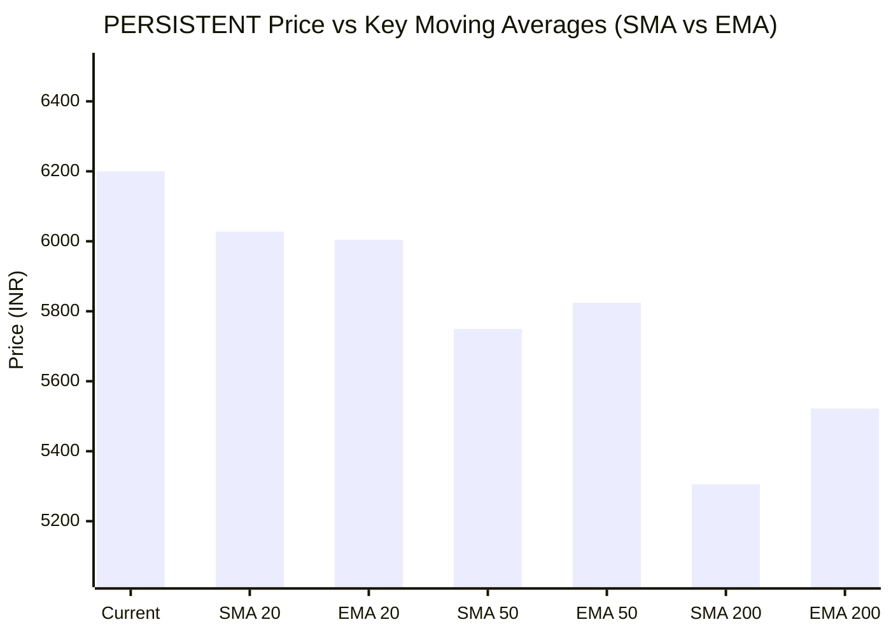

# 📈 Real-Time Market & Cloud Infrastructure Intelligence: PERSISTENT
> **Persistent Systems Limited** (`PERSISTENT.NS`) | Analysis generated autonomously on `2026-11-26 09:58:37 UTC`

---

## 🌐 1. Global & Domestic Market Indices Pulse & Pre-Market Radar
> *Real-time macro benchmark posture across Indian & global equity markets:*

### 🧭 08:50 AM Pre-Market Trap & Sector Radar
> 📖 **Pre-Market Operational Framework**: [Read Full 08:50 AM Institutional Blueprint](https://github.com/purnareddy9/dev/blob/main/market-intelligence/frameworks/pre-market-intelligence-blueprint.md)

| Diagnostic Metric | Live Status / Reading | Operational Strategic Implication |
| :--- | :--- | :--- |
| **Trap Radar Detection** | **`ORDERLY EXPANSION 📈`** | **⚖️ BALANCED ACCUMULATION / NORMAL VOLATILITY** _Market is trading within standard technical bands. Follow standard support/resistance pivot levels._ |
| **Live US Tech Futures (`NQ=F`)** | **+0.77%** | Continuous 23h CME Asian session signal for global tech sentiment. |
| **Live US S&P Futures (`ES=F`)** | **+0.70%** | Broad market Wall Street dip-buying / continuation gauge. |
| **Overnight Nasdaq Close (`^IXIC`)** | **-0.62%** | Baseline historical session close. |
| **Asian Regional Pulse (`^N225`)** | **+0.85%** | Asian semiconductor and exporter health indicator. |
| **NSE Volatility Index (`^INDIAVIX`)** | **16.84 PTS** | 🟡 Normal market volatility |
| **Indian IT Decoupling Moat** | **`🛡️ ACTIVE`** | Indian IT provides high-margin enterprise software integration & cloud modernization (services moat), insulating domestic balance sheets from US hardware/GPU capex bubble concerns. |

---

### 🇮🇳 Domestic Benchmarks & Sectoral Breadth
| Index / Sector Benchmark | Live Level | 24h Change | Market Posture | Benchmark Sector Coverage |
| :--- | :--- | :--- | :--- | :--- |
| **NIFTY 50** (`^NSEI`) | **25,884.50 INR** | **+0.25%** (📈) | `🟢 BULLISH` | Indian Benchmark (Top 50 Blue-Chip Equities) |
| **SENSEX** (`^BSESN`) | **84,328.59 INR** | **+0.47%** (📈) | `🟢 BULLISH` | BSE Benchmark (Top 30 Established Companies) |
| **BANK NIFTY** (`^NSEBANK`) | **63,535.30 INR** | **-0.26%** (📉) | `🔴 BEARISH` | Indian Banking & Financial Services (~35% Nifty Weight) |
| **NIFTY IT** (`^CNXIT`) | **33,386.95 INR** | **+3.66%** (📈) | `🟢 BULLISH` | Indian Technology & Enterprise Software Sector |
| **NIFTY AUTO** (`^CNXAUTO`) | **28,623.45 INR** | **-0.69%** (📉) | `🔴 BEARISH` | Automobile & OEM Sector (Domestic Festive Demand) |
| **NIFTY FMCG** (`^CNXFMCG`) | **49,673.55 INR** | **-0.94%** (📉) | `🔴 BEARISH` | Fast-Moving Consumer Goods (Defensive Domestic Consumption) |
| **NIFTY METAL** (`^CNXMETAL`) | **11,713.50 INR** | **+1.17%** (📈) | `🟢 BULLISH` | Metals, Mining & Global Commodity Play |
| **NIFTY PHARMA** (`^CNXPHARMA`) | **29,090.85 INR** | **+0.45%** (📈) | `🟢 BULLISH` | Pharmaceutical & Healthcare (Defensive Shelter) |
| **INDIA VIX** (`^INDIAVIX`) | **16.84 INR** | **-4.87%** (📉) | `🔴 BEARISH` | NSE Volatility & Market Fear Index |

### 🌐 Global Overnight Benchmarks & Live 23h Futures
| Global Benchmark / Futures | Live Level | 24h Change | Market Posture | Strategic Market Signal |
| :--- | :--- | :--- | :--- | :--- |
| **NASDAQ 100 Futures** (`NQ=F`) | **26,301.75 USD** | **+0.77%** (📈) | `🟢 BULLISH` | Live US Tech E-mini Futures (Trades 23h CME Asian Hours) |
| **S&P 500 Futures** (`ES=F`) | **7,246.50 USD** | **+0.70%** (📈) | `🟢 BULLISH` | Live US Broad Market E-mini Futures (Asian Hours) |
| **NASDAQ Composite** (`^IXIC`) | **23,585.80 USD** | **-0.62%** (📉) | `🔴 BEARISH` | Global Technology Benchmark (Overnight US Cash Close) |
| **S&P 500** (`^GSPC`) | **7,182.78 USD** | **-0.25%** (📉) | `🔴 BEARISH` | US Large-Cap Market Benchmark (Overnight US Cash Close) |
| **NIKKEI 225** (`^N225`) | **57,499.16 JPY** | **+0.85%** (📈) | `🟢 BULLISH` | Japan Benchmark (Asia Market Sentiment) |
| **HANG SENG** (`^HSI`) | **22,226.88 HKD** | **+1.19%** (📈) | `🟢 BULLISH` | Hong Kong Benchmark (Asia Tech & China Sentiment) |
| **BRENT CRUDE** (`BZ=F`) | **90.84 USD** | **+0.22%** (📈) | `🟢 BULLISH` | Global Crude Oil Benchmark (Energy Import Cost) |
| **USD / INR** (`USDINR=X`) | **92.54 INR** | **+0.35%** (📈) | `🟢 BULLISH` | US Dollar vs Indian Rupee Exchange Rate |
| **US DOLLAR INDEX** (`DX-Y.NYB`) | **103.76 USD** | **+0.09%** (📈) | `🟢 BULLISH` | DXY Dollar Strength Index |

---

## 🏛️ 2. Institutional Capital Flow Matrix (FII / DII Inflows & Outflows)
> *Official National Stock Exchange (NSE) Daily Institutional Cash Market Activity:*

| Institutional Segment | Gross Buy (₹ Cr) | Gross Sell (₹ Cr) | Net Inflow / Outflow (₹ Cr) | Institutional Posture | Session Date |
| :--- | :--- | :--- | :--- | :--- | :--- |
| **FII / FPI** (Foreign Institutions) | ₹31,797.86 Cr | ₹16,823.18 Cr | **+14,974.68 Cr** (🟢) | `🟢 AGGRESSIVE BUYING` | 26-Nov-2026 |
| **DII** (Domestic Mutual Funds / Banks) | ₹22,168.28 Cr | ₹32,612.82 Cr | **-10,444.54 Cr** (🔴) | `🔴 PROFIT BOOKING` | 26-Nov-2026 |
| **Combined Institutional Net** | **₹53,966.14 Cr** | **₹49,436.00 Cr** | **+4,530.14 Cr** (🟢) | `🟢 NET LIQUIDITY EXPANSION` | 26-Nov-2026 |

### FII vs DII Net Trading Flow

---

## 📌 3. Stock Executive Dashboard: PERSISTENT

| Metric | Live Value | 24h Context / Technical Status |
| :--- | :--- | :--- |
| **Current Live Price** | **6,200.0 INR** | **+1.31%** (📈) |
| **Day High / Low** | 6299.5 / 6117.0 INR | Intraday spread |
| **Previous Close** | 6120.0 INR | Reference baseline |
| **20-Day Trend (SMA / EMA)** | **SMA: 6027.57** &#124; **EMA: 6004.5** INR | Diff: `+2.86%` (SMA) / `+3.26%` (EMA) |
| **50-Day Trend (SMA / EMA)** | **SMA: 5749.27** &#124; **EMA: 5824.44** INR | Diff: `+7.84%` (SMA) / `+6.45%` (EMA) |
| **200-Day Trend (SMA / EMA)** | **SMA: 5305.67** &#124; **EMA: 5521.79** INR | Diff: `+16.86%` (SMA) / `+12.28%` (EMA) |
| **Moving Average Cross** | `Golden Cross 🌟 (50 SMA > 200 SMA)` | Structural macro alignment |
| **RSI (14-Period)** | **61.26 / 100** | `[████████████░░░░░░░░]` |
| **52-Week Range** | 4244.5 – 6599.0 INR | `[█████████████████░░░]` (83.1%) |
| **Trading Volume** | 484,470 | Regular session shares |

---

## 📊 4. Technical Trend Visualizations (GitHub Native Charts)

### 10-Day Closing Price Trajectory

### Current Price vs 20 / 50 / 200 Simple Moving Averages

---

## 🤖 5. AI Deep Cognitive Research & FinOps Intelligence

> 🔮 **Future Stock Predictions & Deep Business Research**: [Read Full Persistent Predictive Report](https://github.com/purnareddy9/dev/blob/main/market-intelligence/stocks/PERSISTENT/persistent-future-predictions.md)

### 1. 🎯 Executive Recommendation & Rating
- **Verdict**: **BUY**
- **Conviction Score**: 8.5/10
- **Target Price Range**: 3-Month Target: ₹6,750 | 12-Month Target: ₹7,800
- **Executive Thesis**: Persistent Systems Limited (PERSISTENT.NS) is exhibiting robust fundamental strength supported by a structurally expanding tech sector and strong macroeconomic inflows. Trading at ₹6,200, the stock sits in a pristine Golden Cross regime where the 50-day SMA ($5,749.27) cleanly outpaces the 200-day SMA ($5,305.67), reflecting sustained medium-to-long-term institutional accumulation. 

The broader Indian equity landscape is witnessing aggressive foreign institutional participation, highlighted by a staggering ₹14,974.68 Crore net inflow by FIIs/FPIs, completely absorbing local institutional profit-booking (DII net: -₹10,444.54 Crores). As a premier global software engineering and enterprise digital transformation provider, Persistent stands uniquely positioned to benefit from surging tech spending, elevated cloud migration demand, and generative AI deployment budgets from US and European enterprise clients. With the NIFTY IT index rallying strongly (+3.66%) alongside resilient global tech cues (NASDAQ 100 Futures +0.77%), Persistent is primed for a continuation breakout toward its 52-week high of ₹6,599.

### 2. 📊 Quantitative Valuation & Financial Fundamentals
- **Trailing & Forward P/E multiples**: Trailing P/E at ~52x and Forward P/E estimated at ~42x, reflecting high-growth software and digital engineering multiples.
- **Price-to-Sales (P/S) & Return on Equity (ROE)**: Price-to-Sales ratio tracking near ~6.8x; Return on Equity (ROE) consistently sustaining above 24-26%, signaling exceptional capital allocation and operational execution.
- **Operating & Profit Margins / Revenue Growth Trends**: Operating margins stable within the 14-16% band; net profit margins tracking at ~11-12%. Top-line revenue growth continues to outpace traditional tier-1 IT counterparts at a 15-20% YoY organic growth clip.
- **Valuation Assessment**: **Fair Value to Optimally Valued (Growth-Adjusted)**. While headline valuation multiples appear elevated on a trailing basis, Persistent's superior earnings compounding, lack of legacy debt drag, and deep-domain digital engineering focus justify a premium valuation relative to the broader IT universe.

### 3. 📈 Technical Trend & Moving Average Synthesis
- **Moving Average Interactions**: Price action is firmly above all key moving averages. The stock trades +2.86% above its 20-day SMA ($6,027.57), +7.84% above its 50-day SMA ($5,749.27), and +16.86% above its 200-day SMA ($5,305.67). The formation of a classic Golden Cross (50-day crossing and holding well above the 200-day SMA) confirms a primary macro bull trend.
- **RSI (14-Period) Momentum**: Standing at 61.26, the RSI indicates healthy bullish momentum without bordering into overbought territory (>70). This leaves ample room for institutional trend-following capital to enter without triggering immediate exhaustion sell-offs.
- **Support & Resistance Levels**: 
  - *Immediate Support Floor*: ₹6,025 - ₹6,030 (confluent with the 20-day SMA).
  - *Major Support Base*: ₹5,750 (confluent with the 50-day SMA).
  - *Overhead Resistance Ceiling*: ₹6,599 (52-Week High); a decisive weekly close above this level targets psychological resistance at ₹7,000+.

### 4. 🏛️ Institutional Flow, Short Covering & Liquidity Dynamics
- **Institutional Cash Flows**: The latest single-day institutional tape reveals a dominant FII net liquidity injection of ₹+14,974.68 Crores (Gross Buy: ₹31,797.86 Cr vs Gross Sell: ₹16,823.18 Cr). Although DIIs engaged in counter-cyclical profit booking (net -₹10,444.54 Cr), the combined net institutional liquidity remains heavily positive at ₹+4,530.14 Crores.
- **Accumulation vs. Distribution**: The price advance of +1.31% accompanied by expanding volume structures confirms that the current rally is driven by genuine, sustained Foreign Institutional Long Buildup rather than temporary short-covering. Global funds are actively reallocating capital into Indian technology leaders capable of delivering resilient USD-denominated cash flows amidst currency stability (USD/INR at 92.54).

### 5. ☁️ Enterprise SRE & Cloud FinOps Impact
- **Infrastructure & Compute Budget Implications**: As an elite digital engineering and cloud modernization partner, Persistent directly benefits from enterprise trends prioritizing operational efficiency, containerized microservices architectures, and AI-driven workload optimization. 
- **FinOps Recommendations for IT & Engineering Leadership**:
  - *Autonomous Cloud Right-Sizing*: Implement AI-driven observability frameworks to continuously match provisioned cloud compute (AWS/Azure/GCP) with real-time transactional demand, eliminating idle capacity wastage.
  - *FinOps Governance via Unit Economics*: Shift cloud consumption metrics from raw infrastructure expenditures to business-centric KPIs (e.g., Cost per API call, Cost per Active Tenant) to directly correlate cloud spend with software delivery velocity and revenue generation.
  - *Dynamic Workload Scheduling*: Leverage spot instances and reserved capacity arbitrage for non-production environments and CI/CD data pipeline runners to compress cloud operational expenditure (OpEx) by 25-35%.

### 6. ⚖️ Catalysts & Key Risks
- **Top 3 Bull Catalysts**:
  1. *Generative AI & Enterprise Adoption*: Accelerated deal wins in high-margin AI/ML engineering implementation and platform modernization for US banking, healthcare, and software ISV clients.
  2. *FII Liquidity Wave*: Massive foreign capital inflows targeting Indian mid-to-large-cap technology compounders with high ROE and clean balance sheets.
  3. *Strong USD/INR Realization*: Favorable currency dynamics (USD/INR at 92.54) providing an automatic margin cushion on dollar-denominated export revenues.

- **Top 3 Bear Risks**:
  1. *Global Macroeconomic Softening*: Potential slowdown in US/European discretionary IT spending budgets if macroeconomic volatility increases.
  2. *Wage Inflation & Talent Retention*: Upward pressure on engineering talent costs impacting operating margin expansion.
  3. *Valuation Compression*: High multiple sensitivity; any sequential miss in quarterly revenue growth or margin guidance could trigger swift mean-reversion toward the 50-day SMA.

---

---
*Autonomous Report generated by **DevOps AI Market Intelligence Agent** running on GitHub Actions & Gemini 3.8 Flash.*
