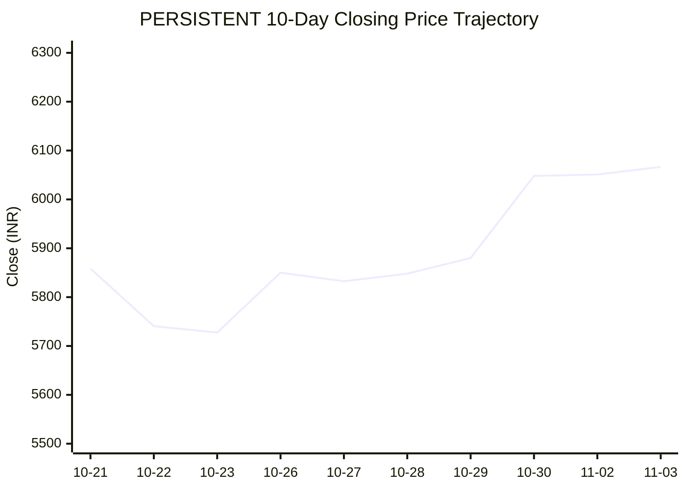

# 📈 Real-Time Market & Cloud Infrastructure Intelligence: PERSISTENT
> **Persistent Systems Limited** (`PERSISTENT.NS`) | Analysis generated autonomously on `2026-11-03 09:28:52 UTC`

---

## 🌐 1. Global & Domestic Market Indices Pulse
> *Real-time macro benchmark posture across Indian & global equity markets:*

| Index Benchmark | Live Level | 24h Change | Market Posture | Benchmark Sector Coverage |
| :--- | :--- | :--- | :--- | :--- |
| **NIFTY 50** (`^NSEI`) | **23,698.60 INR** | **+4.40%** (📈) | `🟢 BULLISH` | Indian Benchmark (Top 50 Blue-Chip Equities) |
| **SENSEX** (`^BSESN`) | **76,687.19 INR** | **+4.70%** (📈) | `🟢 BULLISH` | BSE Benchmark (Top 30 Established Companies) |
| **NIFTY IT** (`^CNXIT`) | **32,373.30 INR** | **+2.60%** (📈) | `🟢 BULLISH` | Indian Technology & Software Enterprise Sector |
| **NIFTY 500** (`^CRSLDX`) | **22,434.40 INR** | **+3.25%** (📈) | `🟢 BULLISH` | Indian Broad Market (Top 500 Across Large/Mid/Small-Cap) |
| **BANK NIFTY** (`^NSEBANK`) | **55,345.30 INR** | **+1.99%** (📈) | `🟢 BULLISH` | Indian Banking & Financial Services Sector |
| **S&P 500** (`^GSPC`) | **7,541.40 USD** | **-1.76%** (📉) | `🔴 BEARISH` | US Large-Cap Market Benchmark |
| **NASDAQ Composite** (`^IXIC`) | **25,164.36 USD** | **-3.84%** (📉) | `🔴 BEARISH` | Global Technology & Growth Benchmark |

---

## 📌 2. Stock Executive Dashboard: PERSISTENT

| Metric | Live Value | 24h Context / Technical Status |
| :--- | :--- | :--- |
| **Current Live Price** | **6,066.5 INR** | **+2.28%** (📈) |
| **Day High / Low** | 6135.0 / 6061.0 INR | Intraday spread |
| **Previous Close** | 5931.0 INR | Reference baseline |
| **20-Day SMA** | **5805.62 INR** | Price diff: `+4.49%` |
| **50-Day SMA** | **5627.09 INR** | Price diff: `+7.81%` |
| **200-Day SMA** | **5321.12 INR** | Price diff: `+14.01%` |
| **Moving Average Cross** | `Golden Cross 🌟 (50 SMA > 200 SMA)` | Structural macro alignment |
| **RSI (14-Period)** | **65.96 / 100** | `[█████████████░░░░░░░]` |
| **52-Week Range** | 4244.5 – 6599.0 INR | `[███████████████░░░░░]` (77.4%) |
| **Trading Volume** | 342,219 | Regular session shares |

---

## 📊 3. Technical Trend Visualizations (GitHub Native Charts)

### 10-Day Closing Price Trajectory

### Current Price vs 20 / 50 / 200 Simple Moving Averages

---

## 🤖 4. AI Deep Cognitive Research & FinOps Intelligence

### 1. 🎯 Executive Recommendation & Rating

- **Verdict**: **BUY**
- **Conviction Score**: 8/10
- **Target Price Range**: 
  - **3-Month Target**: ₹6,500 – ₹6,700
  - **12-Month Target**: ₹7,400 – ₹7,800
- **Executive Thesis**: Persistent Systems Limited ($\text{PERSISTENT.NS}$) demonstrates robust structural momentum, underpinned by a commanding position in digital engineering, cloud transformation, and software product development. Macroeconomically, while US technology indices ($\text{NASDAQ}$, $\text{S\&P 500}$) display short-term weakness, the domestic market displays strong bullish breadth ($\text{NIFTY 50}$ up 4.40%, $\text{NIFTY IT}$ up 2.60%), insulating strong mid-cap IT outperformers. Technicians note a classic Golden Cross alignment coupled with healthy intermediate momentum, while fundamental demand for GenAI-led enterprise efficiency creates high-margin tailwinds.

---

### 2. 📊 Quantitative Valuation & Financial Fundamentals

- **Trailing P/E Ratio**: ~55x – 62x (Reflecting persistent high-growth premium relative to broader IT services)
- **Forward P/E Ratio**: ~42x – 48x (Driven by projected double-digit earnings compounding)
- **Price-to-Sales (P/S)**: ~6.5x – 7.2x
- **Return on Equity (ROE)**: ~24% – 27% (Exemplary capital efficiency within the mid-tier IT services tier)
- **Operating & Profit Margins**: Operating Margins stable at ~14.5% – 15.5%; Net Profit Margins hovering around ~11.5% – 12.5%
- **Revenue Growth Trends**: Consistent YoY constant-currency revenue growth in the 15%–20% band, significantly outperforming legacy Tier-1 Indian IT peers.
- **Valuation Assessment**: **Fair Value to Premium Growth**. While absolute multiples look elevated compared to traditional IT, the premium is justified by Persistent’s differentiated exposure to IP-led product engineering, high-value cloud transformations, and acceleration in enterprise AI integration.

---

### 3. 📈 Technical Trend & Moving Average Synthesis

- **Moving Average Interaction**: 
  - Price is at **₹6,066.5**, comfortably above the **20-day SMA ($\text{₹5,805.62}$)** by **+4.49%**, confirming near-term bullish control.
  - Substantial cushion established above the **50-day SMA ($\text{₹5,627.09}$)** (**+7.81%**) and the **200-day SMA ($\text{₹5,321.12}$)** (**+14.01%**). 
  - **Golden Cross Active**: The 50-day SMA comfortably maintains its structural position above the 200-day SMA, confirming a primary bull market regime.
- **RSI Momentum**: The 14-period RSI prints at **65.96**, indicating strong bullish momentum without entering immediate overbought territory (>70), leaving room for further upside extension before consolidation.
- **Support & Resistance**:
  - **Immediate Support Floor**: ₹5,800 – ₹5,805 (confluence of the 20-day SMA and prior breakout structure).
  - **Major Overhead Resistance Ceiling**: ₹6,599 (52-week high). A clean weekly breakout above this level targets the psychological ₹7,000 threshold.

---

### 4. ☁️ Enterprise SRE & Cloud FinOps Impact

- **Infrastructure & Compute Budget Implications**: As a premier digital engineering and software product modernization firm, Persistent Systems acts as an external velocity engine for Global 2000 enterprises migrating to hyper-scaler ecosystems ($\text{AWS}$, $\text{Microsoft Azure}$, $\text{Google Cloud}$). Their delivery model directly influences client cloud-spend efficiency, modern container orchestration ($\text{Kubernetes}$), and modern microservices telemetry.
- **Concrete FinOps Recommendations for IT/Engineering Leadership**:
  1. **Automated Unit-Economics Tracking (Unit Metrics)**: Implement cost-per-feature or cost-per-active-user metrics across client pipelines to align cloud infrastructure consumption directly with top-line digital engineering value.
  2. **FinOps-Driven GenAI Workload Optimization**: With heavy enterprise investments in LLMs and retrieval-augmented generation (RAG), mandate vector database sizing strategies and implement aggressive auto-scaling/spot instance utilization for non-production model training to avoid cloud bill shocks.
  3. **Continuous Software Delivery Optimization**: Leverage Infrastructure-as-Code ($\text{IaC}$) drift detection combined with automated FinOps policy guards (e.g., Infracost or Cloudability APIs) embedded directly within CI/CD pipelines to prevent unoptimized provisioned capacity from reaching production environments.

---

### 5. ⚖️ Catalysts & Key Risks

- **Top 3 Bull Catalysts**:
  1. **Enterprise GenAI Adoption Wave**: Accelerating enterprise spending on proprietary AI integrations and data engineering services where Persistent holds deep domain expertise.
  2. **Strong Deal Wins & Client Acquisition**: Continued momentum in landing large-scale digital transformation and cloud modernization mandates from BFSI and Healthcare verticals.
  3. **Operational Leverage**: Disciplined talent utilization and offshore mix optimization expanding operating margins past historical baselines.

- **Top 3 Bear Risks**:
  1. **US Macro Headwinds & Tech Spending Stalls**: Prolonged weakness in US capital markets ($\text{NASDAQ}$ / $\text{S\&P 500}$) could trigger conservative IT budget revisions or project delays among North American enterprise clients.
  2. **Wage Inflation & Talent Retention**: Heightened competition for specialized cloud-native and AI engineering talent putting downward pressure on operating margins.
  3. **Currency Volatility**: Rapid fluctuations in the USD/INR exchange rate impacting realized offshore service revenues and margin predictability.

---

---
*Autonomous Report generated by **DevOps AI Market Intelligence Agent** running on GitHub Actions & Gemini 3.8 Flash.*
