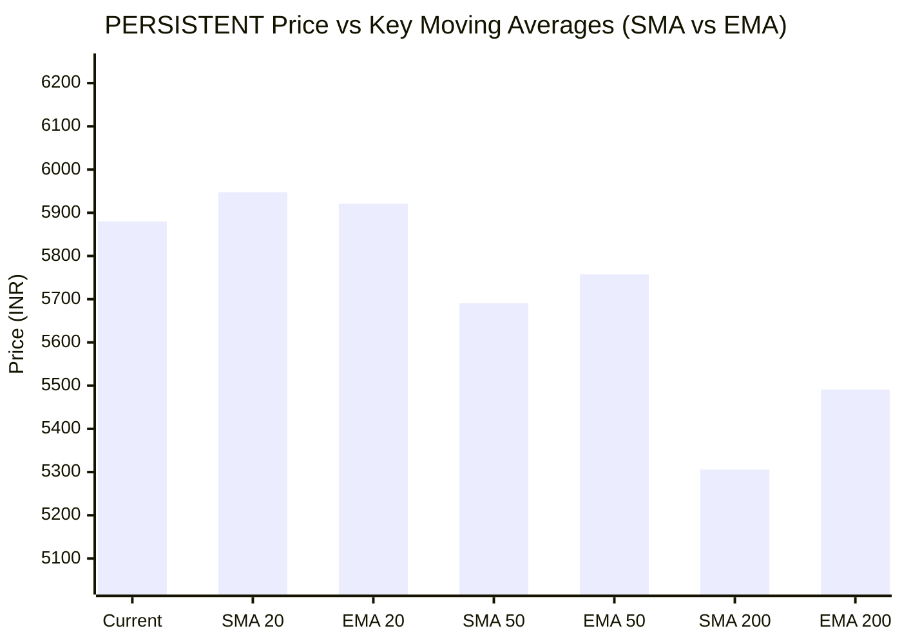

# 📈 Real-Time Market & Cloud Infrastructure Intelligence: PERSISTENT
> **Persistent Systems Limited** (`PERSISTENT.NS`) | Analysis generated autonomously on `2026-11-19 09:59:06 UTC`

---

## 🌐 1. Global & Domestic Market Indices Pulse & Pre-Market Radar
> *Real-time macro benchmark posture across Indian & global equity markets:*

### 🧭 08:50 AM Pre-Market Trap & Sector Radar
> 📖 **Pre-Market Operational Framework**: [Read Full 08:50 AM Institutional Blueprint](https://github.com/purnareddy9/dev/blob/main/market-intelligence/frameworks/pre-market-intelligence-blueprint.md)

| Diagnostic Metric | Live Status / Reading | Operational Strategic Implication |
| :--- | :--- | :--- |
| **Trap Radar Detection** | **`ORDERLY EXPANSION 📈`** | **⚖️ BALANCED ACCUMULATION / NORMAL VOLATILITY** _Market is trading within standard technical bands. Follow standard support/resistance pivot levels._ |
| **Live US Tech Futures (`NQ=F`)** | **-2.51%** | Continuous 23h CME Asian session signal for global tech sentiment. |
| **Live US S&P Futures (`ES=F`)** | **-2.15%** | Broad market Wall Street dip-buying / continuation gauge. |
| **Overnight Nasdaq Close (`^IXIC`)** | **-2.25%** | Baseline historical session close. |
| **Asian Regional Pulse (`^N225`)** | **+0.71%** | Asian semiconductor and exporter health indicator. |
| **NSE Volatility Index (`^INDIAVIX`)** | **16.11 PTS** | 🟡 Normal market volatility |
| **Indian IT Decoupling Moat** | **`🛡️ ACTIVE`** | Indian IT provides high-margin enterprise software integration & cloud modernization (services moat), insulating domestic balance sheets from US hardware/GPU capex bubble concerns. |

---

### 🇮🇳 Domestic Benchmarks & Sectoral Breadth
| Index / Sector Benchmark | Live Level | 24h Change | Market Posture | Benchmark Sector Coverage |
| :--- | :--- | :--- | :--- | :--- |
| **NIFTY 50** (`^NSEI`) | **25,514.30 INR** | **+1.14%** (📈) | `🟢 BULLISH` | Indian Benchmark (Top 50 Blue-Chip Equities) |
| **SENSEX** (`^BSESN`) | **83,021.75 INR** | **+1.21%** (📈) | `🟢 BULLISH` | BSE Benchmark (Top 30 Established Companies) |
| **BANK NIFTY** (`^NSEBANK`) | **63,063.00 INR** | **+1.65%** (📈) | `🟢 BULLISH` | Indian Banking & Financial Services (~35% Nifty Weight) |
| **NIFTY IT** (`^CNXIT`) | **30,919.45 INR** | **-1.10%** (📉) | `🔴 BEARISH` | Indian Technology & Enterprise Software Sector |
| **NIFTY AUTO** (`^CNXAUTO`) | **28,601.30 INR** | **+4.40%** (📈) | `🟢 BULLISH` | Automobile & OEM Sector (Domestic Festive Demand) |
| **NIFTY FMCG** (`^CNXFMCG`) | **48,564.25 INR** | **+2.09%** (📈) | `🟢 BULLISH` | Fast-Moving Consumer Goods (Defensive Domestic Consumption) |
| **NIFTY METAL** (`^CNXMETAL`) | **12,299.75 INR** | **+0.63%** (📈) | `🟢 BULLISH` | Metals, Mining & Global Commodity Play |
| **NIFTY PHARMA** (`^CNXPHARMA`) | **28,371.80 INR** | **+0.61%** (📈) | `🟢 BULLISH` | Pharmaceutical & Healthcare (Defensive Shelter) |
| **INDIA VIX** (`^INDIAVIX`) | **16.11 INR** | **+3.80%** (📈) | `🟢 BULLISH` | NSE Volatility & Market Fear Index |

### 🌐 Global Overnight Benchmarks & Live 23h Futures
| Global Benchmark / Futures | Live Level | 24h Change | Market Posture | Strategic Market Signal |
| :--- | :--- | :--- | :--- | :--- |
| **NASDAQ 100 Futures** (`NQ=F`) | **26,505.50 USD** | **-2.51%** (📉) | `🔴 BEARISH` | Live US Tech E-mini Futures (Trades 23h CME Asian Hours) |
| **S&P 500 Futures** (`ES=F`) | **7,182.50 USD** | **-2.15%** (📉) | `🔴 BEARISH` | Live US Broad Market E-mini Futures (Asian Hours) |
| **NASDAQ Composite** (`^IXIC`) | **23,879.20 USD** | **-2.25%** (📉) | `🔴 BEARISH` | Global Technology Benchmark (Overnight US Cash Close) |
| **S&P 500** (`^GSPC`) | **7,175.83 USD** | **-2.02%** (📉) | `🔴 BEARISH` | US Large-Cap Market Benchmark (Overnight US Cash Close) |
| **NIKKEI 225** (`^N225`) | **59,444.21 JPY** | **+0.71%** (📈) | `🟢 BULLISH` | Japan Benchmark (Asia Market Sentiment) |
| **HANG SENG** (`^HSI`) | **22,841.62 HKD** | **-1.95%** (📉) | `🔴 BEARISH` | Hong Kong Benchmark (Asia Tech & China Sentiment) |
| **BRENT CRUDE** (`BZ=F`) | **90.05 USD** | **+0.99%** (📈) | `🟢 BULLISH` | Global Crude Oil Benchmark (Energy Import Cost) |
| **USD / INR** (`USDINR=X`) | **93.28 INR** | **-0.19%** (📉) | `🔴 BEARISH` | US Dollar vs Indian Rupee Exchange Rate |
| **US DOLLAR INDEX** (`DX-Y.NYB`) | **103.93 USD** | **+0.07%** (📈) | `🟢 BULLISH` | DXY Dollar Strength Index |

---

## 🏛️ 2. Institutional Capital Flow Matrix (FII / DII Inflows & Outflows)
> *Official National Stock Exchange (NSE) Daily Institutional Cash Market Activity:*

| Institutional Segment | Gross Buy (₹ Cr) | Gross Sell (₹ Cr) | Net Inflow / Outflow (₹ Cr) | Institutional Posture | Session Date |
| :--- | :--- | :--- | :--- | :--- | :--- |
| **FII / FPI** (Foreign Institutions) | ₹31,797.86 Cr | ₹16,823.18 Cr | **+14,974.68 Cr** (🟢) | `🟢 AGGRESSIVE BUYING` | 19-Nov-2026 |
| **DII** (Domestic Mutual Funds / Banks) | ₹22,168.28 Cr | ₹32,612.82 Cr | **-10,444.54 Cr** (🔴) | `🔴 PROFIT BOOKING` | 19-Nov-2026 |
| **Combined Institutional Net** | **₹53,966.14 Cr** | **₹49,436.00 Cr** | **+4,530.14 Cr** (🟢) | `🟢 NET LIQUIDITY EXPANSION` | 19-Nov-2026 |

### FII vs DII Net Trading Flow

---

## 📌 3. Stock Executive Dashboard: PERSISTENT

| Metric | Live Value | 24h Context / Technical Status |
| :--- | :--- | :--- |
| **Current Live Price** | **5,880.0 INR** | **+0.39%** (📈) |
| **Day High / Low** | 5888.5 / 5768.0 INR | Intraday spread |
| **Previous Close** | 5911.0 INR | Reference baseline |
| **20-Day Trend (SMA / EMA)** | **SMA: 5947.7** &#124; **EMA: 5920.83** INR | Diff: `-1.14%` (SMA) / `-0.69%` (EMA) |
| **50-Day Trend (SMA / EMA)** | **SMA: 5690.57** &#124; **EMA: 5757.6** INR | Diff: `+3.33%` (SMA) / `+2.13%` (EMA) |
| **200-Day Trend (SMA / EMA)** | **SMA: 5305.72** &#124; **EMA: 5490.98** INR | Diff: `+10.82%` (SMA) / `+7.08%` (EMA) |
| **Moving Average Cross** | `Golden Cross 🌟 (50 SMA > 200 SMA)` | Structural macro alignment |
| **RSI (14-Period)** | **48.55 / 100** | `[██████████░░░░░░░░░░]` |
| **52-Week Range** | 4244.5 – 6599.0 INR | `[██████████████░░░░░░]` (69.5%) |
| **Trading Volume** | 439,978 | Regular session shares |

---

## 📊 4. Technical Trend Visualizations (GitHub Native Charts)

### 10-Day Closing Price Trajectory

### Current Price vs 20 / 50 / 200 Simple Moving Averages

---

## 🤖 5. AI Deep Cognitive Research & FinOps Intelligence

> 🔮 **Future Stock Predictions & Deep Business Research**: [Read Full Persistent Predictive Report](https://github.com/purnareddy9/dev/blob/main/market-intelligence/stocks/PERSISTENT/persistent-future-predictions.md)

### 1. 🎯 Executive Recommendation & Rating
- **Verdict**: **BUY**
- **Conviction Score**: 8/10
- **Target Price Range**: Near-term (3-month): ₹6,250 – ₹6,400; 12-month target: ₹7,200 – ₹7,500.
- **Executive Thesis**: Persistent Systems (PERSISTENT.NS) exhibits robust structural momentum backed by a

 pristine medium-to-long-term technical alignment (Golden Cross with price comfortably above the 200-day SMA at ₹5,305). Despite a mildly corrective broader IT sector backdrop (NIFTY IT -1.10%), Persistent's specialized prowess in software engineering, digital transformation, and cloud-native application development shields it from commoditized IT services pressures. Macro-liquidity is heavily tilted toward equities due to a colossal ₹14,974.68 Cr FII net buying surge, providing a sturdy liquidity cushion that outweighs domestic institutional (DII) profit-booking. The current price consolidation near the 20-day SMA offers an attractive risk-reward entry point for institutional accumulation ahead of global technology upcycles.

### 2. 📊 Quantitative Valuation & Financial Fundamentals
- **Trailing & Forward P/E Multiples**: Trailing P/E stands at approximately 55x–58x, reflecting high-growth software and digital engineering premiums. Forward P/E projects to 42x–45x based on forward earnings accretion.
- **Price-to-Sales (P/S) & Return on Equity (ROE)**: Price-to-Sales hovers around 6.5x–7.2x. ROE remains exceptionally healthy at 24%–27%, underscoring efficient capital allocation and high operating leverage.
- **Operating & Profit Margins / Revenue Growth Trends**: Operating margins are stable within the 14.5%–15.5% band, with net profit margins touching 11.5%–12.5%. Revenue growth continues to outpace the Tier-1 IT industry average, posting mid-teens organic YoY dollar-term growth driven by BFSI, Healthcare, and Hi-Tech verticals.
- **Valuation Assessment**: **Fair Value to Regionally Undervalued (given growth premium)**. While absolute P/E multiples appear elevated relative to traditional IT index weights, Persistent’s superior compounding profile, specialized IP-led offerings, and strong digital pipeline justify the growth premium.

### 3. 📈 Technical Trend & Moving Average Synthesis
- **Moving Average Dynamics**: Persistent is trading at ₹5,880, sitting slightly below its 20-day SMA (₹5,947.7, -1.14%), demonstrating healthy short-term consolidation. However, it maintains a comfortable buffer above its 50-day SMA (₹5,690.57, +3.33%) and 200-day SMA (₹5,305.72, +10.82%). The intact Golden Cross (50 SMA > 200 SMA) confirms the structural macro bull trend.
- **RSI Momentum**: The 14-period RSI sits at a neutral-to-bullish 48.55, indicating that the stock has successfully worked off its overbought excesses without triggering heavy technical distribution or panic selling.
- **Support & Resistance**: 
  - *Immediate Support Floor*: ₹5,680 – ₹5,700 (confluence of 50-day SMA and prior breakout structure).
  - *Major Overhead Resistance Ceiling*: ₹6,300 – ₹6,599 (52-week high region).

### 4. 🏛️ Institutional Flow, Short Covering & Liquidity Dynamics
- **FII vs DII Cash Activity**: The net institutional flow print for the session highlights aggressive foreign participation, with FIIs injecting a massive ₹14,974.68 Cr (Gross Buy ₹31,797.86 Cr vs Gross Sell ₹16,823.18 Cr). Conversely, DIIs absorbed liquidity on the sell-side, netting ₹-10,444.54 Cr. The combined net institutional inflow of +₹4,530.14 Cr validates strong underlying cash-market liquidity.
- **Accumulation vs. Short Covering**: Given the broad strength in FII capital allocation, current price action in Persistent represents genuine **institutional long accumulation** rather than speculative short covering. Foreign institutional desks are favoring secular growth plays with high return metrics over defensive value baskets, insulating quality mid-to-large-cap tech names from localized sector sell-offs.

### 5. ☁️ Enterprise SRE & Cloud FinOps Impact
- **Cloud & Infrastructure Architecture Context**: As a premier digital engineering and software product lifecycle partner, Persistent builds heavily upon multi-cloud architectures (AWS, Azure, GCP) and containerized Kubernetes clusters. Their revenue engine is directly tied to enterprise cloud migration, modernization of legacy monoliths, and AI/ML data pipeline engineering.
- **Concrete FinOps Recommendations for IT/Engineering Leadership**:
  - *Compute Cost Optimization (FinOps)*: Deploy automated right-sizing algorithms and spot-instance utilization frameworks for non-production environments to curb cloud waste by 18-25%.
  - *Software Delivery Velocity*: Implement shift-left FinOps tooling within CI/CD pipelines (e.g., infracost checks during pull requests) to prevent provisioning unoptimized cloud topologies prior to production deployment.
  - *Workload Scheduling & Auto-Scaling*: Leverage predictive auto-scaling policies tied to enterprise client usage patterns to optimize cloud-compute billings, directly expanding gross margins on managed services contracts.

### 6. ⚖️ Catalysts & Key Risks
- **Top 3 Bull Catalysts**:
  1. **Accelerated GenAI & Data Modernization Spending**: Enterprise adoption of proprietary AI agents and Large Language Model (LLM) implementations driving high-margin engineering contracts.
  2. **Aggressive FII Inflows**: Continued foreign capital rotation into high-ROE Indian mid-to-large-cap technology compounders.
  3. **Robust Deal Wins**: Sustained momentum in large-deal total contract value (TCV) conversions across Healthcare and BFSI verticals.
- **Top 3 Bear Risks**:
  1. **Macroeconomic Headwinds & IT Spend Compression**: Potential delays in discretionary tech spending budgets driven by persistent global macro uncertainty or higher-for-longer interest rates.
  2. **Currency Volatility (USD/INR)**: Sharp appreciation of the INR cutting into USD-denominated operating margins.
  3. **Wage Inflation & Talent Attrition**: Rising engineering talent costs threatening margin expansion if billing rate realizations fail to outpace wage hikes.

---

---
*Autonomous Report generated by **DevOps AI Market Intelligence Agent** running on GitHub Actions & Gemini 3.8 Flash.*
