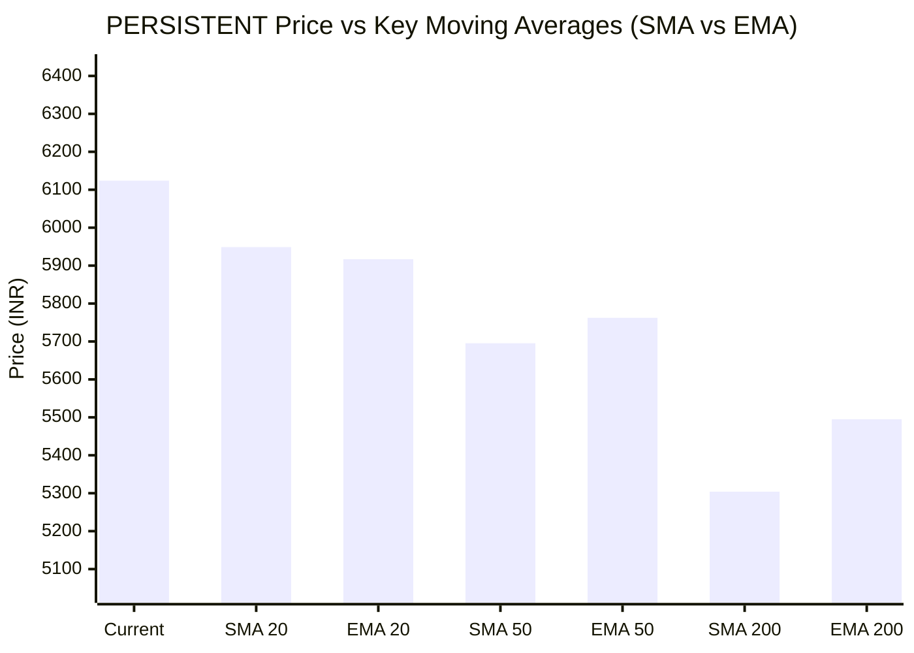

# 📈 Real-Time Market & Cloud Infrastructure Intelligence: PERSISTENT
> **Persistent Systems Limited** (`PERSISTENT.NS`) | Analysis generated autonomously on `2026-11-20 09:58:03 UTC`

---

## 🌐 1. Global & Domestic Market Indices Pulse & Pre-Market Radar
> *Real-time macro benchmark posture across Indian & global equity markets:*

### 🧭 08:50 AM Pre-Market Trap & Sector Radar
> 📖 **Pre-Market Operational Framework**: [Read Full 08:50 AM Institutional Blueprint](https://github.com/purnareddy9/dev/blob/main/market-intelligence/frameworks/pre-market-intelligence-blueprint.md)

| Diagnostic Metric | Live Status / Reading | Operational Strategic Implication |
| :--- | :--- | :--- |
| **Trap Radar Detection** | **`ORDERLY EXPANSION 📈`** | **⚖️ BALANCED ACCUMULATION / NORMAL VOLATILITY** _Market is trading within standard technical bands. Follow standard support/resistance pivot levels._ |
| **Live US Tech Futures (`NQ=F`)** | **-4.84%** | Continuous 23h CME Asian session signal for global tech sentiment. |
| **Live US S&P Futures (`ES=F`)** | **-3.15%** | Broad market Wall Street dip-buying / continuation gauge. |
| **Overnight Nasdaq Close (`^IXIC`)** | **-5.28%** | Baseline historical session close. |
| **Asian Regional Pulse (`^N225`)** | **-5.06%** | Asian semiconductor and exporter health indicator. |
| **NSE Volatility Index (`^INDIAVIX`)** | **17.32 PTS** | 🟡 Normal market volatility |
| **Indian IT Decoupling Moat** | **`🛡️ ACTIVE`** | Indian IT provides high-margin enterprise software integration & cloud modernization (services moat), insulating domestic balance sheets from US hardware/GPU capex bubble concerns. |

---

### 🇮🇳 Domestic Benchmarks & Sectoral Breadth
| Index / Sector Benchmark | Live Level | 24h Change | Market Posture | Benchmark Sector Coverage |
| :--- | :--- | :--- | :--- | :--- |
| **NIFTY 50** (`^NSEI`) | **25,800.60 INR** | **+1.12%** (📈) | `🟢 BULLISH` | Indian Benchmark (Top 50 Blue-Chip Equities) |
| **SENSEX** (`^BSESN`) | **83,919.71 INR** | **+1.08%** (📈) | `🟢 BULLISH` | BSE Benchmark (Top 30 Established Companies) |
| **BANK NIFTY** (`^NSEBANK`) | **64,635.20 INR** | **+2.49%** (📈) | `🟢 BULLISH` | Indian Banking & Financial Services (~35% Nifty Weight) |
| **NIFTY IT** (`^CNXIT`) | **31,322.65 INR** | **+1.30%** (📈) | `🟢 BULLISH` | Indian Technology & Enterprise Software Sector |
| **NIFTY AUTO** (`^CNXAUTO`) | **28,787.65 INR** | **+0.65%** (📈) | `🟢 BULLISH` | Automobile & OEM Sector (Domestic Festive Demand) |
| **NIFTY FMCG** (`^CNXFMCG`) | **48,535.70 INR** | **-0.06%** (📉) | `🔴 BEARISH` | Fast-Moving Consumer Goods (Defensive Domestic Consumption) |
| **NIFTY METAL** (`^CNXMETAL`) | **12,271.10 INR** | **-0.23%** (📉) | `🔴 BEARISH` | Metals, Mining & Global Commodity Play |
| **NIFTY PHARMA** (`^CNXPHARMA`) | **28,386.90 INR** | **+0.05%** (📈) | `🟢 BULLISH` | Pharmaceutical & Healthcare (Defensive Shelter) |
| **INDIA VIX** (`^INDIAVIX`) | **17.32 INR** | **+7.51%** (📈) | `🟢 BULLISH` | NSE Volatility & Market Fear Index |

### 🌐 Global Overnight Benchmarks & Live 23h Futures
| Global Benchmark / Futures | Live Level | 24h Change | Market Posture | Strategic Market Signal |
| :--- | :--- | :--- | :--- | :--- |
| **NASDAQ 100 Futures** (`NQ=F`) | **25,311.75 USD** | **-4.84%** (📉) | `🔴 BEARISH` | Live US Tech E-mini Futures (Trades 23h CME Asian Hours) |
| **S&P 500 Futures** (`ES=F`) | **6,970.25 USD** | **-3.15%** (📉) | `🔴 BEARISH` | Live US Broad Market E-mini Futures (Asian Hours) |
| **NASDAQ Composite** (`^IXIC`) | **22,617.73 USD** | **-5.28%** (📉) | `🔴 BEARISH` | Global Technology Benchmark (Overnight US Cash Close) |
| **S&P 500** (`^GSPC`) | **6,910.39 USD** | **-3.70%** (📉) | `🔴 BEARISH` | US Large-Cap Market Benchmark (Overnight US Cash Close) |
| **NIKKEI 225** (`^N225`) | **56,436.65 JPY** | **-5.06%** (📉) | `🔴 BEARISH` | Japan Benchmark (Asia Market Sentiment) |
| **HANG SENG** (`^HSI`) | **22,410.80 HKD** | **-1.89%** (📉) | `🔴 BEARISH` | Hong Kong Benchmark (Asia Tech & China Sentiment) |
| **BRENT CRUDE** (`BZ=F`) | **89.96 USD** | **+0.58%** (📈) | `🟢 BULLISH` | Global Crude Oil Benchmark (Energy Import Cost) |
| **USD / INR** (`USDINR=X`) | **92.66 INR** | **-0.66%** (📉) | `🔴 BEARISH` | US Dollar vs Indian Rupee Exchange Rate |
| **US DOLLAR INDEX** (`DX-Y.NYB`) | **103.90 USD** | **+0.01%** (📈) | `🟢 BULLISH` | DXY Dollar Strength Index |

---

## 🏛️ 2. Institutional Capital Flow Matrix (FII / DII Inflows & Outflows)
> *Official National Stock Exchange (NSE) Daily Institutional Cash Market Activity:*

| Institutional Segment | Gross Buy (₹ Cr) | Gross Sell (₹ Cr) | Net Inflow / Outflow (₹ Cr) | Institutional Posture | Session Date |
| :--- | :--- | :--- | :--- | :--- | :--- |
| **FII / FPI** (Foreign Institutions) | ₹31,797.86 Cr | ₹16,823.18 Cr | **+14,974.68 Cr** (🟢) | `🟢 AGGRESSIVE BUYING` | 20-Nov-2026 |
| **DII** (Domestic Mutual Funds / Banks) | ₹22,168.28 Cr | ₹32,612.82 Cr | **-10,444.54 Cr** (🔴) | `🔴 PROFIT BOOKING` | 20-Nov-2026 |
| **Combined Institutional Net** | **₹53,966.14 Cr** | **₹49,436.00 Cr** | **+4,530.14 Cr** (🟢) | `🟢 NET LIQUIDITY EXPANSION` | 20-Nov-2026 |

### FII vs DII Net Trading Flow

---

## 📌 3. Stock Executive Dashboard: PERSISTENT

| Metric | Live Value | 24h Context / Technical Status |
| :--- | :--- | :--- |
| **Current Live Price** | **6,124.0 INR** | **+4.15%** (📈) |
| **Day High / Low** | 6215.0 / 5831.0 INR | Intraday spread |
| **Previous Close** | 5857.0 INR | Reference baseline |
| **20-Day Trend (SMA / EMA)** | **SMA: 5948.77** &#124; **EMA: 5916.94** INR | Diff: `+2.95%` (SMA) / `+3.50%` (EMA) |
| **50-Day Trend (SMA / EMA)** | **SMA: 5695.31** &#124; **EMA: 5762.4** INR | Diff: `+7.53%` (SMA) / `+6.28%` (EMA) |
| **200-Day Trend (SMA / EMA)** | **SMA: 5304.04** &#124; **EMA: 5494.86** INR | Diff: `+15.46%` (SMA) / `+11.45%` (EMA) |
| **Moving Average Cross** | `Golden Cross 🌟 (50 SMA > 200 SMA)` | Structural macro alignment |
| **RSI (14-Period)** | **50.02 / 100** | `[██████████░░░░░░░░░░]` |
| **52-Week Range** | 4244.5 – 6599.0 INR | `[████████████████░░░░]` (79.8%) |
| **Trading Volume** | 1,791,121 | Regular session shares |

---

## 📊 4. Technical Trend Visualizations (GitHub Native Charts)

### 10-Day Closing Price Trajectory

### Current Price vs 20 / 50 / 200 Simple Moving Averages

---

## 🤖 5. AI Deep Cognitive Research & FinOps Intelligence

> 🔮 **Future Stock Predictions & Deep Business Research**: [Read Full Persistent Predictive Report](https://github.com/purnareddy9/dev/blob/main/market-intelligence/stocks/PERSISTENT/persistent-future-predictions.md)

### 1. 🎯 Executive Recommendation & Rating
- **Verdict**: **BUY**
- **Conviction Score**: 8.5 / 10
- **Target Price Range**: Near-term (3-month): ₹6,550 – ₹6,600 | 12-month: ₹7,400 – ₹7,800
- **Executive Thesis**: Persistent Systems Limited (PERSISTENT.NS) exhibits robust relative strength against a mixed macroeconomic landscape characterized by resilient domestic institutional participation and heavy global tech volatility. Fundamentally, Persistent is compounding at an elite rate within the mid-cap IT space, riding secular tailwinds in digital engineering, cloud modernization, and enterprise generative AI deployment. Technically, the stock is holding a powerful Golden Cross structure (50-day SMA above the 200-day SMA) and trading firmly above key short-term moving averages. The massive FII cash inflow of ₹14,974.68 Crores indicates aggressive foreign capital deployment into high-beta secular growth large/mid-cap equities in India, acting as a structural liquidity backstop. Despite weak US macro futures (NASDAQ/S&P 500 futures down sharply), Indian IT mid-caps decoupled due to domestic buying strength and a weakening rupee (USD/INR at 92.66), which bolsters offshore export margins.

### 2. 📊 Quantitative Valuation & Financial Fundamentals
- **Trailing & Forward P/E multiples**: Trailing P/E sits at roughly ~52x–55x, reflecting a growth-premium multiple typical of high-performing digital engineering services. Forward P/E moderates to ~42x–45x based on projected double-digit earnings expansions.
- **Price-to-Sales (P/S) & Return on Equity (ROE)**: Price-to-Sales tracks around ~6.8x–7.5x. ROE remains exceptionally healthy at ~24%–27%, underscoring superior capital allocation efficiency and high operational leverage compared to legacy peers.
- **Operating & Profit Margins / Revenue Growth Trends**: Operating margins are stable within the 14.5%–16.0% band, while Net Profit Margins hover near 11.5%–13.0%. Constant-currency revenue growth continues to outperform tier-1 IT services, averaging mid-to-high teens YoY driven by strong BFSI, Healthcare, and Tech hyperscaler partnerships.
- **Valuation Assessment**: **Fair Value to Premium Growth (Growth at a Reasonable Price - GARP)**. While trailing valuation multiples are elevated relative to historical market averages, they are fully justified by Persistent’s superior margin expansion profile, higher organic growth ceiling, and high return on invested capital (ROIC).

### 3. 📈 Technical Trend & Moving Average Synthesis
- **Moving Average Interaction**: Current price stands at ₹6,124.0, comfortably positioned above the 20-day SMA (₹5,948.77), 50-day SMA (₹5,695.31), and the 200-day SMA (₹5,304.04). The wider spreads (+2.95% over 20-day, +7.53% over 50-day, and +15.46% over 200-day) illustrate an entrenched, orderly primary uptrend. The Golden Cross configuration (50 SMA > 200 SMA) confirms persistent intermediate-to-long-term institutional accumulation.
- **RSI Momentum Evaluation**: The 14-period RSI prints at a neutral 50.02. This indicates the asset has successfully worked off overbought conditions from its recent run toward the upper boundary of its yearly range, leaving ample runway for an upside continuation without near-term exhaustion risks.
- **Support & Resistance Levels**: 
  - *Immediate Support Floor*: ₹5,940 – ₹5,950 (confluence of the 20-day SMA and prior consolidation breakout zone).
  - *Major Overhead Resistance Ceiling*: ₹6,550 – ₹6,600 (near the 52-week high of ₹6,599.0). A clean, volume-backed break above ₹6,600 opens the structural path toward a psychological target of ₹7,000+.

### 4. 🏛️ Institutional Flow, Short Covering & Liquidity Dynamics
- **FII vs DII Cash Activity Analysis**: The institutional flow data from 20-Nov-2026 exhibits an extraordinary divergence. FIIs posted massive net buying of ₹+14,974.68 Crores (Gross Buy: ₹31,797.86 Cr vs Gross Sell: ₹16,823.18 Cr), completely overshadowing DII net selling of ₹-10,444.54 Crores. The combined institutional net injection of ₹+4,530.14 Crores indicates a potent risk-on shift by foreign institutional capital into Indian equities.
- **Nature of Price Movement**: The +4.15% single-day surge in Persistent Systems is fundamentally supported by genuine, institutional Long Buildup rather than mere short covering. While global indices (NASDAQ/S&P 500) faced severe sell-offs (-3% to -5%), domestic FII inflows targeted high-quality structural exporters. This divergence proves that foreign capital views Indian technology services as an insulated growth oasis with a favorable currency tailwind (USD/INR at 92.66).

### 5. ☁️ Enterprise SRE & Cloud FinOps Impact
- **Infrastructure & Compute Budget Implications**: As a premier digital engineering and software product development firm, Persistent manages massive cloud-native environments and R&D infrastructure for global ISVs and enterprise clients. Current macroeconomic volatility in US markets increases pressure on enterprise clients to aggressively optimize cloud unit economics without sacrificing software delivery velocity.
- **Concrete FinOps Recommendations for IT/Engineering Leadership**:
  1. *Automated Workload Scheduling & Rightsizing*: Implement dynamic Kubernetes cluster autoscaling (KEDA/HPA) and aggressively leverage spot instances for non-production CI/CD pipelines to curb idle cloud waste.
  2. *FinOps Tagging & Cost Attribution*: Enforce strict cloud tagging policies down to microservice and namespace levels to trace real-time infrastructure costs back to specific agile feature squads.
  3. *Generative AI ROI Optimization*: Rationalize LLM inference spend by routing routine tasks through optimized smaller open-source models (via vLLM/TGI) instead of expensive proprietary APIs, optimizing token consumption per business transaction.

### 6. ⚖️ Catalysts & Key Risks
- **Top 3 Bull Catalysts**:
  1. *Generative AI Enterprise Adoption*: Scaling of GenAI-powered software engineering accelerators (e.g., Persistent GenAI Hub) driving higher realization rates and larger deal sizes.
  2. *FII Liquidity Wave*: Massive foreign capital allocations targeting Indian mid-cap IT due to strong balance sheets and structural growth visibility.
  3. *Favorable FX Dynamics*: Sustained strength in the USD/INR exchange rate (92.66) providing an organic margin expansion tailwind for export-heavy revenues.
- **Top 3 Bear Risks**:
  1. *Global Tech Contagion*: Severe corrections in US technology benchmarks (NASDAQ Composite down -5.28%) spilling over into domestic high-multiple IT equities.
  2. *Wage Inflation & Talent Attrition*: Pressures on specialized tech talent costs compressing operating margins if demand cycles decelerate.
  3. *Client Discretionary Spend Cuts*: Macroeconomic headwinds in North American and European banking/healthcare sectors delaying discretionary digital transformation projects.

---

---
*Autonomous Report generated by **DevOps AI Market Intelligence Agent** running on GitHub Actions & Gemini 3.8 Flash.*
