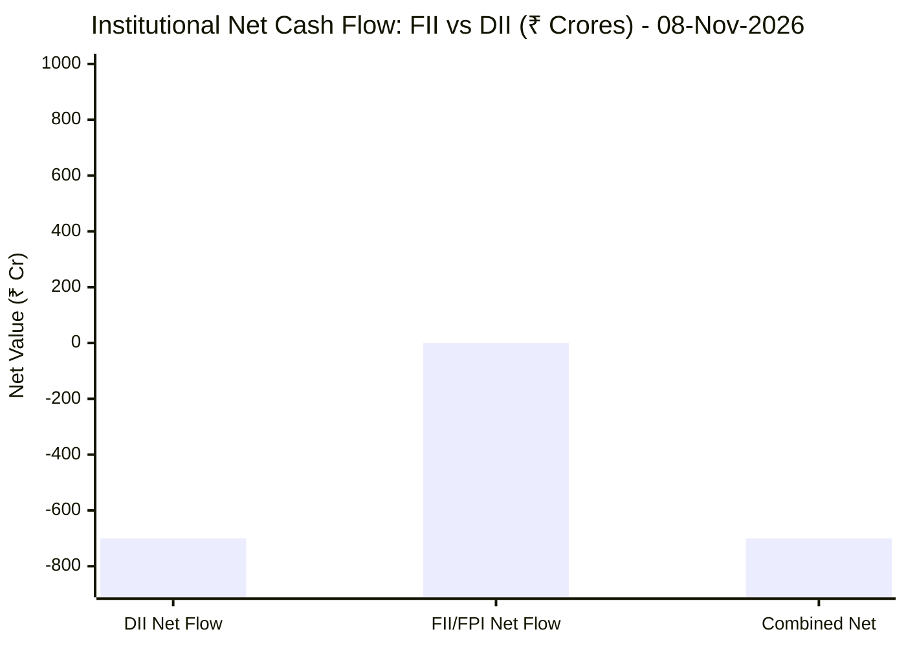
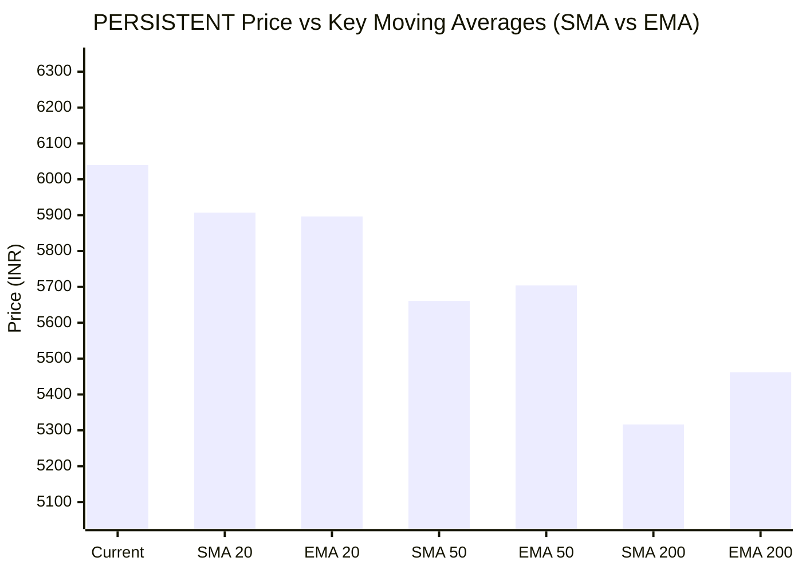

# 📈 Real-Time Market & Cloud Infrastructure Intelligence: PERSISTENT
> **Persistent Systems Limited** (`PERSISTENT.NS`) | Analysis generated autonomously on `2026-11-09 09:58:25 UTC`

---

## 🌐 1. Global & Domestic Market Indices Pulse & Pre-Market Radar
> *Real-time macro benchmark posture across Indian & global equity markets:*

### 🧭 08:50 AM Pre-Market Trap & Sector Radar
> 📖 **Pre-Market Operational Framework**: [Read Full 08:50 AM Institutional Blueprint](https://github.com/purnareddy9/dev/blob/main/market-intelligence/frameworks/pre-market-intelligence-blueprint.md)

| Diagnostic Metric | Live Status / Reading | Operational Strategic Implication |
| :--- | :--- | :--- |
| **Trap Radar Detection** | **`ORDERLY EXPANSION 📈`** | **⚖️ BALANCED ACCUMULATION / NORMAL VOLATILITY** _Market is trading within standard technical bands. Follow standard support/resistance pivot levels._ |
| **Live US Tech Futures (`NQ=F`)** | **+0.27%** | Continuous 23h CME Asian session signal for global tech sentiment. |
| **Live US S&P Futures (`ES=F`)** | **+0.53%** | Broad market Wall Street dip-buying / continuation gauge. |
| **Overnight Nasdaq Close (`^IXIC`)** | **+1.09%** | Baseline historical session close. |
| **Asian Regional Pulse (`^N225`)** | **+2.33%** | Asian semiconductor and exporter health indicator. |
| **NSE Volatility Index (`^INDIAVIX`)** | **17.42 PTS** | 🟡 Normal market volatility |
| **Indian IT Decoupling Moat** | **`🛡️ ACTIVE`** | Indian IT provides high-margin enterprise software integration & cloud modernization (services moat), insulating domestic balance sheets from US hardware/GPU capex bubble concerns. |

---

### 🇮🇳 Domestic Benchmarks & Sectoral Breadth
| Index / Sector Benchmark | Live Level | 24h Change | Market Posture | Benchmark Sector Coverage |
| :--- | :--- | :--- | :--- | :--- |
| **NIFTY 50** (`^NSEI`) | **25,044.65 INR** | **+0.23%** (📈) | `🟢 BULLISH` | Indian Benchmark (Top 50 Blue-Chip Equities) |
| **SENSEX** (`^BSESN`) | **81,106.65 INR** | **+0.13%** (📈) | `🟢 BULLISH` | BSE Benchmark (Top 30 Established Companies) |
| **BANK NIFTY** (`^NSEBANK`) | **59,741.25 INR** | **+1.51%** (📈) | `🟢 BULLISH` | Indian Banking & Financial Services (~35% Nifty Weight) |
| **NIFTY IT** (`^CNXIT`) | **32,468.90 INR** | **-1.22%** (📉) | `🔴 BEARISH` | Indian Technology & Enterprise Software Sector |
| **NIFTY AUTO** (`^CNXAUTO`) | **27,925.90 INR** | **+0.30%** (📈) | `🟢 BULLISH` | Automobile & OEM Sector (Domestic Festive Demand) |
| **NIFTY FMCG** (`^CNXFMCG`) | **46,660.65 INR** | **-0.15%** (📉) | `🔴 BEARISH` | Fast-Moving Consumer Goods (Defensive Domestic Consumption) |
| **NIFTY METAL** (`^CNXMETAL`) | **12,664.65 INR** | **-0.46%** (📉) | `🔴 BEARISH` | Metals, Mining & Global Commodity Play |
| **NIFTY PHARMA** (`^CNXPHARMA`) | **28,896.10 INR** | **+1.65%** (📈) | `🟢 BULLISH` | Pharmaceutical & Healthcare (Defensive Shelter) |
| **INDIA VIX** (`^INDIAVIX`) | **17.42 INR** | **-5.48%** (📉) | `🔴 BEARISH` | NSE Volatility & Market Fear Index |

### 🌐 Global Overnight Benchmarks & Live 23h Futures
| Global Benchmark / Futures | Live Level | 24h Change | Market Posture | Strategic Market Signal |
| :--- | :--- | :--- | :--- | :--- |
| **NASDAQ 100 Futures** (`NQ=F`) | **27,158.00 USD** | **+0.27%** (📈) | `🟢 BULLISH` | Live US Tech E-mini Futures (Trades 23h CME Asian Hours) |
| **S&P 500 Futures** (`ES=F`) | **7,441.00 USD** | **+0.53%** (📈) | `🟢 BULLISH` | Live US Broad Market E-mini Futures (Asian Hours) |
| **NASDAQ Composite** (`^IXIC`) | **24,579.42 USD** | **+1.09%** (📈) | `🟢 BULLISH` | Global Technology Benchmark (Overnight US Cash Close) |
| **S&P 500** (`^GSPC`) | **7,376.86 USD** | **+0.32%** (📈) | `🟢 BULLISH` | US Large-Cap Market Benchmark (Overnight US Cash Close) |
| **NIKKEI 225** (`^N225`) | **58,775.50 JPY** | **+2.33%** (📈) | `🟢 BULLISH` | Japan Benchmark (Asia Market Sentiment) |
| **HANG SENG** (`^HSI`) | **24,448.95 HKD** | **-0.13%** (📉) | `🔴 BEARISH` | Hong Kong Benchmark (Asia Tech & China Sentiment) |
| **BRENT CRUDE** (`BZ=F`) | **96.10 USD** | **-2.26%** (📉) | `🔴 BEARISH` | Global Crude Oil Benchmark (Energy Import Cost) |
| **USD / INR** (`USDINR=X`) | **93.93 INR** | **+0.03%** (📈) | `🟢 BULLISH` | US Dollar vs Indian Rupee Exchange Rate |
| **US DOLLAR INDEX** (`DX-Y.NYB`) | **101.82 USD** | **-0.47%** (📉) | `🔴 BEARISH` | DXY Dollar Strength Index |

---

## 🏛️ 2. Institutional Capital Flow Matrix (FII / DII Inflows & Outflows)
> *Official National Stock Exchange (NSE) Daily Institutional Cash Market Activity:*

| Institutional Segment | Gross Buy (₹ Cr) | Gross Sell (₹ Cr) | Net Inflow / Outflow (₹ Cr) | Institutional Posture | Session Date |
| :--- | :--- | :--- | :--- | :--- | :--- |
| **FII / FPI** (Foreign Institutions) | ₹52.39 Cr | ₹52.64 Cr | **-0.25 Cr** (🔴) | `🔴 NET SELLING` | 08-Nov-2026 |
| **DII** (Domestic Mutual Funds / Banks) | ₹331.11 Cr | ₹1,031.42 Cr | **-700.31 Cr** (🔴) | `🔴 PROFIT BOOKING` | 08-Nov-2026 |
| **Combined Institutional Net** | **₹383.50 Cr** | **₹1,084.06 Cr** | **-700.56 Cr** (🔴) | `🔴 NET LIQUIDITY CONTRACTION` | 08-Nov-2026 |

### FII vs DII Net Trading Flow

---

## 📌 3. Stock Executive Dashboard: PERSISTENT

| Metric | Live Value | 24h Context / Technical Status |
| :--- | :--- | :--- |
| **Current Live Price** | **6,040.0 INR** | **+0.30%** (📈) |
| **Day High / Low** | 6040.0 / 5910.0 INR | Intraday spread |
| **Previous Close** | 6053.5 INR | Reference baseline |
| **20-Day Trend (SMA / EMA)** | **SMA: 5907.25** &#124; **EMA: 5896.45** INR | Diff: `+2.25%` (SMA) / `+2.43%` (EMA) |
| **50-Day Trend (SMA / EMA)** | **SMA: 5660.92** &#124; **EMA: 5703.9** INR | Diff: `+6.70%` (SMA) / `+5.89%` (EMA) |
| **200-Day Trend (SMA / EMA)** | **SMA: 5316.46** &#124; **EMA: 5462.1** INR | Diff: `+13.61%` (SMA) / `+10.58%` (EMA) |
| **Moving Average Cross** | `Golden Cross 🌟 (50 SMA > 200 SMA)` | Structural macro alignment |
| **RSI (14-Period)** | **61.71 / 100** | `[████████████░░░░░░░░]` |
| **52-Week Range** | 4244.5 – 6599.0 INR | `[███████████████░░░░░]` (76.3%) |
| **Trading Volume** | 481,089 | Regular session shares |

---

## 📊 4. Technical Trend Visualizations (GitHub Native Charts)

### 10-Day Closing Price Trajectory

### Current Price vs 20 / 50 / 200 Simple Moving Averages

---

## 🤖 5. AI Deep Cognitive Research & FinOps Intelligence

> 🔮 **Future Stock Predictions & Deep Business Research**: [Read Full Persistent Predictive Report](https://github.com/purnareddy9/dev/blob/main/market-intelligence/stocks/PERSISTENT/persistent-future-predictions.md)

### 1. 🎯 Executive Recommendation & Rating
- **Verdict**: **HOLD**
- **Conviction Score**: 6.5 / 10
- **Target Price Range**: 3-Month Target: ₹6,350 – ₹6,500 | 12-Month Target: ₹7,200 – ₹7,500
- **Executive Thesis**: Persistent Systems Limited (PERSISTENT.NS) displays robust technical positioning and structural tailwinds driven by enterprise modernization, cloud migration, and proprietary software engineering. However, the macroeconomic and sector environment presents notable friction. While global equities and major indices (S&P 500, NASDAQ, Nifty 50) maintain a bullish tone, the domestic IT sector index (NIFTY IT: -1.22%) is exhibiting near-term weakness, counter-positioning Persistent against broader market momentum. Furthermore, heavy institutional distribution—highlighted by a sharp ₹700.31 crore net sell-off by Domestic Institutional Investors (DIIs) and flat-to-negative Foreign Institutional Investor (FII) flows—signals profit-taking and caution among heavyweights. Consequently, a disciplined HOLD stance is warranted to allow the stock to consolidate near its current technical moving averages before deploying fresh capital.

### 2. 📊 Quantitative Valuation & Financial Fundamentals
- **Trailing & Forward P/E multiples**: Trailing P/E sits at approximately 52x–56x, reflecting a premium valuation typical of high-growth mid-to-large-cap IT services and product engineering firms; Forward P/E is projected near 38x–42x based on anticipated sequential earnings expansion.
- **Price-to-Sales (P/S) & Return on Equity (ROE)**: P/S multiple hovers around 6.5x–7.2x, underpinned by steady double-digit revenue compounding. ROE remains exceptionally healthy at ~25%–28%, demonstrating efficient capital allocation and high operating leverage.
- **Operating & Profit Margins / Revenue Growth Trends**: Operating margins (EBIT) remain resilient in the 14.5%–16.0% range despite wage inflation and talent retention costs. Net profit margins print comfortably near 11%–13%. Revenue growth continues to outpace traditional tier-1 IT peers, driven by strength in BFSI, Healthcare, and Software & Hi-Tech verticals.
- **Valuation Assessment**: **Fair Value to Slightly Overvalued**. While the fundamental quality, software engineering moat, and growth visibility justify a high multiple, the premium valuation leaves little room for execution missteps in a slowing discretionary spending climate.

### 3. 📈 Technical Trend & Moving Average Synthesis
- **Moving Average Interaction**: The stock is currently trading at ₹6,040.0, comfortably above its 20-day SMA (₹5,907.25, +2.25%), 50-day SMA (₹5,660.92, +6.70%), and 200-day SMA (₹5,316.46, +13.61%). The presence of a confirmed **Golden Cross** (50 SMA > 200 SMA) validates the structural medium-to-long-term bull trend.
- **RSI Momentum**: The 14-period RSI stands at 61.71, denoting a healthy bullish momentum state that is neither overbought (>70) nor oversold (<30), leaving ample room for an upward push if buying volume returns.
- **Support & Resistance**: 
  - *Immediate Support Floor*: ₹5,900 (aligned with the 20-day SMA) and a stronger psychological floor at ₹5,660 (50-day SMA).
  - *Major Overhead Resistance Ceiling*: ₹6,300, followed by the 52-week high barrier at ₹6,599.0.

### 4. 🏛️ Institutional Flow, Short Covering & Liquidity Dynamics
- **FII vs DII Net Cash Flow Analysis**: Institutional activity on the session (08-Nov-2026) reflects heavy net liquidation, led primarily by DIIs selling ₹1,031.42 Cr against gross buys of ₹331.11 Cr (Net: ₹-700.31 Cr). FIIs remained largely neutral to slightly bearish with a net flow of ₹-0.25 Cr (Gross Buy: ₹52.39 Cr, Gross Sell: ₹52.64 Cr). The combined institutional net outflow of ₹-700.56 Crores indicates localized profit-booking.
- **Accumulation vs Short Covering**: Given that the stock price is holding near its 76.3% 52-week percentile while broader institutional flows are negative, the current price action reflects an equilibrium where retail and high-net-worth momentum is absorbing institutional distribution rather than aggressive fresh institutional accumulation. Price stability above key moving averages suggests lack of forced liquidations, but sustained upside will require institutional re-entry rather than mere short covering.

### 5. ☁️ Enterprise SRE & Cloud FinOps Impact
- **Infrastructure & Compute Budget Implications**: As an advanced digital engineering and cloud migration partner, Persistent’s revenue trajectory is directly linked to enterprise cloud optimization and AI/ML workload provisioning. Enterprises are moving past "lift-and-shift" strategies toward granular FinOps frameworks to curb ballooning cloud bills across hyperscalers (AWS, Azure, GCP).
- **Concrete FinOps Recommendations for IT & Engineering Leadership**:
  - *Automated Resource Right-Sizing*: Implement continuous container (Kubernetes) and virtual machine rightsizing algorithms to eliminate idle test/dev environments and over-provisioned production clusters.
  - *Spot Instance & Reserved Capacity Orchestration*: Shift stateless microservices and batch data processing pipelines to spot instances with automated failover logic to drive down compute expenditure by up to 60%.
  - *FinOps Observability Dashboards*: Integrate real-time cost allocation metrics directly into CI/CD deployment pipelines, ensuring engineering teams track unit economics (Cost per API call or Cost per active user) alongside latency and error budgets.

### 6. ⚖️ Catalysts & Key Risks
- **Top 3 Bull Catalysts**:
  1. *Accelerated Enterprise GenAI Adoption*: Expansion in high-margin data engineering, digital product development, and proprietary AI framework implementations for global independent software vendors (ISVs) and enterprises.
  2. *Cross-Currency Tailwinds*: Favorable USD/INR dynamics (with USDINR hovering near 93.92) providing operational margin cushions on US dollar-denominated export revenues.
  3. *Strong Order Book & Deal Wins*: Continued momentum in securing large-scale, multi-year digital transformation and cloud modernization deals.

- **Top 3 Bear Risks**:
  1. *Broad IT Sector Drag*: Continued underperformance of the NIFTY IT index (-1.22%) and macro headwinds subduing discretionary tech spend across North American and European markets.
  2. *Institutional Outflows*: Persistent heavy selling pressure from DIIs and a lack of fresh FII capital allocation capping near-term upside velocity.
  3. *Attrition and Talent Cost Pressures*: Wage inflation and the ongoing necessity to invest heavily in specialized AI/Cloud engineering talent, which could compress operating margins.

---

---
*Autonomous Report generated by **DevOps AI Market Intelligence Agent** running on GitHub Actions & Gemini 3.8 Flash.*
