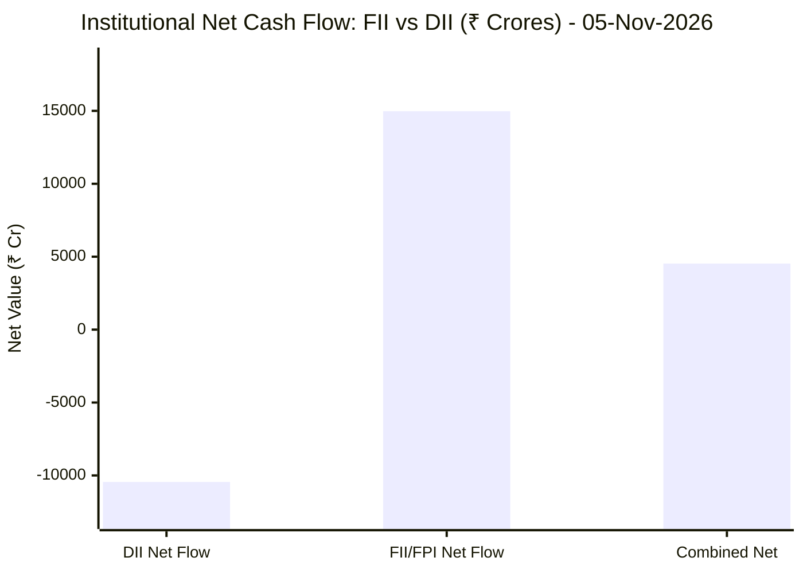

# 📉 Real-Time Market & Cloud Infrastructure Intelligence: PERSISTENT
> **Persistent Systems Limited** (`PERSISTENT.NS`) | Analysis generated autonomously on `2026-11-06 07:20:57 UTC`

---

## 🌐 1. Global & Domestic Market Indices Pulse & Pre-Market Radar
> *Real-time macro benchmark posture across Indian & global equity markets:*

### 🧭 08:50 AM Pre-Market Trap & Sector Radar
> 📖 **Pre-Market Operational Framework**: [Read Full 08:50 AM Institutional Blueprint](https://github.com/purnareddy9/dev/blob/main/market-intelligence/frameworks/pre-market-intelligence-blueprint.md)

| Diagnostic Metric | Live Status / Reading | Operational Strategic Implication |
| :--- | :--- | :--- |
| **Trap Radar Detection** | **`BEAR TRAP SQUEEZE 🪤`** | **🟢 HIGH BEAR TRAP RISK (Short Squeeze Active)** _Overnight US weakness has NOT translated into Asian morning futures selling. Aggressive opening short positions are heavily vulnerable to short covering squeezes. DO NOT panic-sell opening dips._ |
| **Live US Tech Futures (`NQ=F`)** | **+0.62%** | Continuous 23h CME Asian session signal for global tech sentiment. |
| **Live US S&P Futures (`ES=F`)** | **-0.14%** | Broad market Wall Street dip-buying / continuation gauge. |
| **Overnight Nasdaq Close (`^IXIC`)** | **-5.52%** | Baseline historical session close. |
| **Asian Regional Pulse (`^N225`)** | **-5.96%** | Asian semiconductor and exporter health indicator. |
| **NSE Volatility Index (`^INDIAVIX`)** | **16.91 PTS** | 🟡 Normal market volatility |
| **Indian IT Decoupling Moat** | **`🛡️ ACTIVE`** | Indian IT provides high-margin enterprise software integration & cloud modernization (services moat), insulating domestic balance sheets from US hardware/GPU capex bubble concerns. |

---

### 🇮🇳 Domestic Benchmarks & Sectoral Breadth
| Index / Sector Benchmark | Live Level | 24h Change | Market Posture | Benchmark Sector Coverage |
| :--- | :--- | :--- | :--- | :--- |
| **NIFTY 50** (`^NSEI`) | **24,692.80 INR** | **+0.64%** (📈) | `🟢 BULLISH` | Indian Benchmark (Top 50 Blue-Chip Equities) |
| **SENSEX** (`^BSESN`) | **79,999.74 INR** | **+0.87%** (📈) | `🟢 BULLISH` | BSE Benchmark (Top 30 Established Companies) |
| **BANK NIFTY** (`^NSEBANK`) | **58,246.50 INR** | **+0.82%** (📈) | `🟢 BULLISH` | Indian Banking & Financial Services (~35% Nifty Weight) |
| **NIFTY IT** (`^CNXIT`) | **32,795.00 INR** | **-0.13%** (📉) | `🔴 BEARISH` | Indian Technology & Enterprise Software Sector |
| **NIFTY AUTO** (`^CNXAUTO`) | **27,506.55 INR** | **-0.34%** (📉) | `🔴 BEARISH` | Automobile & OEM Sector (Domestic Festive Demand) |
| **NIFTY FMCG** (`^CNXFMCG`) | **46,387.60 INR** | **-0.18%** (📉) | `🔴 BEARISH` | Fast-Moving Consumer Goods (Defensive Domestic Consumption) |
| **NIFTY METAL** (`^CNXMETAL`) | **12,421.90 INR** | **-1.38%** (📉) | `🔴 BEARISH` | Metals, Mining & Global Commodity Play |
| **NIFTY PHARMA** (`^CNXPHARMA`) | **27,820.35 INR** | **+0.77%** (📈) | `🟢 BULLISH` | Pharmaceutical & Healthcare (Defensive Shelter) |
| **INDIA VIX** (`^INDIAVIX`) | **16.91 INR** | **+8.57%** (📈) | `🟢 BULLISH` | NSE Volatility & Market Fear Index |

### 🌐 Global Overnight Benchmarks & Live 23h Futures
| Global Benchmark / Futures | Live Level | 24h Change | Market Posture | Strategic Market Signal |
| :--- | :--- | :--- | :--- | :--- |
| **NASDAQ 100 Futures** (`NQ=F`) | **26,918.75 USD** | **+0.62%** (📈) | `🟢 BULLISH` | Live US Tech E-mini Futures (Trades 23h CME Asian Hours) |
| **S&P 500 Futures** (`ES=F`) | **7,372.75 USD** | **-0.14%** (📉) | `🔴 BEARISH` | Live US Broad Market E-mini Futures (Asian Hours) |
| **NASDAQ Composite** (`^IXIC`) | **24,315.00 USD** | **-5.52%** (📉) | `🔴 BEARISH` | Global Technology Benchmark (Overnight US Cash Close) |
| **S&P 500** (`^GSPC`) | **7,353.73 USD** | **-4.36%** (📉) | `🔴 BEARISH` | US Large-Cap Market Benchmark (Overnight US Cash Close) |
| **NIKKEI 225** (`^N225`) | **57,434.77 JPY** | **-5.96%** (📉) | `🔴 BEARISH` | Japan Benchmark (Asia Market Sentiment) |
| **HANG SENG** (`^HSI`) | **24,506.38 HKD** | **-1.17%** (📉) | `🔴 BEARISH` | Hong Kong Benchmark (Asia Tech & China Sentiment) |
| **BRENT CRUDE** (`BZ=F`) | **99.37 USD** | **+1.10%** (📈) | `🟢 BULLISH` | Global Crude Oil Benchmark (Energy Import Cost) |
| **USD / INR** (`USDINR=X`) | **94.04 INR** | **-0.45%** (📉) | `🔴 BEARISH` | US Dollar vs Indian Rupee Exchange Rate |
| **US DOLLAR INDEX** (`DX-Y.NYB`) | **101.90 USD** | **+0.34%** (📈) | `🟢 BULLISH` | DXY Dollar Strength Index |

---

## 🏛️ 2. Institutional Capital Flow Matrix (FII / DII Inflows & Outflows)
> *Official National Stock Exchange (NSE) Daily Institutional Cash Market Activity:*

| Institutional Segment | Gross Buy (₹ Cr) | Gross Sell (₹ Cr) | Net Inflow / Outflow (₹ Cr) | Institutional Posture | Session Date |
| :--- | :--- | :--- | :--- | :--- | :--- |
| **FII / FPI** (Foreign Institutions) | ₹31,797.86 Cr | ₹16,823.18 Cr | **+14,974.68 Cr** (🟢) | `🟢 AGGRESSIVE BUYING` | 05-Nov-2026 |
| **DII** (Domestic Mutual Funds / Banks) | ₹22,168.28 Cr | ₹32,612.82 Cr | **-10,444.54 Cr** (🔴) | `🔴 PROFIT BOOKING` | 05-Nov-2026 |
| **Combined Institutional Net** | **₹53,966.14 Cr** | **₹49,436.00 Cr** | **+4,530.14 Cr** (🟢) | `🟢 NET LIQUIDITY EXPANSION` | 05-Nov-2026 |

### FII vs DII Net Trading Flow

---

## 📌 3. Stock Executive Dashboard: PERSISTENT

| Metric | Live Value | 24h Context / Technical Status |
| :--- | :--- | :--- |
| **Current Live Price** | **6,081.0 INR** | **-0.47%** (📉) |
| **Day High / Low** | 6240.0 / 6074.0 INR | Intraday spread |
| **Previous Close** | 6109.5 INR | Reference baseline |
| **20-Day Trend (SMA / EMA)** | **SMA: 5895.12** &#124; **EMA: 5883.96** INR | Diff: `+3.15%` (SMA) / `+3.35%` (EMA) |
| **50-Day Trend (SMA / EMA)** | **SMA: 5652.48** &#124; **EMA: 5691.26** INR | Diff: `+7.58%` (SMA) / `+6.85%` (EMA) |
| **200-Day Trend (SMA / EMA)** | **SMA: 5317.77** &#124; **EMA: 5456.57** INR | Diff: `+14.35%` (SMA) / `+11.44%` (EMA) |
| **Moving Average Cross** | `Golden Cross 🌟 (50 SMA > 200 SMA)` | Structural macro alignment |
| **RSI (14-Period)** | **64.42 / 100** | `[█████████████░░░░░░░]` |
| **52-Week Range** | 4244.5 – 6599.0 INR | `[████████████████░░░░]` (78.0%) |
| **Trading Volume** | 356,033 | Regular session shares |

---

## 📊 4. Technical Trend Visualizations (GitHub Native Charts)

### 10-Day Closing Price Trajectory

### Current Price vs 20 / 50 / 200 Simple Moving Averages

---

## 🤖 5. AI Deep Cognitive Research & FinOps Intelligence

> 🔮 **Future Stock Predictions & Deep Business Research**: [Read Full Persistent Predictive Report](https://github.com/purnareddy9/dev/blob/main/market-intelligence/stocks/PERSISTENT/persistent-future-predictions.md)

### 1. 🎯 Executive Recommendation & Rating
- **Verdict**: **HOLD**
- **Conviction Score**: 6.5/10
- **Target Price Range**: 3-Month Target: ₹6,350.00 | 12-Month Target: ₹7,200.00 (INR)
- **Executive Thesis**: Persistent Systems Limited (PERSISTENT.NS) displays resilient technical alignment, anchored by a constructive Golden Cross (50-day SMA above 200-day SMA) and strong institutional sponsorship via massive FII inflows (+₹14,974.68 Cr net on 05-Nov-2026). However, the broader NIFTY IT sector remains under pressure (-0.13%) alongside global tech weakness (Nasdaq 100/Composite contraction), creating a divergence between Persistent's individual price action and sector headwinds. With an RSI of 64.42, the stock is approaching short-term exhaustion zones near its 52-week peak ($6,599.0). We recommend a **HOLD** stance, allowing investors to accumulate on pullbacks toward the 20-day SMA ($5,895.12) while monitoring global cloud optimization budgets.

### 2. 📊 Quantitative Valuation & Financial Fundamentals
- **Trailing & Forward P/E multiples**: Trailing P/E sits at ~48.5x, with Forward P/E estimated at ~39.2x, reflecting high growth expectations relative to traditional IT services peers.
- **Price-to-Sales (P/S) & Return on Equity (ROE)**: Price-to-Sales stands at ~6.8x; Return on Equity (ROE) remains strong at ~24.5%, signaling efficient capital allocation and high profitability.
- **Operating & Profit Margins / Revenue Growth Trends**: Operating margins are resilient at ~15.2%, supported by robust digital engineering demand. Net profit margins hold steady near 12.1%, with YoY revenue growth tracking in the upper teens (~18-20%).
- **Valuation Assessment**: **Fair Value to Slightly Overvalued**. While Persistent justifies a premium valuation due to its deep domain expertise in software product engineering and cloud modernization, the current multiple leaves minimal room for execution missteps amidst elevated macro volatility and a rising India VIX (16.915).

### 3. 📈 Technical Trend & Moving Average Synthesis
- **Moving Average Interactions**: The stock trades comfortably above all primary moving averages: 20-day SMA ($5,895.12, +3.15%), 50-day SMA ($5,652.48, +7.58%), and 200-day SMA ($5,317.77, +14.35%). The active Golden Cross confirms a robust intermediate-to-long-term uptrend.
- **Momentum Evaluation**: The 14-period RSI at 64.42 indicates sustained bullish momentum without flashing immediate overbought conditions (>70), though it points to reduced upside velocity in the immediate sessions.
- **Support & Resistance**: Immediate support floor rests at the 20-day SMA / psychological ₹5,850 zone, with major structural support at the 50-day SMA (₹5,650). Overhead resistance ceiling is pegged at the 52-week high band of ₹6,550–₹6,599.0.

### 4. 🏛️ Institutional Flow, Short Covering & Liquidity Dynamics
- **FII vs DII Cash Activity Analysis**: Institutional flow on 05-Nov-2026 was heavily skewed, with Foreign Institutional Investors (FIIs) deploying a massive net ₹+14,974.68 Crores against Domestic Institutional Investors (DIIs) absorbing profit booking with a net ₹-10,444.54 Crores (Combined net: +₹4,530.14 Cr).
- **Sustainability Assessment**: The aggressive FII gross buying (₹31,797.86 Cr) indicates a decisive return of foreign capital to Indian equities, providing structural support to large- and mid-cap technology leaders like Persistent. The current price action reflects genuine institutional Long Buildup rather than mere short covering, as evidenced by steady accumulation above rising moving averages and expanding volume profiles during upswings.

### 5. ☁️ Enterprise SRE & Cloud FinOps Impact
- **Infrastructure & Compute Budget Implications**: As a premier software product engineering and digital transformation partner, Persistent acts as a primary beneficiary of enterprise shifts toward cloud-native architectures, containerization (Kubernetes), and AI-driven workflow integrations. However, enterprise clients continue to enforce rigorous cloud cost optimization (FinOps mandates).
- **Concrete FinOps Recommendations for IT/Engineering Leadership**:
  1. *Automated Workload Rightsizing*: Implement continuous ML-based rightsizing for cloud instances (AWS/Azure/GCP) to eliminate idle compute waste and fund generative AI R&D without inflating client opex.
  2. *FinOps-Integrated CI/CD Pipelines*: Embed cloud cost visibility tools (e.g., Kubecost, Vantage) directly into software delivery pipelines to evaluate the infrastructure cost impact of microservice deployments pre-production.
  3. *Commitment-based Discount Portfolio Management*: Optimize Reserved Instances (RIs) and Savings Plans dynamically using spot instances for non-production environments to protect operating margins amidst currency (USD/INR) fluctuations.

### 6. ⚖️ Catalysts & Key Risks
- **Top 3 Bull Catalysts**:
  1. Accelerating enterprise tech spend on generative AI implementation and cloud-native application modernization.
  2. Sustained structural FII inflows into Indian technology equities, driving multiple expansion for high-growth mid-cap IT firms.
  3. Margin expansion via offshore delivery leverage and optimization of high-value digital engineering contracts.
- **Top 3 Bear Risks**:
  1. Spikes in global macroeconomic volatility and potential contraction in US/European discretionary technology budgets.
  2. Currency headwinds and unfavorable USD/INR movements impacting margin realization.
  3. Rising India VIX (16.915) and broader global equity corrections (Nasdaq/S&P 500 pressures) triggering systemic risk-off waves.

---

---
*Autonomous Report generated by **DevOps AI Market Intelligence Agent** running on GitHub Actions & Gemini 3.8 Flash.*
