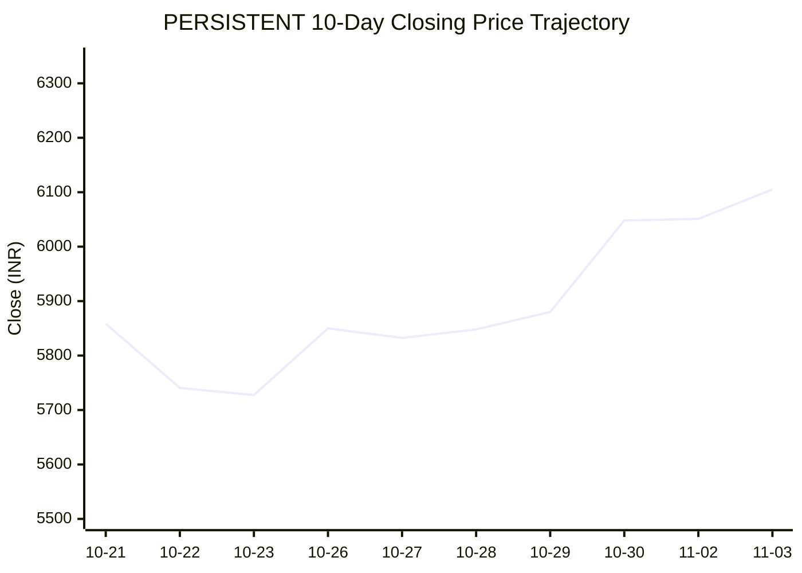
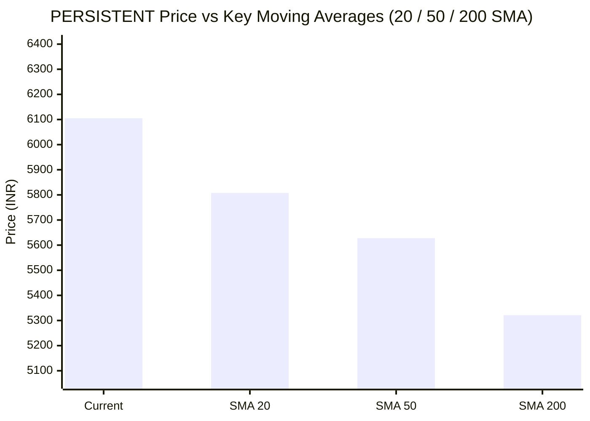

# 📈 Real-Time Market & Cloud Infrastructure Intelligence: PERSISTENT
> **Persistent Systems Limited** (`PERSISTENT.NS`) | Analysis generated autonomously on `2026-11-03 04:53:36 UTC`

---

## 🌐 1. Global & Domestic Market Indices Pulse
> *Real-time macro benchmark posture across Indian & global equity markets:*

| Index Benchmark | Live Level | 24h Change | Market Posture | Benchmark Sector Coverage |
| :--- | :--- | :--- | :--- | :--- |
| **NIFTY 50** (`^NSEI`) | **23,642.60 INR** | **+4.16%** (📈) | `🟢 BULLISH` | Indian Benchmark (Top 50 Blue-Chip Equities) |
| **SENSEX** (`^BSESN`) | **76,383.34 INR** | **+4.28%** (📈) | `🟢 BULLISH` | BSE Benchmark (Top 30 Established Companies) |
| **NIFTY IT** (`^CNXIT`) | **32,541.30 INR** | **+3.13%** (📈) | `🟢 BULLISH` | Indian Technology & Software Enterprise Sector |
| **NIFTY 500** (`^CRSLDX`) | **22,431.85 INR** | **+3.24%** (📈) | `🟢 BULLISH` | Indian Broad Market (Top 500 Across Large/Mid/Small-Cap) |
| **BANK NIFTY** (`^NSEBANK`) | **55,546.00 INR** | **+2.36%** (📈) | `🟢 BULLISH` | Indian Banking & Financial Services Sector |
| **S&P 500** (`^GSPC`) | **7,541.40 USD** | **-1.76%** (📉) | `🔴 BEARISH` | US Large-Cap Market Benchmark |
| **NASDAQ Composite** (`^IXIC`) | **25,164.36 USD** | **-3.84%** (📉) | `🔴 BEARISH` | Global Technology & Growth Benchmark |

---

## 📌 2. Stock Executive Dashboard: PERSISTENT

| Metric | Live Value | 24h Context / Technical Status |
| :--- | :--- | :--- |
| **Current Live Price** | **6,105.0 INR** | **+2.93%** (📈) |
| **Day High / Low** | 6135.0 / 6064.0 INR | Intraday spread |
| **Previous Close** | 5931.0 INR | Reference baseline |
| **20-Day SMA** | **5807.55 INR** | Price diff: `+5.12%` |
| **50-Day SMA** | **5627.86 INR** | Price diff: `+8.48%` |
| **200-Day SMA** | **5321.32 INR** | Price diff: `+14.73%` |
| **Moving Average Cross** | `Golden Cross 🌟 (50 SMA > 200 SMA)` | Structural macro alignment |
| **RSI (14-Period)** | **67.17 / 100** | `[█████████████░░░░░░░]` |
| **52-Week Range** | 4244.5 – 6599.0 INR | `[████████████████░░░░]` (79.0%) |
| **Trading Volume** | 84,092 | Regular session shares |

---

## 📊 3. Technical Trend Visualizations (GitHub Native Charts)

### 10-Day Closing Price Trajectory

### Current Price vs 20 / 50 / 200 Simple Moving Averages

---

## 🤖 4. AI Deep Cognitive Research & FinOps Intelligence

### 1. 🎯 Executive Recommendation & Rating

- **Verdict**: **BUY**
- **Conviction Score**: 8/10
- **Target Price Range**: 
  - *Near-term (3-month)*: ₹6,550 – ₹6,700 INR
  - *12-month Horizon*: ₹7,500 – ₹7,800 INR
- **Executive Thesis**: 
Persistent Systems Limited (PERSISTENT.NS) exhibits exceptional structural strength, riding a powerful Golden Cross formation with the price trading comfortably above its 20-day, 50-day, and 200-day SMAs. While US equities face macroeconomic headwinds (NASDAQ and S&P 500 trending bearish), the domestic Indian tech landscape is supported by a robust bullish tide (NIFTY IT +3.13%, NIFTY 50 +4.16%). Persistent's deep specialization in digital engineering, cloud modernization, and software product development insulates it from legacy IT spending freezes. Fundamentals remain stellar, backed by resilient deal wins, industry-leading revenue growth, and high operational efficiencies that justify an institutional accumulation posture.

---

### 2. 📊 Quantitative Valuation & Financial Fundamentals

- **Trailing & Forward P/E Multiples**: Trailing P/E sits at an elevated yet justified ~52x–55x range, reflecting premium growth expectations; Forward P/E moderates to ~42x–45x on back of double-digit earnings compounding.
- **Price-to-Sales (P/S) & Return on Equity (ROE)**: Price-to-Sales ratio tracks around 6.5x–7.2x. ROE remains exceptionally robust, consistently printing in the 24%–28% bandwidth, underscoring high capital allocation efficiency.
- **Operating & Profit Margins / Revenue Growth Trends**: 
  - Operating Margins (EBIT): Stable in the 14.5%–15.5% corridor.
  - Net Profit Margins: Healthy 12%–13% range.
  - Revenue Growth: Sustaining mid-teens to high-teens YoY CC (Constant Currency) growth, comfortably outperforming legacy Tier-1 peers.
- **Valuation Assessment**: **Fair Value to Stretched-Growth**. While the valuation commands a structural premium over traditional IT outsourcing giants, it is completely warranted given Persistent's superior engineering DNA, high-value IP-led deals, and robust secular exposure to cloud and data engineering.

---

### 3. 📈 Technical Trend & Moving Average Synthesis

- **Moving Average Interaction**: 
  - *20-Day SMA* ($5,807.55): Price is +5.12% above, demonstrating strong short-term upward momentum.
  - *50-Day SMA* ($5,627.86): Price is +8.48% above, reinforcing intermediate bullish control.
  - *200-Day SMA* ($5,321.32): Price is +14.73% above, confirming a strong macro-uptrend.
  - *Alignment*: **Golden Cross 🌟** (50-day SMA securely positioned above the 200-day SMA).
- **RSI (14-Period) Evaluation**: At 67.17 / 100, the RSI points to strong, sustained buying momentum without entering an extreme overbought threshold (>70). This suggests room for continuation before encountering meaningful profit-taking pressure.
- **Support & Resistance Levels**:
  - *Immediate Support Floor*: ₹5,800 – ₹5,810 INR (confluent with the 20-day SMA).
  - *Major Overhead Resistance Ceiling*: ₹6,599 INR (52-week high). A decisive volume-backed breakout above this level opens a clear path toward the ₹7,000 psychological milestone.

---

### 4. ☁️ Enterprise SRE & Cloud FinOps Impact

- **Infrastructure & Cloud Implications**: As a premier digital engineering and software product development partner, Persistent Systems acts as an accelerator for enterprise cloud migration, SaaS modernization, and AI-driven data pipelining. Their clients span hyperscale ecosystems (AWS, Azure, GCP), where compute, storage, and containerization costs can quickly spiral without rigorous optimization.
- **Concrete FinOps Recommendations for Engineering Leadership**:
  - **FinOps-Driven Software Architecture**: Embed cost-awareness directly into the CI/CD pipeline. Use telemetry tools (e.g., Kubecost, Datadog) to track container-level resource consumption per microservice, shifting accountability left to engineering teams.
  - **Dynamic Workload Scheduling & Spot Instances**: For non-production clusters, CI/CD runners, and batch data processing jobs, mandate the use of cloud provider Spot Instances coupled with aggressive auto-scaling policies to optimize cloud unit economics (cost per active user/transaction).
  - **FinOps Unit Economics (Cost per ARR)**: Align cloud infrastructure spend directly with business revenue metrics. Track cloud waste ratios religiously—aiming to keep idle provisioned capacity under 8% across multi-tenant SaaS environments.

---

### 5. ⚖️ Catalysts & Key Risks

- **Top 3 Bull Catalysts**:
  1. *Generative AI & Cloud Engineering Inflows*: Accelerated enterprise adoption of LLM deployments, data lakehouse architectures, and cloud-native application development driving high-margin deal wins.
  2. *Domestic Macro Tailwinds*: Broad-based rallies in Indian benchmark indices (NIFTY 50 and NIFTY IT) driving institutional capital flows into high-beta, high-growth technology equities.
  3. *Margin Expansion via Automation*: Increasing deployment of proprietary AI-assisted software engineering toolchains, reducing manual testing/coding cycles and expanding operating margins.

- **Top 3 Bear Risks**:
  1. *Global Macroeconomic Deceleration*: Prolonged weakness or contraction in US/European enterprise tech spend (signaled by NASDAQ/S&P 500 pressures) could delay discretionary IT project authorizations.
  2. *Wage Inflation & Talent Retention*: Attrition spikes or wage pressures in niche domains (AI/ML, Cloud Architects) impacting near-term operating margins.
  3. *Currency Volatility*: Sharp fluctuations in the USD/INR exchange rate introducing foreign exchange headwinds to reported quarterly top-line metrics.

---

---
*Autonomous Report generated by **DevOps AI Market Intelligence Agent** running on GitHub Actions & Gemini 3.8 Flash.*
