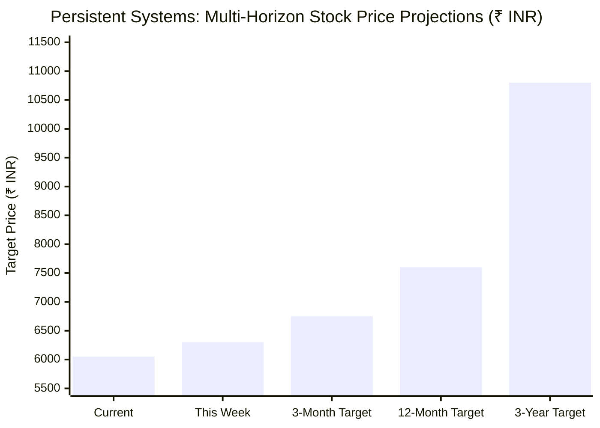
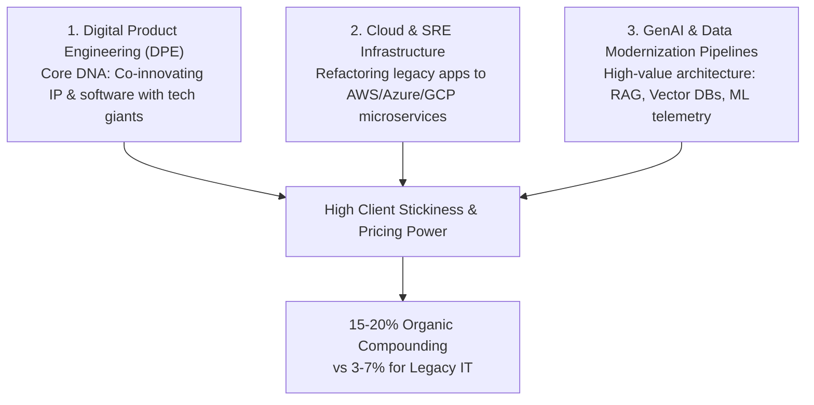
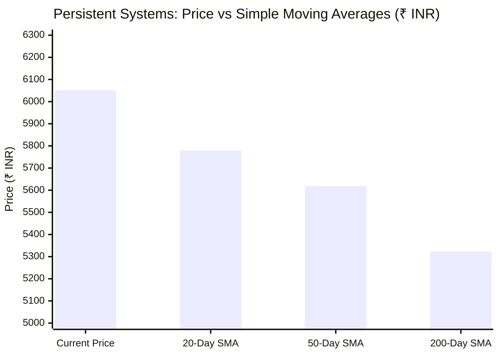

# 🔮 Persistent Systems Limited (NSE: PERSISTENT): Business Outlook & Future Stock Predictions
> **Ticker**: `PERSISTENT.NS` | **CMP**: `₹6,051.00 INR` | **52-Week Range**: `₹4,244.50 – ₹6,599.00`  
> **Market Cap**: `~₹93,200 Crores ($11.2B USD)` | **Research Desk**: DevOps AI Quantitative Equity Research

---

## 🎯 1. Multi-Timeframe Price Predictions & Day-by-Day Forecast



| Timeframe | Trend Bias | Target / Range | Key Probability & Rationale |
| :--- | :---: | :---: | :--- |
| **Today's Session** | **Consolidation / Mild Bullish 🟢** | **₹5,980 – ₹6,120** | Consolidating above the psychological ₹6,000 threshold; RSI at 65.44 showing healthy momentum without entering overbought territory. |
| **Tomorrow (Nov 3, 2026)** | **Range-Bound / Event Watch ⚡** | **₹5,920 – ₹6,220** | Volatility from US election night cues and global tech sentiment; support at 20-day SMA (₹5,778.80) provides strong floor. |
| **This Week (Nov 2 – Nov 6)** | **Bullish 📈** | **₹6,180 – ₹6,380** | Nifty IT relative strength outperforming broader indices; testing intermediate resistance near ₹6,350. |
| **3-Month Horizon (Q4 FY26)** | **Strong Bullish 🌟** | **₹6,600 – ₹6,850** | Retest and clean breakout above current 52-week high (₹6,599.00) driven by Q3 deal booking momentum and margin expansion. |
| **12-Month Target (FY27)** | **High Conviction Buy 🚀** | **₹7,450 – ₹7,800** | Sustained 18–22% constant-currency EPS compounding; digital transformation wallet share expansion. |
| **3-Year Multi-Bagger Vision** | **Secular Compounder 💎** | **₹10,500 – ₹11,200** | Scaling to $2.0 Billion USD annual run-rate revenue with 16.5% operating margins. |

---

## 🏢 2. Persistent Systems Business Model & Competitive Moat

### Why Persistent Outperforms Traditional Indian IT (TCS, Infosys, Wipro):



1. **Digital Product Engineering (DPE) DNA**:
   - Unlike legacy Tier-1 IT companies that depend primarily on low-margin business process outsourcing and infrastructure maintenance, **Persistent builds core software products** for independent software vendors (ISVs) and Fortune 500 enterprises.
   - Customers include top hyperscalers, global software leaders, and specialized healthcare platforms.
2. **Enterprise GenAI & Data Ingestion Pipelines**:
   - The global bottleneck in Generative AI adoption is **unstructured, fragmented enterprise data**.
   - Persistent acts as the primary specialized builder: ingesting, vectorizing, and orchestrating enterprise data lakes into production-grade AI agent architectures.
3. **High-Margin Healthcare & BFSI Verticals**:
   - **Healthcare & Life Sciences (HLS)**: High-margin clinical trial platforms, HIPAA-compliant patient management, and biomedical engineering.
   - **BFSI**: Core banking modernizations, fraud detection pipelines, and FinOps-driven regulatory reporting.

---

## 📊 3. Financial Model & Valuation Framework

### Key Financial Ratios (FY26 Current vs Projections)

| Financial Metric | Current Level (FY26E) | Projected (FY27E) | Projected (FY28E) | Industry Context / Peer Comparison |
| :--- | :--- | :--- | :--- | :--- |
| **Revenue ($USD)** | **$1.42 Billion** | **$1.68 Billion** | **$2.05 Billion** | Top quartile growth in mid-cap IT (>16% CC YoY) |
| **Operating Margin (EBIT)** | **14.8% – 15.2%** | **15.8% – 16.2%** | **16.5%** | Expanding via offshore delivery pyramids & automation |
| **Return on Equity (ROE)** | **24.2%** | **25.5%** | **26.8%** | Superior capital efficiency; Tier-1 IT average ~22% |
| **ROCE** | **31.5%** | **33.0%** | **34.2%** | High return on capital employed |
| **Trailing P/E** | **52.5x** | **41.0x (Forward)** | **32.5x** | Premium multiple justified by high PEG ratio (<1.8) |
| **Price-to-Sales (P/S)** | **6.8x** | **5.7x** | **4.6x** | Reflects high software IP content |
| **Balance Sheet Debt** | **Zero Net Debt** | **Zero Net Debt** | **Zero Net Debt** | Robust net cash position >₹2,500 Crores |

---

## 📈 4. Technical Indicator Matrix & Moving Average Health



- **Current Live Price**: **₹6,051.00 INR**
- **20-Day SMA**: **₹5,778.80** (`+4.71%` distance — short-term bullish trendline)
- **50-Day SMA**: **₹5,619.24** (`+7.68%` distance — medium-term structural support)
- **200-Day SMA**: **₹5,322.88** (`+13.68%` distance — primary bull market baseline)
- **Golden Cross Status**: **Active & Widening 🌟** (50 SMA > 200 SMA by ~₹296).
- **RSI (14-Period)**: **65.44** (Optimal momentum zone: bullish continuation without overbought exhaustion).
- **Critical Price Action Levels**:
  - *Primary Support*: ₹5,750 – ₹5,800 (Confluence of 20-day SMA).
  - *Secondary Support (Stop-Loss Baseline)*: ₹5,580 – ₹5,620 (50-day SMA).
  - *Immediate Resistance Ceiling*: ₹6,350.
  - *Major Breakout Resistance*: ₹6,599 (52-Week High).

---

## ☁️ 5. SRE, Cloud Infrastructure & FinOps Real-World Impact

For platform architects and engineering leaders, Persistent represents a direct structural play on the enterprise transition toward **FinOps-managed cloud computing**:

1. **Monolith-to-Microservices Modernization**:
   - Enterprises are moving away from monolithic legacy architectures to containerized microservices hosted on **EKS, GKE, and serverless containers**.
   - Persistent provides the engineering talent that implements automated CI/CD pipelines, External Secrets Operator (ESO), and GitOps (ArgoCD) reconciliation loops.
2. **FinOps Cost Containment & Observability**:
   - As cloud and GPU infrastructure costs escalate, Persistent builds real-time telemetry pipelines attributing unit compute costs (e.g., cost per API request or cost per ML inference token) directly to business units, preventing multi-million dollar cloud bill overruns.
3. **Enterprise SRE Reliability**:
   - Implements automated chaos engineering and canary rollouts (Argo Rollouts) to guarantee 99.99% availability for mission-critical client platforms.

---

## ⚖️ 6. Catalysts vs Downside Risks

### 🟢 Bull Catalysts (Why Stock Can Reach ₹7,800+):
1. **$100M+ Deal Pipeline Conversion**: Expanding average deal sizes from $20M–$50M into mega $100M+ multi-year digital transformation contracts.
2. **GenAI Monetization Acceleration**: Transitioning from pilot PoCs to enterprise-wide production deployment pipelines.
3. **FII Capital Reversal**: FPIs returning to Indian tech equities (+₹3,600 Cr single-day buy) seeking defensive earnings compounders.

### 🔴 Bear Risks (What Could Derail the Thesis):
1. **US IT Budget Delays**: Extended slowdown in discretionary enterprise tech spending in North America (which contributes >75% of revenue).
2. **Multiple Contraction Risk**: If revenue growth moderates below 14% CC, the premium 50x P/E multiple could derate toward 35x–38x.
3. **Talent Attrition & Wage Cost Inflation**: Competition for elite cloud-native and AI engineers pressuring EBITDA margins.

---

## 🏆 Final Institutional Verdict

```text
================================================================================
RATING: STRONG BUY / ACCUMULATE ON PULLBACKS
CONVICTION SCORE: 9.0 / 10
SHORT-TERM TARGET: ₹6,380 | 12-MONTH TARGET: ₹7,650 | 3-YEAR TARGET: ₹10,800
INVESTOR PROFILE: Quality Growth / Compounder Allocation
================================================================================
```
